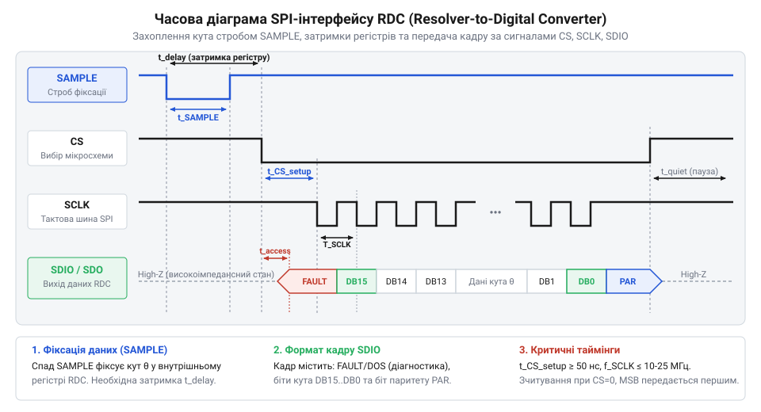
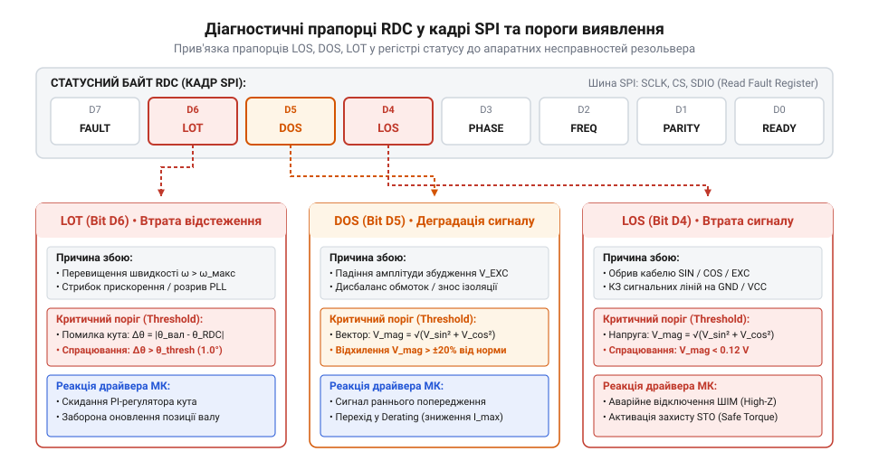

# Програмний інтерфейс зчитування даних кута та діагностики RDC через SPI

<preknowlist>
- [Датчики кутового положення сервоприводів: потенціометри та магнітні енкодери](root:cat-hw-sensors/servo-feedback-potentiometers-and-magnetic-encoders) — принципи побудови контурів зворотного зв'язку за кутом та загальні вимоги до систем вимірювання положення
- [Магнітний енкодер кута AS5048](root:cat-hw-sensors/as5048-magnetic-encoder) — базові прийоми організації SPI-обміну з цифровими датчиками кута та інтерпретації регістрових даних
</preknowlist>

## Збої керування через ненадійне зчитування кута

Потужний електропривід під навантаженням раптово видає жорсткий механічний ривок, видає акустичний гул і вимикається за перевантаженням по струму. На рівні верхнього програмного забезпечення контур кутової швидкості виглядав стабільним, проте аналіз осцилограм показує: мікроконтролер отримав некоректне значення кута ротора. Силові системи векторного керування критично залежать від точності зворотного зв'язку за положенням, який забезпечує @@en|резольвер@@ (від @@en|resolver@@, з латинського @@la|resolvere@@ — розв'язувати, розкладати) через @@en|RDC@@ (від @@en|Resolver-to-Digital Converter@@ — перетворювач «резольвер-код»). 

Алгоритм векторного керування (FOC) використовує поточний кут ротора `θ` для розрахунку прямого та зворотного перетворень Парка і Кларк. Перетворення розкладають трифазні струми статора на намагнічувальну складницю `d` та реактивну складницю `q`, що створює обертовий момент. Якщо через завади на шині даних або несвоєчасне опитування микроконтролер зчитує запізніле чи викривлене значення кута `θ_read`, виникає кутова помилка `θ_err = θ_real - θ_read`. Внаслідок цього вектор струму створюється під хибним кутом: складниця `i_q` потрапляє в вісь `d`, зменшуючи корисний момент і зумовлюючи розмагнічування, а складниця `i_d` перетворюється на гальмівний момент. При помилці `θ_err ≈ 90°` силовий інвертор створює максимальний момент у протилежному напрямку або входить у режим короткого замикання через втрату керованості.

На відміну від цифрових пристроїв, таких як [магнітний енкодер AS5048](root:cat-hw-sensors/as5048-magnetic-encoder), аналоговий @@en|резольвер@@ працює за принципом обертового трансформатора, в якому первинна обмотка ротора живиться високочастотною змінною напругою збудження `U_exc = V_exc · sin(ω · t)` від генератора @@en|RDC@@. Внаслідок електромагнітної індукції дві ортогональні обмотки статора формують вихідні напруги, амплітудно модульовані кутом повороту ротора `θ`: синусну `U_sin = k · U_exc · sin(θ)` та косинусну `U_cos = k · U_exc · cos(θ)`. Перетворювач @@en|RDC@@ обчислює кут через синхронне демодулювання цих сигналів, яке вимагає суворого фазового узгодження між вихідними напругами статора та опорним сигналом збудження. Якщо через індуктивність ліній, температурний дрейф чи завади від перемикання силових @@en|IGBT@@-транзисторів виникає фазовий зсув `φ`, демодулятор викривляє значення кута або фіксує апаратне падіння амплітуди. Приймаючи загальні [принципи побудови контурів](root:cat-hw-sensors/servo-feedback-potentiometers-and-magnetic-encoders) зворотного зв'язку за кутом, інженер має враховувати цю змішану аналогово-цифрову природу пристрою: якщо програмне забезпечення зчитує дані з @@en|RDC@@ без урахування часових затримок або ігнорує прапорці апаратного стану та фазового збою, випадковий шум чи бітовий зсув сприймаються як реальний поворот ротора. Для детального розрахунку генераторів синусоїдального збудження та підсилювачів потужності для первинних обмоток ротора перегляньте матеріал про [схеми збудження резольверних обмоток](root:hw-sensing/resolver-excitation-circuitry).

Для запобігання аваріям програмний @@en|інтерфейс@@ мікроконтролера повинен чітко дотримуватися трирівневої захисної логіки: апаратна синхронізація стробування `SAMPLE`, суворе дотримання часових затримок шини @@en|SPI@@ (від @@en|Serial Peripheral Interface@@ — послідовний периферійний @@en|інтерфейс@@) та обов'язкова перевірка діагностичних прапорців у кожному циклі керування.

## Таймінги та часові вимоги шини SPI

Всередині перетворювача RDC аналогові сигнали синуса та косинуса безперервно відстежуються цифровим контуром стеження (Type II tracking loop). Щоб мікроконтролер міг зчитати стабільне значення кута, RDC повинен зафіксувати поточний стан внутрішнього реверсивного лічильника і перенести його в вихідний зсувний регістр. Для цього використовується зовнішній сигнал стробування `SAMPLE` або спадаючий фронт сигналу `CS` (Chip Select). Для детального вивчення аналогово-цифрової моделі та принципів перетворення фазового зсуву у двійковий код перегляньте статтю про [архітектуру контуру відстеження RDC](root:hw-sensing/rdc-tracking-loop-architecture).

При подачі активного низького рівня на лінію `SAMPLE` RDC припиняє оновлення вихідного регістру й фіксує значення кута та кутової швидкості. Час, необхідний для внутрішньої фіксації даних, визначається затримкою `t_SAMPLE`. Якщо мікроконтролер почне тактування шини `SCLK` до завершення інтервалу `t_SAMPLE`, зсувний регістр видасть перехідний стан. Це призведе до викривлення старших розрядів (MSB) або виникнення хибних стрибків кута на `180°`.


*Часова послідовність стробування та зчитування кадру RDC показує необхідність дотримання часових затримок t_SAMPLE та t_QUIET між транзакціями шини SPI.*

Основні часові параметри, які мають бути витримані у периферійному модулі SPI мікроконтролера:

- `t_SAMPLE`: тривалість імпульсу фиксації та затримка перед першим тактовим імпульсом (типово `200 ns` – `1 μs`). - `t_CS_SETUP`: інтервал від активації `CS` до першого фронту `SCLK`. - `t_SCLK`: період тактового сигналу SPI (максимальна частота `f_SCLK` зазвичай обмежена `5 MHz` – `10 MHz`). - `t_QUIET`: мінімальний час пасивного стану `CS` між сусідніми кадрами для відновлення внутрішніх ліній RDC.

Мінімальний період опитування одного кадру положення обчислюється як сума часових затримок фіксації, передачі N-бітного слова та паузи відновлення:

```
t_FRAME = t_SAMPLE + (N × t_SCLK) + t_QUIET
= 0.5 μs + (16 × 0.2 μs) + 0.5 μs   [розрахунок для f_SCLK = 5 MHz та N = 16 біт]
= 4.2 μs                            [найкоротший період опитування кадру]
```

Для коректного зчитування даних ліній `SDIO` (від @@en|Serial Data Input/Output@@) модуль SPI мікроконтролера налаштовується на режим Mode 1 (CPOL = 0, CPHA = 1) або Mode 3 (CPOL = 1, CPHA = 1) відповідно до специфікації RDC. Дані встановлюються перетворювачем по спадаючому фронту `SCLK` і зчитуються мікроконтролером по наростаючому фронту. Невідповідність фази тактування `CPHA` призводить до зсуву всієї бітової послідовності на один біт ліворуч або праворуч, що повністю спотворює вихідний код кута та біт паритету.

## Карта регістрів та формат команд RDC

Промислові мікросхеми RDC організовують внутрішній простір у вигляді карти регістрів, доступ до яких здійснюється через командні кадри SPI. Структура регістрової карти включає:

- `POSITION` (10–16 біт): регістр поточного двоічного коду кута ротора `N_POS`. - `VELOCITY` (12–16 біт): регістр кутової швидкості `N_VEL` у форматі додаткового коду (знаковий двійковий код). - `FAULT_STATUS`: регістр діагностичних прапорців апаратних несправностей. - `CONTROL`: регістр конфігурації частоти збудження, вибору роздільної здатності (10, 12, 14 або 16 біт) та скидання помилок.

Кадр транзакції SPI містить напрямок передачі `R/W` (`0` — запис, `1` — читання), адресу регістру `A5..A0`, дані `D15..D0` та біт перевірки на @@en|паритет@@ (від @@en|parity@@, з латинського @@la|paritas@@ — рівність) `P`.

Перетворення сирого двійкового коду `N_POS` у фізичний кут в градусах та радіанах виконується за формулами пропорційного розподілу повного оберту `360°` (`2π` rad) на повний діапазон розрядності `2^N_bits` (де для 16-бітного режиму `2^16 = 65536` відліків):

```
θ_deg = (N_POS ÷ 65536) × 360°
= (16384 ÷ 65536) × 360°      [приклад для коду N_POS = 16384]
= 90.0°                       [кут ротора в градусах]

θ_rad = (N_POS ÷ 65536) × 2π
= (16384 ÷ 65536) × 6.283185 [переведення у радіани]
= 1.570796 rad                [кут ротора в радіанах]
```

Значення кутової швидкості визначається з регістра `VELOCITY`. Двійковий код у додатковому коді масштабується відносно максимально допустимої швидкості стеження `ω_MAX`, вказаної у конфігурації RDC:

```
ω_rad_s = (N_VEL ÷ 32767) × ω_MAX
= (16384 ÷ 32767) × 1000.0    [приклад для N_VEL = 16384 та ω_MAX = 1000 rad/s]
= 500.0 rad/s                 [кутова швидкість ротора]
```

Зміна роздільної здатності RDC створює компроміс між точністю та динамікою: висока роздільна здатність (16 біт) забезпечує дискретність `0.005.5°`, але обмежує максимальну швидкість відстеження ротора `ω_MAX` через максимальну смугу пропускання аналогового контуру стеження. Зниження роздільної здатності до 10–12 біт дозволяє керувати високошвидкісними двигунами на швидкостях до декількох десятків тисяч обертів на хвилину.

## Аналіз прапорців діагностики та помилок RDC

Апаратний діагностичний модуль RDC безперервно стежить за цілісністю аналогових сигналів синусно-косинусного приймача та станом внутрішніх вузлів. Результати перевірки відображаються у статусному регістрі у вигляді спеціалізованих бітових прапорців.


*Бітова маска статусного регістру RDC показує локалізацію апаратних аварій лінії резольвера та ступінь критичності виявленого збою.*

Ключові діагностичні прапорці RDC включають:

1. `LOS` (@@en|LOS@@ / Loss of Signal): втрата сигналу. Прапорець встановлюється, якщо амплітуда вхідних сигналів синуса чи косинуса падає нижче порогового значення `V_LOS`. Основні причини — обрив кабелю резольвера, пошкодження лінії збудження або вихід з ладу первинної обмотки. 2. `DOS` (@@en|DOS@@ / Degradation of Signal): деградація сигналу. Включається, коли сума квадратів напруг `Sin²(θ) + Cos²(θ)` виходить за межі нормованого допускного вікна. Це свідчить про міжвиткове замикання в обмотках резольвера, неузгодженість імпедансу ліній або виражений температурний @@en|дрейф фази@@. 3. `LOT` (@@en|LOT@@ / Loss of Tracking): втрата відстеження. Виникає, коли механічне прискорення ротора перевищує динамічні можливості контуру стеження RDC, або коли фазова помилка між вхідним аналоговим сигналом та цифровим лічильником перевищує порогове значення (наприклад, `5°`). 4. `PARITY_ERR`: помилка паритету. Вказує на одиночний зсув або інверсію біта під час передачі кадру по шині SPI через високий рівень імпульсних завад.

За ступенем небезпеки для електроприводу помилки класифікуються на два рівні:

- **Критичні несправності (`LOS`, `LOT`, `PARITY_ERR`)**: вимагають негайного апаратного блокування шім-сигналів (PWM) силового інвертора. Продовження роботи при втраті сигналу чи відстеження викликає неконтрольований розгін двигуна чи стрибок струму. - **Попереджувальні статуси (`DOS`)**: сигналізують про погіршення якості сигналу. Систематичний запис `DOS` у журнал телеметрії дозволяє виявити знос підшипників чи деградацію кабелю до настання повної аварії.

## Побудова драйвера зчитування та обробки збоїв

Низькорівневий @@en|драйвер@@ RDC об'єднує контроль стробування, транзакції SPI, перевірку паритету та класифікацію помилок у єдиний регулярний алгоритм, який виконується в перериванні таймера контуру керування (частота `8 kHz` – `16 kHz`).

Послідовність роботи драйвера:
1. Формування від'ємного імпульсу на лінії `SAMPLE` з витримкою затримки `t_SAMPLE`. 2. Виконання послідовної передачі двох 16-бітних слів через SPI DMA або розпірне читання: перше слово — позиція, друге — швидкість та статус. 3. Перевірка непарності біта паритету `P` для кожного отриманого кадру. 4. Маскування статусного байта для перевірки прапорців `LOS`, `LOT` та `DOS`. 5. При виявленні `LOS` або `LOT` — повернення коду аварії та ініціалізація процедури безпечного зупину (Emergency Coast-to-Stop). 6. При виявленні помилки паритету — відхилення поточного вибірки, використання екстрапольованого значення кута з попереднього кроку та збільшення лічильника завад.

Нижче наведено ідіоматичні реалізації низькорівневого драйвера RDC мовами C та C++.

:::tabs
@tab C
:::code api-rdc-spi-protocol/c/rdc-check-parity-odd.c
@tab C++
:::code api-rdc-spi-protocol/cpp/rdcfault.cpp
:::