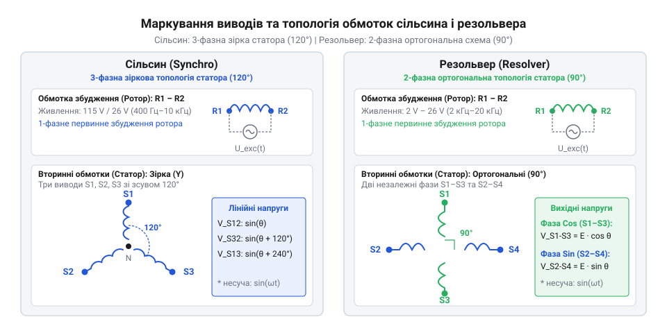
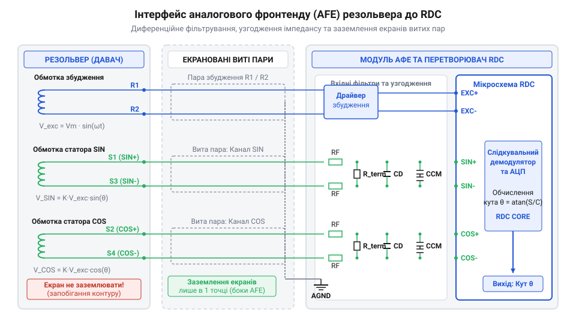

# Електричний та механічний інтерфейс сільсинів і резольверів

<preknowlist>
- [Лінійні змінні диференціальні трансформатори LVDT](root:cat-hw-sensors/lvdt-linear-variable-differential-transformers) — Принцип трансформаторного зчитування сигналу на змінному струмі та амплітудної модуляції вихідної напруги.
- [Енкодери кутового та лінійного переміщення](root:cat-hw-sensors/optical-and-magnetic-encoders) — Загальні концепції дискретизації кутового положення та порівняння точності в системах зворотного зв'язку.
</preknowlist>

## Спотворення кута та призначення виводів

Підключення електромагнітного давача кута ненадійними дрітами без розуміння призначення його ліній в умовах імпульсних завад сервопривода призводить до хаотичного дрейфу виміряного положення або миттєвого виходу з ладу вхідних кіл обробки сигналів. Спроба помилково подати напругу збудження на вторинні вимірювальні обмотки спричиняє термічне перевантаження тонкого дріту статора та спотворення магнітного потоку.

Аналогові кутові перетворювачі поділяються на два базові класи: сельсин (@@en|synchro@@, від грецького *syn* — разом та *chronos* — час) та резольвер (@@en|resolver@@, від англійського *resolve* — розкладати на складові). Обидва пристрої працюють за принципом обертового трансформатора, однак відрізняються просторовою конфігурацією та кількістю вторинних обмоток. Спільною для них є наявність первинної обмотки збудження (@@en|excitation winding@@), яка позначається виводами `R1` та `R2` (або `R1`–`R3` у схемах із компенсаційними котушками). На цю обмотку від зовнішнього генератора подається високочастотна змінна напруга, яка створює пульсуюче магнітне поле в роторі.


*Схема електричного з'єднання та розміщення обмоток сільсина і резольвера з маркуванням виводів R1–R2 та S1–S4.*

Вторинні сигнальні обмотки (@@en|secondary windings@@) сприймають наведену індуктивність (@@en|inductance@@, від латинського *inductio* — наведення) та формують вихідну напругу, амплітуда якої пропорційна синусу або косинусу кута повороту ротора `θ`. У класичному сільсині вторинні обмотки розміщені на статорі з просторовим зсувом `120°` відносно одна одної та з'єднані за схемою «зірка» з трьома зовнішніми виводами `S1`, `S2` та `S3`. У резольвері статор містить дві взаємно перпендикулярні обмотки зі зсувом `90°` електричних градусів, виводи яких маркуються як `S1`–`S3` (канал синуса) та `S2`–`S4` (канал косинуса). На відміну від [дискретизації кутового положення](root:cat-hw-sensors/optical-and-magnetic-encoders) в оптичних дискретних датчиках, резольвер передає абсолютний кут у межах одного електричного оберту через співвідношення амплітуд аналогових напруг.

Для правильного монтажу без маркувальних табличок застосовують вимірювання активного опору (@@en|DC resistance@@) та індуктивності обмоток цифровим мультиметром або RLC-метром. Первинна обмотка збудження `R1`–`R2`, розрахована на проходження підвищеного струму магнічення, виготовляється із товщого дріту й має нижчий активний опір та вищу індуктивність розсіювання, ніж високоомні сигнальні виводи `S1`–`S4`. У симетричному двофазному резольвері пари `S1`–`S3` та `S2`–`S4` показують ідентичний активний опір із точністю до часток відсотка, тоді як міжнесучі паразитні зв'язки між незадіяними виводами прямують до нескінченності.

## Режими живлення та навантаження збудження

Створення носійного змінного поля вимагає точного розрахунку електричного режиму первинної обмотки `R1`–`R2`. Застосування невідповідної частоти або амплітуди напруги призводить до магнітного насичення (@@en|magnetic saturation@@) осердя, спотворення формоутворюючої синусоїди та надмірного нагріву датчика.

Повний імпеданс (@@en|impedance@@, від латинського *impedio* — перешкоджати) первинної обмотки `Z_R` визначається векторною сумою активного опору мідного дріту `R_R` та індуктивного опору `X_L` на частоті збудження `f`:

```
X_L = 2 · π · f · L_R
Z_R = √(R_R² + X_L²)
```

У діапазоні частот від `400 Гц` (стандарт авіаційних сільсинів) до `10 кГц`–`20 кГц` (промислові сервоприводи) індуктивна складова повністю домінує над активною. При зниженні частоти живлення `f` індуктивний опір `X_L` пропорційно падає, що викликає різке зростання струму збудження `I_R`:

```
I_R = U_R ÷ Z_R
= U_R ÷ √(R_R² + (2 · π · f · L_R)²)    [підстановка імпедансу]
```

Зміна температури навколишнього середовища викликає дрейф активного опору міді з температурним коефіцієнтом приблизно `+0.393%` на кожний градус Цельсія:

```
R_R(T) = R_0 · (1 + α · (T - T_0))
```

Зростання `R_R` при нагріванні змінює кут фазового зсуву між напругою та струмом збудження:

```
φ_R = arctan((2 · π · f · L_R) ÷ R_R)
```

Принцип функціонування обмотки збудження подібний до [трансформаторного зчитування сигналу](root:cat-hw-sensors/lvdt-linear-variable-differential-transformers), де коефіцієнт трансформації (@@en|transformation ratio@@) `k` визначає співвідношення пикового значення сигнальної напруги вторинних обмоток до напруги збудження:

```
k = U_S_max ÷ U_R
```

Типові значення `k` для промислових резольверів становлять `0.28` або `0.5`. Щоб виключити спотворення передавальної функції, вторинні обмотки `S1`–`S3` та `S2`–`S4` повинні працювати в режимі близькому до нехтуваного навантаження (режим холостого ходу). Вхідний опір аналогового фронтенду має перевищувати `100 кОм`. Навантаження вторинних обмоток низькоомним опором викликає протікання струму вторинного кола, створює розмагнічувальне поле статора та призводить до суттєвої фазової та амплітудної помилки.

Для керування обмоткою `R1`–`R2` застосовують двотактні підсилювачі (@@en|push-pull driver@@) або мостові схеми (@@en|H-bridge driver@@) із послідовним роздільним конденсатором. Постійна складова струму (@@en|DC offset@@) у колі збудження суворо недопустима: навіть незначна постійна напруга `100 мВ` підмилує магнітопровід, зміщує робочу точку на петлі гістерезису та викликає симетричні спотворення вихідного сигналу.

## Підключення до фронтенду та RDC

Напруги, що знімаються з вторинних обмоток резольвера, являють собою амплітудно-модульовані високочастотні сигнали несучої частоти:

```
U_S1_S3(t) = k · U_R · sin(ω · t) · sin(θ)
U_S2_S4(t) = k · U_R · sin(ω · t) · cos(θ)
```

де `ω = 2 · π · f` — кругова частота збудження, а `θ` — механічний кут ротора. Для перетворення цих аналогових величин у цифровий код використовують спеціалізовані мікросхеми перетворювачів «резольвер-код» (@@en|resolver-to-digital converter@@, RDC) або аналоговий фронтенд (@@en|analog front-end@@, AFE) на основі диференційних операційних підсилювачів. Для детального вивчення внутрішньої архітектури, алгоритмів стеження та фазових демодуляторів у спеціалізованих мікросхемах перегляньте статтю про [перетворювачі «резольвер-код» (RDC)](root:cat-hw-sensors/resolver-to-digital-converters).


*Принципова схема підключення сигнальних виводів резольвера до вхідних диференційних підсилювачів RDC із фільтрами та опорним сигналом збудження.*

Кожна пара сигнальних виводів (`S1`–`S3` та `S2`–`S4`) підключається до симетричного диференційного входу RDC. Диференційна схема вимірювання пригнічує синфазні завади (@@en|common-mode noise@@), які наводяться на кабель від силових кіл шим-інвертора. Головна вимога до принципової схеми — сувора симетрія імпедансів обох плечей сигнального тракту. Неоднаковість опорів фільтруючих резисторів або ємностей конденсаторів перетворює синфазну заваду на диференційну напругу помилки, що безпосередньо спотворює обчислений кут.

На входах AFE встановлюють пасивні фільтри низьких частот (@@en|low-pass filter@@) першого або другого порядку. Частоту зрізу фільтра `f_c` обирають вище несучої частоти збудження `f` у `2`–`3` рази, щоб пригнічувати високочастотні завади від перемикання силових транзисторів без внесення нестабільного фазового зсуву на робочій частоті:

```
f_c = 1 ÷ (2 · π · R_F · C_F)
```

Налаштування аналогового периферійного інтерфейсу мікросхеми RDC у програмному забезпеченні системи керування передбачає конфігурацію частоти внутрішнього генератора збудження, підсилення вхідних трактів та програмну компенсацію фазової затримки.

:::tabs
@tab C
:::code api-synchro-resolver-hardware/c/rdc-afe-init.c
@tab C++
:::code api-synchro-resolver-hardware/cpp/resolverfrontend.cpp
:::

## Екранування та заземлення аналогових кіл

Передача низькорівневих високочастотних сигналів від резольвера до плати керування в умовах жорсткого електромагнітного оточення вимагає спеціальних заходів топологічного захисту. Електродвигун, що керується силовим інвертором з частотою ШІМ від `8 кГц` до `32 кГц`, випромінює потужні імпульсні завади з високою швидкістю наростання напруги `dU/dt`.

Основними шляхами проникнення завад є ємнісний зв'язок (@@en|capacitive coupling@@) між паралельними провідниками та індуктивний зв'язок (@@en|inductive coupling@@), викликаний імпульсними магнітними полями силових кабелів. Для нейтралізації цих факторів використовують трасування сигналів у вигляді витих пар (@@en|twisted pair@@) із кроком скрутки не більше `15`–`20 мм`. Скручування провідників `S1` із `S3` та `S2` із `S4` забезпечує однакову індуковану ЕРС завади в обох плечах, яка повністю скасовується на диференційному вході AFE.

Для запобігання перехресним наведенням (@@en|crosstalk@@) між коламу збудження та вимірювальними каналами застосовують кабель із індивідуально екранованими витими парами (@@en|individually shielded twisted pair@@, ISTP). Лінії `R1`–`R2`, `S1`–`S3` та `S2`–`S4` ізолюються окремими фольгованими екранами, а поверх усього кабелю накладається загальне плетене мідне екранування (@@en|overall braid shield@@) з щільністю покриття не менше `85%`.

Конфігурація заземлення екранів визначається діапазоном частот завад та запобіганням виникненню земляних петель (@@en|ground loop@@). Земляна петля виникає у разі гальванічного з'єднання екрана з корпусом двигуна на одному кінці та з заземленням плати керування на іншому. Оскільки потенціали «землі» силової установки та контролера відрізняються через високі струми вирівнювання, по екрану починає протікати коефіцієнтний струм завади, який через паразитну ємність наводиться на сигнальні жили.

Для захисту від низькочастотних петель індивідуальні внутрішні екрани витих пар заземлюють за схемою одноточкового заземлення (@@en|single-point grounding@@) — виключно на боці плати аналогової обробки RDC. Зовнішній плетений екран кабелю підключають по всьому периметру `360°` до металевого корпусу роз'єму (@@en|360-degree EMI backshell connector@@) з обох боків. Це створює суцільну замкнену клітку Фарадея для високих частот ШІМ без утворення закритих гальванічних контурів для низькочастотних струмів вирівнювання.

## Виявлення фазових та амплітудних спотворень

Навіть при правильному екрануванні та узгодженні імпедансів реальний сигнальний тракт вносить фазові та амплітудні спотворення, які знижують точність визначення кута. Індуктивність обмоток резольвера та власна ємність довгого кабелю викликають фазовий зсув (@@en|phase shift@@) `φ` між опорною напругою збудження `U_R(t)` та огинаючою вторинних сигналів:

```
U_S1_S3(t) = k · U_R · sin(ω · t + φ) · sin(θ)
```

Фазочутливий демодулятор (@@en|phase-sensitive demodulator@@, від латинського *de* — відхилення та *modulatio* — розміреність) усередині RDC множить вхідний сигнал на опорну синусоїду несучої частоти. Якщо фазовий зсув `φ` відрізняється від нуля, амплітуда демодульованого сигналу зменшується пропорційно `cos(φ)`, а в системі стеження виникає статична кутова помилка (@@en|angular position error@@). При значеннях `φ`, що наближаються до `90°`, демодульований сигнал повністю зникає, що призводить до втрати стеження та збою RDC.

Амплітудні спотворення виникають через несиметрію підсилення в аналогових каналах синуса та косинуса або асиметрію магнітного зазору ротора. Удеальному випадку сума квадратів нормованих амплітуд сигналів є константою:

```
sin²(θ) + cos²(θ) = 1
```

Якщо коефіцієнти передачі каналів `A_SIN` та `A_COS` не рівні (`A_SIN ≠ A_COS`), коло ідеальної кругової діаграми деформується в еліпс. Це викликає циклічну помилку вимірювання кута з подвоєною просторовою частотою (друга гармоніка).

Для діагностики та виявлення несправностей у мікроконтролері реалізують алгоритм безперервного моніторингу векторної амплітуди `V_MAG`:

```
V_MAG = √(U_SIN² + U_COS²)
```

Якщо обчислена величина `V_MAG` виходить за межі допустимого допускного вікна `[V_MIN, V_MAX]`, система фіксує аварійний стан. Падіння `V_MAG` до нуля свідчить про обрив кабелю (@@en|open circuit@@) або відсутність напруги збудження. Перевищення `V_MAX` вказує на коротке замикання (@@en|short circuit@@) сигнальних жил на лінії живлення або пробій вхідних каскадів AFE. Порівняно з альтернативними рішеннями, такими як [давачі кутового положення сервоприводів](root:cat-hw-sensors/servo-feedback-potentiometers-and-magnetic-encoders) або компактного [магнітного енкодера AS5048](root:cat-hw-sensors/as5048-magnetic-encoder), аналоговий резольвер вимагає регулярного фазового калібрування, проте забезпечує високу надійність у критичних застосуваннях.