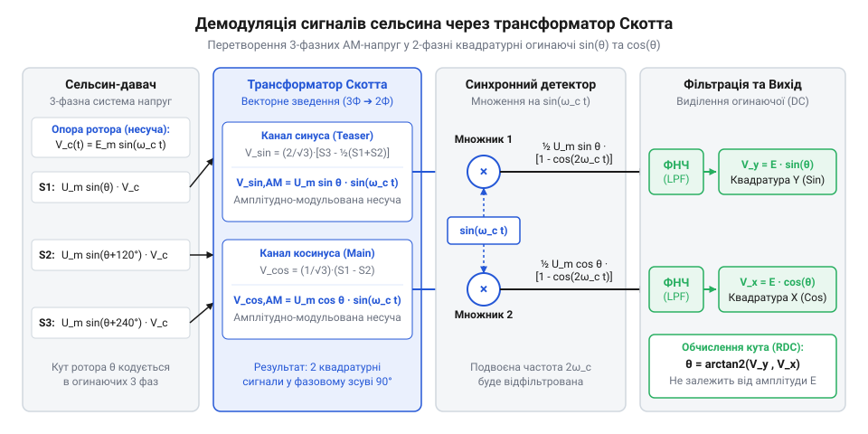
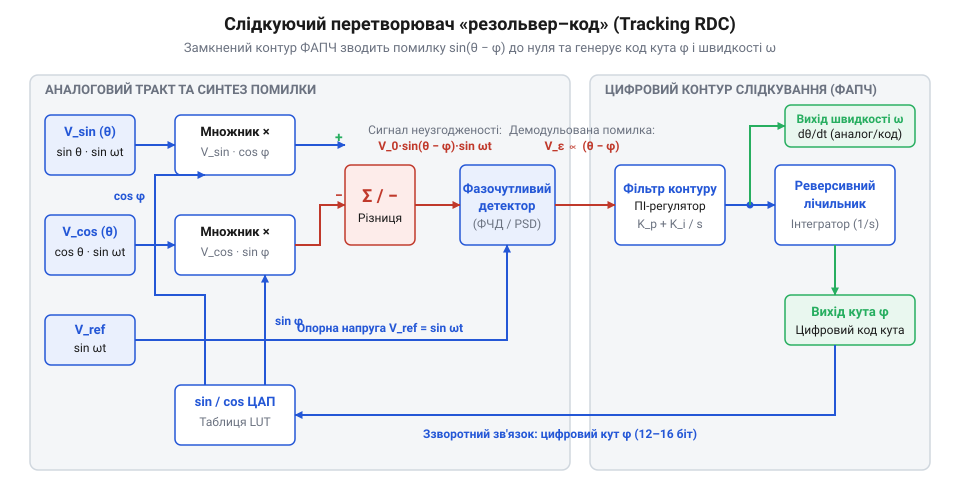

# Математика кутових перетворень: від трифазної системи сельсинів до квадратури та RDC

<preknowlist>
- [Лінійні змінні диференціальні трансформатори LVDT](root:cat-hw-sensors/lvdt-linear-variable-differential-transformers) — розуміння принципу змінної взаємоіндуктивності, збудження обмоток змінним струмом несучої частоти та амплітудної модуляції вихідного сигналу механічним переміщенням.
- [Енкодери кутового та лінійного переміщення](root:cat-hw-sensors/optical-and-magnetic-encoders) — базові поняття про дискретне цифрове представлення кута, квадратурні сигнали та вимоги до роздільної здатності й точності вимірювання кутового положення.
</preknowlist>

## Проблема обробки амплітудно-модульованих кутових сигналів

Високоточні системи керування рухом — робототехнічні маніпулятори, поворотні платформи радарів, важкі верстати з ЧПК та авіаційні приводи — працюють у умовах сильних електромагнітних завад, температурних коливань і механічних вібрацій. У таких середовищах напівпровідникові давачі Холла або крихкі оптичні диски втрачають точність або виходять з ладу. Індуктивні кутові датчики, такі як сельсини (англ. @@en|synchro@@, від грец. @@el|syn@@ — разом, та @@el|chronos@@ — час) та резольвери (англ. @@en|resolver@@, від англ. @@en|resolve@@ — розкладати, розв'язувати), вирішують проблему надійності завдяки міцній конструкції трансформаторних обмоток. Проте вони створюють фундаментальну проблему для обробки сигналів: кутове положення `θ` не видається у вигляді постійної напруги чи цифрового коду, а зашифроване всередині @@en|амплітудно-модульованих сигналів@@ (від лат. @@la|modulus@@ — міра).

Найпростіший підхід — підключити виходи статора безпосередньо до аналого-цифрового перетворювача (АЦП) і зчитувати миттєві значення напруги. Однак сигнал статора збуджується змінною напругою ротора `v_r(t) = V_m · sin(ω · t)` на високій @@en|несучій частоті@@ (від 400 Гц до 20 кГц). У довільний момент дискретизації вихідна напруга залежить не лише від кута повороту ротора `θ`, а й від миттєвого значення синусоїди збудження `sin(ω · t)`. Якщо відлік АЦП припадає на момент переходу несучої через нуль, виміряна напруга дорівнює нулю незалежно від реального кута повороту, що робить точкове вимірювання повністю недолірним.

Крім того, реальні лінії зв'язку додають фазові зсуви, високочастотні завади та @@en|фазовий джиттер@@ (від англ. @@en|jitter@@ — тремтіння). Окремий сплеск електромагнітної завади в кабелі викривляє пикове значення напруги, що прямий АЦП сприймає як хибний стрибок кутової координати. На відміну від [дискретних цифрових енкодерів](root:cat-hw-sensors/optical-and-magnetic-encoders), де кут обчислюється підрахунком імпульсів або зчитуванням двійкового коду, аналогові індуктивні давачі вимагають неперервного виділення низькочастотної @@en|огинаючої@@ (від англ. @@en|envelope@@). Інформація про кут `θ` міститься виключно в коефіцієнті масштабування амплітуди несучої хвилі.

Подібно до [принципу змінної індуктивності](root:cat-hw-sensors/lvdt-linear-variable-differential-transformers) у лінійних трансформаторах, механічний поворот ротора змінює коефіцієнт взаємоіндуктивності між первинною та вторинними обмотками. Щоб надійно виділити кут `θ` без чутливості до фазового дрейфу несучої та високочастотного шуму, неможливо обмежитися вимірюванням амплітуди одного каналу. Необхідне математичне перетворення, яке приймає багатофазні вихідні напруги, усуває високу несучу частоту `sin(ω · t)`, компенсує синфазні завади та формує ортогональні сигнали `sin(θ)` і `cos(θ)`. Сформулювати таке перетворення можна лише на основі точної математичної моделі індуктивної взаємодії обмоток.

## Математика індуктивних взаємодій сельсинів і резольверів

Сельсини та резольвери працюють як обертові трансформатори із змінним коефіцієнтом зв'язку. Джерело змінного струму подає на обмотку збудження ротора опорну напругу:

```
v_r(t) = V_m · sin(ω · t)
```

де `V_m` — амплітуда напруги збудження, `ω = 2 · π · f` — кутова несуча частота, а `t` — час. При повороті ротора на кут `θ` геометричний кут між віссю обмотки ротора та осями статорних обмоток змінюється, модулюючи взаємну індуктивність.

У двофазному @@en|резольвері@@ статор містить дві ортогональні обмотки, розміщені під кутом 90° одна до одної (синусну та косинусну). При повороті ротора на кут `θ` вихідні напруги синусної обмотки `v_sin(t)` та косинусної обмотки `v_cos(t)` визначаються через @@en|коефіцієнт трансформації@@ `K`:

```
v_sin(t) = K · V_m · sin(θ) · sin(ω · t)
v_cos(t) = K · V_m · cos(θ) · sin(ω · t)
```

тут `K` — максимальний коефіцієнт передачі між ротором і статором при збігу їхніх магнітних осей. Обидва вихідні сигнали мають однакову несучу частоту `sin(ω · t)`, але амплітуди їхніх огинаючих модульовані в @@en|квадратурі@@ (від лат. @@la|quadratura@@ — надання квадратної форми) функціями `sin(θ)` та `cos(θ)`.

Трифазний @@en|сельсин@@ має одну обмотку збудження на роторі та три статорні обмотки (S1, S2, S3), розташовані фізично під кутом 120° одна до одної. Фазні напруги, що індукуються в кожній обмотці відносно внутрішньої нейтральної точки N, мають вигляд:

```
v_S1_N(t) = K · V_m · sin(θ) · sin(ω · t)
v_S2_N(t) = K · V_m · sin(θ - 120°) · sin(ω · t)
v_S3_N(t) = K · V_m · sin(θ - 240°) · sin(ω · t)
```

У реальних сельсинах нейтральна точка N є ізольованою та недоступною для підключення. Тому вимірювальні кола зчитують лінійні (фаза-фаза) напруги між клемами статора: `v_S1_S3(t)`, `v_S3_S2(t)` та `v_S2_S1(t)`. 

Щоб отримати аналітичний вираз для лінійної напруги `v_S1_S3(t)`, виконаємо віднімання фазних напруг:

```
v_S1_S3(t) = v_S1_N(t) - v_S3_N(t)
           = K · V_m · sin(ω · t) · (sin(θ) - sin(θ - 240°))                       [підстановка фазних напруг статора]
           = K · V_m · sin(ω · t) · (sin(θ) - sin(θ + 120°))                       [еквівалентність кута -240° та +120°]
           = K · V_m · sin(ω · t) · (2 · sin(-60°) · cos(θ + 60°))                  [формула різниці синусів sin A - sin B]
           = K · V_m · sin(ω · t) · (2 · (-√3 / 2) · cos(θ + 60°))                 [обчислення sin(-60°) = -√3/2]
           = -√3 · K · V_m · cos(θ + 60°) · sin(ω · t)                              [спрощення коефіцієнтів]
           = √3 · K · V_m · sin(θ + 30°) · sin(ω · t)                              [перетворення -cos(x + 60°) = sin(x + 30°)]
```

Аналогічне тригонометричне перетворення для решти пар клем дає повну систему лінійних напруг сельсина:

```
v_S1_S3(t) = √3 · K · V_m · sin(θ - 30°) · sin(ω · t)
v_S3_S2(t) = √3 · K · V_m · sin(θ + 90°) · sin(ω · t)
v_S2_S1(t) = √3 · K · V_m · sin(θ + 210°) · sin(ω · t)
```

Лінійні напруги зберігають симетрію зсуву 120° статорних обмоток, але амплітуда сигналу зростає в `√3` разів порівняно з фазною напругою.

**Обчислення лінійних напруг сельсина**
Ротор сельсина повернуто на кут `θ = 45°`. Коефіцієнт трансформації `K = 0.5`, амплітуда напруги збудження `V_m = 10 В`. Обчислити миттєві амплітуди трьох лінійних напруг статора.

```
V_line_max = √3 · K · V_m
           = 1.73205 · 0.5 · 10
           = 8.66025 В                                                             [амплітудний коефіцієнт]

V_S1_S3_amp = 8.66025 · sin(45° + 30°)
            = 8.66025 · sin(75°)
            = 8.66025 · 0.96593
            = 8.3651 В                                                             [амплітуда першої лінійної напруги]

V_S3_S2_amp = 8.66025 · sin(45° + 150°)
            = 8.66025 · sin(195°)
            = 8.66025 · (-0.25882)
            = -2.2414 В                                                            [амплітуда другої лінійної напруги]

V_S2_S1_amp = 8.66025 · sin(45° + 270°)
            = 8.66025 · sin(315°)
            = 8.66025 · (-0.70711)
            = -6.1237 В                                                            [амплітуда третьої лінійної напруги]
```

Сума амплітуд лінійних напруг `V_S1_S3_amp + V_S3_S2_amp + V_S2_S1_amp = 8.3651 - 2.2414 - 6.1237 = 0.0000 В`, що підтверджує виконання першого закону Кірхгофа для замкненого трикутника статорних обмоток.

Якщо резольвер одразу формує ортогональну двофазну систему `(sin θ, cos θ)`, то трифазний сельсин видає три зсунуті на 120° сигнали. Для обробки сигналів сельсина стандартними обчислювальними алгоритмами необхідно звести трифазну систему до двофазної квадратури.

В основі ідеально синусоїдальної залежності вихідних напруг як сельсинів, так і резольверів лежить геометричний розподіл їхніх обмоток. Якби обмотка була зосереджена в єдиній парі діаметрально протилежних пазів, взаємна індуктивність при обертанні ротора змінювалася б ступінчасто або трапецієподібно, утворюючи небажані @@en|вищі просторові гармоніки@@. Щоб забезпечити чисто гармонійну амплітудну модуляцію, застосовують @@en|розподілену обмотку@@ (від англ. @@en|distributed winding@@): витки кожного фазного каналу розміщують у кількох послідовних @@en|пазах статора@@, а їхню кількість у кожному пазі варіюють пропорційно синусу кутового положення паза. Інтегрування магнітного потоку ротора по такій просторово модульованій обмотці створює залежність @@en|взаємної індуктивності@@ вигляду `M(θ) = M_max · sin(θ)`, що усуває спотворення огинаючої та забезпечує високу точність обчислення кута.

## Трансформація Скотта та синхронне детектування

Обчислення кута `θ` безпосередньо з трьох лінійних напруг сельсина вимагає складних розрахунків і є чутливим до асиметрії фаз. Для спрощення обробки застосовується @@en|трансформація Скотта@@ (від імені винахідника Чарльза Скотта, @@en|Scott-T transformation@@), яка алгебраїчно перетворює трифазну систему лінійних напруг у двофазну ортогональну систему `(v_α, v_β)`.

Використовуючи дві незалежні лінійні напруги сельсина `v_S1_S2(t)` та `v_S3_S2(t)`, ми формуємо синусний канал `v_α(t)` та косинусний канал `v_β(t)`. Зведемо фазні напруги сельсина до квадратурних компонент:

```
v_α(t) = v_S1_N(t)
       = K · V_m · sin(θ) · sin(ω · t)                                             [визначення каналу синуса]

v_β(t) = (1 / √3) · (v_S3_N(t) - v_S2_N(t))
       = (1 / √3) · K · V_m · (sin(θ - 240°) - sin(θ - 120°)) · sin(ω · t)         [підстановка фазних напруг]
       = (1 / √3) · K · V_m · (sin(θ + 120°) - sin(θ - 120°)) · sin(ω · t)         [спрощення фазових кутів]
       = (1 / √3) · K · V_m · (2 · cos(θ) · sin(120°)) · sin(ω · t)                 [формула різниці синусів sin A - sin B]
       = (1 / √3) · K · V_m · (2 · cos(θ) · (√3 / 2)) · sin(ω · t)                 [обчислення sin(120°) = √3/2]
       = K · V_m · cos(θ) · sin(ω · t)                                             [визначення каналу косинуса]
```

Під час роботи з доступними лінійними напругами `v_S1_S2` та `v_S3_S2` перетворення Скотта реалізується лінійною комбінацією сигналів:

```
v_α(t) = (2 / 3) · v_S1_S2(t) - (1 / 3) · v_S3_S2(t)
       = K · V_m · sin(θ) · sin(ω · t)                                             [ортогональний синусний компонент]

v_β(t) = (1 / √3) · v_S3_S2(t)
       = K · V_m · cos(θ) · sin(ω · t)                                             [ортогональний косинусний компонент]
```


*Схема математичних перетворень сигналу від трифазної системи сельсина через трансформатор Скотта до квадратурних огинаючих.*

Після трансформації Скотта (або безпосередньо з виходу резольвера) маємо два квадратурні АМ-сигнали:

```
v_α(t) = V_A · sin(θ) · sin(ω · t)
v_β(t) = V_A · cos(θ) · sin(ω · t)
```

де `V_A = K · V_m`. Обидва канали залишаються модульованими високочастотною несучою хвилею `sin(ω · t)`.

Щоб виділити чисті огинаючі `sin(θ)` та `cos(θ)`, застосовується @@en|синхронне детектування@@ (від грец. @@el|syn@@ — разом, @@el|chronos@@ — час, та лат. @@la|de-@@ — зняття, @@la|modulus@@ — міра). Для цього кожен модульований сигнал множиться на опорний сигнал збудження `v_ref(t) = sin(ω · t)`, отриманий безпосередньо від генератора несучої частоти.

Розглянемо процес множення для синусного каналу `v_α(t)`:

```
v_mult_α(t) = v_α(t) · v_ref(t)
            = (V_A · sin(θ) · sin(ω · t)) · sin(ω · t)                              [множення на опорну несучу]
            = V_A · sin(θ) · sin²(ω · t)                                            [зведення в квадрат несучої]
            = V_A · sin(θ) · (1/2 · (1 - cos(2 · ω · t)))                           [тригонометрична тотожність для sin² x]
            = (1/2) · V_A · sin(θ) - (1/2) · V_A · sin(θ) · cos(2 · ω · t)          [розподіл на постійну та ВЧ складові]
```

Отриманий сигнал `v_mult_α(t)` складається з двох частин:
1. Постійної (низькочастотної) складової `(1/2) · V_A · sin(θ)`, яка прямо пропорційна синусу кута повороту `θ`. 2. Високочастотної складової `(1/2) · V_A · sin(θ) · cos(2 · ω · t)` на подвоєній несучій частоті `2 · ω`.

Пропускання сигналів `v_mult_α(t)` та `v_mult_β(t)` через фільтр низьких частот (ФНЧ) із частотою зрізу значно нижчою за `2 · ω` повністю пригнічує високочастотну складову. На виході фільтра отримуємо чисті огинаючі постійного струму:

```
V_sin = (1/2) · V_A · sin(θ)
V_cos = (1/2) · V_A · cos(θ)
```

Якщо між опорним сигналом збудження та вихідними напругами статора виникає фазовий зсув `ϕ` через індуктивність обмоток або ємність кабелю (`v_ref(t) = sin(ω · t + ϕ)`), результат множення змінюється:

```
v_mult_α(t) = V_A · sin(θ) · sin(ω · t) · sin(ω · t + ϕ)
            = (1/2) · V_A · sin(θ) · cos(ϕ) - (1/2) · V_A · sin(θ) · cos(2 · ω · t + ϕ)  [множення з фазовим зсувом]
```

Після фільтрації ФНЧ амплітуда огинаючої стає рівною `V_sin = (1/2) · V_A · sin(θ) · cos(ϕ)`. При синфазних сигналах (`ϕ = 0°`) `cos(ϕ) = 1`, і амплітуда є максимальною. Однак якщо фазовий зсув `ϕ` досягає 90°, `cos(90°) = 0`, і корисний сигнал повністю зникає. Це доводить математичну критичність точної фазової синхронізації опорного сигналу при синхронному детектуванні.

Виділені огинаючі `V_sin` та `V_cos` є готовими вхідними даними для обчислення арктангенса `atan2(V_sin, V_cos)` або для подачі в замкнений слідкуючий контур RDC.

## Слідкуючий контур RDC для розрахунку кута

Отримавши огинаючі квадратурних сигналів синуса та косинуса після дедетектування, виникає завдання обчислити поточний кут повороту ротора. Прямий розрахунок через арктангенс у реальному часі зіштовхується з серйозними перешкодами. Обчислення арктангенса на мікроконтролері вимагає значних обчислювальних ресурсів або ітераційних алгоритмів на кшталт @@en|CORDIC@@ (від @@en|COordinate Rotation DIgital Computer@@). Крім того, прямий арктангенс дуже чутливий до високочастотних шумів АЦП, викликає розриви фази при переході через межу оберту і не дає змоги безпосередньо оцінити кутову швидкість без чисельного диференціювання, яке кратно посилює завади. Для глибокого розуміння ітераційного обчислення арктангенса за допомогою простих зсувів і додавань дивіться матеріал про [алгоритм CORDIC для тригонометричних обчислень](root:math-numeric/cordic-algorithm-trigonometry).

Для розв'язання цих проблем застосовують перетворювач «резольвер-цифра» (від @@en|Resolver-to-Digital Converter@@, RDC), побудований за принципом слідкуючого контуру (від @@en|tracking loop@@, корінь @@en|track@@ — відстежувати). Замість обчислення арктангенса контур RDC генерує внутрішню оцінку кута та зводить тригонометричну різницю між фактичним і оціненим кутом до нуля.

В основі роботи контуру лежить тригонометрична тотожність для синуса різниці двох кутів. Якщо вхідні дедетектовані напруги мають коефіцієнт передачі `K` та амплітуду несучої `V_m`, а внутрішньо згенерована оцінка кута дорівнює `θ̂`, ми множимо синусний канал на косинус оцінки `cos(θ̂)`, а косинусний канал — на синус оцінки `sin(θ̂)`. Вираховуючи один результат з іншого, дістаємо сигнал неузгодженості `e` за наступним покроковим перетворенням:

```
e = V_sin × cos(θ̂) - V_cos × sin(θ̂)
  = (K × V_m × sin(θ)) × cos(θ̂) - (K × V_m × cos(θ)) × sin(θ̂)    [підстановка вхідних квадратурних сигналів]
  = K × V_m × (sin(θ) × cos(θ̂) - cos(θ) × sin(θ̂))                [винесення спільного множника]
  = K × V_m × sin(θ - θ̂)                                         [тригонометрична тотожність синуса різниці кутів]
```

Оскільки в замкненому слідкуючому контурі розбаланс кутів `ε = θ - θ̂` підтримується дуже малим, застосовується наближення `sin(ε) ≈ ε`. Внаслідок цього вихідний сигнал помилки `e` стає строго пропорційним кутовій неузгодженості: `e ≈ K · V_m · (θ - θ̂)`. Масштабний коефіцієнт `K · V_m` визначає підсилення контуру, але не змінює точність нульового положення.


*Структура слідкуючого контуру RDC другого порядку із пропорційно-інтегральним регулятором та послідовним подвійним інтегруванням для отримання оцінки кута й кутової швидкості.*

Отриманий сигнал неузгодженості `e` подається на фільтр контуру (від @@en|loop filter@@) — зазвичай пропорційно-інтегральний (ПІ) регулятор з передавальною функцією `F(s) = K_p + K_i / s`. Вихід регулятора задає оцінку кутової швидкості `ω̂`. Вона надходить на другий інтегратор, виходом якого є оновлена оцінка кута `θ̂`.

Використання контуру другого порядку (з двома інтеграторами у відкритій петельці) забезпечує нульову статичну похибку позиціонування `θ - θ̂ = 0` при обертанні вала зі сталою швидкістю. Крім того, така система природно фільтрує високочастотні завади АЦП та неперервно генерує гладку оцінку кутової швидкості `ω̂` без застосування шумного чисельного диференціювання. На відміну від [оптичних та магнітних енкодерів](root:cat-hw-sensors/optical-and-magnetic-encoders), де швидкість визначається лічбою імпульсів за проміжок часу, слідкуючий RDC надає абсолютний кут і швидкість миттєво на кожному такті.

У дискретних мікроконтролерних системах алгоритм RDC виконується з періодом дискретизації `T_s`. Нижче наведено ідіоматичну реалізацію дискретного крок-оновлення контуру RDC мовами C та C++.

:::tabs
:::code math-synchro-resolver-transformations/c/rdc-update.c
:::code math-synchro-resolver-transformations/cpp/rdctrackingloop.cpp
:::

## Аналіз неідеальностей та компенсація кутових похибок

Математична модель слідкуючого контуру RDC припускає ідеальну симетрію квадратурних сигналів: однакові коефіцієнти підсилення каналів, відсутність зміщення постійної складової та суворо перпендикулярне просторове й фазове розташування обмоток під кутом 90°. У реальних давачах та вимірювальних трактах виникають фізичні неідеальності:
1. Зміщення нуля (від @@en|DC offset@@) через розбаланс операційних підсилювачів та АЦП. 2. Амплітудний розбаланс (від @@en|gain imbalance@@) через нерівність опору й індуктивності обмоток статора. 3. Фазова неортогональність (від @@en|phase non-orthogonality@@) через технологічні відхилення кута між обмотками статора від 90°.

Кожна з цих неідеальностей трансформується у циклічну кутову похибку `Δθ = θ_meas - θ`. Розглянемо аналітичне виведення цих залежностей.

При виникненні зміщення постійної складової `u_sin` та `u_cos` реальні сигнали набувають вигляду `V_sin' = V_sin + u_sin` та `V_cos' = V_cos + u_cos`. Підставляючи їх у рівність неузгодженості контуру `e = 0`, дістаємо співвідношення `(sin(θ) + u_sin) · cos(θ̂) - (cos(θ) + u_cos) · sin(θ̂) = 0`.

Припускаючи малий кут похибки `Δθ = θ - θ̂`, розкладемо тригонометричний вираз неузгодженості для визначення циклічної залежності від кута повороту `θ`:

```
Δθ ≈ u_cos × sin(θ) - u_sin × cos(θ)
```

Отриманий результат показує, що зміщення постійної складової створює кутову похибку першої гармоніки: один повний цикл похибки на один оберт ротора (`1θ`).

Якщо присутній амплітудний розбаланс каналів з відносним відхиленням `δ`, сигнали описуються як `V_sin' = (1 + δ) · sin(θ)` та `V_cos' = (1 - δ) · cos(θ)`. Рівняння неузгодженості `(1 + δ) · sin(θ) · cos(θ̂) - (1 - δ) · cos(θ) · sin(θ̂) = 0` після розкриття дужок дає `sin(θ - θ̂) + δ · sin(θ + θ̂) = 0`.

Підставляючи наближення малого кута `θ̂ ≈ θ` у вираз неузгодженості, отримуємо похильку вимірювання від амплітудної асиметрії:

```
Δθ ≈ -δ × sin(2θ)
```

Амплітудний розбаланс каналів породжує кутову похибку другої гармоніки (`2θ`), яка чотири рази за оберт досягає екстремумів під кутами 45°, 135°, 225° та 315°. Аналогічно фазова неортогональність обмоток на кут `β` формує другу гармоніку зсунуту на 90°: `Δθ ≈ (β / 2) · cos(2θ)`. Подібні спотворення фазового кола до еліпса виникають і в [лінійних диференціальних трансформаторах LVDT](root:cat-hw-sensors/lvdt-linear-variable-differential-transformers), і в [магнітному енкодері AS5048](root:cat-hw-sensors/as5048-magnetic-encoder).

Для усунення циклічних похибок застосовують матричну калібрувальну компенсацію. Сирі квадратурні напруги `V_raw = [V_sin_raw, V_cos_raw]ᵀ` перетворюються на скориговані сигнали `V_corr = [V_sin_corr, V_cos_corr]ᵀ` шляхом віднімання вектора зміщення `U_offset = [u_sin, u_cos]ᵀ` та множення на калібрувальну матрицю `C`.

Визначивши вектори сирої напруги `V_raw`, зміщення нуля `U_offset` та корегуючу калібрувальну матрицю `C`, отримаємо вираз компенсації в матричній формі:

```
V_corr = C × (V_raw - U_offset)
```

де калібрувальна матриця `C` розгортається у вигляд:

```
[ V_sin_corr ]   [       1 / (1 + δ)              0        ]   ( [ V_sin_raw ]   [ u_sin ] )
[            ] = [                                         ] × ( [           ] - [       ] )
[ V_cos_corr ]   [ -tan(β) / (1 + δ)   1 / ((1 - δ) × cos(β)) ]   ( [ V_cos_raw ]   [ u_cos ] )
```

Калібрувальна матриця `C` виконує відновлення ідеального кола у фазовому просторі: спочатку віднімаються постійні зміщення `u_sin` та `u_cos`, зсуваючи центр еліпса в початок координат `(0, 0)`, а потім елементи матриці компенсують амплітудний масштаб та випрямляють косокутну асиметрію фазового зсуву `β`.

Параметри `u_sin`, `u_cos`, `δ` та `β` визначаються під час процедури калібрування при рівномірному обертанні ротора на 360°. Зміщення оцінюють як середнє значення екстремумів `u_sin = (V_sin_max + V_sin_min) / 2`, а амплітуди визначають розмах `A_sin = (V_sin_max - V_sin_min) / 2`. Застосування такої компенсації перед контуром RDC знижує кутову похибку з десятків кутових мінут до менше ніж 1 кутової мінути, що є критичним для прецизійних [датчиків кутового положення сервоприводів](root:cat-hw-sensors/servo-feedback-potentiometers-and-magnetic-encoders).