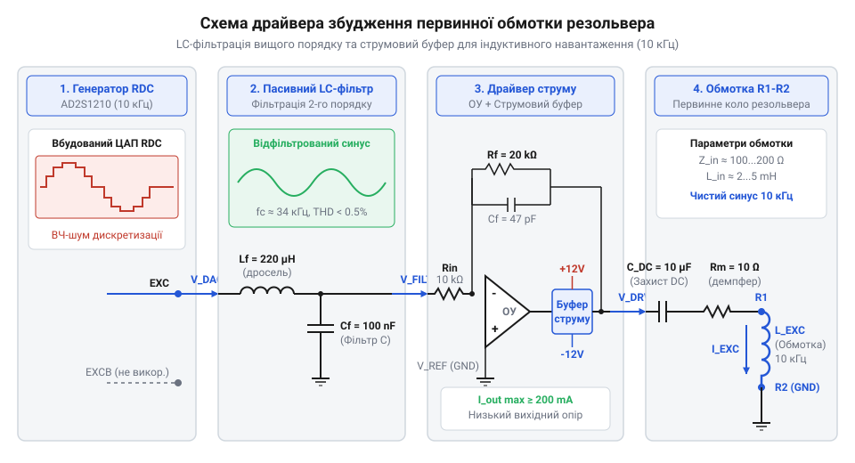
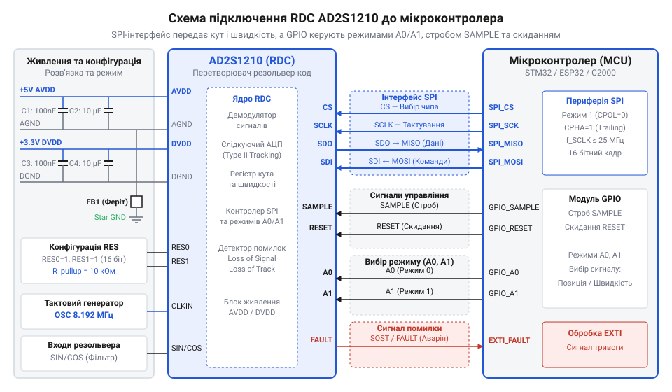

# Розробка збуджувача та зчитувального тракту резольвера на базі спеціалізованої мікросхеми RDC

<preknowlist>
- [Енкодери кутового та лінійного переміщення](root:cat-hw-sensors/optical-and-magnetic-encoders) — розуміння принципів цифрового кодування кута, поняття роздільної здатності та відмінностей між абсолютним і інкрементальним позиціонуванням.
- [Датчики кутового положення сервоприводів: потенціометри та магнітні енкодери](root:cat-hw-sensors/servo-feedback-potentiometers-and-magnetic-encoders) — вимоги до зворотного зв'язку за положенням і швидкістю в контурах керування силових електроприводів.
</preknowlist>

## Проблема зчитування кута в завадовому середовищі

Пряме вимірювання вихідних синусоїдальних і косинусних сигналів електромагнітного резольвера мікроконтролером через вбудовані аналого-цифрові перетворювачі (АЦП) є складним та вкрай завадозахищеним інженерним завданням. В умовах сучасного силового електроприводу — де інвертери на IGBT/SiC-транзисторах комутують струми у десятки ампер з крутими фронтами (dv/dt ≥ 10 кВ/мкс) — кабельні лінії від резольвера до контролера перетворюються на ефективні антени. Вони збирають ємнісні та індуктивні перешкоди, які накладаються безпосередньо на слабкі аналогові сигнали вторинних обмоток резольвера.

Класичний алгоритм визначення кута обертання за допомогою тригонометричної функції арктангенса співвідношення амплітуд:

```
θ = atan2(V_sin, V_cos)
```

вимагає одночасного (синхронного) вимірювання обох каналів, високої розрядності АЦП, а також ресурсомістких математичних обчислень у кожному циклі ШІМ-регулятора. Ба більше, амплітуди сигналів синуса й косинуса залежать від амплітуди напруги збудження первинної обмотки та коефіцієнта трансформації K_tr, які дрейфують через зміни температури довкілля та деградацію параметрів кабелю. Навіть мікроскопічна асиметрія амплітуд або фазовий зсув між каналами призводять до виникнення гармонійних похибок у вимірюванні кута, що критично для високоточних сервосистем.

Для подолання цих обмежень використовують спеціалізовані мікросхеми перетворювачів «резольвер-код» (RDC — Resolver-to-Digital Converter), серед яких галузевим стандартом є мікросхема **AD2S1210** від Analog Devices. Вона інтегрує:
- цифровий генератор синусоїдального збудження (DDS),
- вхідні фазочутливі детектори,
- внутрішній цифровий слідкуючий контур (Type II tracking loop), що автоматично відстежує кут і швидкість без потреби в програмному обчисленні `atan2`.

Використання RDC переносить усю аналогову обробку та трудомістке відстеження положення на апаратний рівень, звільняючи мікроконтролер для виконання задач управління електроприводом.

## Розрахунок силового драйвера збудження резольвера

Первинна обмотка резольвера (обмотка ротора або статора, залежно від конструкції) вимагає живлення стабільним синусоїдальним сигналом високої чистоти з частотою зазвичай від 2 до 20 кГц (часто обрано **10 кГц**) та амплітудою порядку 7 В rms. Внутрішній генератор мікросхеми AD2S1210 здатний видавати лише слабкий логічний сигнал збудження (Signal Generator Output), який не може безпосередньо керувати низькоомною індуктивною обмоткою резольвера (опір первинного кола часто становить десятки ом при індуктивності в кілька мілігенрі). Відтак, необхідний зовнішній синій силовий драйвер збудження.

Схема підключення та побудови силового драйвера збудження первинної обмотки на базі операційного підсилювача і дискретних транзисторів показана на малюнку нижче.



Розрахунок силового драйвера виконується у кілька етапів:

1. **Визначення імпедансу навантаження**: Нехай первинна обмотка резольвера має активний опір `R1 = 30 Ом` та індуктивність `L1 = 5 мГн` на частоті `f0 = 10 кГц`. Реактивний опір обмотки на робочій частоті становить:

```
X_L1 = 2 · π · f0 · L1 = 2 · π · 10000 · 0.005 ≈ 314.16 Ом
```

Повний комплексний опір навантаження:

```
Z1 = √(R1² + X_L1²) = √(30² + 314.16²) ≈ 315.6 Ом
```

2. **Розрахунок необхідного вихідного струму**: Для забезпечення напруги збудження `U_exc = 7 Vrms` (9.9 Vpk) амплітуда вихідного струму підсилювача повинна бути:

```
I_pk = U_exc_pk / Z1 = 9.9 / 315.6 ≈ 0.031 А (31 мА rms)
```

З урахуванням запасу на перехідні процеси та можливе зниження імпедансу при підвищенні температури, вихідний каскад драйвера проєктується на максимальний струм до 100 мА.

3. **Фільтрація вищих гармонік**: Сигнал із виходу DDS-генератора RDC або ШІМ-модулятора містить дискретні гармонічні складові. Для їх усунення на виході операційного підсилювача встановлюється активний або пасивний LC-фільтр низьких частот (ФНЧ) із частотою зрізу, що вдвічі перевищує робочу частоту (`fc = 20 кГц`). Завдяки цьому коефіцієнт гармонік (THD) синусоїдального сигналу збудження знижується нижче 0.1%, що запобігає появі похибок кута в апаратній частині RDC.

## Проєктування вхідних диференціальних кіл RDC

Вторинні обмотки резольвера формують синусоїдальні та косинусні сигнали, модульовані кутом повороту ротора θ:

```
V_sin = K_tr · U_exc · sin(ωt) · sin(θ)
V_cos = K_tr · U_exc · sin(ωt) · cos(θ)
```

де `K_tr` — коефіцієнт трансформації резольвера (типово від 0.5 до 1.0).

Ці сигнали надходять по довгій екранованій кабельній лінії на вхідні виводи SIN, COS, SINLO та COSLO мікросхеми AD2S1210. Оскільки кабелі у промисловому середовищі піддаються синфазним електромагнітним перешкодам, вхідні кола мікросхеми обов'язково проєктуються як диференціальні з високим коефіцієнтом придушення синфазного сигналу (CMRR).

Розрахунок вхідних кіл включає:
- **Узгоджувальні резистори та конденсатори**: Резистори у диференціальних колах обмежують вхідні струми при перенапругах, а шунтуючі конденсатори утворюють первинні RC-фільтри захисту від високочастотних радіочастотних перешкод (RFI).
- **Вирівнювання фазового зсуву**: Індуктивний характер обмоток резольвера та ємність кабелю створюють фазовий зсув між опорним сигналом збудження та сигналами вторинних обмоток. Мікросхема AD2S1210 має внутрішній регістр корекції фази (Phase Adjustment Register), який дозволяє скомпенсувати фазову похибку в діапазоні ±20° з точністю до 0.35°.
- **Захист від перенапруг**: На входах встановлюються швидкісні малоємнісні діоди Шотткі (наприклад, BAS70-04), які обмежують вхідну напругу в межах живлення мікросхеми у разі обриву кабелю або пробою ізоляції.

## Апаратне підключення AD2S1210 до мікроконтролера через SPI

Для керування режимами роботи та зчитування даних мікросхема AD2S1210 підключається до мікроконтролера через синхронний послідовний інтерфейс SPI та лінії вибору режимів.

Типова принципова схема апаратного підключення AD2S1210 до мікроконтролера наведена на малюнку нижче.



Інтерфейс мікросхеми працює в режимі SPI Mode 3 (CPOL=1, CPHA=1) або Mode 0 залежно від конфігурації. Для стабільного зчитування кута використовується апаратний сигнал стробування **SAMPLE** (активний низький), який фіксує значення у внутрішніх регістрах вибірки, запобігаючи зчитуванню «на льоту» під час оновлення трекінгової петлі.

Лінії вибору режиму **A0** та **A1** керуються двома дискретними виходами GPIO мікроконтролера:
- `A0 = 0, A1 = 0` — Режим зчитування кута (Position Mode)
- `A0 = 0, A1 = 1` — Режим зчитування швидкості (Velocity Mode)
- `A0 = 1, A1 = 1` — Конфігураційний режим (Access to Registers)

Апаратні виводи діагностики **LOT** (Loss of Tracking) та **DOS** (Degradation of Signal) заводяться на лінії зупинки (External Interrupts) або порти опитування мікроконтролера для миттєвої реакції на обрив дротів резольвера.

## Програмна реалізація драйвера на C та C++

Нижче наведено модульний кросплатформний драйвер на мові C та C++ для управління мікросхемою AD2S1210, зчитування даних і обробки діагностичних прапорців.

:::tabs
@tab C (HAL)
:::code proj-resolver-rdc-interface/c/src/main.c
@tab C++ (ООП)
:::code proj-resolver-rdc-interface/cpp/src/main.cpp
:::

## Діагностика апаратних збоїв та обробка помилок у реальному часі

Надійність систем керування електроприводами критично залежить від здатності вимірювального тракту виявляти несправності (обрив кабелю резольвера, коротке замикання, втрата живлення або вихід ротора з полоси захоплення трекінгового контуру). Мікросхема AD2S1210 реалізує комплексний апаратний контроль через регістр помилок (`Fault Register 0xFF`) та виводи `LOT` і `DOS`.

Основні типи апаратних помилок:
1. **LOT (Loss of Tracking)**: Виникає, коли швидкість обертання ротора резольвера перевищує максимальну здатність внутрішнього слідкуючого контуру (наприклад, >2500 RPS для 10-біт режиму) або коли кутова помилка стеження перевищує поріг фіксації. У цьому разі апаратний вивід `LOT` переходить у низький рівень.
2. **DOS (Degradation of Signal / Loss of Signal)**: Детектує падіння амплітуди вхідних сигналів синуса чи косинуса нижче допустимого порогу (втрата живлення збудження, обрив вторинної обмотки) або кліпінг сигналів при перенапрузі.
3. **Помилки шини та конфігурації**: Біти `Parity Error` та `Config Change` у регістрі `0xFF` сигналізують про збої передачі даних по SPI або несанкціоновану зміну конфігураційних регістрів унаслідок електромагнітних наводок.

Програмне забезпечення верхнього рівня повинно в кожному циклі опитування датчика перевіряти стан прапорців помилок через функцію `ad2s1210_read_all()`. У разі виявлення апаратної несправності (`AD2S1210_ERR_HARDWARE_FAULT`) система повинна безпечно зупинити силовий інвертор (Fault Trip) для запобігання аварійному розгону сервоприводу.