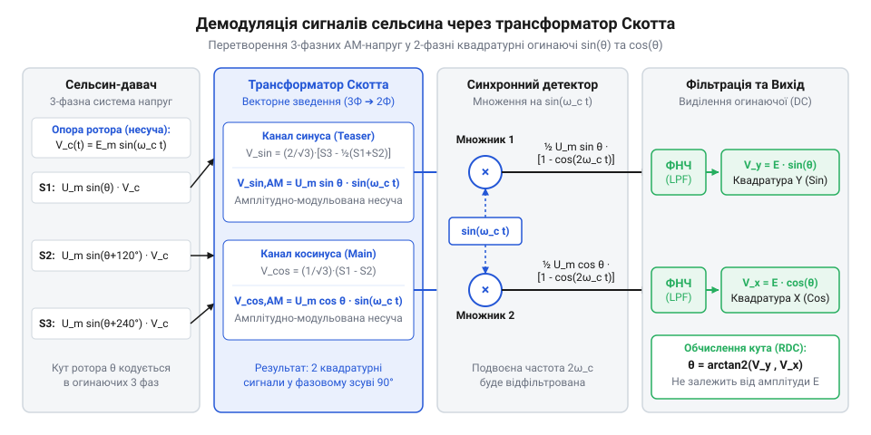
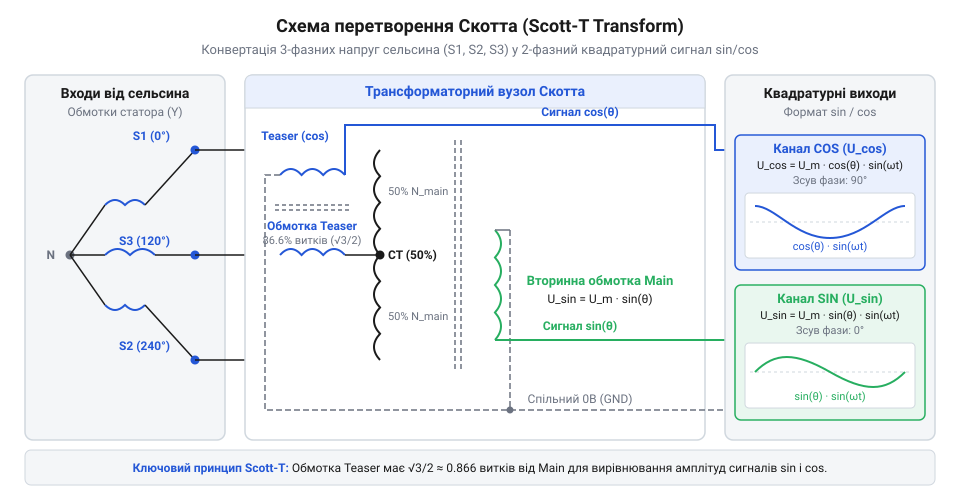
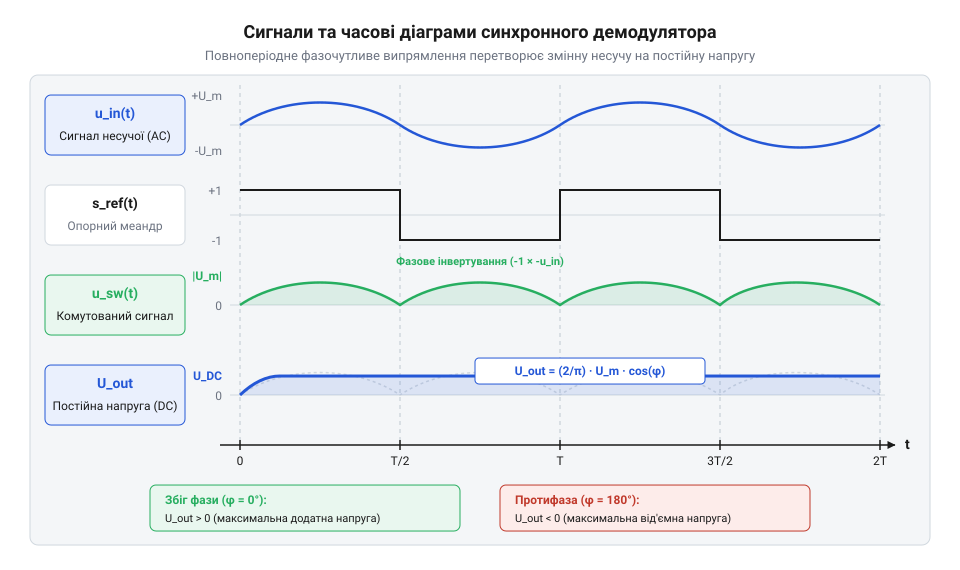

# Демодулятор сигналів сельсина на базі схеми Скотта

<preknowlist>
- [Енкодери кутового та лінійного переміщення](root:cat-hw-sensors/optical-and-magnetic-encoders) — Розуміння концепції ортогональних вимірювань і квадратурних сигналів sin/cos.
- [Сельсини та резольвери: обертові трансформаторні кутоміри](root:cat-hw-sensors/synchro-and-resolver-transducers) — Базові принципи роботи сельсинів та трифазної системи вихідних напруг.
</preknowlist>

## Проблема оцифрування трифазних сигналів сельсина

У промислових і транспортних системах керування часто виникає задача вимірювання кута повороту за допомогою індуктивних давачів. Застарілі системи автоматики та орієнтації активно використовують сельсини, які видають трифазну змінну напругу з несучою частотою, що зазвичай становить 400 Гц або 50 Гц. Сучасні обчислювальні системи та мікроконтролери оперують цифровими квадратурними даними або стабільними напругами постійного струму в діапазоні від 0 до 3.3 В. Пряме підключення обмоток сельсина до аналого-цифрового перетворювача призводить до зрізання сигналів, перевищення допустимих рівнів напруги та повної втрати точності визначення кута.

Сельсин працює за принципом трансформаторного зв'язку, де ротор живиться змінною опорною напругою, а статорні обмотки генерують трифазні сигнали, амплітуди яких змінюються пропорційно синусу та косинусу кута повороту ротора. Для узгодження цих сигналів із сучасними електронними схемами необхідно розуміти концепцію ортогональних вимірювань, яка детально описана в темі про [енкодери кутового та лінійного переміщення](root:cat-hw-sensors/optical-and-magnetic-encoders). На відміну від простих індуктивних давачів, таких як [лінійні змінні диференціальні трансформатори LVDT](root:cat-hw-sensors/lvdt-linear-variable-differential-transformers), сельсин вимагає одночасної обробки трьох взаємопов'язаних фазних напруг. Через це виникає фізичне обмеження: аналого-цифровий перетворювач мікроконтролера не здатний коректно оцифрувати високу змінну напругу несучої частоти без попереднього зниження амплітуди, перетворення формату та фазочутливого виділення огинаючої.

Отже, першочерговим завданням стає розробка апаратного адаптера, який перетворить трифазну систему напруг сельсина на двофазний квадратурний формат з подальшою синхронною демодуляцією. Це дозволить перетворити змінні амплітудні сигнали на постійні напруги, придатні для надійного вимірювання мікроконтролером. Повний тракт проходження сигналів від сельсина до мікроконтролера наведено на структурній схемі нижче:



## Перетворення Скотта для формування сигналів sin/cos

Маючи сформовану задачу узгодження трифазного сигналу сельсина, необхідно вирішити математичну та схемотехнічну задачу перетворення трьох фазних напруг у два квадратурні сигнали. Для цього використовується класичне перетворення Скотта, яке дозволяє симетричну трифазну систему напруг перетворити на двофазну симетричну систему з фазовим зсувом 90 градусів.

Схема вузла перетворення Скотта будується на основі спеціально з'єднаних трансформаторів або активних операційних підсилювачів із коефіцієнтом передачі √3 / 2. У результаті на виході формуються змінні напруги синус та косинус, амплітуди яких прямо пропорційні куту повороту ротора сельсина.



Схема перетворення Скотта демонструє підключення статорних обмоток сельсина S1, S2, S3 до вхідних трансформаторів, де формуються вихідні квадратурні напруги sin та cos.

Для розрахунку вихідних напруг використовується співвідношення амплітуд фазних напруг сельсина. Нехай фазні напруги статора задані як U_s1, U_s2, U_s3. Тоді перетворення у квадратурні складові U_sin та U_cos виконується за такими співвідношеннями:

```
U_sin = U_s2 - U_s3
      = √3 · U_rms · sin(θ)           [різниця фазних напруг сельсина]

U_cos = (2 · U_s1 - U_s2 - U_s3) / √3
      = √3 · U_rms · cos(θ)           [зважування за схемою Скотта]
```

де `U_rms` — діюче значення напруги живлення, а `θ` — електричний кут повороту ротора сельсина. На основі цих виразів проєктуються дільники напруги та операційні підсилювачі для забезпечення необхідного розмаху сигналів. Подібні підходи до трансформаторного перетворення сигналів також застосовуються в пристроях, описаних у темі про [обертові змінні диференціальні трансформатори RVDT](root:cat-hw-sensors/rvdt-rotary-variable-differential-transformers).

## Синхронна демодуляція та фільтрація амплітудної обвідної

Отримані після схеми Скотта квадратурні сигнали є змінними напругами несучої частоти, амплітуда яких промодульована кутом повороту ротора. Для отримання постійної напруги, яка безпосередньо пропорційна амплітуді та знаку сигналу, застосовується синхронна демодуляція. Читач вивчає принцип синхронного детектування, який детально розглядається в матеріалі про [синхронне детектування та фазочутливу демодуляцію давачів положення](root:cat-hw-sensors/synchronous-demodulation-for-inductive-transducers).

Демодулятор використовує аналогові ключі, керовані опорною прямокутною напругою, синхронізованою з живленням сельсина. Це дозволяє випрямити змінний сигнал із збереженням інформації про фазу та напрямок обертання.



На часових діаграмах наведено сигнали несучої частоти, опорний керуючий прямокутний імпульс, комутовану синусоїду на виході аналогових ключів та згладжену постійну напругу після фільтра нижніх частот.

Для виділення корисної постійної складової амплітудної обвідної без фазових спотворень використовується фільтр нижніх частот ФНЧ. Розрахунок частоти зрізу фільтра здійснюється виходячи з максимальної швидкості обертання ротора сельсина та частоти несучої. Одержані постійні напруги `U_sin_dc` та `U_cos_dc` узгоджуються за допомогою резистивних дільників під вхідний діапазон аналого-цифрового перетворювача мікроконтролера. Подальша обробка таких сигналів для визначення кута здійснюється аналогічно до систем, що описані в темі про [перетворювачі «резольвер-код» (RDC)](root:cat-hw-sensors/resolver-to-digital-converters).

## Узгодження рівнів сигналів для АЦП STM32

Виділені після демодуляції сигнали синуса та косинуса змінюються в двополярному діапазоні, наприклад від мінус опорної напруги до плюс опорної напруги. Аналогово-цифровий перетворювач мікроконтролера STM32 живиться від однополярного джерела та здатний вимірювати напругу лише в межах від 0 до 3.3 В. Подання від'ємних напруг безпосередньо на вхід АЦП призведе до виходу мікросхеми з ладу або спотворення результатів вимірювання. Щоб узгодити двополярний сигнал з однополярним входом, до нього необхідно додати постійний зсув, що дорівнює половині опорної напруги АЦП (VREF / 2 ≈ 1.65 В), та зменшити розмах амплітуди, щоб результуючий сигнал повністю вписався в робочий діапазон без насичення.

Для реалізації такого перетворення використовується схема сумувального підсилювача на операційному підсилювачі (@@en|op-amp@@). Неінвертувальний вхід підсилювача підключається до стабільного джерела опорної напруги, розділеного резистивним дільником до рівня 1.65 В. Інвертувальний вхід приймає демодульований сигнал через вхідний резистор, а зворотний зв'язок задає необхідний коефіцієнт передачі та масштабування:

```
V_out     = V_ref / 2 - (R_f / R_in) · V_in
V_out_max = 1.65 + (R_f / R_in) · V_in_max
```

Добір номіналів резисторів `R_f` та `R_in` забезпечує виконання умови, за якої максимальний і мінімальний вихідні сигнали не перевищують межі від 0 до 3.3 В. На практиці обов'язково передбачають захисні RC-кола та невеликий запас за амплітудою, щоб уникнути обмеження сигналу на верхівках синусоїди при температурному дрейфі чи коливаннях живлення.

## Обробка сигналів та калібрування конвертера

Оцифровані мікроконтролером значення напруг на каналах синуса та косинуса містять не лише корисну інформацію про кут, але й похибки: нульовий зміст, нерівність амплітуд обох каналів та можливий фазовий зсув між ними. Пряме застосування тригонометричних функцій без компенсації цих факторів призведе до нелінійних спотворень та похибки вимірювання кута повороту ротора.

Для отримання абсолютного кута в мікроконтролері використовують функцію арктангенса двох аргументів (@@en|atan2@@), яка обчислює кут за значеннями ортогональних складових:

```
θ = atan2(V_sin_corr, V_cos_corr)
```

Перед викликом `atan2` сирий вихід АЦП очищається від апаратних похибок. Компенсація зміщення та нерівності масштабів виконується за допомогою калібрувальних коефіцієнтів, які визначаються під час первинного налаштування пристрою:

```
V_sin_corr = (V_sin_raw - V_sin_offset) · K_sin
V_cos_corr = (V_cos_raw - V_cos_offset) · K_cos
```

Методологія калібрування полягає в повільному обертанні ротора сельсина на повний оберт та фіксації екстремальних значень сигналу на обох каналах. Програмне забезпечення знаходить мінімальні та максимальні амплітуди, обчислює реальні нульові зміщення та коефіцієнти підсилення для кожного каналу окремо, після чого зберігає їх у Flash-пам'яті мікроконтролера.

:::tabs
@tab C
:::code proj-synchro-scott-t-demodulator/c/scott_t_demodulator.c
@tab C++
:::code proj-synchro-scott-t-demodulator/cpp/ScottTDemodulator.cpp
:::
