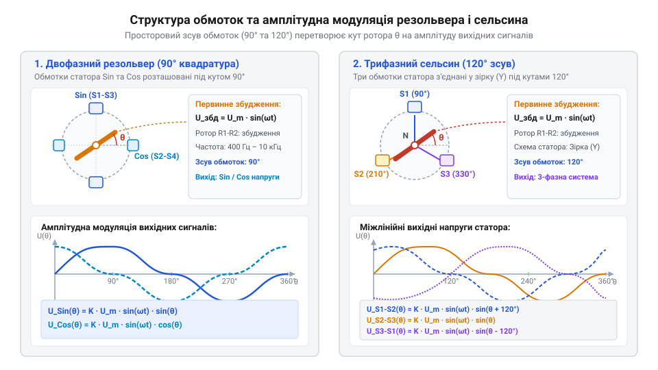
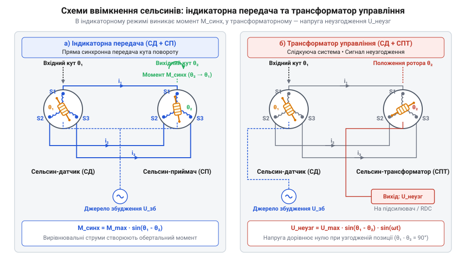
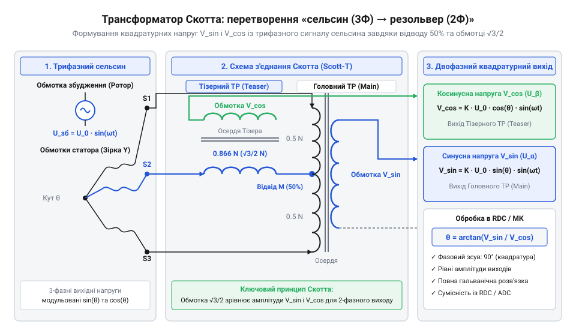
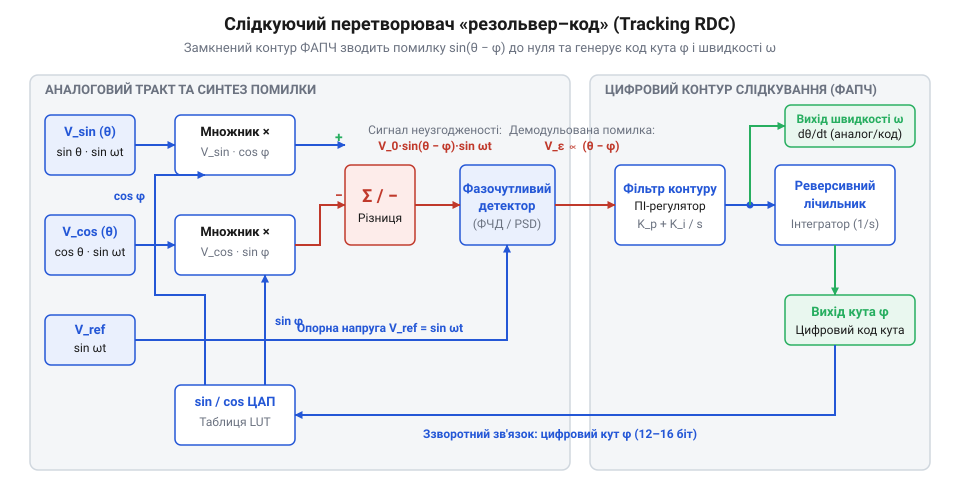
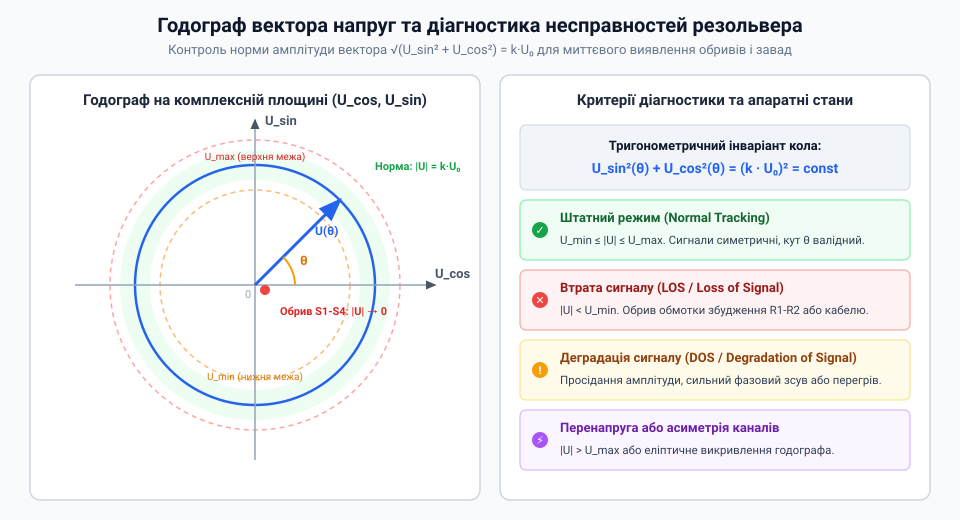

# Сельсини та резольвери: обертові трансформаторні кутоміри

<preknowlist>
- [Лінійні змінні диференціальні трансформатори LVDT](root:cat-hw-sensors/lvdt-linear-variable-differential-transformers) — Принцип трансформаторного узгодження та взаємної індуктивності у зміннострумових датчиках переміщення.
- [Енкодери кутового та лінійного переміщення](root:cat-hw-sensors/optical-and-magnetic-encoders) — Поняття кутового положення вала, роздільної здатності та дискретизації кутових величин.
</preknowlist>

## Проблема вимірювання кута в екстремальних умовах

Системи автоматичного керування рухом у важкому промисловому обладнанні, аерокосмічній техніці, електротранспорті та металургії працюють у середовищах із граничними фізичними та кліматичними навантаженнями. Тягові електродвигуни, поворотні механізми та промислові робототехнічні маніпулятори піддаються безперервній вібрації з широким спектром частот, ударним прискоренням понад 50g, а також впливу агресивного масляного туману, металевого пилу та струмопровідної вологи. Робоча температура безпосередньо всередині корпусу серводвигуна нерідко перевищує +150 °C... +200 °C. За таких умов вимірювання точного кутового положення та швидкості обертання вала перетворюється на першочергову інженерну задачу, адже найменший збій чи похибка у колі зворотного зв'язку призводить до розмикання слідкуючого контуру та катастрофічної відмови всієї установки.

Традиційні первинні давачі кута виявляються повністю непридатними для довготривалого використання в екстремальних умовах через притаманні їм конструктивні обмеження. Резистивний @@en|потенціометр@@ (від латинського @@la|potentia@@ — «сила, потенціал» та грецького @@el|μέτρον@@ — «вимірювач») покладається на безперервний механічний контакт між рухомим струмознімальним ковзаном та графітовим або металоплівковим резистивним елементом. Під дією вібрації ковзаючий контакт зазнає прискореного зносу, виникає ефект мікродемпфування та брязкоту, який насичує вихідний сигнал електричним шумом. Утворення продуктів зносу та мікротріщин на доріжці врешті-решт спричиняє повний обрив кола, що унеможливлює використання потенціометрів у відповідальних @@en|сервопривод@@ах (від латинського @@la|servus@@ — «помічник, той, що виконує команду»).

Спроба застосування [оптичних та магнітних енкодерів](root:cat-hw-sensors/optical-and-magnetic-encoders) розв'язує проблему механічного зносу за рахунок безконтактного зчитування, проте створює низку нових критичних уразливостей. Оптичний @@en|енкодер@@ (від англ. @@en|encoder@@ — «кодувальник») використовує скляний або полімерний кодовий диск із нанесеними прозорими та непрозорими штрихами мікронного розміру. Умови високої вібрації та теплових ударів спричиняють розтріскування скляного диска чи деформацію пластику. Освоєння масляної плівки, осідання пилу або виникнення конденсату при переході через точку роси на оптичних лінзах блокує світловий промінь світлодіода. Більше того, активні напівпровідникові елементи — випромінювальні діоди та фотоприймальні матриці — втрачають стабільність квантового виходу та зазнають швидкої деградації за температур вище +100 °C, а під дією потужного електромагнітного випромінювання чи іонізуючої радіації повністю виходять з ладу.

Суцільнотілі напівпровідникові пристрої, такі як [мікросхемах магнітних енкодерів](root:cat-hw-sensors/as5048-magnetic-encoder) на основі ефекту Холла або магніторезистивних структур, позбавлені тендітних скляних елементів, але мають власний набір жорстких обмежень. Розміщення кремнієвого кристала безпосередньо у зоні вимірювання обмежує допустимий температурний режим через зростання струмів витоку в p-n переходах напівпровідника. Високочастотні імпульсні струми статора, створювані сучасними силовими інверторами широтно-імпульсної модуляції, наводять потужні синфазні завади, які спотворюють слабкі сигнали Холла. Крім того, механічні люфти підшипників, радіальне биття та осьове зміщення вала змінюють величину мікроскопічного повітряного зазору між постійним магнітом та поверхнею мікросхеми, що вносить суттєву нелінійну похибку у виміряне значення кута. Для побудови безвідмовних систем потрібне рішення на основі [датчиках кутового положення](root:cat-hw-sensors/servo-feedback-potentiometers-and-magnetic-encoders) без вбудованих активних напівпровідникових компонентів.

Єдиним розв'язком, здатним забезпечити безперебійну роботу протягом багатьох років без технічного обслуговування, є суто електромагнітний індуктивний перетворювач кута. Усередині його суцільнометалевого герметичного корпусу відсутні будь-які напівпровідникові плати, оптичні елементи, джерела світла чи гнучкі з'єднувальні шлейфи. Конструкція пристрою складається виключно із пакетів електротехнічної листової сталі з високою магнітною проникністю, мідних обмоток із високотемпературною емалевою ізоляцією та надійних підшипникових вузлів. За своєю фізичною природою такий давач є обертовим трансформатором змінного струму, який за механічною й термічною міцністю повністю еквівалентний асинхронному електродвигуну і схожий на [лінійних змінних диференціальних трансформаторах](root:cat-hw-sensors/lvdt-linear-variable-differential-transformers). Пасивний електричний тракт дозволяє винести усю чутливу оброблювальну електроніку на десятки метрів від гарячої та вібраційної зони у захищену шафу керування, що детально описується в специфікаціях [електричного та механічного інтерфейсу](root:cat-hw-sensors/synchro-and-resolver-transducers/api-synchro-resolver-hardware.md).

Історія безконтактних кутомірів розпочалася у першій половині XX століття з потреби надійної дистанційної передачі кута повороту керма корабля, компаса та авіаційних приладів без використання лампової чи напівпровідникової електроніки. Перші пристрої — @@en|сельсин@@ (від англ. @@en|self-synchronous@@ — «самосинхронний») — використовували контактні щіткові вузли та ковзні кільця для подачі живлення на ротор, що обмежувало їхній ресурс і створювало іскріння. Під час Другої світової війни для корабельних артилерійських обчислювачів і станцій радіолокації знадобилися точні пристрої розкладання вектора на синусну та косинусну складові, що породило @@en|резольвер@@ (від англ. @@en|resolver@@ — «розв'язувач», від латинського @@la|resolvere@@ — «розкладати на складові»). Вирішальним технічним кроком став перехід від контактних машин до безконтактних резольверів, де первинне збудження передається на ротор через вбудований допоміжний обертовий трансформатор. Попри масову цифровізацію та появу напівпровідникових енкодерів наприкінці XX століття, безконтактні резольвери зберегли статус абсолютного стандарту для критично важливих галузей завдяки своїй неперевершено надійній електромагнітній природі.

## Електромагнітний принцип обертового трансформатора кута

В основі роботи індуктивного кутоміра лежить фізичний принцип електромагнітної індукції між первинною обмоткою збудження та вторинними вимірювальними обмотками, взаємна індуктивність `M(θ)` між якими змінюється за періодичним законом залежно від кутового положення вала `θ`.

Рухомий @@de|ротор@@ (від латинського @@la|rotare@@ — «обертатися») несе первинну обмотку збудження, на яку від зовнішнього генератора подається високочастотна синусоїдальна напруга живлення:

```
U_exc(t) = U_m · sin(ω · t)
```

де `U_m` — амплітудне значення напруги збудження (зазвичай від 3 В до 26 В), а `ω = 2 · π · f_exc` — колова частота збудження, яка лежить у діапазоні від 2 кГц до 10 кГц.

Синусоїдальний струм первинної обмотки створює у феромагнітному осерді змінний магнітний потік. Коли @@de|ротор@@ повертається відносно нерухомого @@de|статор@@а (від латинського @@la|stator@@ — «нерухомий»), просторова орієнтація магнітного поля змінює ступінь магнітного зв'язку з вторинними обмотками. У результаті у вторинних обмотках індукується електрорушійна сила, амплітуда якої модулюється пропорційно синусу або косинусу кута повороту.

У двофазній квадратурній конфігурації @@en|резольвер@@а на статорі розміщують дві ідентичні обмотки, рознесені в просторі під прямим кутом (90° електричних) одна відносно одної: синусну обмотку (`S1-S3`) та косинусну обмотку (`S2-S4`).

Вихідні напруги на виводах статора являють собою амплітудно-модульовані сигнали високочастотної несучої:

```
U_sin(t, θ) = k · U_m · sin(θ) · sin(ω · t)
U_cos(t, θ) = k · U_m · cos(θ) · sin(ω · t)
```

де `k = N_s / N_r` — коефіціент трансформації резольвера (зазвичай порядку 0.5).

Термін @@la|квадратура@@ (від латинського @@la|quadratura@@ — «зсув на чверть кола, 90 градусів») відображає ортогональне просторове розташування обмоток, завдяки якому огинаючі амплітуд двох сигналів точно відповідають декартовим координатам `(x, y) = (cos(θ), sin(θ))` вектора положення ротора. Поняття @@la|амплітудна модуляція@@ (від латинського @@la|amplitudo@@ — «величина» та @@la|modulatio@@ — «зміна») описує процес, при якому високочастотна несуча напруга `sin(ω · t)` відіграє роль носія сигналів, а низькочастотне механічне обертання ротора `θ` визначає амплітудну огинаючу вихідних напруг.


*_Конструкція обмоток двофазного резольвера з квадратурними виходами та трифазного сельсина, що ілюструє формування синусно-косинусних та трипроменевих амплітудно-модульованих сигналів._*

Амплітуди вихідних сигналів пропорційні напрузі живлення, проте їхнє співвідношення залежить виключно від геометрії кута повороту ротора. Для знаходження тангенса кута знайдемо відношення миттєвих амплітуд синусної та косинусної обмоток статора:

```
U_sin = k · U_m · sin(θ) · sin(ω · t)
U_cos = k · U_m · cos(θ) · sin(ω · t)
Ratio = U_sin / U_cos = [k · U_m · sin(θ) · sin(ω · t)] / [k · U_m · cos(θ) · sin(ω · t)]
= sin(θ) / cos(θ)      [скорочення спільної несучої частоти та амплітуди k · U_m · sin(ω · t)]
= tan(θ)               [тригонометрична тотожність тангенса кута]
```

Отримане відношення залежить виключно від кута `θ`, а амплітуда `U_m`, частота `ω` та термічна зміна опору мідного дроту обмоток скорочуються в чисельнику й знаменнику. Це робить вимірювання за допомогою @@en|резольвер@@а надзвичайно інваріантним до коливань живильної напруги та температурного дрейфу. Повний математичний апарат перетворення сигналів детально висвітлено у матеріалі про [тригонометричних перетворень сигналів](root:cat-hw-sensors/synchro-and-resolver-transducers/math-synchro-resolver-transformations.md).

У трифазній конфігурації @@en|сельсин@@а ротор містить одну обмотку збудження, а на статорі розташовано три однакові обмотки, зсунуті в просторі на 120° одна відносно одної та з'єднані за схемою «зірка» з виводами `S1`, `S2`, `S3`.

Лінійні напруги між фазами статора сельсина описуються виразами:

```
U_S1_S2 = √3 · k · U_m · sin(θ + 240°) · sin(ω · t)
U_S2_S3 = √3 · k · U_m · sin(θ + 120°) · sin(ω · t)
U_S3_S1 = √3 · k · U_m · sin(θ) · sin(ω · t)
```

Сельсинні системи працюють у двох основних режимах взаємодії між датчиком та приймачем:

1. **Індикаторний режим**: Використовується пара сельсинів — сельсин-датчик і сельсин-приймач. Обмотки роторів обох пристроїв підключаються до спільної мережі збудження змінного струму, а їхні трифазні статори з'єднуються однойменними фазами між собою. Якщо кути повороту роторів датчика `θ_trans` та приймача `θ_recv` збігаються, індуковані ЕРС у фазах статорів однакові, струм між статорами не тече і механічний момент відсутній. При виникненні розгладження `θ_trans ≠ θ_recv` різниця напруг викликає зрівняльні струми в статорних лініях, які створюють електромагнітний обертальний момент на роторі приймача, повертаючи його до повного збігу кутів `θ_recv = θ_trans`. Режим застосовується для безпосереднього дистанційного повороту стрілок вимірювальних приладів.

2. **Режим трансформатора управління**: Обмотка ротора сельсина-датчика живиться від мережі збудження й подає трифазну систему напруг на статор сельсина-приймача. Обмотка ротора сельсина-приймача не підключається до мережі живлення, а слугує вимірювальним датчиком помилки. Вихідна напруга на роторі приймача визначається виразом:

```
U_err = k_ctrl · U_m · sin(θ_trans - θ_recv) · sin(ω · t)
```

Коли кути збігаються (`θ_trans = θ_recv`), напруга на роторі дорівнює нулю. При наявності неузгодження амплітуда вихідної напруги `U_err` пропорційна величині похибки `Δθ`, а її фаза (0° або 180° відносно збудження) вказує напрямок відхилення. Цей сигнал неузгодження підсилюється та подається на виконавчий двигун, який обертає @@en|сервопривід@@ до нульового стану.


*_Схеми включення сельсинної пари в індикаторному режимі для дистанційного повороту стрілки та в режимі трансформатора управління для формування сигналу неузгодження в аналогових слідкуючих системах._*

Головна відмінність між пристроями полягає в тому, що двофазний @@en|резольвер@@ формує квадратурний сигнал (`sin` / `cos`), який ідеально адаптований для оцифрування сучасними аналогово-цифровими перетворювачами та мікроконтролерами, тоді як трифазний @@en|сельсин@@ історично розроблявся для прямого електромеханічного зв'язку між валами без проміжної цифрової обробки.

## Режими індикаторної передачі та трансформатора управління

Коли виникає потреба синхронізувати кутове положення двох рознесених механізмів без жорсткого вала — наприклад, передати кут повороту суднового штурвала на стрілку індикатора пеленга або кут антени радіолокатора на віддалений дисплей, — пряме механічне з'єднання стає неможливим. Потенціометричний або оптичний знімач кута в жорстких умовах вібрації та завад може схибити, тоді як обертові трансформатори дозволяють передавати кут безпосередньо через змінний магнітний зв'язок. У найпростішій конфігурації двох однотипних пристроїв — сельсина (від @@en|self-synchronizing@@ — самосинхронізовний) датчика та сельсина-приймача — створюється прямоточний електричний вал. Цей спосіб підключення називають режимом індикаторної передачі прямого кута.

В індикаторній системі обмотки збудження роторів обох сельсинів підключають до одного джерела змінної напруги `U_r(t) = U_m · sin(ωt)`. Статорні обмотки сельсина-датчика (@@en|synchro transmitter@@) з'єднують однойменними виводами із трифазною зіркою статора сельсина-приймача (@@en|synchro receiver@@). Змінний струм збудження ротора датчика наводить у трьох фазах його статора змінні ЕРС, амплітуди яких визначаються кутовим положенням ротора `θ_T`. Ці напруги передаються лініями зв'язку на статор приймача. Якщо ротор сельсина-приймача повернутий на той самий кут `θ_R = θ_T`, ЕРС, наведені ротором приймача в його власних статорних обмотках, повністю збалансовані із зовнішніми напругами. Різниця потенціалів між з'єднаними фазами дорівнює нулю, струми у з'єднувальних дротах не протікають, і електромагнітний обертальний момент відсутній.

Як тільки між валами виникає розузгодження (`θ_T ≠ θ_R`), рівновага ЕРС порушується. У фазних провідниках починають протікати зрівнювальні струми. Взаємодія цих струмів із магнітним потоком збудження ротора створює відновлювальний електромагнітний момент `M = M_max · sin(θ_T - θ_R)`. На роторі сельсина-датчика цей момент діє як протидія руху (гальмівний реактивний момент), а на роторі сельсина-приймача — як рушійна сила, що повертає його вал у бік зменшення розузгодження до точки `θ_R = θ_T`. Однак відновлювальний момент індикаторного сельсина обмежений магнітною індукцією та опором ліній. Якщо на вихідному валу є суттєвий механічний опір або тертя, індикаторний сельсин зупиниться з кутовою похибкою, а спроба зняти з нього значну потужність призведе до розсинхронізації та перегріву обмоток.

Коли вихідний вал мусить повертати важке навантаження — наприклад, позиціонувати масивну антену або поворотну платформу, — використовують режим трансформатора управління (@@en|control transformer mode@@). У цій схемі сельсин-датчик залишається підключеним до мережі збудження, але ротор сельсина-трансформатора управління (@@en|synchro control transformer@@) не підключають до джерела живлення. Замість цього роторна обмотка слугує вимірювальним давачем напруги неузгодження.

Статорні струми, передані від датчика, створюють усередині статора трансформатора управління пульсуюче магнітне поле, вектор напрямку якого в просторі чітко відповідає куту `θ_T`. Роторна обмотка трансформатора управління перетинає це магнітне поле й наводить ЕРС, амплітуда якої пропорційна синусу різниці кутів між вектором поля статора та кутом ротора `θ_CT`:

```
U_out(t) = K · U_m · sin(θ_T - θ_CT) · sin(ωt)
```

За малого кута неузгодження `Δθ = θ_T - θ_CT` синус близький до свого аргументу `sin(Δθ) ≈ Δθ`. Вихідний сигнал являє собою амплітудно-модульовану змінну напругу, носієм якої є частота збудження `ω`, а амплітуда прямо пропорційна кутовій похибці `Δθ`. Фаза цієї напруги (збігається за фазою з джерелом збудження чи зміщена на 180°) вказує напрямок відхилення вала. Знятий сигнал неузгодження подають на підсилювач потужності, який живить виконавчий двигун. Двигун повертає ротор трансформатора управління та пов'язане з ним механічне навантаження доти, доки вихідна напруга не знизиться до нуля. У такий спосіб формується високоточний [сервопривід](root:cat-hw-sensors/servo-feedback-potentiometers-and-magnetic-encoders), де обертовий трансформатор працює в режимі безпосереднього давача помилки без механічного навантаження на вихідний вал.

Якщо у слідкуючу систему необхідно ввести додатковий кутовий зсув або обчислити суму чи різницю двох кутів без використання цифрового обчислювача, застосовують диференційні сельсини (@@en|differential synchro@@) та резольвери (від @@en|resolver@@ — той, що розв'язує тригонометричні рівняння). Диференційний сельсин має трифазну систему обмоток як на статорі, так і на роторі. Його статор підключають до ліній сельсина-датчика, отримуючи просторове магнітне поле під кутом `θ_1`. Ротор диференційного сельсина механічно повертають на кут `θ_2`. У результаті напруги, зняті з роторних обмоток, формують трифазну систему, вектор якої зміщений на кут `θ_out = θ_1 ± θ_2`. Це дозволяє виконувати аналогове підсумовування та віднімання кутових величин безпосередньо у магнітному полі пристрою. За аналогічною схемою працюють двофазні квадратурні диференційні резольвери, що дозволяє гнучко будувати багатовісьові кінематичні сумматори.

Вибір між індикаторним режимом та режимом трансформатора управління визначається вимогами до системи: індикаторна передача проста й не потребує активних електронних компонентів, але обмежена малим моментом і чутлива до тертя; режим трансформатора управління вимагає підсилювача та контуру зворотного зв'язку, проте забезпечує високу точність позиціонування та необмежену силову потужність на вихідному валу. Конкретні електричні параметри з'єднань, рівні напруг збудження та узгодження імпедансів ліній описує електричний [залізний API](root:cat-hw-sensors/synchro-and-resolver-transducers/api-synchro-resolver-hardware.md) давачів.

## Перетворення трифазних сигналів сельсина на квадратуру

Класичні сельсини формують трифазну систему вихідних напруг, знятих із трьох статорних обмоток, розташованих під просторовим кутом 120° одна до одної. Проте сучасна цифрова мікроелектроніка, обчислювальні алгоритми та слідкуючі перетворювачі розраховані на роботу з двофазною квадратурною системою сигналів — синусним та косинусним каналами, зміщеними на 90°. Для сполучення трифазного сельсина із двофазними вимірювальними трактами застосовують пасивне електромеханічне або електронне перетворення на основі [трансформатора Скотта](root:hw-components/scott-t-transformer-circuits) (@@en|Scott-T transformer@@).

Схема Скотта складається з двох спеціально розрахованих трансформаторів — головного (@@en|main transformer@@) та тизерного (@@en|teaser transformer@@, або ділильного). Первинна обмотка головного трансформатора підключається між двома крайніми фазними виводами сельсина (наприклад, S1 та S3). Вона має середню точку (відвід від середини обмотки). Первинна обмотка тизерного трансформатора підключається між третім фазним виводом сельсина (S2) та середньою точкою головного трансформатора.

Для компенсації геометрії векторної діаграми трикутника 120° кількість витків первинної обмотки тизерного трансформатора становить `√3 / 2 ≈ 0.866` від кількості витків головного трансформатора. За такого співвідношення витків на вторинних обмотках формуються два взаємно ортогональні квадратурні сигнали однакової амплітуди, які відтворюють синусну та косинусну залежності від кута ротора:

```
U_cos(t) = K · cos(θ) · sin(ωt)
U_sin(t) = K · sin(θ) · sin(ωt)
```


*Конструкція перетворювача Скотта на двох трансформаторах із тизерним відводом 0.866, що трансформує трифазні напруги сельсина на ортогональні квадратурні напруги.*

Практична реалізація та вибір режимів у складі аналогового конвертера висвітлюються у проекті, де розглянуто [конвертер Скотта](root:cat-hw-sensors/synchro-and-resolver-transducers/proj-synchro-scott-t-demodulator.md) із фазочутливим демодулятором.

Сформовані квадратурні напруги сельсинів або вихідні сигнали двофазного резольвера являють собою амплітудно-модульовані (@@en|amplitude modulation@@) високочастотні гармоніки. Кутова інформація `θ` міститься в обвідній амплітуди. Просте амплітудне детектування за допомогою діодного містка тут незастосовне: коли синус або косинус змінюють знак (проходять через нуль), фаза несного сигналу стрибкоподібно змінюється на 180°. Звичайний діодний детектор випрямить від'ємну напівхвилю обвідної у додатну, що призведе до втрати інформації про квадрант кута.

Для збереження знака кута застосовують синхронне детектування через [фазочутливий демодулятор](root:hw-analog/phase-sensitive-demodulators-and-lock-in-amplifiers) (@@en|phase-sensitive demodulator@@). Суть методу полягає у множенні вхідного амплітудно-модульованого сигналу на опорну напругу збудження `U_ref(t) = sin(ωt)` з наступною фільтрацією низьких частот:

```
U_demod(t) = U_sin(t) · sin(ωt)
= V_m · sin(θ) · sin²(ωt)                     [множення на опорний сигнал збудження]
= 0.5 · V_m · sin(θ) · [1 - cos(2ωt)]         [застосування тригонометричної тотожності]
= 0.5 · V_m · sin(θ)                         [фільтрація високочастотної гармоніки 2ω]
```

Після проходження через фільтр низьких частот (ФНЧ) подвоєна частота несучої `2ω` пригнічується, а на виході залишається чистий аналоговий сигнал постійного струму `0.5 · V_m · sin(θ)`, амплітуда й знак якого точно відповідають синусу кута повороту вала.

Пряме вимірювання демодульованих напруг синуса й косинуса аналогово-цифровим перетворювачем (АЦП) з обчисленням арктангенса `θ = arctan(U_sin / U_cos)` у мікроконтролері має суттєві недоліки: нестабільність амплітуди збудження `V_m`, температурний дрейф опору обмоток та наявність високочастотних завад призводять до значних похибок.

Тому в промислових сервоприводах застосовують спеціалізовані мікросхеми перетворювачів «резольвер-код» (@@en|resolver-to-digital converter@@, або RDC), які будуються на основі апаратного слідкуючого контуру типу 2 (@@en|tracking loop@@ / ФАПЧ).


*Принцип роботи слідкуючого RDC: віднімання кутів у тригонометричному множнику, демодуляція сигналу помилки та інтегрування в цифровий код кута й швидкості.*

Внутрішній алгоритм RDC працює за методом нульового балансу:
1. Внутрішній цифровий реверсивний лічильник мікросхеми зберігає поточну оцінку кута `φ`. 2. Вхідні аналогові квадратурні сигнали `U_sin` та `U_cos` множаться на цифрові значення `cos(φ)` та `sin(φ)` за допомогою перемножувальних ЦАП (MDAC):

```
U_err = U_sin · cos(φ) - U_cos · sin(φ)
= V_m · sin(θ) · sin(ωt) · cos(φ) - V_m · cos(θ) · sin(ωt) · sin(φ)
= V_m · [sin(θ)cos(φ) - cos(θ)sin(φ)] · sin(ωt)
= V_m · sin(θ - φ) · sin(ωt)
```

3. Отриманий сигнал помилки `U_err` подається на фазочутливий демодулятор, де виділяється постійна складова, пропорційна синусу різниці кутів `e = V_m · sin(θ - φ) ≈ V_m · (θ - φ)`. 4. Сигнал помилки `e` надходить на аналогово-цифровий інтегратор (ПІ-регулятор), вихід якого керує генератором, керованим напругою (ГКН), що змінює стан цифрового лічильника `φ` доти, доки різниця `θ - φ` не стане рівною нулю.

Головна перевага слідкуючого RDC полягає у тому, що напруга амплітуди `V_m` входить як спільний множник у сигнал помилки й не впливає на точку нульового балансу `θ = φ`. Це робить перетворювач повністю нечутливим до коливань амплітуди та частоти збудження. Крім того, вихідний сигнал інтегратора перед лічильником пропорційний швидкості обертання вала `dθ/dt`, що дозволяє оцифровувати швидкість без обчислювального диференціювання.

Математичне обґрунтування цих векторних співвідношень дають детальні [тригонометричні перетворення](root:cat-hw-sensors/synchro-and-resolver-transducers/math-synchro-resolver-transformations.md), а проектування вимірювального тракту та узгодження збуджувача описує розробка [інтерфейсу RDC](root:cat-hw-sensors/synchro-and-resolver-transducers/proj-resolver-rdc-interface.md). Готовий цифровий код кута та діагностичні прапорці зчитуються мікроконтролером, який дозволяє передавати [дані кута SPI](root:cat-hw-sensors/synchro-and-resolver-transducers/api-rdc-spi-protocol.md) для подальшої обробки у контурі керування.

Для порівняння з іншими типами кутових давачів — таками як [оптичні енкодери](root:cat-hw-sensors/optical-and-magnetic-encoders) чи [магнітні енкодери](root:cat-hw-sensors/as5048-magnetic-encoder) — резольвери у зв'язці з RDC забезпечують абсолютне кутове положення з високим завадозахистом та безперервною діагностикою обриву фаз.

## Оцифрування сигналів резольвера слідкуючими перетворювачами RDC

Пряме оцифрування вихідних синусно-косинусних напруг резольвера за допомогою стандартних аналогово-цифрових перетворювачів (АЦП) у мікроконтролері зіштовхується з кількома фундаментальними перешкодами. Оскільки сигнали резольвера є амплітудно-модульованими вихідною несучою частотою генератора збудження, точне визначення кута вимагає вимірювання миттєвої амплітуди обох каналів точно в момент піка збуджувального синуса. Найменший фазовий зсув між струмом збудження та вихідною напругою, нестабільність напруги живлення драйвера, високочастотні імпульсні завади від силового інвертора або розсинхронізація моментів вибірки двох каналів АЦП призводять до значних похибок. Якщо амплітуда збудження просідає на кілька відсотків через температурний дрейф опору обмоток, пряме обчислення арктангенса залишається чутливим до будь-якої асиметрії шумів. Крім того, математичне обчислення кутової швидкості шляхом числового диференціювання послідовності кутових значень `Δθ / Δt` колосально посилює високочастотний шум, перетворюючи сигнал швидкості на непридатний для використання у швидкісних контурах керування сервоприводами. Для розв'язання цих проблем застосовують спеціалізований перетворювач «резольвер-код» (англ. @@en|Resolver-to-Digital Converter@@, @@en|RDC@@, від англійського @@en|resolver@@, латинського @@la|resolvere@@ — розкладати, та @@en|digital@@ — цифровий), побудований за принципом слідкуючої системи із замкненим контуром.

В основу роботи слідкуючого перетворювача @@en|RDC@@ покладено відстеження кута за допомогою замкненого контуру фазового автопідстроювання (англ. @@en|Phase-Locked Loop@@, @@en|PLL@@, від англійського @@en|phase@@ — фаза, та @@en|lock@@ — фіксувати). Замість обчислення арктангенса співвідношення напруг, мікросхема @@en|RDC@@ зберігає поточну оцінку кута ротора у внутрішньому цифровому регістраторі `φ` і неперервно порівнює її з реальним кутом вала `θ`. Вхідні аналогові сигнали з резольвера:
`V_sin = V_ref · sin(θ) · sin(ω_e · t)`
`V_cos = V_ref · cos(θ) · sin(ω_e · t)`
подаються на внутрішній множильний аналогово-цифровий перетворювач. Всередині перетворювача обчислюється тригонометричний добуток різниці кутів:

```
  E = V_cos · sin(φ) - V_sin · cos(φ)
= V_ref · sin(ω_e · t) · (cos(θ) · sin(φ) - sin(θ) · cos(φ))      [заміна V_sin та V_cos]
= -V_ref · sin(θ - φ) · sin(ω_e · t)                             [за тотожністю синуса різниці кутів]
```

Отриманий змінний сигнал помилки `E` подається на [фазочутливий демодулятор](root:hw-analog/phase-sensitive-demodulators-and-lock-in-amplifiers) (англ. @@en|phase-sensitive demodulator@@, від латинського @@la|modulus@@ — міра), який синхронізовано з опорною частотою збудження `sin(ω_e · t)`. Демодулятор вилучає високочастотну несучу `ω_e`, залишаючи постійну напругу помилки:

```
  e = V_ref · sin(θ - φ)
≈ V_ref · (θ - φ)            [для малих кутів відхилення sin(x) ≈ x]
```

Отримана напруга помилки `e` надходить на аналоговий або цифровий інтегратор контуру слідкування другого типу (англ. @@en|Type-II tracking loop@@). Контур другого типу містить два послідовні інтегратори: перший обчислює інтеграл від помилки неузгодження, а його вихідний сигнал є прямо пропорційним кутовій швидкості обертання вала `ω = dθ/dt`. Цей сигнал керує генератором, керованим напругою (англ. @@en|Voltage-Controlled Oscillator@@, @@en|VCO@@, від латинського @@la|oscillare@@ — коливатися), або цифровим керованим генератором, який оновлює значення регістра оцінки кута `φ` у другому інтеграторі. Коли контур досягає рівноваги, оцінка кута повністю збігається з реальним кутом вала `θ = φ`, а сигнал помилки `e` прямує до нуля.


*Блок-схема слідкуючого контуру RDC: аналоговий множник формує сигнал неузгодження, фазочутливий демодулятор вилучає несучу, а два інтегратори обчислюють кут та швидкість.*

Така архітектура має дві вирішальні переваги порівняно з простими системами вибірки. По-перше, оскільки контур прагне звести помилку `θ - φ` до нуля, зміна амплітуди збудження `V_ref` змінює лише коефіцієнт підсилення контуру слідкування, але ніяк не впливає на точку нульового неузгодження. Перетворювач @@en|RDC@@ залишається абсолютно інваріантним до коливань напруги генератора збудження або температурної зміни опору кабелю. По-друге, оскільки швидкість обертання `dθ/dt` вилучається безпосередньо з першого інтегратора контуру слідкування, @@en|RDC@@ видає високоточне цифрове значення швидкості без будь-якого фазового запізнення та без набору високочастотних шумів, неминучих при числовому диференціюванні. Детальні виведення тригонометричних рівнянь та фільтрації описані у [математичних перетвореннях резольверів](root:cat-hw-sensors/synchro-and-resolver-transducers/math-synchro-resolver-transformations.md).

Сучасні мікросхеми @@en|RDC@@ об'єднують на одному кристалі аналогові вхідні буфери, синтезатор опорної частоти збудження, слідкуючий контур @@en|PLL@@ та цифрові інтерфейси. Процес обміну даними з мікроконтролером найчастіше реалізується через послідовний периферійний інтерфейс (англ. @@en|Serial Peripheral Interface@@, @@en|SPI@@, від латинського @@la|series@@ — ряд, порядок). Крім цифрового коду кута (роздільна здатність від 10 до 16 біт) та швидкості, мікросхема @@en|RDC@@ постійно передає статусні прапори діагностики цілісності сигналу. Інтеграція вимірювального тракту та налаштування схем детально розглянуті у [проекті розробки тракту резольвера](root:cat-hw-sensors/synchro-and-resolver-transducers/proj-resolver-rdc-interface.md), а специфіка взаємодії з регістрами викладена у [програмному інтерфейсі SPI RDC](root:cat-hw-sensors/synchro-and-resolver-transducers/api-rdc-spi-protocol.md).

Нижче наведено приклад реалізації зчитування кута, швидкості та статусних прапорів із мікросхеми @@en|RDC@@ через інтерфейс @@en|SPI@@ для мікроконтролерних систем.

:::code synchro-and-resolver-transducers-d/c/esp-idf/rdc-read-reg16.c

:::code synchro-and-resolver-transducers-d/cpp/stm32/rdctransceiver.cpp

Цей підхід забезпечує надійне й стійке вимірювання навіть порівняно з класичними [оптичними та магнітними енкодерами](root:cat-hw-sensors/optical-and-magnetic-encoders), оскільки не залежить від оптичного забруднення та стійкий до жорстких температурних вагань. Порівняльний огляд диференціальних, абсолютних та інкрементальних давачів кута, їхніх принципів роботи та критеріїв вибору викладено у статті про [оптичні та магнітні енкодери кутового положення](root:cat-hw-sensors/optical-and-magnetic-encoders/hist-encoder-tech-evolution.md).

## Калібрування, компенсація та діагностика вимірювального тракту

Навіть найточніший перетворювач @@en|RDC@@ та високоякісний резольвер втратять прецизійність, якщо тракт збудження та знімання сигналів побудований без урахування паразитних параметрів обмоток та кабельної лінії. Першим кроком проектування вимірювального тракту є оптимізація частоти та амплітуди опорного генератора збудження. Опорне значення частоти (зазвичай від `2 kHz` до `10 kHz`) обирається на основі індуктивного опору обмотки ротора `X_L = 2 · π · f · L`. На низьких частотах (менше `1 kHz`) активний опір мідного дроту обмоток `R_cu` переважає над індуктивним `X_L`, що призводить до значних втрат енергії на нагрів, сильного температурного дрейфу та збільшення кутового зсуву фази. На надто високих частотах (понад `20 kHz`) різко зростають втрати у вихрових струмах сталевого осердя резольвера та вплив міжвитокової ємності з'єднувального кабелю. Генератор збудження має формувати чисту синусоїду з мінімальним коефіцієнтом гармонійних спотворень (англ. @@en|Total Harmonic Distortion@@, @@en|THD@@, від грецького @@el|harmonia@@ — співзвуччя), оскільки вищі гармоніки створюють хибні точки нульового переходу в демодуляторі.

Другим критичним фактором є компенсація фазового зсуву `δ` між напругою збудження `V_ref` та вихідними напругами статора `V_sin`, `V_cos`. Через наявність індуктивності розсіювання обмоток резольвера та ємності довгого кабелю вихідні синусно-косинусні напруги запізнюються по фазі відносно первинної напруги на кут `δ` (типово від `5°` до `20°`). Якщо фазочутливий демодулятор мікросхеми @@en|RDC@@ використовує некомпенсовану напругу збудження як опорний сигнал, вихідна напруга помилки послаблюється на множник `cos(δ)`. При великих фазових зсувах це зменшує коефіцієнт підсилення контуру слідкування, викликає динамічну похибку відстеження або навіть повну втрату захвату @@en|PLL@@. Для компенсації цього ефекту сучасні мікросхеми @@en|RDC@@ застосовують внутрішній цифровий контур автопідлаштування фази опорного сигналу, або ж застосовують зовнішні аналогові фазообертачі на операційних підсилювачах. Параметри електричного узгодження ліній описано в [описі електричного інтерфейсу](root:cat-hw-sensors/synchro-and-resolver-transducers/api-synchro-resolver-hardware.md).

Третім завданням є встановлення та калібрування електричного нуля. Фізичне положення ротора резольвера при монтажі на вал двигуна рідко точно збігається з механічним нулем ротора серводвигуна. Оскільки в системах векторного керування помилка вирівнювання електричного нуля навіть на `2°`-`3°` призводить до падіння моменту двигуна та перевитрати струму, необхідна процедура двоетапного калібрування:
1. Механічне грубе налаштування: статор резольвера повертається у кріпильному фланці при подачі фіксованого постійного струму в обмотки статора двигуна (подача вектора вирівнювання ротора), поки вихідна напруга синусного каналу резольвера не наблизиться до нуля. 2. Програмне точне калібрування: залишковий зміщення кута `θ_offset` записується в енергонезалежну пам'ять мікроконтролера або в спеціальний внутрішній регістр зсуву мікросхеми @@en|RDC@@. Усі подальші значення кута коригуються за формулою:

```
  θ_actual = (θ_rdc - θ_offset) mod 360°
```

У жорстких промислових умовах з'єднувальні дроти резольвера прокладаються поруч із силовими кабелями електроприводу, якими протікають імпульсні струми з високою швидкістю наростання напруги `dV/dt` (від вихідних інверторів із частотою широкоімпульсної модуляції `8`-`16 kHz`). Для захисту від наведень застосовують виключно диференційну передачу сигналів по витих парах (`SIN+`/`SIN-`, `COS+`/`COS-`, `EXC+`/`EXC-`). Симетричні диференційні лінії забезпечують високий коефіцієнт приглушення синфазного сигналу (англ. @@en|Common-Mode Rejection Ratio@@, @@en|CMRR@@, від латинського @@la|modus@@ — міра, та @@la|ratus@@ — розрахований). Захисний екран кабелю повинен заземлюватися тільки з одного боку — на боці платформи вимірювального контролера чи перетворювача @@en|RDC@@. Двостороннє заземлення екрана утворює замкнені контури із землями силового обладнання, викликаючи вирівнювальні струми та важкі завади у синусно-косинусних каналах. При використанні сельсинів трифазну систему перетворюють у квадратуру через [трансформатори Скотта](root:hw-components/scott-t-transformer-circuits), як описує [конвертер сигналів сельсина](root:cat-hw-sensors/synchro-and-resolver-transducers/proj-synchro-scott-t-demodulator.md).

Останнім рубежем надійності є вбудована апаратна діагностика несправностей вимірювального тракту. Перетворювач @@en|RDC@@ постійно моніторить геометричну суму квадратів вихідних напруг:

```
  V_sum = V_sin² + V_cos²
= (V_ref · sin(θ))² + (V_ref · cos(θ))²
= V_ref² · (sin²(θ) + cos²(θ))
= V_ref²
```

Оскільки сума квадратів синуса та косинуса тотожно дорівнює одиниці, величина `V_sum` повинна лишатися строго постійною незалежно від кута обертання вала `θ`. На основі цього критерію @@en|RDC@@ визначає такі типи аварійних ситуацій:
- Втрата сигналу (англ. @@en|Loss of Signal@@, @@en|LOS@@): якщо `V_sum` падає нижче встановленого порогу (наприклад, менше `20%` від номіналу), це свідчить про обрив обмотки статора, пошкодження кабелю або коротке замикання. - Вихід амплітуди за межі (англ. @@en|Degradation of Signal@@, @@en|DOS@@): якщо `V_sum` перевищує допустимий діапазон або стає асиметричним, це вказує на виткове замикання, температурну деградацію або несправність драйвера збудження. - Втрата стеження (англ. @@en|Loss of Tracking@@, @@en|LOT@@): виникає при перевищенні максимально допустимої кутової швидкості обертання вала або при різкому механічному ударі, коли швидкість зміни кута перевищує динамічну смугу пропускання контуру @@en|PLL@@.


*Векторна діаграма кругової норми: в нормі вектор описує коло радіуса V_ref, а відхилення за встановлені межі виявляють обриви (LOS) або спотворення (DOS).*

Завдяки такій глибокій діагностиці системи на базі резольверів повністю переважають рішення на основі [датчиків кута сервоприводів](root:cat-hw-sensors/servo-feedback-potentiometers-and-magnetic-encoders) чи [магнітних енкодерів AS5048](root:cat-hw-sensors/as5048-magnetic-encoder), гарантуючи безпечну зупинку технологічного обладнання при виникненні найменших пошкоджень лінії.