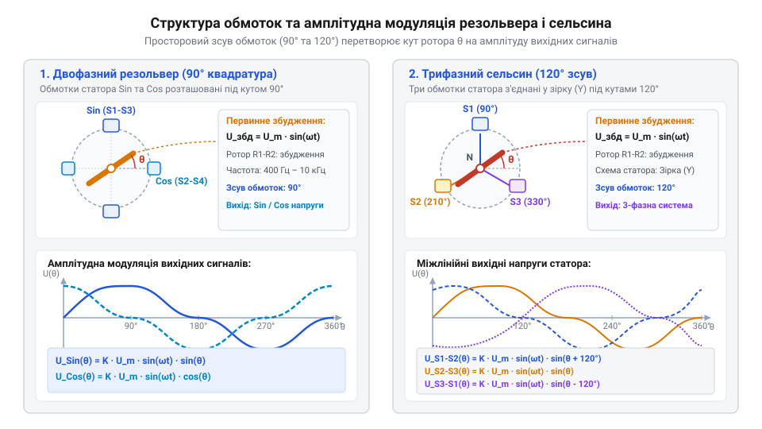
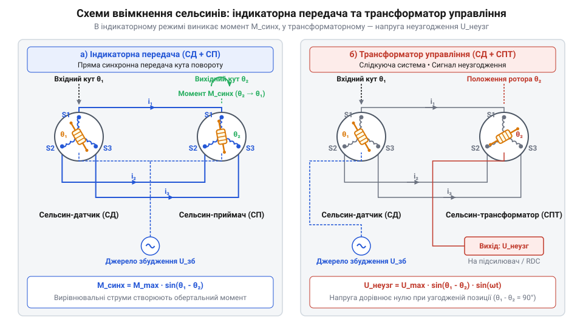
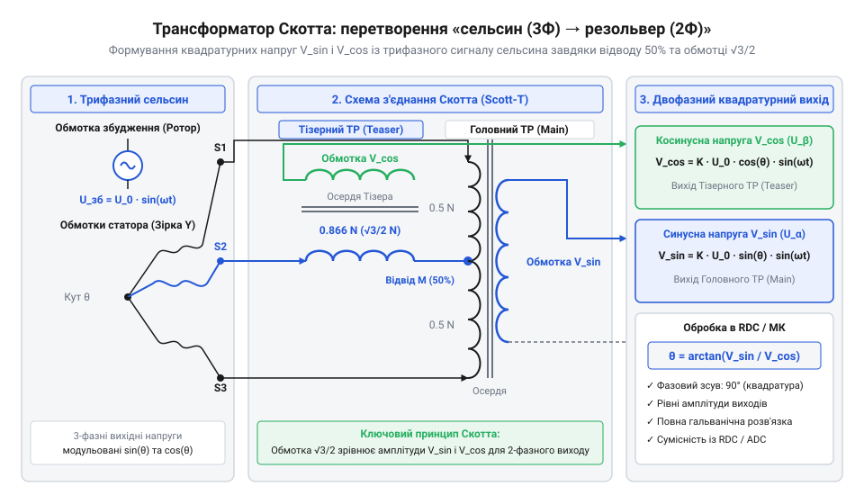
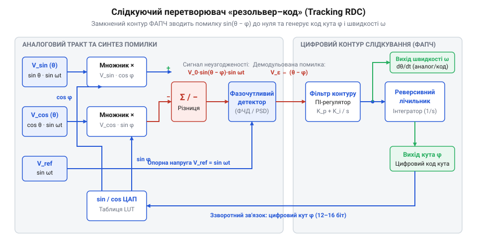
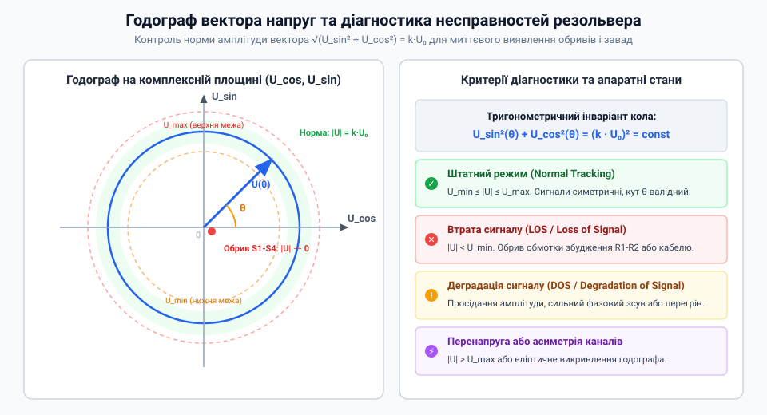

# Сельсини та резольвери: обертові трансформаторні кутоміри

<preknowlist>
- [Лінійні змінні диференціальні трансформатори LVDT](root:cat-hw-sensors/lvdt-linear-variable-differential-transformers) — Принцип трансформаторного узгодження та взаємної індуктивності у зміннострумових датчиках.
- [Енкодери кутового та лінійного переміщення](root:cat-hw-sensors/optical-and-magnetic-encoders) — Поняття кутового положення вала та дискретизації кутових величин.
</preknowlist>

## Проблема вимірювання кута в екстремальних умовах

Вимірювання кута в середовищах із температурою понад +150 °C, вібраціями та масляним туманом виводить з ладу більшість датчиків. [Потенціометричні датчики положення](root:cat-hw-sensors/servo-feedback-potentiometers-and-magnetic-encoders) втрачають контакт під час вібрацій, [оптичні кутові енкодери](root:cat-hw-sensors/optical-and-magnetic-encoders) тріскаються від ударів і деградують від тепла, а [спеціалізовані магнітні енкодери](root:cat-hw-sensors/as5048-magnetic-encoder) обмежені температурним лімітом кремнію.

Рішенням є @@en|rotary transformer@@ (обертовий трансформатор) — пасивний вузол лише з електротехнічної сталі, мідного дроту та підшипників. Відсутність напівпровідників і ковзних контактів дозволяє винести оброблювальну електроніку на десятки метрів у безпечну зону. За фізикою цей пристрій схожий на [лінійні змінно-струмові трансформатори](root:cat-hw-sensors/lvdt-linear-variable-differential-transformers), але працює при нескінченному обертанні вала.

## Електромагнітний принцип обертового трансформатора

На ротор обертового трансформатора подається синусоїдальна напруга збудження `U_exc(t) = U_0 · sin(ω · t)` із частотою `ω` від 400 Гц до 10 кГц. Змінне магнітне поле ротора індукує у статорних обмотках змінні напруги, амплітуда яких пропорційна косинусу кута між їхніми осіми.

У двофазному @@en|resolver@@ (резольвер, від англійського @@en|resolver@@ — від @@en|resolve@@, розкладати вектор) дві обмотки статора розташовані під кутом 90°. Індуковані напруги мають вигляд `U_sin(t) = k · U_0 · sin(θ) · sin(ω · t)` та `U_cos(t) = k · U_0 · cos(θ) · sin(ω · t)`, де `k` — коефіцієнт трансформації, а `θ` — кут повороту ротора.


*Схема розташування обмоток збудження та знімання сигналів у двофазній квадратурній та трифазній конфігураціях.*

Для обчислення кута `θ` знаходять співвідношення амплітуд синусного `U_sin` та косинусного `U_cos` сигналів:

```
U_sin / U_cos
= (k · U_0 · sin(θ) · sin(ω · t)) / (k · U_0 · cos(θ) · sin(ω · t))      [підстановка рівнянь індукованих напруг]
= sin(θ) / cos(θ)                                                         [скорочення спільних множників k, U_0 та sin(ω · t)]
= tan(θ)                                                                  [тригонометрична тотожність]
```

Результат залежить виключно від тангенса кута `θ`. Зміни амплітуди живлення `U_0`, температурний дрейф опору міді чи спад напруги в лінії однаково змінюють обидва сигнали, не впливаючи на їхнє відношення.

У трифазному @@en|synchro@@ (сельсин, від англійського @@en|self-synchronizing@@, самосинхронізований) статор має три обмотки зі зсувом 120°. Його використовують в @@en|indicator mode@@ (індикаторний режим), де приймач відтворює кут датчика, або в @@en|control transformer mode@@ (режим трансформатора управління), де ротор приймача формує напругу помилки `sin(θ_in - θ_out)`.


*Схема включення сельсинів для прямої передачі кута та формування сигналу розсогласування в сервосистемах.*

## Перетворення сигналів та оцифрування RDC

Трифазні напруги сельсина зі зсувом 120° перетворюють у двофазну квадратурну систему за допомогою @@en|Scott-T transformer@@ (схеми Скотта). Два трансформатори з відношенням витків 1 : 1 та `√3 / 2 ≈ 0.866 : 1` розкладають лінійні напруги на ортогональні синусну `U_sin` та косинусну `U_cos` компоненти.


*Трансформаторне поєднання виходів сельсина для отримання ортогональних сигналів.*

Отримані напруги оцифровує @@en|RDC@@ (від @@en|resolver-to-digital converter@@, перетворювач резольвер-код). Пряме обчислення арктангенса чутливе до завад, тому RDC побудовано як замкнений контур стеження на основі @@en|PLL@@ (від @@en|Phase-Locked Loop@@, фазове автопідстроювання частоти).

Перетворювач формує код оцінки кута `φ` і подає його на тригонометричний множник, обчислюючи сигнал помилки `e(t)` між реальним кутом `θ` та оцінкою `φ`:

```
e(t)
= U_sin · cos(φ) - U_cos · sin(φ)                                                                        [визначення тригонометричного множника]
= (K · sin(θ) · sin(ω · t)) · cos(φ) - (K · cos(θ) · sin(ω · t)) · sin(φ)                                 [підстановка виразів сигналів статора]
= K · sin(ω · t) · (sin(θ) · cos(φ) - cos(θ) · sin(φ))                                                  [винесення спільного множника K · sin(ω · t)]
= K · sin(ω · t) · sin(θ - φ)                                                                            [формула синуса різниці кутів]
```

Після демодуляції опорною частотою `sin(ω · t)` сигнал `e(t)` надходить на пропорційно-інтегральний контролер, який обертає лічильник до обнулення `θ - φ`. Така структура робить код кута `φ` стійким до шумів, а вихід контролера дає кутову швидкість `dθ/dt` без числового диференціювання.


*Замкнений контур стеження RDC з тригонометричним множником, фазовим демодулятором та інтегратором помилки.*

## Калібрування та діагностика вимірювального тракту

Калібрування @@en|electrical zero@@ (електричного нуля) узгоджує механічне положення ротора з точкою, де амплітуда синусного сигналу `U_sin` дорівнює нулю, а косинусного `U_cos` — максимуму. Також компенсують @@en|phase shift@@ (фазовий зсув) між напругою збудження та сигналами статора, спричинений індуктивністю обмоток і ємністю кабелю.

Для захисту від електромагнітних завад силових інверторів сигнальні лінії та живлення прокладають @@en|twisted pair@@ (диференційними витими парами). Екран кабелю заземлюють лише з одного боку — біля контролера, щоб уникнути вихрових струмів у контурі заземлення.


*Кругова траєкторія вектора напруг квадратурного резольвера та межі контролю несправностей.*

Для безперервної апаратної діагностики цілісності ліній та обмоток обчислюють суму квадратів амплітуд синусного `U_sin` та косинусного `U_cos` сигналів статора, де `k` — коефіцієнт трансформації, `U_0` — амплітуда збудження, а `θ` — кут повороту:

```
U_sin^2 + U_cos^2
= (k · U_0 · sin(θ))^2 + (k · U_0 · cos(θ))^2      [підстановка виразів амплітуд сигналів статора]
= (k · U_0)^2 · (sin^2(θ) + cos^2(θ))              [винесення спільного множника (k · U_0)^2]
= (k · U_0)^2                                       [основна тригонометрична тотожність]
```

Отримана величина `(k · U_0)^2` є константою й не залежить від кута `θ`. При обриві лінії, короткому замиканні чи збої живлення сума квадратів виходить за допустимі межі, що дає змогу миттєво виявити аварію без руху вала.

:::tabs
@c
:::code synchro-and-resolver-transducers/c/process-resolver-signals.c
@cpp
:::code synchro-and-resolver-transducers/cpp/resolverresult.cpp
:::