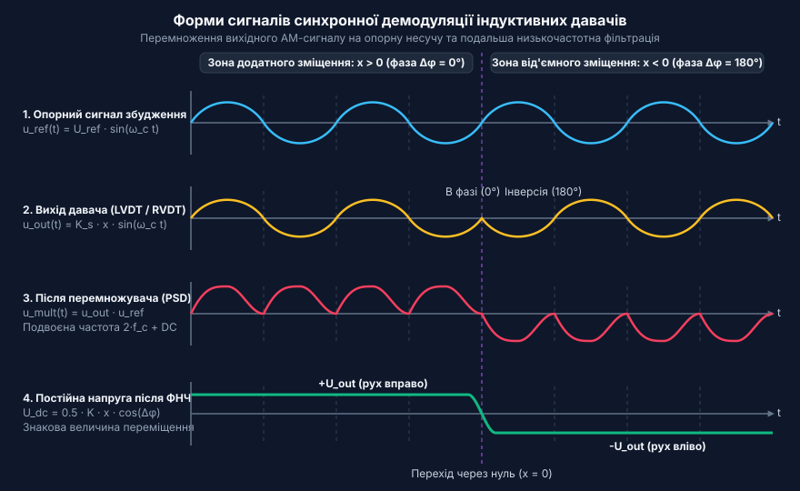
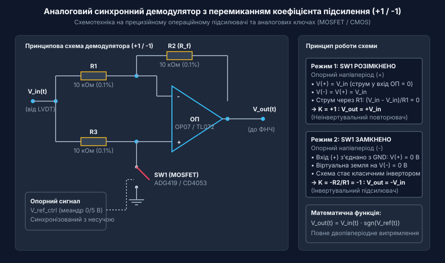
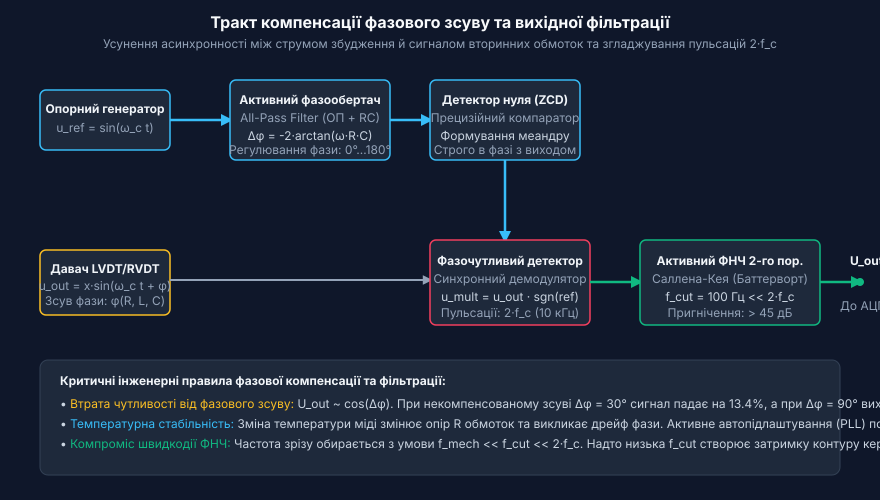
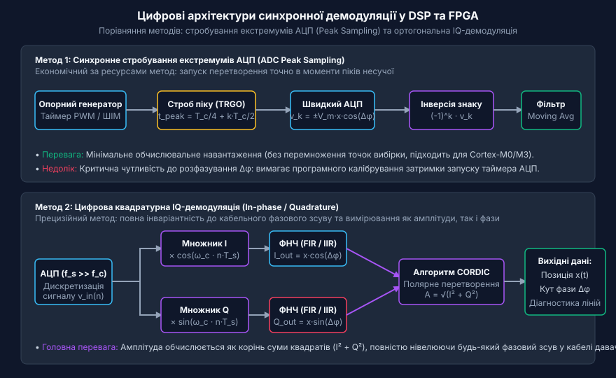

# Синхронне детектування та фазочутлива демодуляція давачів положення

<preknowlist>
- [Лінійні змінні диференціальні трансформатори LVDT](root:cat-hw-sensors/lvdt-linear-variable-differential-transformers) — Принцип формування амплітудно-модульованих сигналів у вторинних обмотках та стрибок фази на 180° при переході через нуль.
- [Сельсини та резольвери: обертові трансформаторні кутоміри](root:cat-hw-sensors/synchro-and-resolver-transducers) — Фізичний принцип обмоточного зсуву та вихідні синусно-косинусні сигнали збудження обертових трансформаторів.
</preknowlist>

## Проблема амплітудної детекції індуктивних давачів

У високоточних системах промислового керування, робототехніці, верстатах з ЧПК та авіації вимірювання лінійних і кутових переміщень спирається на індуктивні (від лат. @@la|inductio@@ — наведення, спонукання) перетворювачі. Найпоширенішими серед них є [диференціальні трансформатори LVDT](root:cat-hw-sensors/lvdt-linear-variable-differential-transformers) та [обертові трансформаторні кутоміри](root:cat-hw-sensors/synchro-and-resolver-transducers). На відміну від оптичних чи магнітних енкодерів, які видають дискретний цифровий код, індуктивний давач є пасивним електромагнітним пристроєм трансформаторного типу. Його первинна обмотка живиться змінним струмом генератора збудження `u_ref(t) = U_ref · sin(ω_c t)` з несучою частотою `ω_c` (зазвичай від 1 кГц до 10 кГц). Магнітний потік первинної обмотки замикається через рухоме феромагнітне осердя та наводить ЕРС у двох вторинних обмотках, які ввімкнені послідовно-зустрічно (диференційна схема). Коли осердя знаходиться точно по центру — у нульовій позиції (@@en|null point@@) — ЕРС вторинних обмоток рівні за величиною та протилежні за напрямком, тому сумарна вихідна напруга дорівнює нулю. Зсув осердя від нульового положення порушує магнітну симетрію: амплітуда вихідної напруги зростає пропорційно величині переміщення `x`, а її фаза визначається напрямком руху осердя відносно центру.

Найпростішим та найбільш інтуїтивним рішенням для перетворення вихідного змінного сигналу давача у постійну напругу, зрозумілу для мікроконтролера чи АЦП, здається ззвичайний амплітудний детектор (від лат. @@la|detectio@@ — виявлення, розкриття) на основі діодного містка або пікового детектора (@@en|peak detectors@@) зі згладжувальним конденсатором. Проте спроба застосувати класичну амплітудну детекцію для індуктивних давачів положення створює фундаментальну інженерну проблему: повну втрату інформації про знак напрямку зміщення відносно нуля та катастрофічне падіння завадостійкості вимірювального тракту.

Фізична причина втрати напрямку руху полягає у тому, що будь-який діодний випрямляч чи піковий детектор реалізує математичну операцію взяття абсолютного значення (модуля) миттєвої напруги `|u_out(t)|`. Розглянемо поведінку вихідного сигналу при зміщенні осердя в протилежні боки від нульової позиції. Коли осердя зміщується вправо на `x = +5 мм`, вихідний синусоїдний сигнал `u_out(t)` перебуває в однаковій фазі з напругою збудження `u_ref(t)`, і піковий детектор випрямляє його у позитивну постійну напругу `+2.5 В`. Якщо ж перемістити осердя вліво на `x = -5 мм`, амплітуда вихідного сигналу залишається точно такою ж (`2.5 В`), але сам синусоїдний сигнал виявиться зсунутим за фазою на 180° відносно напруги збудження (`sin(ω_c t + 180°) = -sin(ω_c t)`). Оскільки діодний міст випрямляє як додатні, так і від'ємні півхвилі однакову кількість разів за період, вихідна напруга амплітудного детектора знову дорівнюватиме `+2.5 В`. У результаті вихідна статична характеристика амплітудного детектора має V-подібну форму `U_out = k · |x|`, симетричну відносно нуля. Вимірювальна система бачить однакову напругу як при `+5 мм`, так і при `-5 мм`, втрачаючи здатність розрізняти знак зміщення. Це унеможливлює використання амплітудного детектора в замкнених контурах сервоприводів, де система керування мусить чітко знати не лише величину, а й напрямок відхилення від заданої точки.

Окрім втрати знака, амплітудна детекція демонструє вкрай низьку завадостійкість і нелінійність біля нульової точки. По-перше, пряме падіння напруги на напівпровідникових діодах (0.3 В – 0.7 В для кремнієвих діодів і 0.2 В – 0.3 В для діодів Шотткі) утворює широку зону нечутливості (@@en|dead band@@) навколо нуля. При малих зміщеннях осердя (наприклад, `±10 мкм`) амплітуда вихідного AC-сигналу виявляється меншою за поріг відкривання діодів, і випрямляч взагалі не реагує на рух. По-друге, накопичувальний конденсатор пікового детектора реагує на найвище миттєве значення напруги в колі. Будь-який імпульсний шум, електромагнітна завада від силових ключів інвертора або високовольтний сплеск, наведений на довгому сигнальному кабелі, миттєво заряджає конденсатор до пікового значення завади. Оскільки розряд конденсатора відбувається повільно через навантажувальний резистор, вихідна напруга тривалий час залишається викривленою, створюючи хибні показання положення та дрейф нуля.

Історичний шлях виділення напрямку зміщення розпочався з електромеханічних віброперетворювачів (@@en|mechanical choppers@@) та діодних кільцевих мостів (@@en|diode ring demodulators@@), які механічно чи комутаційно узгоджували полярність випрямлення з фазою опорного струму в авіаційних автопілотах та промислових приладах. Із розвитком напівпровідникової техніки їм на зміну прийшли підсилювачі з перемиканням коефіцієнта підсилення (@@en|switched-gain amplifiers@@) на дискретних польових транзисторах та інтегральні аналогові перемножувачі на комірках Ґілберта (@@en|Gilbert cell analog multipliers@@), що суттєво підвищили лінійність та швидкодію. Сучасний етап полягає у переході до цифрової сигнальної обробки (@@en|DSP@@) та синхронного вибіркового оцифрування АЦП (@@en|ADC peak sampling@@), де фазочутливе детектування здійснюється програмними алгоритмами, виключаючи температурний дрейф аналогових компонентів і забезпечуючи граничну завадостійкість вимірювань.

Єдиним способом подолання названих обмежень є збереження та використання фазової інформації вихідного сигналу за допомогою фазочутливого детектування (@@en|phase-sensitive detection@@, @@en|PSD@@), або синхронної демодуляції (від лат. @@la|de-@@ — префікс скасування та @@la|modulatio@@ — розміреність; від грец. @@el|σύγχρονος@@: @@el|συν-@@ — разом та @@el|χρόνος@@ — час). Її сутність полягає у тому, що випрямлення відбувається не хаотично за амплітудою, а в суворій синхронізації з фазою (від грец. @@el|φάσις@@ — поява, вигляд) опорного сигналу збудження, що дає змогу одночасно виділити знак переміщення та пригнічити будь-які несинхронні завади.

## Математика та принцип фазочутливого множення

Математична модель синхронного детектування (@@en|synchronous demodulation@@) базується на операції перемноження вихідного амплітудно-модульованого сигналу індуктивного давача на опорний синусоїдний сигнал з подальшим виділенням постійної складової за допомогою фільтра нижніх частот (@@en|low-pass filters@@).

Розглянемо аналітичний вивід вихідного сигналу. Нехай первинна обмотка давача живиться від генератора опорною напругою збудження:

```
u_ref(t) = U_ref · sin(ω_c t)
```

де `U_ref` — пікова амплітуда напруги збудження, а `ω_c = 2π f_c` — кругова несуча частота.

У реальних [обертових змінних диференціальних трансформаторах](root:cat-hw-sensors/rvdt-rotary-variable-differential-transformers) та LVDT вихідний сигнал вторинних обмоток `u_out(t)` є модульованим по амплітуді величиною зміщення `x(t)` і має власне фазове зсунення `φ` відносно напруги збудження. Цей фазовий зсув виникає через комплексний опір обмоток (активний опір дротів `R` та індуктивність `L`), а також паразитною ємністю з'єднувального кабелю:

```
u_out(t) = K_s · x(t) · U_ref · sin(ω_c t + φ)
```

де `K_s` — коефіцієнт чутливості давача, а `x(t)` — алгебраїчне зміщення осердя, яке може бути додатним (`x > 0`), дорівнювати нулю (`x = 0`) або бути від'ємним (`x < 0`). Коли `x < 0`, вираз `x(t)` вносить від'ємний знак, що математично еквівалентно додатковому фазовому зсуву на 180° (`-sin(α) = sin(α + π)`).

У фазочутливому демодуляторі вихідний сигнал `u_out(t)` подається на аналоговий або цифровий перемножувач, де множиться на опорну напругу демодулятора `u_demod(t) = U_d · sin(ω_c t + φ_ref)` з підлаштованою фазою `φ_ref`. Процес перемноження описується ланцюжком перетворень:

```
u_mult(t)
= u_out(t) · u_demod(t)
= K_s · x(t) · U_ref · sin(ω_c t + φ) · U_d · sin(ω_c t + φ_ref)     [перемноження вихідного та опорного сигналів]
= K_mult · x(t) · sin(ω_c t + φ) · sin(ω_c t + φ_ref)                 [позначення K_mult = K_s · U_ref · U_d]
= K_mult · x(t) · 0.5 · [cos(φ - φ_ref) - cos(2 ω_c t + φ + φ_ref)]   [застосування тотожності sin(A)sin(B) = 0.5(cos(A-B) - cos(A+B))]
```

Результат перемноження `u_mult(t)` містить дві принципово різні складові:

1. Низькочастотний корисний сигнал `0.5 · K_mult · x(t) · cos(φ - φ_ref)`, амплітуда якого прямо пропорційна зміщенню `x(t)` та косинусу різниці фаз `Δφ = φ - φ_ref`. 2. Високочастотну складову `-0.5 · K_mult · x(t) · cos(2 ω_c t + φ + φ_ref)` з подвоєною несучою частотою `2 ω_c` (@@en|carrier frequency ripple@@).


*Діаграми сигналів у часовій області: перемноження АМ-сигналу давача на опорну несучу створює пульсуючу напругу з постійною складовою, знак якої відповідає напрямку зміщення, а фільтрація нижніх частот виділяє точну величину переміщення.*

Після проходження сигналу через фільтр нижніх частот із частотою зрізу `f_cut << 2 f_c` складова з подвоєною частотою повністю пригнічується, і на виході вимірювального тракту залишається постійна (або повільно змінювана) напруга:

```
U_out(x)
= 0.5 · K_mult · x(t) · cos(Δφ)      [профільтрована вихідна напруга при Δφ = φ - φ_ref]
```

Аналіз залежності вихідної напруги від різниці фаз `Δφ = φ - φ_ref` розкриває вирішальну роль фазового узгодження:

- Повне фазове узгодження (`Δφ = 0`): `cos(0) = +1`. Напруга дорівнює `U_out = 0.5 · K_mult · x(t)`. Якщо `x > 0` (зміщення вправо), `U_out > 0`. Якщо `x < 0` (зміщення вліво), `U_out < 0`. Знакова залежність є строго лінійною і проходить через нуль без жодної dead-зони! - Протифазний режим (`Δφ = 180°`): `cos(180°) = -1`. Знак вихідної напруги інвертується. - Квадратурна розфазовка (`Δφ = 90°`): `cos(90°) = 0`. Вихідна напруга повністю дорівнює нулю (`U_out = 0`) незалежно від величини механічного переміщення осердя `x`!

Через це компенсація фазового зсуву (@@en|phase shift compensation@@) між напругою збудження та вихідним сигналом є найважливішим завданням розробки схемотехніки. У реальних системах, як-от [аналоговому фронтенді LVDT](root:cat-hw-sensors/lvdt-analog-front-end) чи [сигнальних мікросхемах AD698](root:cat-hw-sensors/ad698-signal-conditioner), опорний сигнал пропускають через регульований фазообертач або схему автопідлаштування фази (@@en|phase-locked loop@@, @@en|PLL@@). Крім того, некомпенсований фазовий зсув `Δφ ≠ 0` призводить до температурної нестабільності: при зміні температури активний опір мідних обмоток `R(T)` змінюється, змінюючи кут `φ`, що за наявності `cos(Δφ)` спричиняє температурний дрейф коефіцієнта підсилення всього давача.

Математичний аналіз також пояснює колосальну завадостійкість фазочутливого множення. Припустимо, що в сигнальний тракт проникла зовнішня синусоїдна завада `n(t) = U_n · sin(ω_n t + θ_n)` із довільною частотою `ω_n ≠ ω_c` (наприклад, наводка від мережі 50 Гц або випромінювання від силового перетворювача). Множення цієї завади на опорний сигнал демодулятора дає:

```
u_n_mult(t)
= U_n · sin(ω_n t + θ_n) · U_d · sin(ω_c t + φ_ref)
= 0.5 · U_n · U_d · [cos((ω_n - ω_c) t + θ_n - φ_ref) - cos((ω_n + ω_c) t + θ_n + φ_ref)]
```

Результатом є дві гармонічні складові з різницевою частотою `|ω_n - ω_c|` та сумарною частотою `ω_n + ω_c`. Якщо різниця частот перевищує смугу пропускання фільтра нижніх частот (`|ω_n - ω_c| > 2π f_cut`), обоє гармонік зрізаються ФНЧ до нульового рівня. Демодулятор працює як надвузькосмуговий фільтр із смугою пропускання `[f_c - f_cut, f_c + f_cut]`, центрований точно на частоту збудження `f_c`. Усі завади поза цією вузькою смугою послаблюються на 60–80 дБ.

Сучасні пристрої, такі як [перетворювачі резольвер-код](root:cat-hw-sensors/resolver-to-digital-converters), реалізують алгоритми демодуляції у цифровому вигляді на сигнальних процесорах. Більш детальний аналіз вищих гармонік, впливу несинусоїдального збудження та розрахунку фільтрів наведено у [математичному аналізі демодуляції](root:cat-hw-sensors/synchronous-demodulation-for-inductive-transducers/math-synchronous-demodulation-signals-and-filtering.md).

## Схемотехніка аналогових фазочутливих детекторів

При випрямленні вихідного амплітудно-модульованого сигналу індуктивних давачів звичайними діодними мостами втрачається фазовий знак напрямку зміщення, а падіння напруги на діодах створює зону нечутливості поблизу нульової позиції. Щоб зберегти точний напрямок руху та лінійність, аналоговий фазочутливий детектор здійснює математичну операцію множення вхідного сигналу давача на опорну напругу збудження. У схемотехніці це завдання вирішують двома основними способами: перемиканням коефіцієнта підсилення між значеннями `+1` та `-1` за допомогою керованих аналогових ключів або безперервним чотириквадрантним множенням на транзисторних аналогових перемножувачах.

Найпоширенішою топологією для дискретної реалізації є підсилювачі з перемиканням коефіцієнта підсилення (від англ. @@en|switched-gain amplifiers@@, з лат. *amplificatio* — розширення). Така схема складається з одного операційного підсилювача (ОП) та двох напівпровідникових ключів на польових транзисторах (MOSFET або CMOS-комутаторах серії CD4053 чи ADG419).

Упродовж позитивної напівхвилі опорного сигналу несучої частоти один ключ замикає неінвертувальний вхід ОП на землю або комутує вхідний сигнал таким чином, що каскад працює як неінвертувальний повторювач із коефіцієнтом підсилення `K = +1`. Під час негативної напівхвилі опорного сигналу ключі змінюють стан, перетворюючи схему на інвертувальний підсилювач із `K = -1`.


*Схема синхронного демодулятора (+1/-1) на операційному підсилювачі та польових транзисторах для випрямлення фазочутливого сигналу.*

Оскільки керування ключами здійснюється прямокутним меандровим сигналом, ця операція еквівалентна множенню вхідної синусоїди на знаковий прямокутний сигнал `sgn(sin(2 π f_c t))`. Розклад такого меандру у ряд Фур'є містить вищі непарні гармоніки:

```text
S_ref(t) = (4 / π) · (sin(2 π f_c t) + (1 / 3) · sin(6 π f_c t) + (1 / 5) · sin(10 π f_c t) + ...)  [розклад прямокутного опорного сигналу у ряд Фур'є]
```

Через наявність гармонік `3 f_c`, `5 f_c` підсилювач із перемиканням чутливий до завад на цих вищих частотах. Проте ця схема характеризується низькою вартістю, простим налаштуванням та високою температурною стабільністю коефіцієнта підсилення, який визначається виключно прецизійними резисторами обв'язки. Покроковий розрахунок та випробування подібного каскаду наведено у [практичному проєкті демодулятора](root:cat-hw-sensors/synchronous-demodulation-for-inductive-transducers/proj-analog-switched-gain-lvdt-demodulator.md).

Для роботи на високих частотах (від сотень кілогерц до мегагерц), де операційні підсилювачі втрачають швидкодію, використовують діодні кільцеві демодулятори (від англ. @@en|diode ring demodulators@@, з грец. *di-ode* — двоелектродний шлях). Схема будується на чотирьох підібраних діодах Шотткі, з'єднаних у кільцевий міст, та двох симетричних високочастотних трансформаторах з відводами від середини обмоток. Потужний опорний сигнал подається у середні точки трансформаторів і почергово відкриває діагональні пари діодів, виконуючи функцію пасивного високочастотного комутатора.

Кільцеві діодні мости забезпечують винятково широку смугу пропускання та низький рівень власних шумив. Основні недоліки цієї топології — потреба в значній потужності генератора збудження для переключення діодів, а також висока чутливість до температурного дрейфу прямої напруги діодів, що вимагає ретельного підбору компонентів моста.

Коли вимагається найвища лінійність і повне пригнічення вищих гармонік, застосовують аналогові перемножувачі на базі комірок Ґілберта (від англ. @@en|Gilbert cell analog multipliers@@). Ця топологія являє собою перехресно зв'язане деревце з шести транзисторів, у якому нижній диференціальний каскад керується вхідним сигналом, а два верхніх паралельних каскади комутуються опорною напругою.

На відміну від підсилювачів із перемиканням `+1/-1`, комірка Ґілберта виконує безперервне чотириквадрантне множення двох аналогових синусоїдальних сигналів:

```text
V_out(t) = K · V_in(t) · V_ref(t)
         = K · [A · sin(2 π f_c t + Δφ)] · [V_m · sin(2 π f_c t)]       [вирази вхідного та опорного сигналів]
         = (K · A · V_m / 2) · [cos(Δφ) - cos(4 π f_c t + Δφ)]          [тригонометричне перетворення добутку синусів]
```

Оскільки множення здійснюється чисто синусоїдальним опорним сигналом, у вихідному спектрі відсутні паразитичні складові на непарних гармоніках, а подвоєна несуча `4 π f_c t` легко видаляється фільтром нижніх частот.

Застосування комірки Ґілберта у спеціалізованих мікросхемах, таких як [чипи серії AD698](root:cat-hw-sensors/ad698-signal-conditioner), дозволяє досягти нелінійності перетворення менше `0.05%` у широкому температурному діапазоні. Електричні параметри та схема підключення таких систем наведені в матеріалі про [інтерфейс аналогового фронтенду](root:cat-hw-sensors/synchronous-demodulation-for-inductive-transducers/api-analog-synchronous-demodulation-front-end.md).

Порівняльний аналіз розглянутих топологій визначає їхню практичну нішу. Схеми на аналогових ключах і ОП є стандартом для промислових давачів [групи трансформаторів LVDT](root:cat-hw-sensors/lvdt-linear-variable-differential-transformers) із частотами збудження від 1 кГц до 10 кГц. Інтегральні перемножувачі Ґілберта застосовуються у високоточних вимірювальних трактах авіаційних давачів типу [кутових трансформаторів RVDT](root:cat-hw-sensors/rvdt-rotary-variable-differential-transformers). Діодні кільцеві мости є оптимальним вибором для високочастотних індуктивних давачів спецтехніки.

## Компенсація фазового зсуву та вихідна фільтрація

Первинні індуктивні перетворювачі — зокрема [диференціальні трансформатори LVDT](root:cat-hw-sensors/lvdt-linear-variable-differential-transformers) та [обертові трансформаторні кутоміри](root:cat-hw-sensors/synchro-and-resolver-transducers) — володіють власною індуктивністю обмоток `L` та активним опором `R`. У поєднанні з паразитною ємністю з'єднувальних кабелів `C_line` вони створюють комплексний імпеданс, який зсуває фазу вихідного сигналу відносно генератора збудження на кут `θ`.

З математичної моделі перемноження випливає, що постійна складова вихідної напруги демодулятора безпосередньо залежить від косинуса різниці фаз:

```text
V_dc = V_max · cos(Δφ)   [залежність постійної складової від фазового зсуву]
```

За точного збігу фаз (`Δφ = 0°`) косинус дорівнює одиниці (`cos(0°) = 1`), і демодулятор забезпечує максимальний вихідний сигнал. Проте якщо через зміну температури обмоток або довжини кабелю виникає зсув `Δφ = 30°`, амплітуда вихідної напруги зменшується до `cos(30°) ≈ 0.866`, що викликає похибку вимірювання `13.4%`. При ортогональному зсуві `Δφ = 90°` корисний сигнал повністю зникає (`cos(90°) = 0`). Тому компенсація фазового зсуву (від англ. @@en|phase shift compensation@@, з лат. *compensatio* — зрівноваження) є критичним елементом вимірювального тракту.


*Тракт фазового підлаштування та фільтрації нижніх частот для виділення постійної складової сигналу давача.*

Для усунення розфазування в аналогових вимірювальних трактах застосовують кілька схемотехнічних рішень:

1. **Активні фазообертачі на ОП (All-Pass Filters)**. Схема на ОП із регульованим RC-ланцюгом дозволяє зсувати фазу опорного сигналу від `0°` до `-180°` без зміни його амплітуди. Зсув фази розраховується за формулою:

```text
φ(f) = -2 · arctan(2 π f · R · C)   [фазовий зсув активного фазообертача]
```

Шляхом підлаштування резистора `R` досягають точної синхронізації фаз опорного сигналу та вихідної напруги давача.

2. **Детектори нуля та схемна затримка**. Детектори нуля (від англ. @@en|zero-crossing detectors@@) перетворюють синусоїдальний сигнал збудження на прямокутний імпульс за допомогою швидкого компаратора, після чого регульована схема затримки на моновибраторі підганяє фронт перемикання демодулятора під пік вихідного сигналу.

3. **Схеми автопідлаштування фази (PLL)**. В автономних та високоточних системах застосовують контур автопідлаштування фази (від англ. @@en|phase-locked loop@@, @@en|PLL@@, з лат. *phasis* — поява). Контур PLL підлаштовує опорний сигнал до фази вихідної напруги давача, усуваючи вплив температурного дрейфу та старіння компонентів. Детальні виведення для аналізу фазових співвідношень подано у матеріалі про [математичному аналізі детектування](root:cat-hw-sensors/synchronous-demodulation-for-inductive-transducers/math-synchronous-demodulation-signals-and-filtering.md).

Після проходження перемножувача демодульований сигнал містить дві складові: низькочастотну постійну напругу, що відповідає вимірюваному переміщенню, та високочастотну змінну напругу на подвоєній несучій частоті `2 f_c` — пульсації несучої (від англ. @@en|carrier frequency ripple@@). Для виділення корисного сигналу застосовують активні фільтри нижніх частот (від англ. @@en|low-pass filters@@).

Головне завдання ФНЧ — ефективне пригнічення пульсацій `2 f_c` при мінімальному фазовому запізненні у смузі механічних переміщень `f_mech`. Якщо несуча частота давача становить `f_c = 5 кГц`, подвоєна несуча дорівнює `2 f_c = 10 кГц`. Для механічного руху з частотою до `100 Гц` фільтр має забезпечувати пригнічення частоти `10 кГц` не менше ніж на `40–50 дБ`.

Стандартом побудови вихідних фільтрів є активний ФНЧ 2-го порядку топології Саллена-Кея з характеристикою Баттерворта, яка забезпечує максимально плоску АЧХ у смузі пропускання:

```text
f_0 = 1 / (2 π · √(R_1 · R_2 · C_1 · C_2))   [частота зрізу ФНЧ Саллена-Кея]
Q = √(R_1 · R_2 · C_1 · C_2) / (C_2 · (R_1 + R_2)) [добротність фільтра]
```

Для фільтра Баттерворта обирають `Q = 0.707` (`1 / √2`), що запобігає виникненню викидів АЧХ поблизу частоти зрізу.

Обчислення компонентів активного фільтра реалізується програмними функціями розрахунку:

:::tabs
:::code synchronous-demodulation-for-inductive-transducers-d/c/calculate-sallen-key-butterworth.c
<!-- slide -->
:::code synchronous-demodulation-for-inductive-transducers-d/cpp/sallenkeybutterworthfilter.cpp
:::

Вибір частоти зрізу ФНЧ визначається компромісом між рівнем пригнічення пульсацій та фазовим лагом системи. Занадто низька частота зрізу ефективно видаляє пульсації, але викликає затримку відгуку в десятки мілісекунд, що може порушити стійкість швидкісного контуру сервоприводу. Збільшення частоти зрізу зменшує фазову затримку, але вимагає використання ФНЧ вищих порядків.

Спеціалізовані рішення на базі мікросхем кондиціонування, таких як [інтегральний фронтенд LVDT](root:cat-hw-sensors/lvdt-analog-front-end) та [перетворювачі RDC](root:cat-hw-sensors/resolver-to-digital-converters), пропонують вбудовані активні фільтри з можливістю зовнішнього програмування смуги пропускання.

## Цифрові методи синхронної демодуляції в DSP

Аналогова схемотехніка фазочутливих демодуляторів дає змогу виділити напрямок та величину зміщення, проте вона має природні фізичні обмеження. Аналогові ключі, операційні підсилювачі та активні фільтри схильні до температурного дрейфу нуля, старіння компонентів та нелінійностей при малих амплітудах вихідного сигналу. Крім того, зміна фазового зсуву через прогрів обмоток давача або зміну довжини кабелю вимагає апаратного підлаштування фазообертачів. Цифрова синхронна демодуляція (@@en|digital synchronous demodulation@@) усуває ці проблеми за рахунок перенесення процесу множення та фільтрації у цифрову область обчислителя — сигнального процесора (@@en|digital signal processor@@, @@en|DSP@@) або ПЛІС (@@en|field-programmable gate array@@, @@en|FPGA@@).

Перехід до цифрової обробки починається з оцифрування вихідного аналогового сигналу давача за допомогою аналого-цифрового перетворювача (@@en|analog-to-digital converter@@, @@en|ADC@@). Проте пряме безперервне оцифрування з наступним цифровим множенням на гармонічну несучу вимагає високої частоти дискретизації АЦП та суттєвих ресурсів для цифрової фільтрації. Для оптимізації обчислень у цифрових системах застосовують два основних підходи: пікове стробування вибірок та квадратурну IQ-демодуляцію.

Метод пікового стробування вибірок АЦП (@@en|ADC peak sampling@@) базується на вибірці сигналу в точно визначені моменти часу. Оскільки опорний сигнал збудження є синусоїдою відомої частоти, його екстремуми (максимуми та мінімуми) припадають на моменти часу, коли значення амплітуди досягає піку. Якщо АЦП запускається синхронно з опорним генератором саме в моменти цих піків, аналогово-цифрове перетворення виконується у точках, де вихідний амплітудно-модульований сигнал має найбільший рівень.

Математично цей процес можна описати через аналіз значення вибірки. Якщо вихідний сигнал давача описується виразом:

```
v_out(t) = V_m · x(t) · sin(ω · t + Δφ)
```

де `V_m` — масштабний коефіцієнт, `x(t)` — нормоване переміщення ядра, `ω` — кругова частота збудження, а `Δφ` — фазовий зсув, то в момент піку несучої без урахування фазового зсуву (`ω · t = π/2 + k · π`) значення синуса дорівнює `+1` або `-1`. Відповідно, оцифрована вибірка `v_k` безпосередньо пропорційна величині зміщення `x(t)`, а її знак визначається напівперіодом несучої:

```
v_k = V_m · x(t) · (-1)ᵏ
```

Для виділення корисного сигналу обчислювальному ядру достатньо змінити знак кожної непарної вибірки на протилежний та застосувати простий ковзний цифровий фільтр низьких частот (@@en|low-pass filters@@). Це виключає потребу у виконанні операцій ресурсомісткого цифрового множення для кожної точки відліку.

Проте при застосуванні пікового стробування виникає критична пастка: наявність фазового зсуву `Δφ` між напругою збудження та вихідним сигналом давача. Якщо АЦП здійснює вибірку в момент піку опорного генератора збудження, а вихідний сигнал давача затриманий на кут `Δφ`, значення вибірки буде меншим від реального пікового значення на фактор `cos(Δφ)`:

```
v_k = V_m · x(t) · cos(Δφ) · (-1)ᵏ
```

Якщо фазовий зсув сягає 90°, вибірка припаде на нульове значення вихідної синусоїди, і демодульований сигнал повністю зникне, незалежно від реального переміщення об'єкта. Для подолання цього ефекту в системах з піковим стробуванням застосовують апаратну або програмну затримку моменту запуску АЦП. Затримка налаштовується так, щоб строб вибірки збігався з реальним екстремумом вихідного сигналу давача, що досягається за допомогою апаратного детектора нуля чи програмного таймера-тригера.

Коли фазовий зсув `Δφ` змінюється під впливом температури або деградації кабельної лінії, пікове стробування вимагає постійної адаптації затримки. У таких умовах найточнішим та найстійкішим рішенням є цифрова квадратурна демодуляція (@@en|IQ demodulation@@).

При квадратурній демодуляції оцифрований сигнал давача `v_out(t)` розділяється на два паралельні обчислювальні канали та множиться на дві ортогональні опорні послідовності: синфазну (In-phase, `I`) та квадратурну (Quadrature, `Q`). Синфазна опорна послідовність відповідає `cos(ω · t)`, а квадратурна — `sin(ω · t)`.


*Структурна схема цифрового синхронного детектора з підсистемами пікового вибіркового оцифрування (ADC peak sampling) та квадратурної обробки (IQ demodulation).*

У результаті перемноження та подальшої цифрової фільтрації ФНЧ формуються дві постійні складові:

```
I_out = (V_m / 2) · x(t) · cos(Δφ)      [синфазна складова]
Q_out = (V_m / 2) · x(t) · sin(Δφ)      [квадратурна складова]
```

Отримані значення дозволяють обчислити повну амплітуду корисного сигналу `A` та поточний фазовий зсув `Δφ` безпосередньо у цифровому вигляді:

```
A = √((I_out)² + (Q_out)²)              [повна амплітуда сигналу]
Δφ = atan2(Q_out, I_out)               [поточний фазовий зсув]
```

Знак напрямку переміщення відносно нульової позиції (@@en|null point@@) визначається за знаком синфазної складової `I_out` або аналізом фазового кута `Δφ`. Головна перевага IQ-демодуляції полягає у повній незалежності обчислення амплітуди від амплітудно-фазових спотворень у кабелі: навіть при фазовому зсуві 90° амплітуда `A` обчислюється абсолютно точно, оскільки вся енергія сигналу переходить у квадратурний канал `Q_out`.

Особливо ефективним є застосування IQ-демодуляції для обробки сигналів [сімейства резольверів](root:cat-hw-sensors/synchro-and-resolver-transducers). У резольверах вихідні сигнали вторинних обмоток самі по собі формують синусно-косинусний квадратурну пару. Цифрова обробка в DSP дозволяє розрахувати кут повороту ротора за допомогою алгоритму CORDIC або арктангенса співвідношення сигналів з повною компенсацією амплітудних коливань генератора збудження.

Для реалізації цих алгоритмів у ПЛІС чи мікроконтролерах розробники спираються на готову апаратно-програмну архітектуру. Практичні аспекти проєктування обчислювальних модулів розкрито у проєкті з [цифровій квадратурній демодуляції](root:cat-hw-sensors/synchronous-demodulation-for-inductive-transducers/proj-digital-iq-demodulator-fpga-dsp.md), а деталі побудови низькорівневого програмного коду для DSP наведено у довіднику [програмного інтерфейсу DSP](root:cat-hw-sensors/synchronous-demodulation-for-inductive-transducers/api-digital-psd-dsp-firmware-module.md).

## Інтеграція демодуляторів у промислові вимірювальні тракти

Побудова промислового вимірювального тракту на основі індуктивних та трансформаторних давачів вимагає системного підходу до узгодження електричних рівнів, захисту від завад та температурної стабілізації. У реальних умовах промислових підприємств давачі положення часто віддалені від контролера на десятки чи сотні метрів. Довгі кабельні лінії створюють суттєву паразитичну ємність та індуктивність, а також піддаються впливу потужних електромагнітних завад від частотних перетворювачів серводвигунів, контакторів та силових трансформаторів.

Для створення надійного вимірювального каналу широко застосовують спеціалізовані аналогові інтегральні мікросхеми кондиціонування сигналу. Класичним прикладом таких рішень є [мікросхеми AD698](root:cat-hw-sensors/ad698-signal-conditioner), а також профільні рішення на базі [аналоговому фронтенді LVDT](root:cat-hw-sensors/lvdt-analog-front-end).

Головною перевагою мікросхеми AD698 є реалізація відносного (раціометричного) методу вимірювання. Внутрішня структура мікросхеми містить вимірювальний генератор збудження та два незалежні синхронні демодулятори: один підключений до первинної обмотки давача (або суми вторинних обмоток), а другий — до диференціального виходу вторинних обмоток. Мікросхема обчислює відношення вихідного демодульованого сигналу `V_diff` до опорного сигналу первинної обмотки `V_ref`:

```
V_out = V_diff / V_ref
```

Така математична обробка усуває залежність вихідного сигналу від зміни амплітуди напруги збудження, викликаного температурним дрейфом опору первинної обмотки давача або коливанням живлення генератора. Це гарантує високу стабільність нульової позиції та постійний коефіцієнт передачі вимірювального тракту при побудові систем на базі [диференціальних трансформаторів LVDT](root:cat-hw-sensors/lvdt-linear-variable-differential-transformers).

При роботі з обертовими трансформаторами та резольверами аналоговий фронтенд часто спрягають зі спеціалізованими слідкуючими інтегральними перетворювачами — [перетворювачах RDC](root:cat-hw-sensors/resolver-to-digital-converters) (Resolver-to-Digital Converters). Перетворювач RDC інтегрує в собі аналогову схему фазочутливої демодуляції та цифровий замкнений контур слідкування (Type II tracking loop). Внутрішній демодулятор RDC множить синусно-косинусні сигнали резольвера на внутрішню оцінку кута, виділяючи помилку фази. Потім контур слідкування зводить цю помилку до нуля, генеруючи високоточний цифровий код кутового положення та швидкості обертання без затримок, характерних для звичайних фільтрів нижніх частот.

Завадостійкість вимірювального тракту визначається не лише топологією демодулятора, а й правильним фізичним підключенням. Сигнали вторинних обмоток давача необхідно передавати через екрановані виті пари у режимі диференційного підключення. Це забезпечує високий коефіцієнт пригнічення синфазних завад (@@en|common-mode rejection ratio@@, @@en|CMRR@@), оскільки зовнішні електромагнітні наводки наводяться на обидва провідники лінії однаково та взаємно компенсуються на диференційному вході підсилювача.

Для запобігання виникненню земляних петель (@@en|ground loops@@), що спричиняють низькочастотну наводку 50 Гц та імпульсні завади від силового обладнання, екран кабелю повинен заземлюватися лише з одного боку — як правило, з боку вимірювального блоку або аналогового фронтенду. У критичних застосуваннях використовують гальванічну розв'язку сигнальних кіл за допомогою вимірювальних трансформаторів або ізольованих операційних підсилювачів.

Критичним етапом проєктування є розрахунок активного фільтра нижніх частот (ФНЧ) на виході демодулятора. Фільтр виконує дві протилежні задачі: пригнічення пульсацій подвоєної несучої частоти (@@en|carrier frequency ripple@@) та забезпечення необхідної динамічної смуги пропускання корисного сигналу переміщення. Частоту зрізу ФНЧ `f_c` обирають за компромісним критерієм:

```
f_sig_max << f_c << 2 · f_carr
```

де `f_sig_max` — максимальна частота зміни механічного переміщення об'єкта, а `f_carr` — несуча частота збудження давача. Зазвичай частоту зрізу ФНЧ розраховують на рівні `(0.1 ... 0.2) · f_carr`, що забезпечує пригнічення подвоєної несучої на 30–40 дБ при використанні фільтра Баттерворта або Чебишева 2-го порядку.

Докладніші правила математичного розрахунку смуги пропускання та параметрів фільтрації наведено у матеріалі з [математичного аналізу демодуляції](root:cat-hw-sensors/synchronous-demodulation-for-inductive-transducers/math-synchronous-demodulation-signals-and-filtering.md), а схемотехнічне розведення аналогової плати демодулятора детально розглянуто у проєкті з побудови [дискретного аналогового демодулятора](root:cat-hw-sensors/synchronous-demodulation-for-inductive-transducers/proj-analog-switched-gain-lvdt-demodulator.md) та довіднику [апаратного аналогового фронтенду](root:cat-hw-sensors/synchronous-demodulation-for-inductive-transducers/api-analog-synchronous-demodulation-front-end.md).

При виборі датчиків для промислових сервоприводів та систем автоматики розробники порівнюють індуктивні давачі з альтернативними технологіями, такими як [оптичні та магнітні енкодери](root:cat-hw-sensors/optical-and-magnetic-encoders), [магнітний енкодер AS5048](root:cat-hw-sensors/as5048-magnetic-encoder) або [магніторезистивні сенсори AMR](root:cat-hw-sensors/amr-gmr-tmr-magnetic-sensors). Оптичні та магнітні енкодери забезпечують вищу цифрову роздільну здатність та простіший цифровий інтерфейс. Проте у надсуворих умовах експлуатації — за наявності сильних вібрацій, високої температури (понад 150 °C), радіаційного випромінювання чи сильного пилового забруднення — індуктивні давачі з синхронною демодуляцією лишаються єдиним безальтернативним рішенням завдяки своїй високій надійності та відсутності крихких оптичних чи напівпровідникових елементів безпосередньо у зоні вимірювання.