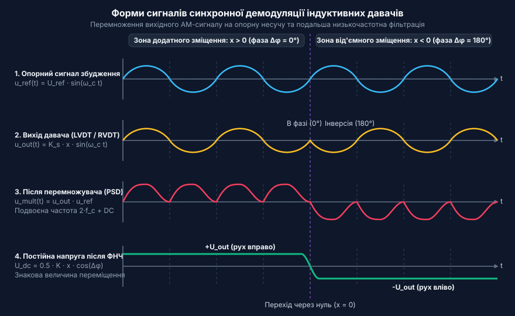
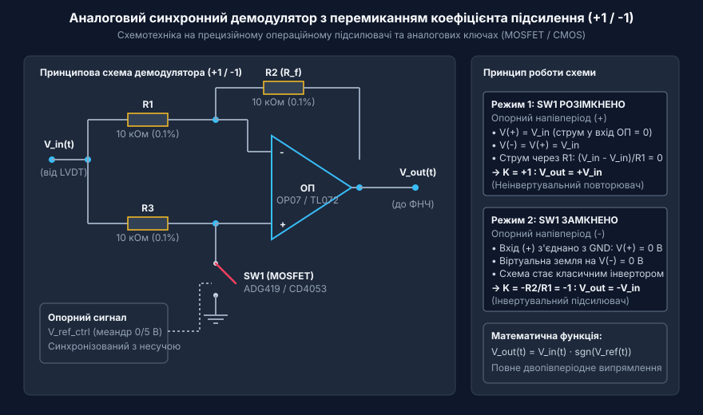
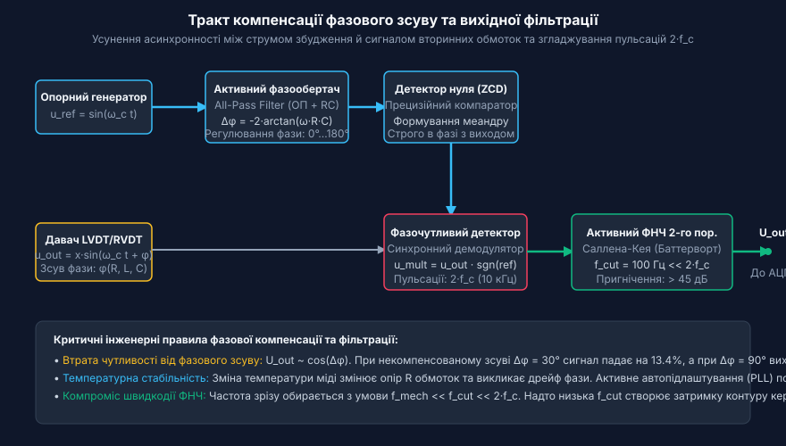
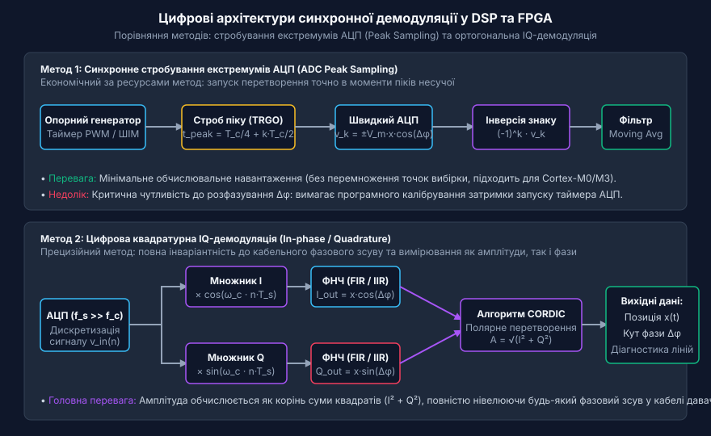

# Синхронне детектування та фазочутлива демодуляція індуктивних давачів

<preknowlist>
- [Лінійні змінні диференціальні трансформатори LVDT](root:cat-hw-sensors/lvdt-linear-variable-differential-transformers) — Принцип формування амплітудно-модульованих сигналів у вторинних обмотках та стрибок фази на 180° при переході через нуль.
- [Сельсини та резольвери: обертові трансформаторні кутоміри](root:cat-hw-sensors/synchro-and-resolver-transducers) — Фізичний принцип обмоточного зсуву та вихідні синусно-косинусні сигнали збудження обертових трансформаторів.
</preknowlist>

## Призначення та фізичні обмеження амплітудної детекції

У промислових системах автоматизації, верстатах з ЧПК, авіаційному приладобудуванні та прецизійній робототехніці лінійні й кутові переміщення традиційно вимірюються індуктивними перетворювачами: [трансформаторами LVDT](root:cat-hw-sensors/lvdt-linear-variable-differential-transformers) та [кутовими трансформаторами RVDT](root:cat-hw-sensors/rvdt-rotary-variable-differential-transformers). Первинна обмотка такого давача живиться змінною опорною напругою збудження несучої частоти (зазвичай 1–10 кГц):

```
u_ref(t) = U_ref · sin(ω_c t)
```

Магнітний потік наводить у зустрічно ввімкнених вторинних обмотках ЕРС. У нульовому положенні рухомого осердя вихідна диференційна напруга дорівнює нулю. При зміщенні осердя від центру амплітуда вихідної напруги лінійно зростає, а її фаза визначається знаком переміщення: при русі в один бік вихідний сигнал синфазний з опорною напругою (0°), а при зміщенні в протилежний бік — перебуває в протифазі (180°).

Спроба застосувати звичайний амплітудний детектор (наприклад, діодний випрямляч або піковий детектор із конденсатором) стикається з трьома критичними фізичними обмеженнями:

1. **Повна втрата інформації про знак напрямку зміщення**: Будь-який діодний випрямляч бере абсолютне значення миттєвої напруги `|u_out(t)|`. Зміщення осердя як на `+5 мм`, так і на `-5 мм` створює однакову додатну напругу `+2.5 В`. Статична характеристика виходить V-подібною, і система керування втрачає здатність визначити, в який бік відхилився об'єкт.
2. **Зона нечутливості біля нуля (dead band)**: Пряме падіння напруги на напівпровідникових діодах (0.3–0.7 В) блокує випрямлення малих сигналів. При мікропереміщеннях осердя амплітуда сигналу нижча за поріг відмикання діодів, тому вимірювальний тракт повністю сліпне.
3. **Низька завадостійкість**: Накопичувальний конденсатор пікового детектора захоплює будь-які імпульсні викиди, комутаційні завади двигунів та мережеві наводки 50 Гц, викликаючи тривалий дрейф вихідного рівня.

Єдиним способом збереження знаку напрямку руху та забезпечення граничної лінійності є синхронна демодуляція (фазочутливе детектування, Phase-Sensitive Detection — PSD).

## Математичний принцип фазочутливого перемноження

Сутність фазочутливого детектування полягає у математичному перемноженні вихідного амплітудно-модульованого сигналу давача на опорний гармонічний сигнал збудження з наступною низькочастотною фільтрацією.

Нехай вихідний сигнал давача описується виразом:

```
u_out(t) = K_s · x(t) · U_ref · sin(ω_c t + φ)
```

де `x(t)` — алгебраїчне зміщення осердя (додатне або від'ємне), а `φ` — власний фазовий зсув обмоток давача. Помноживши цей сигнал на синфазний опорний сигнал демодулятора `u_demod(t) = U_d · sin(ω_c t + φ_ref)`, отримуємо:

```
u_mult(t) = u_out(t) · u_demod(t)
          = 0.5 · K · x(t) · [cos(φ - φ_ref) - cos(2 ω_c t + φ + φ_ref)]
```

Добуток містить дві чітко розмежовані складові:
- Корисну низькочастотну складову: `0.5 · K · x(t) · cos(Δφ)`.
- Високочастотні пульсації на подвоєній несучій частоті `2 ω_c` (ripple).


*Часові діаграми процесів синхронної демодуляції: опорна несуча, знакочутливий вихід LVDT, перемножений пульсуючий сигнал та згладжена постійна напруга після ФНЧ.*

Після проходження фільтра нижніх частот (ФНЧ) високочастотна пульсація `2 ω_c` зрізається, і вихідна напруга стає прямо пропорційною знаковому переміщенню осердя:

```
U_dc = 0.5 · K · x(t) · cos(Δφ)
```

Якщо `x > 0` (рух вправо), вихідна напруга є додатною (`U_dc > 0`). Якщо `x < 0` (рух вліво), напруга змінює полярність на від'ємну (`U_dc < 0`). Залежність є строго лінійною і плавно проходить через нуль без зони мертвого ходу.

## Схемотехніка аналогових демодуляторів: перемикання підсилення (+1/-1)

В аналоговій схемотехніці для синхронного детектування застосовують підсилювачі з комутованим коефіцієнтом підсилення (+1 / -1) на основі прецизійного операційного підсилювача та аналогових ключів (MOSFET або CMOS-мікросхем типу ADG419 чи CD4053).


*Принципова електрична схема синхронного детектора (+1/-1) на ОП і ключі та алгоритм комутації за полярністю опорної несучої.*

Схема функціонує у двох тактах відповідно до полярності опорного сигналу несучої частоти:

1. **Додатний напівперіод (SW1 розімкнено)**:
   Неінвертувальний вхід ОП підключений до вхідного сигналу через резистор R3. Струм у високоомний вхід ОП не тече, тому потенціал на неінвертувальному вході дорівнює `V_in`. Через від'ємний зворотний зв'язок потенціал інвертувального входу також стає рівним `V_in`. Падіння напруги на резисторі R1 дорівнює нулю, струм через R2 не протікає, і вихідна напруга точно повторює вхідну:
   ```
   K = +1,  V_out = +V_in
   ```

2. **Від'ємний напівперіод (SW1 замкнено на GND)**:
   Неінвертувальний вхід ОП замикається на землю (`V(+) = 0 В`). Схема перетворюється на класичний інвертувальний підсилювач із відношенням опорів `K = -R2 / R1`. При прецизійному підборі однакових резисторів `R1 = R2`:
   ```
   K = -1,  V_out = -V_in
   ```

Таким чином, схема реалізує повне фазочутливе двопівперіодне випрямлення без втрат на діодах і зберігає повну амплітудно-фазову інформацію. У спеціалізованих мікросхемах, таких як [чип AD698](root:cat-hw-sensors/ad698-signal-conditioner), для перемноження застосовують чотириквадрантні транзисторні комірки Ґілберта, що усувають вплив непарних гармонік прямокутного меандру.

## Компенсація фазового зсуву та вихідний фільтр нижніх частот

Реальні обмотки індуктивних давачів мають значну індуктивність `L` та активний опір `R`, а з'єднувальний кабель вносить власну розподілену ємність `C`. У результаті вихідний сигнал давача зсувається за фазою відносно струму збудження на кут `φ`.

Оскільки корисна постійна складова після детектування пропорційна `cos(Δφ)`, нескомпенсований зсув фази призводить до суттєвого спотворення вимірювань:
- При `Δφ = 30°` сигнал зменшується на `13.4%` (`cos(30°) ≈ 0.866`).
- При ортогональному зсуві `Δφ = 90°` сигнал падає до нуля (`cos(90°) = 0`), унеможливлюючи вимірювання.
- При зміні температури опір міді змінюється, що без термокомпенсації викликає дрейф крутизни характеристики.


*Структура тракту фазової корекції: регульований фазообертач, компаратор детектора нуля, перемножувач PSD та фільтр Саллена-Кея 2-го порядку.*

Для вирішення цієї проблеми у вимірювальний тракт вводять активний фазообертач (All-Pass Filter) або контур фазового автопідлаштування частоти (PLL). Фазообертач на операційному підсилювачі забезпечує незалежне регулювання фази в діапазоні від 0° до 180° без зміни амплітуди:

```
Δφ = -2 · arctan(2 π f · R · C)
```

Компаратор формує з підлаштованого синуса крутий прямокутний меандр для керування ключами демодулятора строго синхронно з вихідним сигналом давача.

Після детектора сигнал містить залишкові пульсації на подвоєній частоті збудження `2 · f_c`. Для їхнього пригнічення встановлюють активний ФНЧ 2-го порядку Саллена-Кея з характеристикою Баттерворта. Частоту зрізу фільтра `f_cut` обирають з умови:

```
f_mech << f_cut << 2 · f_c
```

Наприклад, при частоті збудження `f_c = 5 кГц` частота пульсацій становить `10 кГц`. Обравши частоту зрізу `f_cut = 100 Гц`, фільтр Баттерворта 2-го порядку забезпечує пригнічення завади подвоєної частоти більш ніж на 40 дБ, забезпечуючи швидкий відгук на механічне переміщення об'єкта.

## Цифрова демодуляція в мікроконтролерах та DSP

Сучасні системи керування переносять синхронне детектування у цифрову область за допомогою сигнальних процесорів (DSP) або мікроконтролерів (STM32, TI C2000). Це усуває температурний дрейф аналогових компонентів і спрощує калібрування.

У цифровій обробці застосовують два ключові методи:
1. **Синхронне стробування екстремумів АЦП (ADC Peak Sampling)**: АЦП запускається за апаратним тригером таймера рівно в моменти максимумів та мінімумів сигналу збудження. Значення вибірки множиться на `(-1)^k` та усереднюється ковзним фільтром. Цей метод вимагає мінімальних обчислень, але чутливий до кабельного розфазування.
2. **Ортогональна квадратурна демодуляція (IQ-Demodulation)**: Оцифрований АЦП сигнал множиться на дві ортогональні гармоніки — синфазну `cos(ω_c t)` та квадратурну `sin(ω_c t)`.


*Структурна схема алгоритмів пікового стробування АЦП та квадратурної IQ-демодуляції з розрахунком амплітуди через алгоритм CORDIC.*

Після цифрової низькочастотної фільтрації утворюються два канали:
```
I = 0.5 · V_m · x · cos(Δφ)
Q = 0.5 · V_m · x · sin(Δφ)
```

Повна амплітуда переміщення та поточний кут фазового зсуву обчислюються векторним методом:
```
A = √(I² + Q²)
Δφ = atan2(Q, I)
```

Квадратурний метод повністю нечутливий до фазового зсуву в кабелі: навіть при `Δφ = 90°` вся енергія сигналу переходить у канал `Q`, і результуюча амплітуда `A` обчислюється з граничною точністю.

Нижче наведено приклад простої функції цифрової фазочутливої демодуляції на мові C для вбудованих систем:

```c
#include <math.h>
#include <stdint.h>

typedef struct {
    float i_accum;
    float q_accum;
    float alpha;       // Коефіцієнт експоненційного фільтра ФНЧ (0.01 - 0.1)
    float omega_step;  // Фазовий крок несучої: 2 * M_PI * f_c / f_sample
    float current_phi; // Поточна фаза синтезованої опорної несучої
} PsdDemodulator;

void psd_init(PsdDemodulator *psd, float f_carrier, float f_sample, float alpha) {
    psd->i_accum = 0.0f;
    psd->q_accum = 0.0f;
    psd->alpha = alpha;
    psd->omega_step = 2.0f * (float)M_PI * (f_carrier / f_sample);
    psd->current_phi = 0.0f;
}

// Функція викликається в перериванні АЦП для кожної вибірки adc_sample
void psd_process_sample(PsdDemodulator *psd, float adc_sample, float *out_position, float *out_phase_deg) {
    // 1. Обчислення ортогональних опорних значень
    float ref_i = cosf(psd->current_phi);
    float ref_q = sinf(psd->current_phi);

    // 2. Інкремент фази несучої для наступного відліку
    psd->current_phi += psd->omega_step;
    if (psd->current_phi >= 2.0f * (float)M_PI) {
        psd->current_phi -= 2.0f * (float)M_PI;
    }

    // 3. Перемноження та фільтрація нижніх частот 1-го порядку (EMA LPF)
    float raw_i = adc_sample * ref_i;
    float raw_q = adc_sample * ref_q;

    psd->i_accum += psd->alpha * (raw_i - psd->i_accum);
    psd->q_accum += psd->alpha * (raw_q - psd->q_accum);

    // 4. Обчислення амплітуди переміщення та збереження знаку
    float amplitude = sqrtf(psd->i_accum * psd->i_accum + psd->q_accum * psd->q_accum);
    
    // Знак визначається за полярністю синфазного каналу
    *out_position = (psd->i_accum >= 0.0f) ? amplitude : -amplitude;
    
    // Розрахунок кабельного фазового зсуву для діагностики
    *out_phase_deg = atan2f(psd->q_accum, psd->i_accum) * (180.0f / (float)M_PI);
}
```

Використання синхронної демодуляції у поєднанні з [інтегральними фронтендами LVDT](root:cat-hw-sensors/lvdt-analog-front-end) та [перетворювачами резольвер-код](root:cat-hw-sensors/resolver-to-digital-converters) забезпечує високу завадостійкість промислових систем вимірювання положення в найжорсткіших умовах експлуатації.
