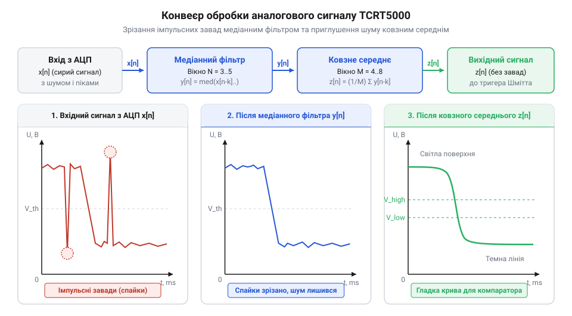
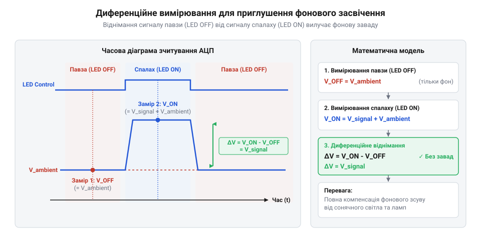

# Інтерфейс програмного зчитування та обробки сигналів TCRT5000

<preknowlist>
- [IR-давачі перешкод (FC-51 / KY-032)](root:cat-hw-sensors/ir-obstacle) — принцип роботи оптичної пари з ІЧ-світлодіодом і фототранзистором для виявлення перешкод
</preknowlist>

## Проблема зчитування та структура драйвера

Коли розробник вперше підключає оптичний давач @@en|TCRT5000@@ до мікроконтролера, з'являється спокуса обмежитися простим опитуванням цифрового виводу або разовим викликом аналогово-цифрового перетворювача (від грецьк. @@en|analogos@@ — відповідний та лат. @@en|digitus@@ — палець, далі — @@en|ADC@@). Проте пряме зчитування сигналів без спеціалізованої програмної абстракції швидко виявляє свою ненадійність у реальних умовах експлуатації. На відміну від простих переривачів променя, таких як [оптичний переривач KY-010](root:cat-hw-sensors/ky-010-interrupter), де світловий шлях повністю відкритий або перекритий механічною перешкодою, відбивальний давач оперує безперервною зміною інтенсивності відбитого інфрачервоного випромінювання.

Оптичний вимірювальний канал вразливий до двох основних груп завад:
1. Електричні завади: високочастотні наводки на аналогові лінії від шин живлення, цифрових шин даних та джерел @@en|PWM@@, а також шуми квантування самого модуля @@en|ADC@@. 2. Оптичні завади: зміна фонового інфрачервоного випромінювання довкілля (сонячні промені, лампи розжарювання), локальні нерівності й різна рефлексивність поверхні, що створюють тремтіння (від англ. @@en|jitter@@ — дрижання) вихідного сигналу.

Пряме зчитування цифрового виводу без програмної обробки спричиняє так званий «дебоунс» або хибне брязкання логічних рівнів, коли сигнал коливається поблизу апаратного порогу порівняння. У свою чергу, разові відліки @@en|ADC@@ без усереднення дають значний розкид значень, через що система виявлення перешкод розпізнає порожнечу як об'єкт або навпаки. На відміну від ширших оптичних рішень для фіксації руху на кшталт [PIR-давача руху HC-SR501](root:cat-hw-sensors/hc-sr501), давач @@en|TCRT5000@@ вимагає високої точності на малій відстані в межах кількох міліметрів, що робить будь-який шум критичним.

Щоб ізолювати прикладний код від низькорівневих апаратних особливостей та позбутися хибних спрацьовувань, створюють програмний драйвер (від англ. @@en|driver@@ — керуючий елемент). Програмний драйвер являє собою модуль або клас, що об'єднує конфігурацію виводів, стан вимірювального каналу, буфери фільтрації, налаштування калібрування та поточний статус пристрою.

Структура давача містить параметри призначення виводів @@en|GPIO@@ (від англ. @@en|General Purpose Input/Output@@ — інтерфейс введення-виведення загального призначення) для цифрового сигналу (DO), аналогового виводу (AO) та виводу керування анодом ІЧ-діода (CTRL), якщо використовується імпульсний режим живлення. Крім того, структура зберігає кастомні порогові значення, розмір вікна фільтрації та поточні розраховані фізичні показники.

Порядок ініціалізації драйвера передбачає послідовне виконання кількох кроків:
1. Конфігурація апаратних периферійних вузлів мікроконтролера: налаштування цифрових входів у режим зчитування, аналогових каналів @@en|ADC@@ та виводу керування випромінювачем. 2. Ініціалізація внутрішніх буферів фільтрації початковими нульовими або базісними значеннями. 3. Встановлення дефолтних порогових меж спрацьовування та значень гістерезису. 4. Перевірка працездатності вимірювального тракту шляхом зчитування тестового відліку.

Приклад реалізації структури драйвера та його ініціалізації наведено нижче у двох ідіоматичних варіантах:

:::tabs
:::code api-tcrt5000-driver/c/esp-idf/tcrt5000-init.c
:::code api-tcrt5000-driver/cpp/arduino/tcrt5000driver.cpp
:::

Чітке розділення апаратних виводів та обчислювальних даних усередині структури створює прозору лінію абстракції. Це дає змогу масштабувати кількість давачів у системі (наприклад, у лінійках для роботів-компактів) без плутанини з номерами ніжок мікроконтролера та без дублювання коду.

## Інтерфейси аналогового та цифрового зчитування

Підключення модуля @@en|TCRT5000@@ пропонує два незалежні виходи: цифровий (DO, від англ. @@en|Digital Output@@) та аналоговий (AO, від англ. @@en|Analog Output@@). Кожен із цих виходів вимагає власного підходу до програмного зчитування та надає різний обсяг інформації про стан об'єкта перед давачем.

Цифрове зчитування реалізується шляхом опитування (від англ. @@en|polling@@) логічного стану виводу @@en|GPIO@@ мікроконтролера. На платі модуля вихід DO підключено до апаратного компаратора. Коли струм фототранзистора (від грецьк. @@en|photos@@ — світло та англ. @@en|transistor@@) перевищує рівень, заданий підлаштовним потенціометром, компаратор перемикає свій вихід із високого логічного рівня на низький (або навпаки, залежно від конкретної ревізії плати). 

Основні особливості цифрового інтерфейсу:
- Перевага: Мінімальне навантаження на обчислювальне ядро. Зчитування виконується за один тактовий цикл читанням регістру входів або через зовнішнє переривання (від англ. @@en|interrupt@@). - Недоліки: Повна втрата градацій відбиття. Програма отримує лише бінарний факт «є поріг / немає порогу». Неможливо програмно коригувати чутливість під час роботи, а апаратний компаратор позбавлений гнучкого програмного гістерезису (від грецьк. @@en|hysteresis@@ — запізнення), що приводить до дрижання логічного стану при повільному наближенні перешкоди.

Аналогове зчитування полягає у вимірюванні вихідної напруги на виводі AO за допомогою вбудованого в мікроконтролер перетворювача @@en|ADC@@. Напруга на виході AO прямо пропорційна оптичному потоку, який відбивається від поверхні та потрапляє на базу фототранзистора. На відміну від типових [ІЧ-давачів перешкод](root:cat-hw-sensors/ir-obstacle), які часто використовують лише цифровий компаратор, доступ до аналогового сигналу відкриває можливість гнучкого аналізу контрастності.

Основні особливості аналогового інтерфейсу:
- Перевага: Отримання повної інформації про градієнт контрастності та точну відстань до об'єкта в межах робочої зони давача (0.2–15 мм). Це дозволяє реалізовувати алгоритми цифрового згладжування, динамічного калібрування та компенсації фонового світла. - Недоліки: Необхідність використання периферійного модуля @@en|ADC@@, час конверсії аналогового сигналу в цифровий код (від одиниць до десятків мікросекунд) та потреба в програмній фільтрації шуму.

Отриманий із @@en|ADC@@ сирий відлік `N_raw` являє собою ціле беззнакове число у діапазоні від `0` до `2^B - 1`, де `B` — розрядність перетворювача (наприклад, 10 біт = 0..1023, 12 біт = 0..4095). Для забезпечення універсальності драйвера сирі дані нормують — переводять у фізичну напругу (в мілівольтах) або відносний коефіцієнт відбиття (від 0.0 до 1.0 або 0–100%).

Формула перерахунку сирого значення @@en|ADC@@ у напругу в мілівольтах має вигляд:

```
V_mv = (N_raw × V_ref) ÷ (2^B - 1)
```

де `V_ref` — опорна напруга АЦП у мілівольтах (наприклад, 3300 мВ або 5000 мВ), `N_raw` — виміряний сирий відлік, `B` — бітова розрядність.

Для нормування в відносний коефіцієнт `K_ref` у діапазоні від `0.0` до `1.0` використовують співвідношення:

```
K_ref = N_raw ÷ (2^B - 1)
```

Функції драйвера для зчитування сирих та нормованих даних подано нижче:

:::tabs
:::code api-tcrt5000-driver/c/esp-idf/tcrt5000-read-digital-raw.c
:::code api-tcrt5000-driver/cpp/arduino/snippet-4.cpp
:::

Отримання чистих нормованих значень створює єдину базу даних для подальших обчислювальних блоків. Незалежно від апаратної платформи та розрядності її @@en|ADC@@, наступні алгоритми фільтрації та калібрування працюють із нормованим вимірювальним вектором.

## Алгоритми згладжування та фільтрації завад

Сирі аналогові дані з виводу AO давача @@en|TCRT5000@@ містять шумові компоненти різного походження. При високій швидкості зчитування спостерігаються імпульсні сплески від оптичних завад та спотворення від електромагнітного фону. Для отримання стабільного сигналу застосовують двоступеневий конвеєр обробки: комбінацію медіанного фільтра (від англ. @@en|median filter@@) та скользячого середнього (від англ. @@en|moving average@@).

Перший етап — медіанна фільтрація. Вона призначена для відсікання одиночних короткочасних імпульсних викидів (аномальних відліків), які виникають через пил у повітрі, дрібні подряпини на поверхні або поодинокі оптичні відблиски. Алгоритм зберігає ковзне вікно з `M` останніх відліків (де `M` — зазвичай непарне число: 3, 5 або 7). Під час надходження нового значення вікно сортується за зростанням, і як результат вибирається медіанний елемент (той, що стоїть по центру відсортованого масиву). Основна перевага медіанного фільтра — він повністю ліквідує гострі імпульси, не згладжуючи при цьому реальні різкі граничні переходи сигналу.

Другий етап — скользяче середнє. Воно пригнічує білий високочастотний шум та дрібні коливання напруги живлення. Для вікна розміром `N` поточне очищене значення `Y_k` розраховується як арифметичне середнє останніх `N` відліків, що пройшли медіанний фільтр:

```
Y_k = (1 ÷ N) × ∑ X_(k - i)    [для i від 0 до N - 1]
```

де `X_i` — входження відліків після медіанної обробки. 

Послідовність обробки сигналу у програмному конвеєрі показано на малюнку:


*Конвейєр обробки аналогового сигналу: вхідні шумові відліки з АЦП очищуються медіанним фільтром від аномальних сплесків та згладжуються скользячим середнім.*

Розмір вікон `N` та `M` є компромісом між якістю згладжування та затримкою (фазовим зсувом) реакції драйвера. Велике вікно робить графік ідеально гладким, але уповільнює реагування на швидку зміну поверхні під давачем. Для роботів, що рухаються вздовж лінії, оптимальним є вікно медіани `M = 3` та вікно усереднення `N = 4..8`.

Нижче наведено реалізацію програмних фільтрів у драйвері:

:::tabs
:::code api-tcrt5000-driver/c/esp-idf/median-filter-apply.c
:::code api-tcrt5000-driver/cpp/arduino/signalfilter.cpp
:::

Завдяки застосуванню очищувального конвеєра аналоговий сигнал звільняється від непередбачуваних піків і стає придатною основою для алгоритмів адаптивного розрахунку порогів спрацьовування.

## Адаптивне калібрування та порогові значення

Фіксоване порогове значення напряму обмежує надійність системи виявлення перешкод та ліній. У реальних умовах експлуатації світловідбивальна здатність матеріалів суттєво варіюється: чорна матова фарба відбиває світло інакше, ніж чорний глянцевий пластик; білий папір має один коефіцієнт відбиття, а білий полімер — інший. Більше того, зі зміною відстані між давачем та поверхнею рівень освітленості фототранзистора зміщується. Фіксований апаратний поріг при зміні поверхні викличе або постійне хибне спрацьовування, або повне ігнорування межі об'єкта.

Розв'язанням цієї проблеми є процедура адаптивного автокалібрування (від араб. @@en|qalib@@ — шаблон, форма). Ідея полягає у вимірюванні крайніх контрольних точок рефлексії безпосередньо перед початком робочого циклу або динамічно під час руху.

Процедура підготовки включає два етапи:
1. Запис відліку над світлою/високорефлексивною поверхнею (`V_white`).
2. Запис відліку над темною/низькорефлексивною поверхнею (`V_black`).

Після отримання екстремумів програмний драйвер обчислює динамічний поріг `V_th` та межі гістерезису `H`:

```
V_span = V_white - V_black
V_th   = V_black + (k × V_span)
V_high = V_th + H
V_low  = V_th - H
```

де `k` — коефіцієнт зміщення порогу (зазвичай `k = 0.5` для симетричної поверхні або `0.3..0.7` залежно від пріоритету виявлення), `H` — зона гістерезису (наприклад, 5–10% від амплітуди `V_span`). Гістерезис гарантує, що при незначних коливаннях сигналу навколо порогу логічний стан не буде неодноразово перемикатися.

Алгоритм калібрування та порогової порівняльної обробки у коді:

:::tabs
:::code api-tcrt5000-driver/c/esp-idf/tcrt5000-calculate-calibration.c
:::code api-tcrt5000-driver/cpp/arduino/adaptivecalibrator.cpp
:::

Автоматичне адаптивне калібрування робить драйвер автономним щодо зовнішніх факторів рефлективності, гарантуючи чітке й прогнозоване розпізнавання меж об'єктів.

## Компенсація засвічення та граничні стани

Найбільш складним випробуванням для оптичного давача @@en|TCRT5000@@ є робота в умовах нестабільного або інтенсивного зовнішнього освітлення (наприклад, на прямому сонячному світлі або під потужними лампами). Оскільки фототранзистор чутливий до широкого спектра інфрачервоного випромінювання, пряме або відбите сонячне світло може відкрити його повністю, імітуючи присутність якраз перед ним білого відбивача. Відмінність від об'ємних датчиків огляду, таких як [мініатюрний PIR-давач руху HC-SR505](root:cat-hw-sensors/hc-sr505), полягає в тому, що TCRT5000 оперує точковою оптичною парою, де засвічення повністю блокує корисний сигнал.

Для вирішення цієї проблеми застосовують метод диференційного зчитування з імпульсним живленням випромінювального ІЧ-світлодіода. ІЧ-діод підключається не до постійної лінії живлення, а до виводу @@en|GPIO@@ мікроконтролера через транзисторний ключ.

Схема диференційного вимірювання складається з двох послідовних фаз:
1. Фаза спалаху (LED ON): ІЧ-діод увімкнено. Фототранзистор сприймає суму власного відбитого світла давача та зовнішнього фонового засвічення (`V_on = V_reflected + V_ambient`). 2. Фаза павзи (LED OFF): ІЧ-діод вимкнено. Фототранзистор сприймає тільки зовнішнє фонове випромінювання (`V_off = V_ambient`).

Корисний відбитий сигнал обчислюється шляхом віднімання фонової складової:

```
V_diff = V_on - V_off
```

Часову діаграму цього процесу подано нижче:


*Часова діаграма диференційного зчитування: віднімання фонового рівня в павзі (LED OFF) з рівня в спалаху (LED ON) дає чистий корисний сигнал V_diff.*

Крім оптичних завад, програмний драйвер повинен коректно обробляти граничні та аварійні стани апаратного забезпечення:
- Насичення фототранзистора (від лат. @@en|saturatio@@ — насичення): Якщо фонове світло `V_off` перевищує допустиму межу (наприклад, 95% від шкали @@en|ADC@@), фототранзистор входить у насичення. У цьому стані будь-який додатковий спалах світлодіода не змінить струм колектора (`V_on ≈ V_off ≈ V_max`). Драйвер повинен сигналізувати про помилку `TCRT5000_ERR_SATURATION`. - Обрив кола / несправність (відключення давача): Якщо під час фази спалаху `V_on` залишається близьким до нуля або дорівнює нулю незалежно від поверхні, це свідчить про обрив лінії ІЧ-діода, відсутність живлення або апаратне пошкодження. Драйвер повертає статус `TCRT5000_ERR_DISCONNECTED`.

Програмний код диференційного зчитування та контролю граничних станів:

:::tabs
:::code api-tcrt5000-driver/c/esp-idf/tcrt5000-read-differential.c
:::code api-tcrt5000-driver/cpp/arduino/snippet-10.cpp
:::

Диференційний режим у поєднанні з перевіркою граничних станів гарантує найвищий рівень завадостійкості та надійності драйвера в критичних застосуваннях — від автономних робототехнічних платформ до промислових лічильників деталей.