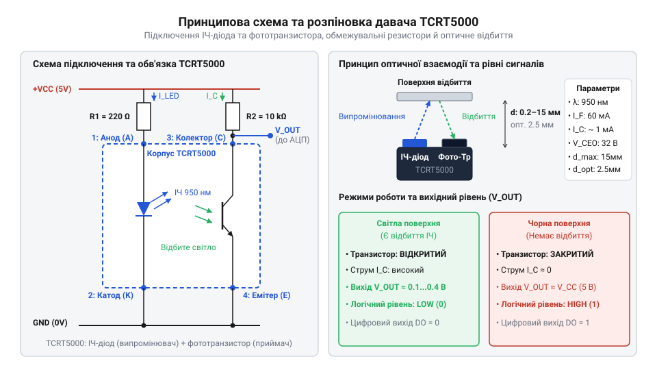
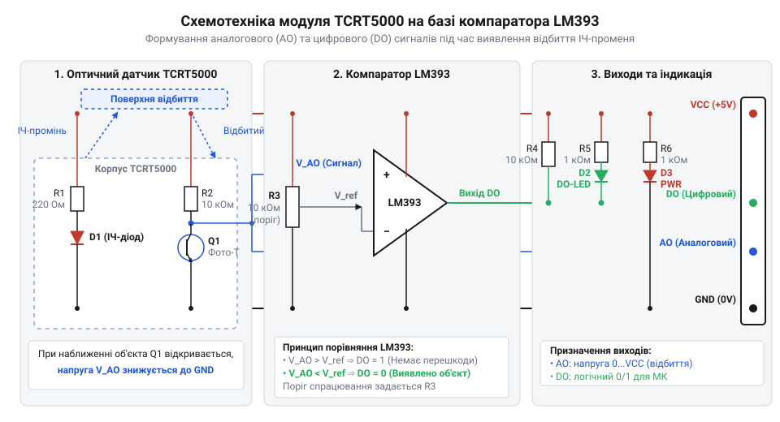

# Специфікація розводки виводів, схемотехніки та електричних параметрів TCRT5000

<preknowlist>
- [IR-давачі перешкод (FC-51 / KY-032)](root:cat-hw-sensors/ir-obstacle) — Базовий принцип відбиття інфрачервоного випромінювання від поверхонь із різним коефіцієнтом відбиття.
- [KY-010 — оптичний переривач](root:cat-hw-sensors/ky-010-interrupter) — Принцип роботи оптичної пари з ІЧ-світлодіодом та фототранзистором.
</preknowlist>

## Виявлення відбиття без контактних датчиків

Механічні вимикачі й кінцевики тривалий час залишалися основним засобом визначення положення рухомих деталей у механізмах. Проте фізичний контакт неминуче спричиняє механічне зношування деталей, брязкіт контактів, виникнення іскор та обмеження за швидкістю спрацьовування. Крім того, механічна кнопка не може зафіксувати появу крихких, легких або рідких матеріалів, не чинячи на них фізичного тиску. Для розв'язання цих проблем застосовують оптичні методи виявлення, де роль механічного штовхача виконує промінь світла.

На відміну від щілинних конструкцій, у яких об'єкт має фізично перекрити світловий потік між рознесеними елементами (як працює [оптичний переривач ще щілястий](root:cat-hw-sensors/ky-010-interrupter)), відбивальний давач працює з відбитим від поверхні випромінюванням. Пристрій @@en|TCRT5000@@ об'єднує в єдиному пластиковому корпусі два незалежні компоненти: інфрачервоний @@en|світлодіод@@ (від @@gr|phos@@ — світло та @@en|diode@@) та @@en|фототранзистор@@ (від @@gr|phos@@ — світло та @@en|transistor@@). Обидва кристали розміщені поруч і спрямовані в один бік, утворюючи @@en|відбивальну оптопару@@ (від @@gr|optikos@@ — зоровий).

Принцип дії пристрою ґрунтується на оптичному зв'язку через зовнішнє середовище. Коли перед давачем немає перешкоди, інфрачервоне випромінювання світлодіода розсіюється у просторі й не потрапляє на базу фототранзистора. Транзистор залишається закритим, а струм через його колектор дорівнює мікроскопічному темновуму струму. Якщо ж у зоні чутливості з'являється поверхня, частина світлового потоку відбивається від неї й потрапляє через лінзу на світлочутливу область фототранзистора. Фотони генерують носії заряду в p-n переході бази, що призводить до відкриття транзистора й протікання вихідного струму.

Компонент @@en|TCRT5000@@ має чотири виводи: анод і катод для керування світлодіодом, а також колектор і емітер для зчитування стану фототранзистора. Корпус виготовлено з темно-синього або чорного пластику, який слугує оптичним фільтром денного світла. Окрім того, всередині корпусу між випромінювачем і приймачем передбачено непрозору перегородку, яка запобігає прямому оптичному перехресному заваданню (паразитному просочуванню світла всередині пластику). Це робить @@en|TCRT5000@@ оптимальним вибором для локального виявлення ліній у робототехніці, підрахунку обертів зубчастих коліс, контролю наявності паперу в принтерах та визначення крайніх положень механізмів без фізичного торкання.

## Призначення виводів та граничні параметри

Для правильного підключення дискретного компонента @@en|TCRT5000@@ необхідно чітко розрізняти виводи його випромінювальної та приймальної частин. Корпус пристрою має два оптичних вікна. З боку інфрачервоного світлодіода виведені @@en|анод@@ (від @@gr|anodos@@ — шлях вгору) та @@en|катод@@ (від @@gr|kathodos@@ — шлях вниз). З боку приймача розміщено @@en|колектор@@ (від @@la|collector@@ — збирач) та @@en|емітер@@ (від @@la|emittere@@ — випускати) фототранзистора.


*Принципова схема підключення окремого компонента TCRT5000 із розпіновкою виводів, струмообмежувальним резистором світлодіода R_F та навантажувальним резистором фототранзистора R_L.*

Для забезпечення надійної та тривалої роботи пристрою важливо не перевищувати його граничні електричні характеристики. Випромінювач працює на піковій довжині хвилі `λₚ = 950` нм, що відповідає ближньому інфрачервоному діапазону. Прямий спад напруги на світлодіоді `V_F` становить орієнтовно `1.25` В при робочому струмі. Максимально припустимий прямий струм через світлодіод `I_{F,max}` дорівнює `60` мА, проте для довговічної роботи рекомендовано обирати значення в діапазоні від `10` до `20` мА. Гранична напруга колектор-емітер фототранзистора `V_{CEO,max}` становить `70` В, а максимальний струм колектора `I_{C,max}` обмежений рівнем `100` мА. Під час відбиття світла реальний струм колектора `I_C` зазвичай перебуває в межах від `0.1` до `2` мА.

Розрахунок струмообмежувального резистора `R_F` для інфрачервоного світлодіода здійснюється за законом Ома для послідовного кола. Необхідно відняти від напруги живлення `V_{CC}` прямий спад напруги `V_F` і розділити результат на бажаний робочий струм `I_F`. Для напруги живлення `V_{CC} = 5` В, прямого спаду `V_F = 1.25` В та струму `I_F = 15` мА (`0.015` А) розрахунок має такий вигляд:

```
R_F = (V_CC - V_F) ÷ I_F
= (5 - 1.25) ÷ 0.015      [підстановка напруги живлення 5 В, спаду 1.25 В та струму 0.015 А]
= 3.75 ÷ 0.015            [різниця потенціалів на резисторі]
= 250                     [розрахований опір у Омах]
```

Найближчим стандартним номіналом із ряду E24 є резистор `240` Ом або `270` Ом. Для приймальної частини фототранзистор вмикають за схемою зі спільним емітером, підключаючи емітер до спільного проводу (GND), а колектор — до лінії живлення через навантажувальний резистор `R_L`. Вихідний аналоговий сигнал знімають безпосередньо з колектора. Для отримання відчутного перепаду напруги `V_{out}` від `5` В до `0.5` В при очікуваному відбитому струмі колектора `I_C = 0.5` мА (`0.0005` А) опір `R_L` обчислюють наступним чином:

```
R_L = (V_CC - V_{out}) ÷ I_C
= (5 - 0.5) ÷ 0.0005      [підстановка напруги живлення 5 В, залишкової напруги 0.5 В та струму 0.0005 А]
= 4.5 ÷ 0.0005            [спад напруги на навантажувальному резисторі]
= 9000                    [розрахований опір 9000 Ом]
```

На практиці обирають стандартний резистор номіналом `10` кОм. Коли поверхня відсутня, фототранзистор закритий, струм колектора близький до нуля, а вихідна напруга `V_{out}` підтягнута до `V_{CC}` (високий логічний рівень). При появі відбивної поверхні фототранзистор відкривається, через `R_L` протікає струм `I_C`, створюючи спад напруги, і рівень `V_{out}` знижується до значень, близьких до `0` В (низький логічний рівень).

## Схемотехніка модуля з компаратором LM393

Хоча окремий компонент @@en|TCRT5000@@ дозволяє зчитувати аналоговий сигнал, безпосереднє підключення колектора до цифрових входів мікроконтролера викликає нестабільність. Якщо відбитий світловий потік перебуває на межі спрацьовування, вихідна напруга опиняється в проміжній зоні між логічним нулем і одиницею. Це призводить до високого рівня шумів, мультиспрацьовувань та підвищеного споживання струму вхідним каскадом контролера. Для усунення цього недоліку розроблено готовий модуль на базі аналогового @@en|компаратора@@ (від @@la|comparare@@ — порівнювати) @@en|LM393@@. Докладніше про схемотехніку компараторів із гістерезисом для захисту від брязкоту аналогових сигналів читайте у статті про [тригер Шмітта](root:hw-analog/schmitt-trigger).


*Принципова схемотехнічна розводка модуля TCRT5000 із підстроювальним потенціометром, аналоговим виходом AO та цифровим виходом DO на базі компаратора LM393.*

Модуль містить дискретний давач @@en|TCRT5000@@, підстроювальний @@en|потенціометр@@ (від @@la|potentia@@ — сила та @@gr|metron@@ — міра) опором `10` кОм, мікросхему @@en|LM393@@ та обв'язку з резисторів та світлодіодів індикації. Аналоговий вихід (AO) виведений безпосередньо з вузла з'єднання колектора фототранзистора з навантажувальним резистором. Напруга на виході AO змінюється безперервно від `V_{CC}` (при повній відсутності відбиття) до часток вольта (при інтенсивному відбитті).

Цифровий вихід (DO) формується вихідним каскадом мікросхеми @@en|LM393@@. Один із входів компаратора підключено до напруги потенціометра `V_{ref}`, яка задає поріг спрацьовування. Другий вхід приймає сигнальну напругу `V_{sens}` з колектора @@en|TCRT5000@@. Оскільки вихід мікросхеми @@en|LM393@@ виконано за схемою з відкритим колектором (@@en|open-collector@@), на платі встановлено підтягувальний резистор (@@en|pull-up@@) опором `10` кОм до лінії `V_{CC}`.

Коли перед давачем немає об'єкта, фототранзистор закритий, а напруга `V_{sens}` на інвертуючому вході компаратора є вищою за опорну напругу `V_{ref}`. Вихідний транзистор @@en|LM393@@ відкритий і замикає лінію DO на землю, формуючи низький логічний рівень (0 В). Як тільки об'єкт наближається і відбиття зростає, фототранзистор відкривається, напруга `V_{sens}` падає нижче від `V_{ref}`. Компаратор перемикається: його вихідний транзистор закривається, і резистор @@en|pull-up@@ підтягує вихід DO до рівня `V_{CC}` (високий логічний рівень).

Для підключення модуля до мікроконтролера розробник обирає відповідний інтерфейс. Якщо необхідно оцінювати відстань або градацію сірого кольору (наприклад, оцінювати ступінь забруднення чи відтінок лінії), вихід AO підключають до аналого-цифрового перетворювача (@@en|АЦП@@). Якщо ж завдання полягає лише у фіксації факту присутність об'єкта або зчитуванні засічок енкодера, використовують вихід DO, підключений до дискретного входу @@en|GPIO@@. Завдяки потенціометру поріг спрацьовування можна гнучко підлаштувати під конкретний матеріал та дистанцію.

## Робоча дистанція та узгодження рівнів

Ефективність роботи @@en|TCRT5000@@ суттєво залежить від геометричного розміщення об'єкта та оптичних властивостей його поверхні. Оптимальний діапазон виявлення для цього давача становить від `0.2` мм до `15` мм, а максимальний струм колектора спостерігається на відстані від `1` мм до `2.5` мм.

Такий розподіл чутливості пояснюється геометрією корпусу. Якщо об'єкт притиснутий впритул до оптичних вікон (відстань менше `0.2` мм), випромінене світло падає під гострим кутом і відбивається повз вхідне вікно фототранзистора, через що струм колектора падає майже до нуля. Зі збільшенням відстані понад `2.5` мм інтенсивність відбитого світла зменшується обернено пропорційно квадрату відстані через дифузне розсіювання. Порівняно з більш далекобійними оптичними пристроями, де [основані на ІЧ-випромінюванні давачі](root:cat-hw-sensors/ir-obstacle) фіксують перешкоди на відстані в кілька десятків сантиметрів, @@en|TCRT5000@@ призначений виключно для надблизького фокусування.

Окрім відстані, вирішальну роль відіграє коефіцієнт відбиття поверхні. Білий глянцевий папір або світлий пластик відбивають до `90`% інфрачервоного випромінювання, тоді як чорна матова стрічка або гума поглинають понад `90`% світла. Саме ця різниця дозволяє роботам-контурникам чітко розрізняти чорну смугу на білому полі.

Важливим схемотехнічним аспектом є узгодження логічних рівнів. Популярні модулі @@en|TCRT5000@@ часто живляться від джерела `5` В, тому на виході DO в активному стані формується потенціал `5` В. Підключення такого сигналу безпосередньо до 3.3-вольтових входів @@en|GPIO@@ сучасних мікроконтролерів (як-от ESP32 або STM32) може призвести до пробою вхідних каскадів. Для безпечного пониження напруги використовують резистивний дільник. Якщо верхній резистор дільника `R_1 = 10` кОм, а нижній `R_2 = 20` кОм, вихідну напругу `V_{MCU}` обчислюють за формулою:

```
V_{MCU} = V_{DO} × R_2 ÷ (R_1 + R_2)
= 5 × 20000 ÷ (10000 + 20000)      [підстановка напруги DO 5 В та опорів дільника 10 кОм і 20 кОм]
= 100000 ÷ 30000                   [обчислення відношення опорів]
= 3.33                             [вихідна напруга в вольтах, безпечна для 3.3 В логіки]
```

Отримане значення `3.33` В є абсолютно безпечним для входів мікроконтролерів із живленням `3.3` В. Альтернативним варіантом є живлення всього модуля від лінії `3.3` В, оскільки компаратор @@en|LM393@@ зберігає працездатність при напругах від `2` В до `36` В. Докладніше про принцип розрахунку та застосування резистивних дільників для узгодження рівнів напруги читайте у статті про [резистивний дільник напруги](root:hw-analog/voltage-divider).

Ще однією пасткою при експлуатації є зовнішнє оптичне засвітлення. Сонячне світло, лампи розжарювання та ІЧ-обігрівачі містять потужну спектральну компоненту з довжиною хвилі `950` нм. Хоча корпус фототранзистора має вбудований фільтр денного світла, сильний потік інфрачервоного випромінювання від сторонніх джерел може повністю відкрити транзистор і викликати хибне спрацьовування. Для захисту від завад застосовують механічні бленди (захисні кожухи) або програмне підлаштування порогу компаратора.

## Проектування друкованої плати та захист

Під час розробки власних друкованих плат із компонентом @@en|TCRT5000@@ необхідно враховувати як електричні, так і механіко-оптичні вимоги розміщення. Некоректне розведення провідників або помилки в геометрії можуть звести нанівець точність вимірювань.

Перш за все, орієнтація двох оптичних вікон @@en|TCRT5000@@ відносно напрямку руху об'єкта має вирішальне значення. Якщо давач використовується для зчитування засічок дискового енкодера або лінії, вісь, що з'єднує центри світлодіода та фототранзистора, повинна розташовуватися паралельно лінії переходу контрасту. При такому розміщенні обидва оптичні елементи перетинають межу розділу кольорів одночасно, що забезпечує чіткий фронт сигнальної напруги без розмивання.

Другим критичним фактором є внутрішнє оптичне перехресне завадання (паразитне засвітлення). Якщо @@en|TCRT5000@@ монтується за захисним прозорим акриловим склом або вглиб корпусу приладу, випромінювання світлодіода може відбиватися від внутрішніх граней скла й потрапляти на фототранзистор ще до виходу назовні. Для запобігання цьому явищу між корпусом давача й зовнішнім вікном встановлюють непрозору ґумову або пластикову перегородку (ущільнювач), яка фізично розділяє випромінювальний та приймальний оптичні канали.

З точки зору електричного розведення друкованої плати необхідно дотримуватися правил захисту від аналогових завад:
1. Керамічний блокувальний конденсатор ємністю `100` нФ необхідно розміщувати в безпосередній близькості до виводів живлення мікросхеми @@en|LM393@@ для фільтрації високочастотних імпульсних завад по шині `V_{CC}`. 2. Лінії аналогового сигналу AO та провідник від рухомого контакту потенціометра є високоомними вузлами. Їх слід робити якомога коротшими й оточувати суцільною заливкою землі (GND fill), щоб уникнути наведення завад від сусідніх цифрових шин чи ліній із широтно-імпульсною модуляцією (ШІМ). 3. При підключенні інфрачервоного світлодіода на максимальному струмі (`20` мА і більше) слід враховувати теплове виділення кристала. Не варто розміщувати поруч із давачем прецизійні термочутливі елементи без відповідної теплової розв'язки.

Дотримання цих схемотехнічних та конструктивних норм гарантує стабільну роботу системи виявлення перешкод у широкому діапазоні зовнішніх умов.