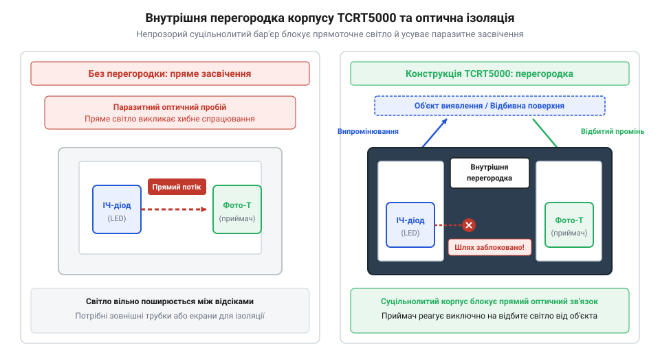
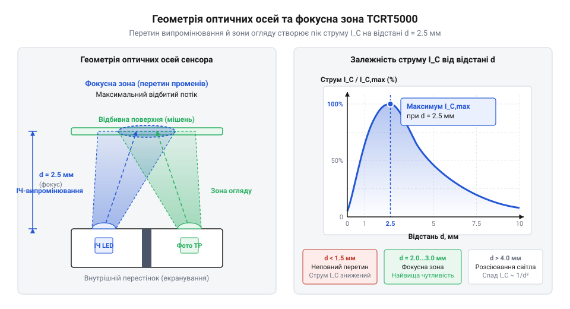

# Еволюція відбивальних оптопар та історія створення TCRT5000

<preknowlist>
- [KY-010 — оптичний переривач](root:cat-hw-sensors/ky-010-interrupter) — Концепція оптичного переривання світлового променя між випромінювачем і приймачем для виявлення непрозорих об'єктів.
- [IR-давачі перешкод (FC-51 / KY-032)](root:cat-hw-sensors/ir-obstacle) — Базові принципи активного інфрачервоного зондування та різниця між прямою локацією перешкоди й фіксацією відбитого променя.
</preknowlist>

## Проблема дискретних оптичних схем ранньої автоматизації

У середині XX століття швидкісні конвеєри та сортувальні лінії промислових підприємств зіштовхнулися з межею надійності контактних механічних перемикачів. Кінцеві вимикачі зі звичайними важелями та кнопками швидко зношувалися від безперервних ударів деталей, а також забруднювалися мастилом. Логічною альтернативою стало безконтактне оптичне виявлення об'єктів: якщо деталь перекриває або відбиває світловий промінь, стан кола змінюється без жодного фізичного контакту. Проте перші інженерні реалізації цієї ідеї збиралися з повністю рознесених, дискретних компонентів. З одного боку конвеєрної стрічки або вимірювального вузла встановлювали джерело світла — лампу розжарювання або ранній @@en|світлодіод@@ (від слов'янського *світло* та грецького *diodos* — шлях крізь), а з протилежного або під кутом — приймач, яким слугував @@en|фоторезистор@@ (від грецького *phōs* — світло, та латинського *resisto* — опираюся).

Головним лихом таких дискретних оптичних схем стала чутливість до найменших фізичних порушень. Щоб фотоприймач впевнено реєстрував появу предмета, оптичні осі випромінювача та приймача мали перетинатися в точці виявлення з точністю до десятих часток міліметра. Це вимагало тривалого ручного @@en|юстування@@ (від німецького *justieren* — вирівнювати, точно підганяти) за допомогою кронштейнів, гвинтів і юстувальних прокладок. Проте будь-яка механічна вібрація від працюючих верстатів чи важких електродвигунів поступово розхитувала кріплення. Оптичні осі зміщувалися, і світловий потік від @@en|світлодіода@@ переставав потрапляти на чутливий майданчик @@en|фоторезистора@@. Система починала видавати хибні спрацьовування або взагалі втрачала здатність бачити об'єкти.

Другою критичною вадою дискретних систем виявилося паразитне фонове засвічення. Ранні фотоприймачі не мали вбудованих оптичних фільтрів і реагували на весь спектр випромінювання. Зміна денного освітлення в цеху через вікна, увімкнення верхніх люмінесцентних ламп або спалахи від сусідніх зварювальних постів насичували @@en|фоторезистор@@ носіями заряду. В результаті опір приймача падав до мінімуму, і схема сприймала це як постійне світло від власного випромінювача, повністю ігноруючи реальне проходження деталей. Навіть створення громіздких трубчастих бленд і затінювальних екранів навколо приймача лише частково вирішувало проблему, значно збільшуючи габарити обладнання.

Ситуація ускладнювалася термічним дрейфом та швидким зносом. Лампи розжарювання сильно нагрівали навколишнє повітря, що змінювало параметри напівпровідникових елементів та деформувало кронштейни. Спроби застосувати рознесені [інфрачервоні давачі перешкод](root:cat-hw-sensors/ir-obstacle) показали, що навіть за відсутності видимого світла неможливо гарантувати стабільну роботу, коли випромінювач і приймач закріплені окремо. Технологічна необхідність щоденного підлаштування кронштейнів і регулярне очищення відкритих лінз від пилу завела промислову автоматизацію в технічний глухий кут. Інженерам знадобилося кардинально нове конструктивне рішення, яке б об'єднало оптичні елементи в єдиний монолітний модуль, захищений від вібрацій та просторового зміщення осей.

## Перехід до відбивальної оптоелектроніки та оптопар

Стрімкий розвиток обчислювальної техніки та периферійних пристроїв у 1960-х роках висунув нові вимоги до швидкодії та надійності зчитування даних. Зчитувачі перфокарт і перфострічок мали обробляти сотні символів за секунду. Для цього застосовували наскрізне оптичне зондування: промінь світла проходив крізь пробитий отвір у @@en|перфокарті@@ (від латинського *perforo* — пробиваю, та *charta* — папір) й потрапляв на фотоприймач. Концепція прямого переривання променя показала свою високу ефективність у щілинних конструкціях, де випромінювач і приймач жорстко фіксувалися в єдиному П-подібному пластиковому корпусі. Саме так з'явився [оптичний переривач KY-010](root:cat-hw-sensors/ky-010-interrupter), який остаточно розв'язав проблему юстування для завдань, де об'єкт міг проходити безпосередньо між двома стінками давача.

Однак із появою швидкісних матричних і барабанних принтерів, а також факсимільних апаратів інженери зіштовхнулися із задачею, яку щелинний давач виконати не міг. Потрібно було контролювати наявність аркуша паперу, фіксувати заминання або відстежувати рух суцільних механічних вузлів, куди фізично неможливо було просунути П-подібну вилку. Виникла потреба в зондуванні об'єктів з одного боку за допомогою відбитого світлового імпульсу. Це стало поштовхом до створення відбивальних оптичних схем, у яких світло прямує до поверхні об'єкта, відбивається від неї й повертається на фотоприймач.

Щоб позбутися рознесених кронштейнів, розробники об'єднали @@en|світлодіод@@ та новий кремнієвий @@en|фототранзистор@@ (від грецького *phōs* — світло, та англійського *transistor* — перетворювач опору) в одному модулі. Так народилася @@en|відбивальна оптопара@@ (від грецького *optos* — видимий, та англійського *couple* — пара). Перші комбіновані відбивальні оптопарні модулі 1970-х років пакувалися у збірні пластикові або металеві оболонки. На відміну від безконтактних давачів об'єму, таких як [PIR-давачі руху HC-SR501](root:cat-hw-sensors/hc-sr501), які реєструють власне теплове випромінювання об'єктів, відбивальні оптопари потребували активного підсвічування поверхні.

Проте перше покоління комбінованих оптопар зіткнулося з важким інженерним бар'єром — внутрішнім оптичним коротким замиканням. У збірних та склеєних корпусах інфрачервоний промінь від @@en|світлодіода@@ частково поширювався всередині самого прозорого або напівпрозорого пластику корпуса. Світло потрапляло на кристал @@en|фототранзистора@@ вхідним шляхом усередині модуля, навіть коли перед давачем не було жодної відбивальної поверхні. Така @@en|перехресна засвітка@@ (англ. @@en|crosstalk@@) маскувала корисний сигнал відбиття. Щоб її позбутися, розробникам доводилося одягати на корпуси гумові трубки, наклеювати зовнішні фольговані перегородки або вручну заповнювати проміжки між діодом і транзистором чорним компаундом, що суттєво здорожчувало виробництво та знижувало надійність пристроїв.

## Інженерний прорив Vishay та конструкція TCRT5000

Розв'язанням проблеми внутрішньої перехресної засвітки у відбивальних оптопарах став інженерний прорив, здійснений у 1990-х роках компанією Telefunken Semiconductors (яка згодом увійшла до складу міжнародного концерну Vishay Intertechnology). Інженери розробили суцільнолитий корпус для нового сенсора, який отримав маркування TCRT5000. Замість збирання давача з окремих деталей чи склеювання пластикових частин, TCRT5000 виготовлявся методом прямого пресування та формування єдиного пластикового блоку зі спеціальною внутрішньою геометрією.

Ключовим елементом конструкції TCRT5000 стала монолітна внутрішня непрозора перегородка. Вона повністю розділяє відсік інфрачервоного випромінювального діода та відсік приймача-@@en|фототранзистора@@ по всій глибині корпусу. Ця стінка створює абсолютний оптичний бар'єр: жоден фотон, випромінений світлодіодом усередині корпуса, не може потрапити безпосередньо на кристал фототранзистора. Тільки той промінь, який вийшов крізь переднє лінзове вікно, відбився від зовнішнього об'єкта та повернувся назад, потрапляє на приймач.

*Підпис: Внутрішня непрозора перегородка в суцільнолитому корпусі TCRT5000 повністю ізолює оптичні канали, усуваючи внутрішню перехресну засвітку.*

Для захисту від зовнішнього сонячного світла та штучного освітлення цехів корпус приймача виготовлено з особливого полімерного матеріалу з домішками — денного фільтра. Цей фільтр оптично чорний для видимого спектра хвиль від 400 до 700 нанометрів, але абсолютно прозорий для інфрачервоного випромінювання з довжиною хвилі 950 нанометрів, на якій працює випромінювальний діод.

Особливу увагу розробники Vishay приділили просторовій геометрії оптичних осей. Випромінювальний діод і @@en|фототранзистор@@ розміщені в корпусі під чітко розрахованим кутом один до одного. Оптична вісь світлодіода та оптична вісь приймача перетинаються у просторі перед давачем. В точці перетину формується @@en|фокусна зона@@ (від латинського *focus* — вогнище, осередок) максимальної чутливості, яка досягає піка на відстані 2.5 міліметра від лицевої грані корпуса (з робочим діапазоном фіксації від 0.2 до 15 міліметрів).

*Підпис: Перетин оптичних осей створює зоновану чутливість з максимумом відбитого сигналу на відстані близько 2.5 міліметра.*

Серед розробників аматорської робототехніки існує поширений міф про те, що TCRT5000 розроблявся спеціально для створення мобільних роботів-лінертрекерів. Утім, дійсне походження сенсора лежить у масовій промисловій та офісній автоматизації 1990-х років. Vishay проектувала TCRT5000 для копіювальних апаратів, лазерних принтерів, касових апаратів, банкоматів та промислових лічильників деталей. Там потрібен був дешевий, але максимально надійний датчик для визначення краю паперу, наявності купюр або позиціонування зубців шестерень.

Лише у 2000-х роках, завдяки мільйонним тиражам, копійчаній вартості та винятковій надійності суцільнолитої конструкції, TCRT5000 адаптували конструктори навчальних та змагальних роботів. Творці мобільних платформ виявили, що високий контраст між білим папером та чорною маркерною лінією ідеально потрапляє в оптичний діапазон TCRT5000. Вдале поєднання промислової захищеності від @@en|перехресної засвітки@@ та точної геометрії осей зробило цей пристрій еталонним елементом відбивальної оптоелектроніки.

## Розвінчання міфу про походження TCRT5000

Серед розробників-початківців та ентузіастів робототехніки поширене переконання, що сенсор `@@en|TCRT5000@@` створили спеціально для мобільних роботів, які відстежують чорну лінію на світлій поверхні — так званих `@@en|line-follower@@` (від англійського *line* — лінія, та *follower* — той, що слідує). Зручний прямокутний корпус із випромінювачем і приймачем поруч здається ідеально підігнаним під завдання орієнтування самохідних платформ. Проте історія електронної промисловості свідчить про зовсім інше джерело появи цього компонента.

Справжнє коріння `@@en|TCRT5000@@` сягає 1990-х років і пов'язане з німецьким концерном `@@en|Telefunken@@` (пізніше у складі групи `@@en|TEMIC@@`). На той час стрімко зростав ринок офісної техніки та промислової автоматизації: масові лазерні принтери, копіювальні апарати, факси й банкомати потребували надійних елементів контролю. Усередині таких пристроїв треба було безперервно відстежувати проходження аркуша паперу, фіксувати заминання матеріалу та зчитувати мітки на обертових валах.

Використання рознесених світлодіодів і фоторезисторів у принтерах спричиняло постійні збої через вібрації механізмів, а [щілинні оптичні переривачі](root:cat-hw-sensors/ky-010-interrupter) не завжди підходили геометрично, коли аркуш рухався вздовж плоскої направляючої. Виробникам потрібен був компактний відбивальний датчик, який можна монтувати безпосередньо на друковану плату над транспортерною стрічкою. Німецькі інженери розробили суцільнолитий корпус із внутрішньою перегородкою, що забезпечив точну фокусну відстань на рівні 2.5 мм — якраз для фіксації відбиття від аркуша паперу на мінімальній відстані від плати.

У 1998 році американська корпорація `@@en|Vishay Intertechnology@@` (відома як `@@en|Vishay@@`) придбала напівпровідниковий бізнес `@@en|TEMIC@@` разом із розробками `@@en|Telefunken@@`. Компанія `@@en|Vishay@@` розгортала масштаби виробництва `@@en|TCRT5000@@` до мільйонних тиражів щомісяця. Саме величезний обсяг випуску для офісних комбайнів здешевив собівартість одного компонента до кількох центів.

На початку 2000-х років, з бурхливим розвитком конструкторів `@@en|DIY@@` та мікроконтролерних платформ на кшталт `@@en|Arduino@@`, розробники шукали доступну сенсорику. Виявилося, що промисловий датчик наявності паперу чудово розрізняє контраст між чорною фарбою та білим картоном. Помилково сприйнявши масовий компонент у любительських наборах за спеціалізовану робототехнічну розробку, `@@en|DIY@@`-спільнота створила міф, який досі кочує підручниками з базової робототехніки.

## Конструктивні переваги та критерії вибору

При розробці оптичних систем виявлення об'єктів перед інженером завжди стоїть вибір між збиранням схеми з окремих дискретних компонентів та застосуванням готових суцільнолитих модулів. Використання оптопари `@@en|TCRT5000@@` надає вирішальні переваги в надійності та стабільності роботи порівняно з дискретними світлодіодами й фототранзисторами.

Головна конструктивна перевага `@@en|TCRT5000@@` полягає в жорсткій фіксації оптичних осей випромінювача та приймача в єдиному пластиковому корпусі. У дискретних схемах найменша вібрація або механічне зусилля зміщує кут нахилу елементів, що повністю руйнує юстування й призводить до втрати чутливості. Суцільнолитий корпус `@@en|TCRT5000@@` виключає механічне зміщення осей упродовж усього терміну експлуатації. Крім того, внутрішня непрозора перегородка усуває пряму оптичну перехресну засвітку всередині корпусу, а інтегрований денний фільтр на приймачі відсікає видиме світло приміщення, реагуючи лише на інфрачервоне випромінювання з довжиною хвилі 950 нм.

Під час вибору `@@en|TCRT5000@@` для конкретного пристрою необхідно враховувати три ключові критерії:
1. **Геометрія зондування:** Оптична система `@@en|TCRT5000@@` розрахована на близький радіус дії. Максимальний вихідний струм фототранзистора досягається на відстані 2.5 мм від передньої грані датчика, а робочий діапазон становить від 0.2 мм до 15 мм. Якщо завдання вимагає виявлення перешкод на відстані в кілька сантиметрів чи метрів, вибір `@@en|TCRT5000@@` є помилковим — для таких задач застосовують [активні інфрачервоні модулі](root:cat-hw-sensors/ir-obstacle) з модульованим сигналом. 2. **Відбивна здатність поверхні:** Датчик вимірює інтенсивність відбитого світла, тому його вихідний сигнал залежить від оптичних властивостей матеріалу. Білий папір відбиває близько 90% інфрачервоного випромінювання, тоді як матова чорна поверхня — менш як 5%. Слід ураховувати, що деякі чорні пластики або тканини можуть добре відбивати інфрачервоні хвилі завдяки хімічному складу барвника. 3. **Економічна доцільність і щільність монтажу:** Завдяки масовому випуску компанією `@@en|Vishay@@` та наявності модифікацій для наскрізного монтажу та `@@en|SMD@@`-монтажу, `@@en|TCRT5000@@` залишається найвигіднішим рішенням для побудови матриць сенсорів. Створення лінійки з 5–8 датчиків на єдиній `@@en|PCB@@`-платі дозволяє отримати точний вузол позиціювання з мінімальними витратами.

Отже, `@@en|TCRT5000@@` залишається еталоном серед відбивальних оптопар для задач точного позиціювання на малій відстані, де вимагаються компактність, механічна стійкість та захист від оптичних завад.