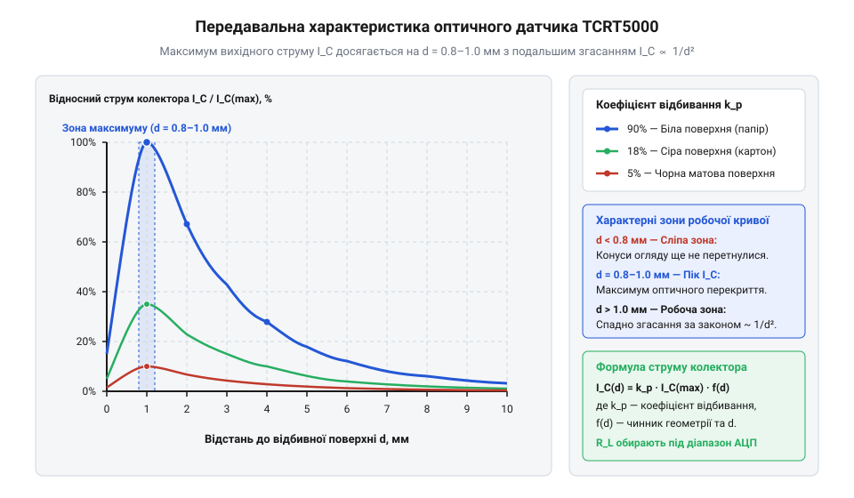
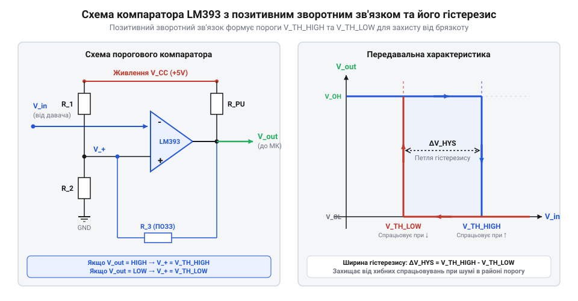

# Математичний розрахунок режимів TCRT5000 та характеристик відбивання

<preknowlist>
- [IR-давачі перешкод (FC-51 / KY-032)](root:cat-hw-sensors/ir-obstacle) — принципи випромінювання та прийому інфрачервоного світла у відкритому оптичному каналі
- [KY-010 — оптичний переривач](root:cat-hw-sensors/ky-010-interrupter) — базова схема включення фототранзистора та комутація електричного сигналу
</preknowlist>

## Непередбачуваність оптичного зчитування без розрахунку

Уявіть розробку мобільного робота для руху по лінії або промислового датчика наявності об'єкта, де серцем вимірювального вузла виступає оптичний модуль @@en|TCRT5000@@. Інженер запаює компоненти на плату, обирає «стандартний» @@en|струмообмежувальний резистор@@ 220 Ом для випромінювача та підтягувальний резистор 10 кОм для приймача, після чого підключає вихід до аналогового входу мікроконтролера. На робочому столі білий аркуш паперу дає напругу 0.2 В, а чорна ізоляційна стрічка — 0.4 В. Проте варто змінити кут нахилу датчика на п'ять градусів або увімкнути настільну лампу, як обидва матеріали починають показувати однакову напругу 0.2 В. Давач або постійно перебуває у глибокому насиченні, або взалі втрачає чутливість до темних поверхонь. Уся система стає непередбачуваною, а спроби підбирати опори «на око» перетворюються на безкінечний пошук випадкового компромісу.

Така нестабільність виникає через те, що оптичний сенсор відбивання є складним аналоговим пристроєм. На відміну від прямого проходження світла в [оптичному переривачі KY-010](root:cat-hw-sensors/ky-010-interrupter), де непрозорий прапорець повністю перекриває промінь, у рефлекторних датчиках сигналу доводиться проходити крізь відкрите середовище. Світло відбивається від матеріалу з різним ступенем розсіювання, а його інтенсивність спадає пропорційно квадрату відстані.

На відміну від пасивних інфрачервоних систем, як-от [PIR-давач руху HC-SR501](root:cat-hw-sensors/hc-sr501) чи його [мініатюрний аналог HC-SR505](root:cat-hw-sensors/hc-sr505), які реєструють власне теплове випромінювання об'єктів, модуль @@en|TCRT5000@@ спирається на власне активне підсвічування. Вихідна напруга схеми визначається довгою пропорційною залежністю: струм живлення світлодіода формує оптичний потік, який долає геометричну відстань до поверхні, відбивається відповідно до оптичних властивостей матеріалу, потрапляє в апертуру приймача й перетворюється на струм колектора, який створює падіння напруги на навантажувальному резисторі. Якщо опір навантаження обрано занадто великим, навіть слабке відбивання від темної поверхні змусить фототранзистор відкритися повністю, зміщуючи робочу точку в область насичення. Якщо ж опір занадто малий, то відбите світло від сліпучо-білого матеріалу викличе лише мікровольтний відгук, який злиється з електричними шумами.

Спроби налаштувати аналоговий @@en|опто-електронний тракт@@ у [давачах перешкод FC-51](root:cat-hw-sensors/ir-obstacle) за допомогою підлаштовного потенціометра без математичного розрахунку часто призводять до хибних спрацьовувань при зміні температури чи зовнішнього освітлення. Для побудови надійної системи необхідно математично описати кожен етап перетворення енергії в оптико-електронному каналі. Розрахунок починається з визначення електричного режиму випромінювального інфрачервоного діода, який задає вихідну потужність оптичного сигналу.

## Обчислення струму живлення інфрачервоного світлодіода

Основою оптичного каналу @@en|TCRT5000@@ є @@en|інфрачервоний світлодіод@@ (грец. *dis* — двічі, *hodos* — шлях), виготовлений на основі арсеніду галію. Діод перетворює електричний струм на невидиме оптичне випромінювання з піковою довжиною хвилі 950 нм. Оптична @@en|потужність випромінювання@@ прямо пропорційна прямому струму, який протікає через p-n перехід напівпровідника. Щоб отримати стабільний оптичний потік, який зможе подолати завади довкілля, випромінювач мусить працювати у чітко розрахованому струмовому режимі.

Напівпровідниковий діод має нелінійну вольт-амперну характеристику. У прямому ввімкненні спад напруги на діоді залишається практично сталим і для інфрачервоних випромінювачів становить близько 1.25 В (типовий діапазон від 1.2 В до 1.5 В залежно від струму та температури). Якщо підключити діод безпосередньо до джерела живлення з напругою 5.0 В, струм через p-n перехід миттєво перевищить максимально припустиме значення 60 мА, що призведе до теплового пробою компонента.

Для обмеження струму послідовно з випромінювачем вмикають @@en|баластний резистор@@. Нехай `V_CC` — напруга живлення схеми у вольтах, `V_F` — прямий спад напруги на інфрачервоному світлодіоді у вольтах, `I_F` — розрахунковий прямий струм світлодіода в амперах, а `R_D` — необхідний опір струмообмежувального резистора в омах. Відповідно до другого закону Кірхгофа, спад напруги на резисторі дорівнює різниці між напругою живлення та прямою напругою діода. За законом Ома опір баластного резистора обчислюється через відношення цієї різниці напруг до заданого робочого струму:

```
R_D
= (V_CC - V_F) ÷ I_F      [законом Ома для ділянки кола з послідовним ввімкненням]
```

Ця формула показує, що опір резистора лінійно залежить від різниці напруг і обернено пропорційний заданому струму живлення. Знаючи потрібний опір, необхідно вибрати найближчий стандартний номінал із ряду E24 та розрахувати фактичний струм і розсіювану потужність, щоб запобігти перегріву елемента.

**Розрахунок баластного резистора для V_CC = 5.0 V та I_F = 15 mA**

Для забезпечення високої чутливості без перевантаження світлодіода оберемо робочий струм `I_F = 15 мА` (0.015 А) при напрузі живлення `V_CC = 5.0 В` та паспортному прямому спаді напруги `V_F = 1.25 В`.

```
R_D
= (5.0 - 1.25) ÷ 0.015    [підстановка параметрів живлення та струму]
= 3.75 ÷ 0.015            [обчислення спаду напруги на резисторі]
= 250 Ω                   [розрахунковий опір баластного резистора]
```

Найближчим стандартним номіналом із поширеного ряду E24 є опір 240 Ом або 270 Ом. Якщо обрати резистор 240 Ом, фактичний струм через світлодіод дещо зросте. Обчислимо фактичний струм `I_F_actual`:

```
I_F_actual
= (5.0 - 1.25) ÷ 240      [обчислення фактичного струму для номіналу 240 Ом]
= 3.75 ÷ 240              [ділення напруги 3.75 В на опір 240 Ом]
= 0.015625 A = 15.63 mA   [фактичний робочий струм через світлодіод]
```

Для вибору корпусу резистора обчислимо теплову потужність `P_R` у ватах, яка розсіюється на баластному резисторі під час безперервної роботи. Потужність визначається як добуток спаду напруги на резисторі та фактичного струму:

```
P_R
= (V_CC - V_F) × I_F_actual    [формула теплової потужності на резисторі]
= 3.75 × 0.015625              [підстановка спаду напруги 3.75 В та струму 0.015625 А]
= 0.0586 W = 58.6 mW           [розсіювана теплова потужність]
```

Отримана потужність 58.6 мВт становить менше половини від стандартної граничної потужності 125 мВт для поверхнево-монтованих резисторів типорозміру 0805 (або 250 мВт для вивідних резисторів 0.25 Вт). Це гарантує стабільний температурний режим без ризику дрейфу опору від перегріву.

Слід враховувати, що напруга живлення в реальних схемах може бути нестабільною. Якщо напруга `V_CC` просяде від 5.0 В до 4.5 В, струм через світлодіод зменшиться з 15.63 мА до 13.54 мА, що спричинить падіння випромінюваної оптичної потужності на 13.4%. Для вимірювальних систем високої точності це вимагає використання стабілізованих джерел живлення. Згенерований оптичний потік спрямовується у відкритий оптичний канал, де формується передавальна характеристика сенсора.

## Моделювання передавальної характеристики оптичного каналу

Оптично-електричний тракт @@en|TCRT5000@@ складається з випромінювального інфрачервоного діода та приймального NPN кремнієвого @@en|фототранзистора@@ (грец. *phōs* — світло, англ. *transistor*, від *transfer* — переносити та *resistor* — опір). Обидва елементи розташовані в єдиному пластиковому корпусі чорного кольору. Між ними встановлено внутрішній непрозорий бар'єр, який запобігає прямому паразитному засвічуванню фототранзистора в обхід відбивної поверхні. Для розуміння роботи сенсора необхідно побудувати залежність струму колектора від відстані до поверхні та її оптичних властивостей.


*Залежність струму колектора I_C від відстані d до поверхні при різних коефіцієнтах відбивання k_r. Найвищий пік струму досягається на відстані 1.0 мм, після чого струм швидко спадає за законом обернених квадратів.*

Передавальна характеристика модуля має виражений немонотонний характер. При аналізі залежності струму колектора `I_C` від відстані `d` виділяють три характерні зони:

1. **Зона мертвеного перекриття (`0 ≤ d < 0.5 мм`)**: Коли відбивна поверхня притиснута впритул до торця сенсора, випромінене світло відбивається від матеріалу безпосередньо перед лінзою світлодіода. Через наявність центральної непрозорої перегородки відбиті промені не можуть потрапити в кут огляду фототранзистора. Пляма підсвічування та @@en|апертура@@ (лат. *apertura* — отвір) приймача не перетинаються, тому струм колектора близький до нуля (`I_C ≈ 0`). 2. **Зона максимальної чутливості (`d ≈ 1.0 мм - 1.5 мм`)**: У міру віддалення поверхні світлова пляма розширюється і входить у зону зору фототранзистора. Перетин оптичних осей випромінювача та приймача досягає максимуму при відстані `d = 1.0 мм` (для стандартного білого паперу Kodak 90%). У цій точці струм колектора набуває свого максимального значення `I_C_max`. 3. **Зона далекового згасання (`d > 2.0 мм`)**: При подальшому збільшенні відстані площа плями випромінювання стає значно більшою за вхідне вікно фототранзистора, а інтенсивність відбитого світла спадає обернено пропорційно квадрату відстані.

Математична модель вихідного струму колектора враховує електричний режим випромінювача, геометричну відстань, @@en|коефіцієнт відбивання@@ матеріалу та кут нахилу поверхні. Нехай `I_F` — прямий струм світлодіода в міліамперах, `CTR_0` — базовий @@en|коефіцієнт передачі струму@@ оптичної пари при піковій відстані для білого паперу (безрозмірне відношення `I_C / I_F`, яке для TCRT5000 зазвичай становить від 0.05 до 0.10), `f_g(d)` — нормована геометрична функція відстані (де `f_g(1.0 мм) = 1.0`), `k_r` — коефіцієнт відбивання поверхні (від 0.05 для чорної гуми до 0.90 для білого паперу), а `θ` — кут відхилення нормалі поверхні від оптичної осі сенсора в радіанах.

Струм колектора фототранзистора `I_C` у міліамперах обчислюється як добуток усіх ланок оптико-електричного тракту:

```
I_C
= I_F × CTR_0 × f_g(d) × k_r × cos(θ)    [математична модель оптико-електронного каналу]
```

Ця формула показує лінійну залежність фотоструму від струму живлення та оптичних властивостей поверхні, тоді як геометричний фактор `f_g(d)` вносить суттєву нелінійність. Для робочих відстаней `d ≥ 1.0 мм` геометричну функцію згасання можна апроксимувати відношенням квадратів відстаней `f_g(d) ≈ (1.0 ÷ d)²`.

**Розрахунок струму колектора для білої та чорної поверхонь**

Розглянемо практичний приклад розрахунку струму колектора при струмі світлодіода `I_F = 15 мА`, передавальному коефіцієнті `CTR_0 = 0.06` та перпендикулярному розташуванні поверхні (`θ = 0°`, `cos(0°) = 1.0`).

Обчислимо струм колектора `I_C_white` для білого паперу (`k_r = 0.90`) на піковій відстані `d = 1.0 мм`, де `f_g(1.0) = 1.0`:

```
I_C_white(1mm)
= 15 × 0.06 × 1.0 × 0.90 × 1.0    [підстановка значень для білої поверхні на піковій відстані]
= 0.90 × 0.90                      [обчислення базового струму колектора]
= 0.81 mA                          [струм колектора для білого паперу на відстані 1 мм]
```

Тепер обчислимо струм колектора `I_C_black` для чорної ізоляційної стрічки (`k_r = 0.05`) на тій самій відстані `d = 1.0 мм`:

```
I_C_black(1mm)
= 15 × 0.06 × 1.0 × 0.05 × 1.0    [підстановка коефіцієнта відбивання чорного матеріалу]
= 0.90 × 0.05                      [обчислення струму]
= 0.045 mA = 45 µA                [струм колектора для чорної стрічки на відстані 1 мм]
```

Розглянемо випадок, коли білий аркуш віддаляється на відстань `d = 3.0 мм`. Згасання геометричної функції становить `f_g(3.0) ≈ (1.0 ÷ 3.0)² = 1 ÷ 9 ≈ 0.111`. Обчислимо струм `I_C_white(3mm)`:

```
I_C_white(3mm)
= 15 × 0.06 × 0.111 × 0.90 × 1.0  [підстановка геометричного згасання f_g = 0.111]
= 0.81 × 0.111                     [множення пікового струму на коефіцієнт згасання]
= 0.090 mA = 90 µA                 [струм колектора білого паперу на відстані 3 мм]
```

З отриманих обчислень видно важливу інженерну особливість: струм колектора 90 мкА спостерігається як для білого паперу на відстані 3.0 мм, так і для сірого матеріалу з `k_r = 0.10` на відстані 1.0 мм. Це означає, що за допомогою одного вимірювання струму неможливо одночасно визначити і відстань, і тип матеріалу.

Контрастне відношення струмів між білою та чорною поверхнею на оптимальній відстані 1.0 мм становить `0.81 мА ÷ 0.045 мА = 18`. Таке 18-кратне розрізнення забезпечує надійний динамічний діапазон. Для фіксації цього розрізнення в електричну напругу необхідно розрахувати @@en|навантажувальний резистор@@ колектора фототранзистора.

## Розрахунок навантажувального резистора для АЦП

Сформований фототранзистором струм колектора `I_C` не можна безпосередньо подати на аналоговий вхід мікроконтролера, оскільки @@en|аналогово-цифровий перетворювач@@ (АЦП) вимірює напругу, а не струм. Щоб перетворити оптичний сигнал на електричний потенціал, у коло колектора фототранзистора послідовно вмикають @@en|навантажувальний резистор@@ `R_L`. Вибір опору цього резистора є критичним етапом проєктування: якщо опір занадто малий, розмах вихідної напруги становитиме лише сотні мілівольт, що призведе до втрати роздільної здатності АЦП; якщо ж опір надмірний, транзистор увійде в глибоке @@en|насичення@@ (лат. *saturatio* — насичення), і вихідна напруга перестане реагувати на зміну інтенсивності відбитого світла. Головна мета розрахунку полягає в отриманні максимального @@en|динамічного діапазону@@ напруги в межах робочої напруги живлення `V_CC`.

Розглянемо схему зі спільним емітером, де емітер фототранзистора підключено до спільної шини (GND), а колектор під'єднано до джерела живлення `V_CC` через навантажувальний резистор `R_L`. Вихідний аналоговий сигнал `V_OUT` знімається безпосередньо з колектора транзистора. Згідно з першим та другим законами Кірхгофа, вихідна напруга `V_OUT` дорівнює різниці між напругою живлення та спадом напруги на навантажувальному резисторі, який створюється струмом колектора `I_C`:

```
V_OUT
= V_CC - (I_C × R_L)      [рівняння вихідної напруги аналогового кола колектора]
```

Ця формула показує обернену залежність: що більший струм протікає через фототранзистор (при яскравому відбиванні від білої поверхні), то більший спад напруги виникає на резисторі `R_L` і то нижчою стає вихідна напруга `V_OUT`. Натомість при слабкому відбиванні від чорної поверхні струм колектора прямує до мінімуму, а вихідна напруга наближається до напруги живлення `V_CC`, переходячи в область @@en|відсічки@@.

Щоб забезпечити максимальний розмах сигналу для АЦП без зрізання верхівок, необхідно обрати опір `R_L` таким чином, щоб при максимальному розрахунковому струмі колектора `I_C_max` (від білої поверхні на оптимальній відстані 1.0 мм) фототранзистор залишався на межі активного режиму і не входив у глибоке @@en|насичення@@. Напруга насичення колектор-емітер `V_CE_sat` для фототранзистора в складі @@en|TCRT5000@@ становить приблизно 0.3 В. Для збереження лінійності встановлюємо мінімально припустиму напругу колектора `V_OUT_min = 0.5 В`. Звідси граничний опір навантажувального резистора `R_L_max` обчислюється як:

```
R_L_max
= (V_CC - V_OUT_min) ÷ I_C_max      [розрахунок максимального опору навантаження]
```

**Розрахунок навантажувального резистора для I_C_max = 0.81 mA та V_CC = 5.0 V**

У попередньому розділі було обчислено, що при струмі світлодіода `I_F = 15 мА` струм колектора для білого паперу становить `I_C_max = 0.81 мА` (0.00081 А), а для чорної ізоляційної стрічки — `I_C_min = 0.045 мА` (0.000045 А). Обчислимо граничний опір навантажувального резистора `R_L_max` при напрузі живлення `V_CC = 5.0 В`:

```
R_L_max
= (5.0 - 0.5) ÷ 0.00081      [підстановка параметрів живлення та максимального фотоструму]
= 4.5 ÷ 0.00081              [обчислення допустимого спаду напруги 4.5 В]
= 5555 Ω ≈ 5.56 kΩ           [граничний опір навантажувального резистора]
```

Обираємо найближчий менший стандартний номінал із ряду E24 — `R_L = 5.1 кОм` (5100 Ом), щоб гарантувати запас по напрузі вище точки насичення.

Тепер обчислимо вихідну напругу `V_OUT_white` для білого матеріалу та `V_OUT_black` для чорного матеріалу при обраному номіналі `R_L = 5.1 кОм`:

```
V_OUT_white
= 5.0 - (0.00081 × 5100)    [підстановка струму білої поверхні 0.81 мА]
= 5.0 - 4.131               [обчислення спаду напруги на R_L]
= 0.869 V                   [вихідна напруга для білого матеріалу]
```

```
V_OUT_black
= 5.0 - (0.000045 × 5100)   [підстановка струму чорної поверхні 0.045 мА]
= 5.0 - 0.2295              [обчислення спаду напруги на R_L]
= 4.7705 V ≈ 4.771 V        [вихідна напруга для чорного матеріалу]
```

Обчислимо отриманий динамічний розмах аналогової напруги `ΔV_OUT`:

```
ΔV_OUT
= V_OUT_black - V_OUT_white    [обчислення динамічного розмаху напруги]
= 4.771 - 0.869                [різниця вихідних напруг чорного та білого матеріалів]
= 3.902 V                      [динамічний розмах сигналу для АЦП]
```

Розмах напруги 3.902 В становить понад 78% від усього діапазону живлення 5.0 В. Для 10-бітного АЦП мікроконтролера (наприклад, ATmega328P із роздільною здатністю 4.88 мВ на відлік) цей розмах відповідає різниці у 799 відліків, що забезпечує високу точність розрізнення тонів сірого кольору та відстані.

Якщо припуститися помилки й обрати `R_L = 10 кОм`, як це часто роблять у типових аматорських схемах для [давачів перешкод FC-51](root:cat-hw-sensors/ir-obstacle), то вже при струмі `I_C = 0.45 мА` спад напруги досягне `0.45 × 10 = 4.5 В`, і транзистор перейде в глибоке @@en|насичення@@ з напругою `V_OUT ≈ 0.3 В`. Усі значення струму від 0.45 мА до 0.81 мА даватимуть один і той самий сигнал 0.3 В, і датчик повністю втратить здатність розрізняти світло-сірий та сліпучо-білий кольори. Якщо ж обрати занадто малий опір `R_L = 1 кОм`, розмах сигналу зменшиться до `ΔV_OUT = 3.902 В ÷ 5.1 ≈ 0.765 В`, що зробить сигнал чутливим до завад і пульсацій живлення. Розрахований аналоговий діапазон від 0.869 В до 4.771 В слугує вхідним базисом для побудови порогового цифрового вузла.

## Обчислення порогів і гістерезису компаратора

Коли аналоговий сигнал від сенсора @@en|TCRT5000@@ використовується для цифрового виявлення лінії або перешкоди, його необхідно перетворити на логічний рівень (0 або 1). Якщо подати аналогову напругу `V_OUT` безпосередньо на цифровий вхід або використати однопороговий @@en|компаратор@@ (лат. *comparare* — порівнювати) без зворотного зв'язку, пристрій стане вкрай нестійким. У момент, коли сенсор перетинає межу між чорним і білим ділянками, вихідна напруга повільно проходить через пороговий рівень. Будь-які оптичні шуми від мерехтіння зовнішнього освітлення, дрібні механічні вібрації чи електричні наводки призведуть до виникнення @@en|брязкоту@@ — швидкого неконтрольованого перемикання цифрового виходу між 0 та 1 зі частотою завад.

Щоб повністю усунути брязкіт і забезпечити чітке релейне перемикання, застосовують двопорогову схему на базі аналогового компаратора LM393 з ланцюгом @@en|позитивного зворотного зв'язку@@.


*Принципова схема компаратора LM393 з ланцюгом позитивного зворотного зв'язку R_f та передавальна характеристика гістерезису з нижнім V_TL і верхнім V_TH порогами.*

Схема побудована за інвертувальною конфігурацією: аналогова напруга `V_OUT` від колектора фототранзистора подається на інвертувальний вхід (`IN-`) компаратора LM393. На неінвертувальний вхід (`IN+`) подається опорна напруга від резистивного дільника `R_1` та `R_2`, охопленого резистором позитивного зворотного зв'язку `R_f`. Оскільки мікросхема LM393 має вихід типу @@en|відкритий колектор@@ (англ. *open collector*), до виходу підключають зовнішній підтягувальний резистор `R_pull` (типово 10 кОм) до шини `V_CC`.

Коли напруга на вході `IN-` перевищує пороговий рівень неінвертувального входу `IN+`, вихідний транзистор компаратора відкривається, і вихідна напруга падає практично до нуля (`V_OUT_dig ≈ 0 В`). Це призводить до того, що резистор `R_f` опиняється підключеним паралельно до резистора `R_2`, знижуючи потенціал на вході `IN+` до нижнього порогу спрацьовування `V_TL`. Коли ж вхідна напруга спадає нижче `V_TL`, вихідний транзистор закривається, підтягувальний резистор піднімає вихід до `V_CC`, і резистор `R_f` опиняється підключеним паралельно до `R_1`, піднімаючи потенціал `IN+` до верхнього порогу `V_TH`. Різниця між цими порогами утворює @@en|гістерезис@@ (грец. *hysteresis* — запізнення), який захищає систему від завад.

Позначимо паралельне з'єднання опорів як `R_1 ∥ R_f = (R_1 × R_f) ÷ (R_1 + R_f)` та `R_2 ∥ R_f = (R_2 × R_f) ÷ (R_2 + R_f)`. Нижній поріг перемикання `V_TL` у вольтах (коли вихід переходить у стан 0) та верхній поріг `V_TH` (коли вихід переходить у стан 1) обчислюються за формулами дільника напруги:

```
V_TL
= V_CC × (R_2 ∥ R_f) ÷ (R_1 + (R_2 ∥ R_f))    [математична формула нижнього порогу спрацьовування]
```

```
V_TH
= V_CC × R_2 ÷ ((R_1 ∥ R_f) + R_2)            [математична формула верхнього порогу спрацьовування]
```

Ширина петлі гістерезису `ΔV_H` визначається як різниця між верхнім та нижнім порогами:

```
ΔV_H
= V_TH - V_TL                                 [ширина петлі гістерезису компаратора]
```

**Розрахунок порогів та гістерезису для V_CC = 5.0 V, R_1 = R_2 = 10 kΩ, R_f = 47 kΩ**

Для надійного перемикання встановимо базову опорну напругу посередині розрахованого в розділі 4 аналогового діапазону (від 0.869 В до 4.771 В). Призначимо однакові опори дільника `R_1 = 10 кОм` та `R_2 = 10 кОм`, що дає базову напругу `V_REF = 2.5 В`. Оберемо резистор позитивного зворотного зв'язку `R_f = 47 кОм`.

Спочатку обчислимо паралельний опір `R_2 ∥ R_f`:

```
R_2 ∥ R_f
= (10 × 47) ÷ (10 + 47)      [обчислення еквівалентного опору нижнього плеча]
= 470 ÷ 57                   [ділення добутку на суму]
= 8.246 kΩ                   [еквівалентний опір R2||Rf]
```

Тепер обчислимо нижній поріг перемикання `V_TL`:

```
V_TL
= 5.0 × 8.246 ÷ (10 + 8.246)  [підстановка параметрів у формулу нижнього порогу]
= 41.23 ÷ 18.246              [обчислення ділення]
= 2.260 V                     [нижній поріг спрацьовування V_TL]
```

Далі обчислимо паралельний опір `R_1 ∥ R_f`, який через симетрію `R_1 = R_2` також дорівнює `8.246 кОм`, і обчислимо верхній поріг `V_TH`:

```
V_TH
= 5.0 × 10 ÷ (8.246 + 10)     [підстановка параметрів у формулу верхнього порогу]
= 50.0 ÷ 18.246               [обчислення ділення]
= 2.740 V                     [верхній поріг спрацьовування V_TH]
```

Обчислимо ширину петлі гістерезису `ΔV_H`:

```
ΔV_H
= 2.740 - 2.260               [різниця між верхнім та нижнім порогами]
= 0.480 V = 480 mV            [ширина петлі гістерезису компаратора]
```

Отримана ширина гістерезису 480 мВ означає, що коли датчик наближається до лінії і напруга спадає нижче 2.260 В, цифровий вихід LM393 перемикається в стан логічної одиниці (5.0 В). Для того, щоб вихід повернувся у стан логічного нуля, вхідна напруга повинна зрости вище 2.740 В. Будь-які шуми та амплітудні коливання сигналу амплітудою менше 240 мВ не зможуть викликати помилкове переключення виходу, що повністю усуває @@en|брязкіт@@.

На відміну від цифрових систем на базі [оптичного переривача KY-010](root:cat-hw-sensors/ky-010-interrupter), де поріг жорстко задано оптичною шторкою, математично розрахований двопороговий компаратор для @@en|TCRT5000@@ дозволяє адаптувати чутливість під конкретну відбивну здатність матеріалу та гарантує завадостійкість оптико-електронного тракту.