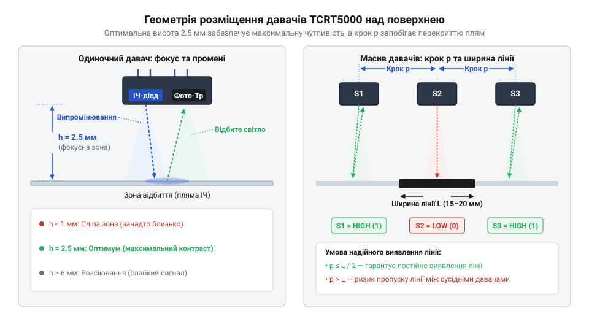
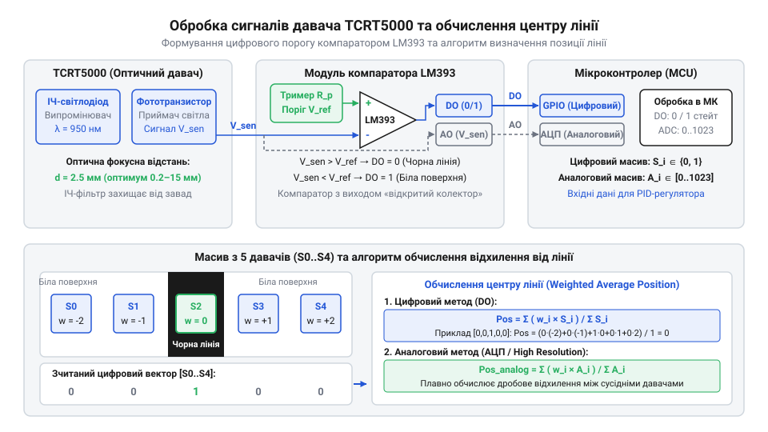

# Модуль давача лінії для робота-трекера на TCRT5000

<preknowlist>
- [IR-давачі перешкод (FC-51 / KY-032)](root:cat-hw-sensors/ir-obstacle) — Принцип випромінювання та прийому інфрачервоного світла фотодіодом чи фототранзистором для виявлення відбиття від поверхні.
</preknowlist>

## Блукання робота поза контрастною трасою

Без точно узгодженої оптичної системи зчитування мобільний робот втрачає орієнтацію на трасі, вилітаючи за межі контрастної лінії під час найменшого прискорення чи зміни освітлення. Початківці часто стикаються з тим, що збірка на одному чи двох давачах хаотично реагує на сторонні відблиски підлоги, коли висота підвісу над дорогою коливається навіть на міліметр. Утримання стійкого руху потребує розуміння фізики відбиття світла: інфрачервоний промінь, що випромінюється діодом, поглинається темними ділянками й інтенсивно відбивається від світлих поверхонь. 

Якщо відстань до поверхні обрана неправильно, пляма розсіювання світла збільшується, перекриваючи сусідні сенсори і стираючи межу між чорним та білим. Тому створення надійного робота-трекера починається не з написання складних алгоритмів руху, а з ретельного проєктування оптичного вузла, підбору компонента TCRT5000 та стабілізації живлення його випромінювачів.

Зокрема, надто низький підвіс (менше 2 мм) призводить до обмеження площі розсіювання світла, через що датчик реагує лише на мікродефекти чи пил на поверхні траси, викликаючи різкі стрибки показань АЦП. Натомість підняття сенсора вище 4 мм розмиває світлову пляму настільки, що контраст між чорною лінією та білим тлом нівелюється, а сигнал стає занадто слабким для надійного розпізнавання. Оптимальна висота 2,5 мм забезпечує чітке фокусування інфрачервоного потоку в межах робочої плями діаметром близько 2–3 мм, що є критично важливим для стабільної роботи алгоритму зваженого центру масиву.

## Оптичний блок @@en|TCRT5000@@ і компаратор

Коли мобільна платформа рухається білою поверхнею, перед нею постає завдання неперервно розрізняти відмінності у відбитті світла від білого тла та чорної лінії. Без точного визначення кількості відбитого інфрачервоного світла робот не зможе вчасно зафіксувати зсув траси, що неминуче призведе до втрати керування та з'їзду з маршруту. Для розв'язання цієї проблеми використовується спеціалізований оптичний давач @@en|TCRT5000@@, який поєднує в одному корпусі джерело випромінювання та приймач.

Оптичний блок @@en|TCRT5000@@ складається з інфрачервоного світлодіода та кремнієвого фототранзистора @@en|phototransistor@@, розміщених в єдиному пластиковому корпусі з оптичними лінзами. Світлодіод випромінює потік інфрачервоних хвиль, які спрямовуються на поверхню під давачем. Якщо під давачем знаходиться світле тла, поверхня інтенсивно відбиває промені назад; якщо ж чорна лінія — світло переважно поглинається вуглецевим барвником, і відбитий потік різко зменшується. Фототранзистор сприймає відбите світло, змінюючи свій внутрішній опір колектор-емітер залежно від інтенсивності потоку. 

Зміна опору фототранзистора безпосередньо впливає на падіння напруги в колі колектора. Якщо послідовно з колектором увімкнути резистор @@en|load resistor@@, то при збільшенні відбиття струм через фототранзистор зростає, а напруга на колекторі падає; при зменшенні відбиття струм падає, а напруга на колекторі наближається до напруги живлення. Цей аналоговий сигнал можна використовувати безпосередньо, проте для швидкого прийняття рішень часто потрібен дискретний поріг.

Аналоговий сигнал із колектора фототранзистора надходить на два можливі шляхи: безпосередньо на аналогово-цифровий перетворювач @@en|ADC@@ мікроконтролера або на вхід інтегрованого аналогового компаратора @@en|LM393@@. Компаратор порівнює напругу з давача з опорною напругою, яку інженер встановлює за допомогою прецизійного потенціометра на платі модуля. Якщо напруга перетинає цей поріг, компаратор видає чіткий дискретний рівень `HIGH` або `LOW`. Проте дискретний підхід втрачає градації сірого та проміжні стани, тоді як аналогове зчитування через АЦП дозволяє реалізувати точні алгоритми зваженого середнього для обчислення плавної позиції робота.

Для роботи з обома типами сигналів на рівні мікроконтролера використовується апаратний інтерфейс ініціалізації та багатоканального зчитування:
:::code proj-tcrt5000-line-tracker/c/include/mcu_gpio_adc.h
:::code proj-tcrt5000-line-tracker/c/src/mcu_gpio_adc.c

А високорівневий драйвер масиву інкапсулює логіку динамічного калібрування екстремумів білого й чорного, нормування вимірювань, обчислення позиції лінії та генерації керуючих сигналів:
:::code proj-tcrt5000-line-tracker/c/include/tcrt5000.h
:::code proj-tcrt5000-line-tracker/c/src/tcrt5000.c

## Фізичний монтаж і фокусування масиву

Ефективність роботи масиву TCRT5000 критично залежить від геометрії його розміщення відносно поверхні траси. Експериментально та за технічною документацією виробника оптимальна фокусна відстань між нижньою площиною давача та поверхнею становить рівно 2,5 мм. У разі збільшення цієї відстані до 5 мм і більше світлова пляма розширюється, контраст між чорною стрічкою та білим тлом зникає, а датчики починають «сліпнути».



Крок між сусідніми датчиками в масиві зазвичай обирається в межах 8–10 мм, що дозволяє перекривати стандартну ширину лінії (15–20 мм) одразу кількома сенсорами. Таке перекриття є ключовим для роботи алгоритму зваженого середнього, оскільки центр лінії визначається як градієнт інтенсивності між сусідніми елементами, а не просто як факт спрацьовування одного дискретного датчика.

Для остаточного закріплення знань розглянемо робочий приклад ініціалізації та циклічного опитування масиву з п'яти датчиків у середовищі мови C:
:::code proj-tcrt5000-line-tracker/c/src/main.c

А для об'єктно-орієнтованих проєктів на C++ аналогічна логіка інкапсулюється в класи з підтримкою фільтрації та динамічного калібрування:
:::code proj-tcrt5000-line-tracker/cpp/include/adc_interface.hpp
:::code proj-tcrt5000-line-tracker/cpp/include/tcrt5000_array.hpp
:::code proj-tcrt5000-line-tracker/cpp/src/main.cpp
:::code proj-tcrt5000-line-tracker/cpp/src/tcrt5000_array.cpp

## Обробка цифрових та аналогових сигналів

Отримавши змонтований масив давачів із дотриманням фокусної відстані, ми переходимо до найважливішого етапу — збору та обробки сигналів мікроконтролером. На цьому етапі апаратні виходи плати перетворюються на числові дані про положення робота відносно лінії.

### Дискретне опитування проти аналогового зчитування

У практиці побудови роботів-трекерів використовують два основні підходи до зчитування інформації з масиву TCRT5000:
1. **Дискретний підхід (через компаратори LM393 та піни GPIO):** Вихідний сигнал кожного датчика порівнюється на бортовому компараторі з порогом, заданим підстроювальним резистором. Мікроконтролер зчитує масив логічних рівнів (`true`/`false` або `0`/`1`). Цей метод надзвичайно швидкий, не навантажує процесор і дозволяє миттєво реагувати на краї лінії. Проте він дає лише бінарну інформацію (лінія під датчиком є чи немає), втрачаючи відтінки сірого та ступінь залягання лінії.
2. **Аналоговий підхід (через АЦП):** Аналоговий сигнал із колекторів фототранзисторів надходить безпосередньо на багатоканальний АЦП мікроконтролера. Це дає змогу вимірювати рівень відбиття у широкому діапазоні (наприклад, від 0 до 4095 для 12-бітного АЦП). Знаючи точні значення для білого поля та чорної лінії, ми можемо застосувати математичне зважування для обчислення плавного центру лінії з субпіксельною точністю.

Для реалізації такого зв'язку на рівні апаратної абстракції використовується модуль `mcu_gpio_adc.h`, який описує базові структури для роботи з пінами GPIO та каналами АЦП.

### Програмна реалізація драйвера в C

Апаратний драйвер масиву інфрачервоних давачів та алгоритм обчислення позиції за допомогою зваженого середнього реалізовано у файлах `tcrt5000.h` та `tcrt5000.c`.

Основна формула обчислення зваженої позиції лінії виглядає так:

```
Position = ∑ (i · S_step · V_i) / ∑ V_i
```

де `i` — індекс датчика (від `0` до `N-1`), `S_step` — крок ваги (наприклад, `1000`), а `V_i` — нормоване значення відбиття для `i`-го датчика.

У файлі `main.c` наведено приклад ініціалізації 5-канального масиву, симуляції калібрування та обробки трьох ключових сценаріїв: лінія по центру, зміщення вправо та повна втрата лінії.

## Алгоритми утримання лінії та перехресть

Маючи обчислену позицію лінії та похибку відхилення від центру (`position_error`), робот може формувати керуючі впливи на мотори. Для плавної їзди без ривків використовується пропорційно-диференціальний (PD) регулятор.

### Пропорційно-диференціальне керування моторами

Похибка визначається як різниця між поточною позицією лінії та еталонним центром масиву:

```
Error = Position_current - Position_center
```

Керуючий вплив (корекція швидкості) розраховується за формулою:

```
Correction = K_p · Error + K_d · (Error - Error_prev)
```

Ця корекція додається до швидкості правого мотора та віднімається від лівого (або навпаки, залежно від орієнтації драйвера моторів), що дозволяє роботу повертати назад на трасу.

### Розпізнавання перехресть і поворотів

Окрім плавного руху вздовж звичайної лінії, робот-трекер часто має проходити складні елементи:
- **Гострі повороти (90° і більше):** Виявляються тоді, коли крайні датчики масиву фіксують чорну лінію, тоді як центральні втрачають її. У такому разі робот переходить у спеціальний режим виконання повороту за таймером або до відновлення центральних сенсорів.
- **T-подібні перехрестя та перетини (+):** Виявляються одночасним спрацьовуванням більшості або всіх датчиків масиву (`total_sum` перевищує високий поріг). Логіка робота може приймати рішення про зупинку, поворот ліворуч/праворуч або рух прямо згідно з заздалегідь завантаженою картою маршруту.

## Усунення завад та автоматичне калібрування

Під час реальної експлуатації мобільного робота на трасі неминуче виникають зовнішні чинники, що спотворюють роботу оптичних датчиків.

### Боротьба з оптичними завадами та бліками

Нерівномірне зовнішнє освітлення (прямі сонячні промені, люмінесцентні лампи) може насичувати фототранзистори інфрачервоним світлом, що призводить до хибних спрацьовувань. Методи захисту включають:
1. **Програмне усереднення вибірок АЦП:** Використання багатократного зчитування (`mcu_adc_read_multi_oversampled`) із подальшим усередненням знижує вплив високочастотних шумів.
2. **Екранування датчиків:** Фізичне огородження світлодіода та фототранзистора чорними термоусадочними трубками або перегородками запобігає прямому перекриванню світла (optical cross-talk).

### Динамічне калібрування білого і чорного

Оскільки характеристики поверхні й акумуляторів змінюються, фіксовані пороги часто дають збій. Функція `tcrt5000_calibration_update` дозволяє під час стартового руху робота збирати мінімальні та максимальні значення сирого АЦП (`min_raw` та `max_raw`), адаптуючись під конкретне освітлення й тип паперу чи стрічки. Це забезпечує максимальну надійність стеження за лінією в будь-яких умовах.


*Схема проходження аналогового сигналу від фототранзистора через компаратор LM393 до АЦП та цифрових входів мікроконтролера. На ній показано формування цифрового порогу та принцип зваженого обчислення центру лінії.*