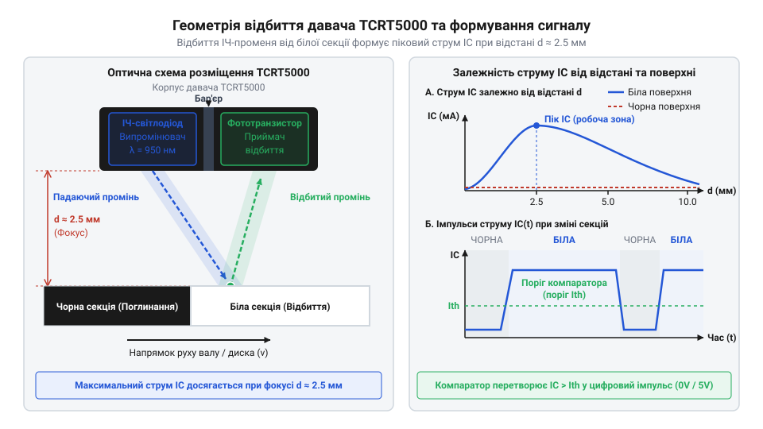
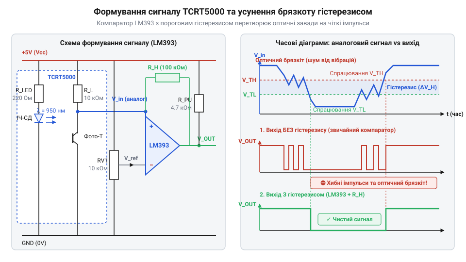

# Безконтактний оптичний тахометр та лічильник обертів на TCRT5000

<preknowlist>
- [KY-010 — оптичний переривач](root:cat-hw-sensors/ky-010-interrupter) — принцип оптичного переривання світлового потоку та підрахунку дискретних імпульсів
- [IR-давачі перешкод (FC-51 / KY-032)](root:cat-hw-sensors/ir-obstacle) — принцип роботи ІЧ-пари випромінювач-приймач та компараторне формування цифрового сигналу
</preknowlist>

## Проблема безконтактного вимірювання швидкості обертання

Механічні контактори, колекторні щітки та механічні енкодери створюють постійне тертя, піддаються зношуванню і вносять механічні спотворення у вимірювання швидкості легких валів або високошвидкісних моторів. Пряме механічне зчитування обертів фізично обмежує частоту обертання через інерційність рухомих елементів і створює ризик заклинювання чи пошкодження механізму. Для безконтактного визначення частоти обертання та кутового положення вала необхідна альтернатива, яка не створює навантаження на рухому частину і працює на основі зміни оптичних властивостей поверхні.

Вирішенням цієї задачі є фіксація контрастних міток на диску за допомогою відбивального оптичного давача @@en|TCRT5000@@, який працює без механічного зв'язку з елементом, що обертається. ІЧ-випромінювач сенсора спрямовує світловий потік на поверхню диска, де білі або дзеркальні ділянки ефективно відбивають фотони назад до фототранзистора, тоді як чорні чи матові секції поглинають випромінювання. Ефективність такого відбиття безпосередньо залежить від кута нахилу датчика відносно нормалі поверхні та відстані до неї: навіть незначний перекіс або биття вала змінюють інтенсивність відбитого потоку, створюючи ризик помилкових спрацьовувань. Просторова стабілізація та оптичне калібрування дозволяють надійно перетворити рух чорно-білих секторів на послідовність електричних імпульсів.


*Оптична схема розміщення давача TCRT5000 відносно контрастної мітки на рухомому диску з фокусною відстанню та зміною струму фототранзистора при переході між секціями.*

## Фізика відбиття та оптичне узгодження TCRT5000

Безконтактне зчитування світлового відбитку від рухомого диска з контрастними секторами базується на різниці коефіцієнтів відбиття інфрачервоного світла від білої та чорної поверхонь. Усередині модуля @@en|TCRT5000@@ розташовані інфрачервоний світлодіод @@en|IR-LED@@ та фототранзистор, об'єднані в єдиному корпусі з пластиковими лінзами. Світлодіод випромінює інфрачервоні промені в напрямку поверхні, а фототранзистор приймає відбите випромінювання. 

Фокусна відстань у діапазоні від 0.2 до 2.5 мм є критичною для перепаду струму фототранзистора, оскільки при занадто малому або занадто великому зазорі інтенсивність відбитого світла падає, а контраст між секторами зникає. Для забезпечення надійного перемикання необхідно правильно розрахувати обмежувальний резистор світлодіода та підтягувальний резистор колектора фототранзистора:

```
I_f = (V_cc - V_f) / R_limit        [Закон Ома для кола випромінювача]
    = (5.0 - 1.2) / 220
    = 3.8 / 220
    ≈ 0.0173 А                      [Струм ІЧ-діода: 17.3 мА]
```

Отриманий струм забезпечує достатню інтенсивність випромінювача без ризику його перегріву. Аналогічно розраховується напруга на колекторі фототранзистора при максимальному освітленні, коли його внутрішній опір мінімальний, що дозволяє узгодити вихідний сигнал з входами мікроконтролера. Правильне геометричне розташування датчика відносно поверхні та підбір номіналів резисторів гарантують чітку амплітуду сигналу при проходженні мітки.

## Формування сигналу та захист від завад

Сформований фототранзистором аналоговий сигнал залежить від фонового засвічення приміщення сонячним чи штучним світлом і має пологий фронт на межах контрастних секцій, що викликає хибні спрацьовування переривань мікроконтролера. Для усунення цієї проблеми сигнал збирається та порівнюється з еталонним значенням. 

Пряме зчитування через АЦП дає повну градацію сигналу, але вимагає частих опитувань, тоді як апаратний [компаратор LM393 у схемотехніці давачів](root:cat-hw-sensors/sound-lm393) з позитивним зворотним зв'язком (гістерезисом) формує миттєвий крутий логічний фронт, повністю усуваючи брязкіт на краях секторів диска.


*Формування сигналу компаратором LM393 з регульованим порогом та усуненням оптичного брязкоту за допомогою петлі гістерезису.*

Впровадження гістерезису усуває хибні перемикання цифрового виходу при коливаннях напруги поблизу порогового рівня. Налаштування порогу спрацьовування компаратора за допомогою змінного резистора дозволяє адаптувати чутливість до конкретної відбивної здатності диску та зовнішнього освітлення. Після цього сформований цифровий сигнал повністю підготовлений для подачі на апаратні переривання мікроконтролера.

## Схема підключення та апаратне захоплення імпульсів

Маючи чистий цифровий сигнал від компаратора, система переходить до його обробки у мікроконтролері без втрати коротких спалахів на високих обертах. Сигнал з виходу компаратора подається на спеціалізований вивід мікроконтролера, здатний генерувати апаратне переривання по фронту або спаду (EXTI), або безпосередньо на [вхід захоплення таймера](root:hw-arch/capture-compare) (Input Capture).

Підключення вимагає надійної підтяжки лінії живлення та мінімізації довжини дротів для запобігання наведенням. Для обробки імпульсів на високих частотах (до кількох кілогерців при багатосекторних дисках) використовують апаратні переривання за спадним фронтом (falling edge), що відповідає моменту входу білої мітки під оптичну вісь датчика. Усередині короткого обробника ISR фіксується високоточна мітка часу (в мікросекундах), після чого керування повертається в основну програму.

## Обчислення обертів та програмне фільтрування

Отримавши потік апаратних імпульсів та їхні часові позначки `t_i`, мікроконтролер обчислює тривалість періоду між сусідніми мітками `Δt = t_i - t_{i-1}`. Якщо диск має `S` однакових контрастних секторів (наприклад, 4 мітки на оберт), то повний оберт вала відповідає `S` імпульсам.

Розрахунок поточної швидкості обертання у обертах за хвилину (RPM) виконується за формулою:

```
RPM = (60 · 1 000 000) / (S · Δt_avg_us)
```

де `S` — кількість міток на диску, а `Δt_avg_us` — середній період між імпульсами в мікросекундах.

Оскільки на високих обертах або при мікродефектах поверхні виникають випадкові викиди, безпосередній розрахунок за одним інтервалом дає значний шум. Для стабілізації показників застосовують [ковзне усереднення](root:com-signal/moving-average) (Moving Average) у кільцевому буфері з вікном на 8 вибірок, а також дебаунс-фільтр, який ігнорує надкороткі імпульси (`dt < 500 мкс`). Якщо імпульси відсутні понад 0.5 секунди, алгоритм фіксує повну зупинку вала (`0 RPM`).

:::tabs
@tab C (ESP-IDF)
:::code proj-tcrt5000-optical-encoder/c/esp-idf/tcrt5000-tachometer.c
@tab C++ (Arduino)
:::code proj-tcrt5000-optical-encoder/cpp/arduino/TcrtTachometer.cpp
:::