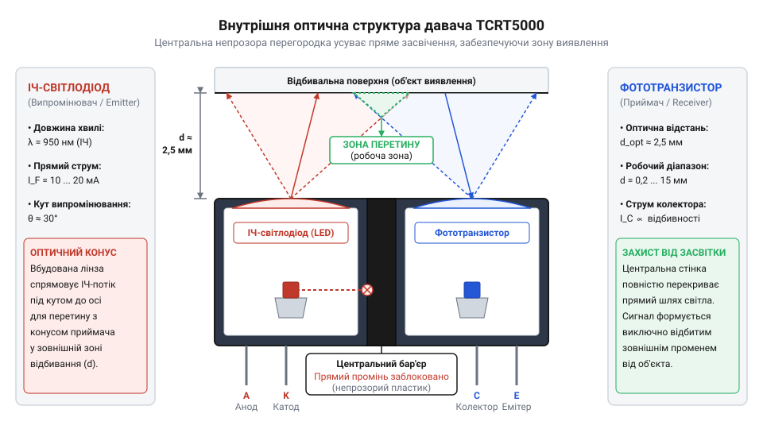
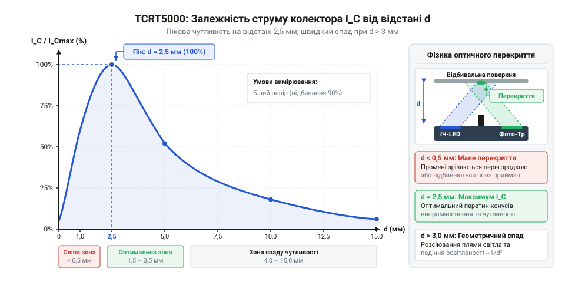
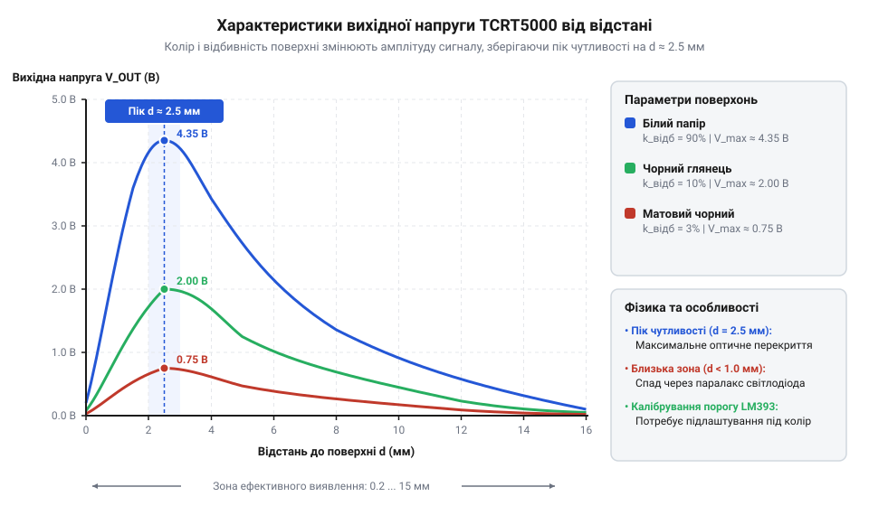
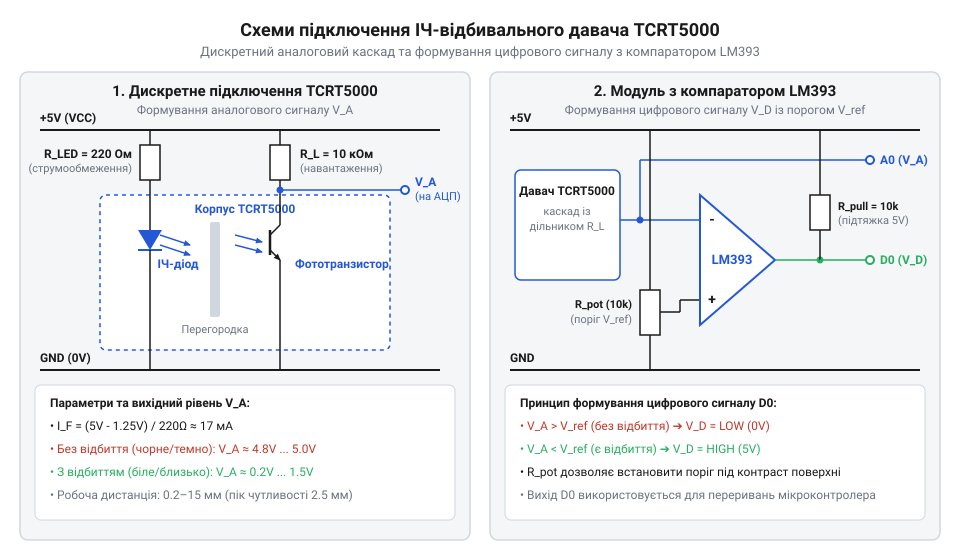
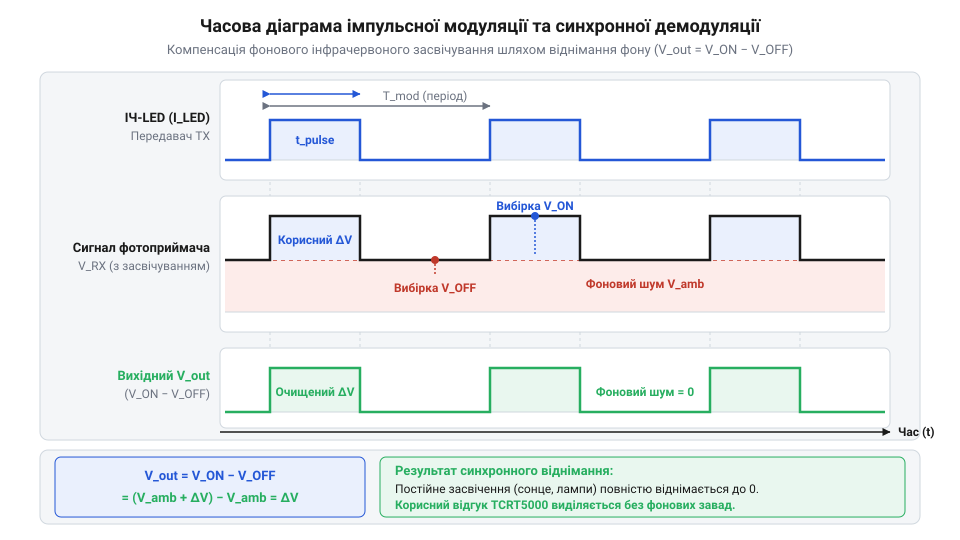
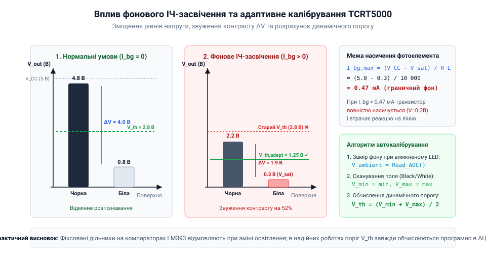

# TCRT5000 — ІЧ-відбивальний давач

<preknowlist>
- [KY-010 — оптичний переривач](root:cat-hw-sensors/ky-010-interrupter) — принцип роботи оптопари з ІЧ-світлодіода та фототранзистора у режимах відсічки та насичення
- [IR-давачі перешкод (FC-51 / KY-032)](root:cat-hw-sensors/ir-obstacle) — поняття про відбивання інфрачервоного променя та компараторну обробку оптичного сигналу
</preknowlist>

## Проблема безконтактного виявлення зносних поверхонь

Коли у виробничих автоматах чи робототехнічних системах виникає задача фіксувати положення деталі, рахувати оберти вала або виявляти появу матеріалу на конвеєрі, першим розглядають встановлення механічних кнопок чи тумблерів. Проте в динамічних механізмах із високою частотою спрацьовувань механічний @@en|кінцевий вимикач@@ (від грец. *mēchanē* — знаряддя та англ. *limit switch*; @@en|mechanical limit switch@@) швидко стає найменш надійною ланкою. Постійний ударний контакт штовхача об рухомий елемент викликає прискорене абразивне та усталосьне зношування контактної групи, обмежений ресурс якої зазвичай не перевищує 100 000 – 1 000 000 циклів. Крім того, пружна металева пластина всередині мікровимикача під час замикання викликає @@en|деренччання контактів@@ (від англ. *bounce* — відскок; @@en|contact bounce@@) — серію хаотичних розмикань і замикань тривалістю від 1 до 10 мілісекунд, що вимагає впровадження апаратних RC-фільтрів або програмних затримок. Фізичне натискання також створює небажане @@en|тертя@@ (від лат. *frictio* — тертя; @@en|friction@@), яке здатне спотворити траєкторію прецизійних деталей, гальмувати мікромотори чи залишати подряпини на чутливих поверхнях.

Ще виразніше обмеження механічного контакту проявляється тоді, коли геометрична висота поверхні залишається незмінною, а змінюються лише її оптичні властивості. Наприклад, під час розробки [автономних мобільних роботів](root:cat-hw-sensors/ir-obstacle) система має утримувати рух уздовж чорної траєкторії, нанесеної на біле покриття. Механічний штовхач принципово неспроможний відрізнити білий папір від чорної фарби, оскільки обидві ділянки утворюють єдину гладку площину. Для виявлення межі забарвлення необхідний фізичний канал, який здатний оцінювати коефіцієнт відбивання світла без застосування механічного зусилля до об'єкта.

Використання фоторезистивних чи фотодіодних схем у видимому спектрі розв'язує задачу безконтактності, проте створює високу вразливість до змін фонової освітленості. Зміна денного світла з вікна чи увімкнення люмінесцентного освітлення змінює рівень засвічення фотоприймача на кілька порядків, викликаючи хибні спрацьовування. Щоб відокремити корисний зондувальний сигнал від навколишніх завад, оптичні системи виявлення перенесли в ближній інфрачервоний спектральний діапазон із довжиною хвилі близько `950 нм`. Вибір цієї довжини хвилі диктується фізикою напівпровідника: ширина забороненої зони кремнію становить `1.12 еВ`, тому фотони з довжиною хвилі `950 нм` і енергією близько `1.31 еВ` ефективно збуджують @@en|внутрішній фотоефект@@ (від грец. *phōs* — світло та лат. *effectus* — виконання; @@en|internal photoelectric effect@@). Таке випромінювання проникає в товщу кремнію саме на глибину збідненої зони, яку утворює @@en|p-n перехід@@ (від лат. *positivus* — позитивний та *negativus* — негативний; @@en|p-n junction@@), де розділення згенерованих електронно-діркових пар є найефективнішим. Це формує пік @@en|спектральної чутливості@@ (від лат. *spectrum* — видіння, образ; @@en|spectral sensitivity@@) кремнієвого @@en|фототранзистор@@-а, який ідеально відповідає смузі випромінювання арсенід-галієвих @@en|інфрачервоний світлодіод@@-ів. Для остаточного відсікання завад приймальний кристал накривають компаундом, який працює як @@en|фільтр денного світла@@ (від англ. *daylight filter*; @@en|daylight filter@@). Фізичний механізм його дії полягає у вибірковому поглинанні: спеціальні барвники у полімерній матриці інтенсивно поглинають видимі хвилі коротше `700 нм` (у діапазоні `400–700 нм`) за рахунок резонансних електронних переходів, проте залишаються повністю прозорими для інфрачервоних хвиль, пропускаючи понад `90%` фотонів із довжиною хвилі `950 нм` безпосередньо до напівпровідникового кристала.

У просторовій організації оптичних давачів застосовують дві базові схеми: на прохід та на відбивання. Якщо розглянути [типові оптичні переривачі](root:cat-hw-sensors/ky-010-interrupter), випромінювач та приймач у них спрямовані назустріч один одному через вузьку щілину. Ця конфігурація чудово працює для розпізнавання зубців енкодерного диска, але абсолютно непридатна, якщо об'єкт є суцільним, рухається вздовж поверхні або доступний для зондування лише з одного боку. Для таких задач застосовують відбивальне зондування: випромінювач посилає інфрачервоний промінь на поверхню, а приймач фіксує частку фотонів, що розсіялися або дзеркально відбилися від об'єкта назад у бік давача.

Перші відбивальні системи збирали з дискретних інфрачервоних світлодіодів та фототранзисторів, розпаяних поруч на друкованій платі. Проте рознесені компоненти мали суттєвий недолік: найменша вібрація або температурна деформація текстоліту викликала зсув оптичних осей, через що зона перетину променів хаотично зміщувалася. Крім того, частина випромінювання світлодіода проникала у фотоприймач напряму через бічні стінки корпусів або відбитки від плати, утворюючи постійний паразитний струм. Детальна [історія розвитку відбивальних оптопар](root:cat-hw-sensors/tcrt5000/hist-reflective-optoelectronics.md) показує шлях від таких дискретних збірок до інтегрованих оптичних модулів із фіксованою геометричною віссю.

Результатом цієї еволюції стало створення монолітних пристроїв, яскравим представником яких є @@en|TCRT5000@@ — інтегрований відбивальний @@en|оптоелектронний давач@@ (від грец. *ōptikos* — зоровий та *ēlektron* — бурштин; @@en|reflective optoelectronic sensor@@). Усередині його єдиного компактного корпусу жорстко зафіксовані випромінювальний @@en|інфрачервоний світлодіод@@ (від англ. *infrared LED*; @@en|infrared LED@@) та приймальний @@en|фототранзистор@@ (від грец. *phōs* — світло та англ. *transistor*; @@en|phototransistor@@). Таке рішення повністю ліквідує механічне зношування, забезпечує високу просторову роздільну здатність і дозволяє надійно відстежувати як наявність об'єкта на відстанях від 0.2 мм до 15 мм, так і контрастні межі кольорів.

## Оптична конструкція та перекриття TCRT5000

Стабільність роботи відбивального давача першочергово визначається геометрією його внутрішнього оптичного тракту. На відміну від дискретних схем, де світлодіод і фототранзистор рознесені на платі й можуть створювати взаємні завади, корпус @@en|TCRT5000@@ виконаний у вигляді єдиного монолітного блоку з непрозорого чорного термопласту. Цей матеріал має високий коефіцієнт поглинання в інфрачервоній області спектра, що запобігає внутрішньому розсіюванню фотонів крізь стінки корпусу.

Всередині корпусу сформовано дві окремі оптичні камери, в яких на металевому виводному каркасі закріплені кристали. Між камерами розташована суцільна непрозора @@en|оптична перегородка@@ (від лат. *septum* — огорожа; @@en|optical barrier@@). Її головне призначення — повністю заблокувати прямий шлях поширення інфрачервоного випромінювання від світлодіода до бази фототранзистора. Без цієї стінки виникає @@en|перехресне оптичне завадання@@ (від англ. *cross* — навхрест та *talk* — розмова; @@en|optical crosstalk@@), за якого фототранзистор відкривається від прямого внутрішнього випромінювання світлодіода навіть за відсутності перед давачем будь-якого відбивального об'єкта. Для детального вивчення фізичних причин оптичного просочування та методів його мінімізації дивіться матеріал про [приглушення оптичного перехресного завадання в оптопарах](root:hw-sensing/optical-crosstalk-suppression).

Обидва оптичні елементи в корпусі TCRT5000 встановлені не паралельно, а під чітко розрахованим кутом нахилу один до одного. Випромінювальний кристал @@en|інфрачервоного світлодіода@@ формує конус інфрачервоного світла з кутом розбіжності близько 30 градусів, а лінза @@en|фототранзистора@@ має відповідний конус прийому. Оптичні осі обох камер перетинаються на певній відстані перед передньою торцевою площиною давача.


*Внутрішній устрій корпусу TCRT5000: ІЧ-світлодіод та фототранзистор розміщені під кутом за непрозорою оптичною стінкою, формуючи область перетину променів.*

Завдяки такій похилій геометрії утворюється чітко окреслена @@en|область перетину оптичних осей@@. Залежно від відстані `d` між торцем TCRT5000 та відбивальною поверхнею, вихідний @@en|струм колектора@@ `I_c` фототранзистора змінюється нелінійно, формуючи три характерні зони:

1. **Сліпа зона (відстань `d < 0.2 мм`):** Коли відбивальна поверхня розташована впритул до корпусу давача, світловий конус світлодіода відбивається від поверхні під гострим кутом і впирається у верхній торець непрозорої перегородки або повертається назад у випромінювальну камеру. Перетирання оптичних осей у цій зоні відсутнє, тому відбиті фотони не потрапляють на кристал фототранзистора. Фототранзистор залишається закритим (`I_c ≈ 0`), а вихідний сигнал відповідає відсутності об'єкта.

2. **Зона пікової чутливості (відстань `d ≈ 2.5 мм`):** На цій дистанції оптичні осі світлодіода та фототранзистора точно перетинаються на площині відбивального матеріалу. Пляма інфрачервоного засвічення від світлодіода повністю потрапляє в поле зору лінзи фототранзистора. У результаті фототранзистор отримує максимальну щільність фотонного потоку, викликаючи максимальне генерирування носіїв заряду в p-n переході та формуючи піковий струм колектора `I_c = I_c,max`.

3. **Зона спаду за законом зворотних квадратів (відстань `d > 2.5 мм` до `15 мм`):** При подальшому віддаленні поверхні площа відбитої плями світла розширюється, а щільність оптичної потужності зменшується пропорційно квадрату відстані. Одночасно геометрична перекритість конусів випромінювання та прийому починає зменшуватися. На відстанях понад `15 мм` рівень відбитого сигналу падає до рівня внутрішніх шумів, і давач втрачає чутливість до наявності об'єкта.

Порівняльний розбір інших типів оптичних сенсорів, наведений у [широкому огляді відбивальних давачів](root:hw-sensing/optical-reflective-sensors-overview), демонструє, що саме жорстка геометрія та внутрішнє оптичне екранування TCRT5000 роблять його одним із найстабільніших рішень у своєму класі. Проте варто враховувати, що внутрішня перегородка захищає лише від прямого просочування світла всередині корпусу. Зовнішнє фонове інфрачервоне випромінювання від сонячного світла чи ламп розжарювання може вільно потрапляти в приймальну камеру ззовні. Для нейтралізації цих зовнішніх завад застосовують [методи приглушення фонового засвічення](root:hw-sensing/ambient-light-rejection-techniques), такі як імпульсна модуляція струму світлодіода та оптичне екранування робочої зони.

## Залежність вихідного сигналу від відбивання

Головна складність під час застосування @@en|TCRT5000@@ полягає у тому, що вихідний @@en|струм колектора@@ `I_c` фототранзистора не є прямою й однозначною функцією лише геометричної відстані `d` до поверхні. Електричний відгук давача визначається багатопараметричним добутком відстані, оптичних властивостей матеріалу, його кольору, текстури та кута нахилу поверхні відносно оптичної осі пристрою. Якщо проєктувальник спрощено вважає, що рівень напруги на виході відповідає лише дистанції, виникає небезпечна оптична невизначеність: темний або матовий чорний об'єкт, розташований у зоні максимальної чутливості (`d ≈ 2.5 мм`), здатний згенерувати точно такий самий слабкий струм колектора, як і яскраво-білий відбивач, віддалений на `8 мм` або `10 мм`.

Фізична передавальна характеристика давача описує залежність відносного вихідного струму колектора від відстані при зондуванні еталонної поверхні з постійним коефіцієнтом відбивання (стандартний білий екран із відбиванням 90%).


*Передавальна характеристика TCRT5000: вихідний струм колектора досягає максимуму на відстані 2.5 мм і спадає до нуля при наближенні впритул або віддаленні понад 15 мм.*

Як видно з передавальної характеристики, залежність має чітко виражений куполоподібний нелінійний характер із трьома критичними ділянками:

1. **Сліпа зона (`d < 0.2 мм`):** У разі притискання давача впритул до поверхні випромінений світловий конус перехоплюється торцем корпусу та непрозорою @@en|оптичною перегородкою@@. Фотони відбиваються назад у випромінювальний канал і не потрапляють на базу фототранзистора, через що струм колектора прямує до нуля (`I_c ≈ 0`). 2. **Зона пікового відгуку (`d ≈ 2.5 мм`):** На цій фіксованій дистанції оптичні осі світлодіода та фототранзистора перетинаються безпосередньо на площині матеріалу. Пляма інфрачервоного зондування повністю перекривається з полем зору приймальної лінзи, забезпечуючи максимальне фотонне збудження p-n переходу. За робочого струму світлодіода `I_F = 20 мА` піковий струм колектора досягає значення `I_c,max ≈ 0.5 мА – 1.5 мА`. 3. **Зона монотонного спаду (`d = 2.5 мм – 15 мм`):** При збільшенні дистанції площа світлової плями розширюється, а інтенсивність відбитого випромінювання падає обернено пропорційно квадрату відстані `1/d²`. Одночасно геометрична площа перетину приймального та випромінювального конусів зменшується, що спричиняє плавний спад струму колектора до рівня шумів на відстанях понад `15 мм`.

Поряд із геометричним фактором дистанції вирішальну роль відіграє @@en|коефіцієнт відбивання@@ (від лат. *reflectere* — повертати назад; @@en|reflectance coefficient@@) `k_refl`, який визначає частку інфрачервоних фотонів довжиною хвилі 950 нм, що повертаються від поверхні.


*Сім'я кривих вихідної напруги залежно від відстані для білого паперу, чорної матової стрічки та дзеркального металу, що показує залежність амплітуди від коефіцієнта відбивання.*

Різні матеріали поводяться в інфрачервоній області спектра зовсім не так, як у видимому світлі:

- **Білий офсетний папір або світлий пластик (`k_refl ≈ 0.85 – 0.90`):** Забезпечує високе розсіяне відбивання, формуючи максимально можливу амплітуду сигналу та широкий динамічний діапазон. - **Чорна вінілова ізоляційна стрічка або сажове чорнило (`k_refl ≈ 0.05 – 0.10`):** Матеріал майже повністю поглинає інфрачервоне випромінювання. Струм колектора фототранзистора падає в 8–15 разів порівняно з білою поверхнею на тій самій відстані. - **Полірований метал або дзеркало (`k_refl ≈ 0.95 – 0.98`):** Має найвищий коефіцієнт, проте створює суто дзеркальну відбивальну картину.

Важливо розрізняти фізичний характер відбивання променів від поверхні об'єкта, оскільки на практиці реальні матеріали рідко бувають суто ідеальними розсіювачами чи дзеркалами:

- @@en|дифузне відбивання@@ (від лат. *diffusio* — розтікання; @@en|diffuse reflection@@): Спостерігається на шорстких і матових поверхнях (папір, дерево, неглянцевий пластик). Відбите випромінювання рівномірно розсіюється у півсферу відповідно до @@en|закону Ламберта@@ (від імені йоганна ламберта; @@en|Lambert's cosine law@@). Завдяки цьому давач сприймає стабільну частку фотонів навіть при помірних змінах кута орієнтації поверхні. - @@en|дзеркальне відбивання@@ (від лат. *speculum* — дзеркало; @@en|specular reflection@@): Виникає на полірованому склі чи дзеркальному металі, де кут відбивання строго дорівнює куту падіння. Якщо поверхня розташована перпендикулярно до оптичної осі давача, дзеркальний промінь повертається вузьким пучком, створюючи потужний сплеск струму. Проте найменший нахил поверхні на кут понад `10°` повністю відводить відбитий промінь убік від приймальної лінзи, викликаючи хибне відчуття відсутності об'єкта. - @@en|мікрошерохуватість поверхні@@ (від грец. *mikros* — малий та нім. *Rauheit* — шорсткість; @@en|surface microroughness@@): Співвідношення між дифузною та дзеркальною складовими відбитого світла визначається тим, як середня висота нерівностей поверхні `R_a` співвідноситься з довжиною хвилі інфрачервоного випромінювання `λ = 950 нм`. Коли мікрошерохуватість набагато менша за довжину хвилі (`R_a « λ`), фазовий фронт хвилі зберігається і переважає дзеркальне відбивання. Якщо ж `R_a` дорівнює або перевищує `950 нм`, хаотичні фазові зсуви на локальних мікрофасетах руйнують дзеркальний пучок, переводячи випромінювання у дифузний режим. Через це матеріал, який здається глянцевим у видимому світлі, для інфрачервоного випромінювання може раптово поводитися як дифузний розсіювач, або навпаки — зовні матова поверхня з дрібною структурою `R_a < 0.5 мкм` утворює потужний дзеркальний відблиск. - @@en|поляризаційні явища@@ (від грец. *polos* — вісь; @@en|polarization phenomena@@): При відбиванні інфрачервоного променя від діелектричних поверхонь (пластик, лак, фарба) під похилими кутами відбувається поляризаційне розщеплення. Наближення кута падіння до @@en|кута Брюстера@@ (від імені девіда брюстера; @@en|Brewster's angle@@, `θ_B ≈ 56°` для більшості полімерів із показником заломлення `n ≈ 1.5`) призводить до того, що p-поляризована складова випромінювання заломлюється всередину матеріалу та поглинається, а відбивається переважно s-поляризована хвиля. Дзеркальне відбивання зберігає цей стан поляризації, тоді як при дифузному розсіюванні внаслідок багаторазових внутрішніх перевідбивань відбувається @@en|деполяризація@@ (від лат. *de* — відхилення та грец. *polos* — вісь; @@en|depolarization@@) світла. Внаслідок цього орієнтація давача під кутами, близькими до кута Брюстера, викликає додаткове згасання відбитого променя та несподіване падіння струму колектора, яке неможливо передбачити лише геометричною відстанню. - @@en|кутовий відгук@@ (від англ. *angular response*; @@en|angular response@@): При збільшенні кута нахилу поверхні `α` відносний струм колектора дифузного матеріалу зменшується пропорційно `cos(α)`. Для дзеркальних поверхонь спад відгуку відбувається катастрофічно швидко за експоненційним законом через швидкий вихід вузького поляризованого пучка за межі апертури приймальної лінзи.

- @@en|дифузне відбивання@@: Спостерігається на шорстких і матових поверхнях (папір, дерево, неглянцевий пластик). Відбите випромінювання рівномірно розсіюється у півсферу відповідно до @@en|закону Ламберта@@. Завдяки цьому давач сприймає стабільну частку фотонів навіть при помірних змінах кута орієнтації поверхні. - @@en|дзеркальне відбивання@@: Виникає на полірованому склі чи дзеркальному металі, де кут відбивання строго дорівнює куту падіння. Якщо поверхня розташована перпендикулярно до оптичної осі давача, дзеркальний промінь повертається вузьким пучком, створюючи потужний сплеск струму. Проте найменший нахил поверхні на кут понад `10°` повністю відводить відбитий промінь убік від приймальної лінзи, викликаючи хибне відчуття відсутності об'єкта. - @@en|кутовий відгук@@: При збільшенні кута нахилу поверхні `α` відносний струм колектора дифузного матеріалу зменшується пропорційно `cos(α)`. Для дзеркальних поверхонь спад відгуку відбувається катастрофічно швидко за експоненційним законом.

Для аналітичного розрахунку очікуваного струму колектора в інженерній практиці застосовують мультиплікативну модель:

```
I_c(d, k_refl, α) = I_c,max · Φ_norm(d) · k_refl · cos(α)
```

де `I_c,max` — максимальний струм колектора для еталонної білої поверхні (`k_refl = 1.0`) на дистанції 2.5 мм при обраному струмі світлодіода `I_F`; `Φ_norm(d)` — нормована геометрична функція перекриття променів (`Φ_norm(2.5 мм) = 1.0`); `k_refl` — відносний коефіцієнт відбивання досліджуваного матеріалу; `cos(α)` — кутовий коефіцієнт нахилу.

**Умова:** Розрахувати очікуваний струм колектора `I_c` для чорної матової лінії (`k_refl = 0.12`), розташованої на робочій відстані `d = 2.5 мм` під кутом `α = 0°`, якщо для еталонного білого матеріалу при струмі світлодіода `I_F = 20 мА` пікове значення становить `I_c,max = 1.0 мА`.

```
I_c = I_c,max · Φ_norm(2.5 мм) · k_refl · cos(0°)
    = 1.0 мА · 1.0 · 0.12 · 1.0      [підстановка параметрів d = 2.5 мм та k_refl = 0.12]
    = 0.12 мА                         [обчислення струму колектора для чорного кольору]
```

Отже, при переході давача з білої поверхні (`I_c = 1.0 мА`) на чорну лінію (`I_c = 0.12 мА`) струм колектора змінюється у 8.3 рази. Ця контрастна різниця дозволяє впевнено фіксувати межу розділу поверхонь.

Детальний математичний апарат, що описує геометричне перекриття світлових конусів, інтегральну модель оптичного відгуку та аналітичний розрахунок струмів, винесено в [математичний розрахунок режимів TCRT5000](root:cat-hw-sensors/tcrt5000/math-tcrt5000-transfer-and-resistors.md).

Здатність чітко розрізняти контрастні плями застосовується при побудові [модулів розпізнавання лінії](root:cat-hw-sensors/tcrt5000/proj-tcrt5000-line-tracker.md), де масив давачів визначає відносне зміщення мобільного робота відносно чорної траєкторії. Аналогічно, у [безконтактних оптичних тахометрах](root:cat-hw-sensors/tcrt5000/proj-tcrt5000-optical-encoder.md) чергування чорних та дзеркальних секторов на кодувальному диску створює періодичні імпульси струму колектора для підрахунку обертів вала. Загальне зіставлення параметрів TCRT5000 з іншими типами фотоприймачів наведено в [огляді оптичних відбивальних давачів](root:hw-sensing/optical-reflective-sensors-overview).

## Схемотехніка дискретного підключення та модулів

Для перетворення первинного фотоструму колектора `I_c` у стабільний напруговий сигнал `V_out`, придатний для обробки мікроконтролером, необхідно правильно розрахувати елементи обв'язки. Некоректний вибір резисторів спричиняє або перехід фототранзистора в @@en|режим насичення@@ (від лат. *saturatio* — насичення; @@en|saturation mode@@), при якому втрачається чутливість до зміни коефіцієнта відбивання, або занадто малу амплітуду сигналу, що тоне у власних шумах АЦП.

Зчитування сигналу TCRT5000 реалізують у вигляді дискретної транзисторної схеми або із застосуванням готових планарних модулів.


*Принципові схеми включення TCRT5000: дискретне зчитування через аналоговий дільник та цифрове формування сигналу на компараторі LM393.*

У дискретній схемі підключення випромінювальна та приймальна частини TCRT5000 розраховуються окремо:

1. **Випромінювальне коло ІЧ-світлодіода:** Світлодіод вмикають у прямому напрямку через @@en|струмообмежувальний резистор@@ (від лат. *resistere* — чинити опір; @@en|current-limiting resistor@@) `R_LED` (або `R_1`). Величина опору обчислюється за законом Ома з урахуванням прямого падіння напруги на діоді `V_F ≈ 1.25 В` (при `I_F = 20 мА`):

```
R_LED = (V_CC - V_F) / I_F
```

**Умова:** Розрахувати номінал резистора `R_LED` для живлення ІЧ-світлодіода від джерела `5.0 В` при робочому струмі `20 мА` та прямому падінні напруги `V_F = 1.25 В`.

```
R_LED = (V_CC - V_F) / I_F
      = (5.0 - 1.25) / 0.020    [підстановка напруги живлення V_CC та струму I_F]
      = 3.75 / 0.020            [обчислення спаду напруги на резисторі]
      = 187.5 Ом                [розрахований опір]
```

Отримане значення округлюють до найближчого номіналу стандартного ряду E24: `180 Ом` або `200 Ом`. За опору `180 Ом` реальний струм становить `I_F = (5.0 - 1.25) / 180 = 20.8 мА`, що забезпечує номінальну оптичну потужність випромінювання.

2. **Приймальне коло фототранзистора:** Фототранзистор вмикають за схемою зі спільним емітером, де колектор підтягнутий до шини живлення `V_CC` через @@en|навантажувальний резистор@@ (від англ. *load resistor*; @@en|load resistor@@) `R_L` (або `R_2`), а емітер з'єднаний із землею `GND`. Вихідну аналогову напругу `V_out` знімають безпосередньо з вузла колектора:

```
V_out = V_CC - I_c · R_L
```

При відсутності відбивача або над чорною поверхнею струм фототранзистора мізерно малий (`I_c ≈ 0`), тому спад напруги на `R_L` відсутній і `V_out ≈ V_CC` (високий логічний рівень). При появі білого відбивача струм `I_c` зростає до `1 мА`, викликаючи падіння напруги на `R_L` та зниження `V_out` до нуля (низький логічний рівень).

Якщо добуток `I_c · R_L` перевищує `V_CC - V_CE,sat` (де напруга насичення колектор-емітер `V_CE,sat ≈ 0.2 В – 0.4 В`), фототранзистор переходить у @@en|режим насичення@@. В області насичення подальше збільшення інтенсивності відбитого світла не викликає падіння `V_out`, і давач втрачає аналогову пропорційність.

Вибір номіналу `R_L` визначає компроміс між чутливістю та динамічним діапазоном:
- Малий опір (`R_L = 1 кОм – 4.7 кОм`): Запобігає насиченню при сильному засвіченні та забезпечує високу швидкість перемикання, але дає невелику зміну напруги `ΔV_out`. - Великий опір (`R_L = 10 кОм – 47 кОм`): Забезпечує високу напругову чутливість `ΔV_out` для слабковідбивальних поверхонь, проте підвищує ризик насичення від фонового денного світла. Стандартним оптимальним вибором є номінал `10 кОм`.

Для цифрових застосувань широкого вжитку набули готові планарні модулі, у які інтегровано [диференціальний компаратор LM393](root:hw-analog/lm393-differential-comparator-module). Схема містить багатооборотний підлаштовний потенціометр, який задає опорну @@en|порогову напругу@@ (від англ. *threshold voltage*; @@en|threshold voltage@@) `V_ref` на інвертуючому вході компаратора. На неінвертуючий вхід подається аналоговий сигнал з колектора TCRT5000. Коли `V_out` падає нижче `V_ref` (поява білої поверхні), компаратор перемикає цифровий вихід `DO` у низький стан.

Оскільки LM393 має вихід із відкритим колектором, на платі модуля встановлено резистор підтяжки `10 кОм` до шини `V_CC`. Для відсікання високочастотних шумів та усунення деренччання сигналу на межі спрацьовування в схему компаратора вводять позитивний зворотний зв'язок (резистор `100 кОм – 1 МОм`), що формує апаратний @@en|гістерезис@@ (від грец. *hysterēsis* — запізнення; @@en|hysteresis@@) шириною 50–100 мВ. Модуль надає два паралельних виходи: аналоговий `AO` (для прямого зчитування через @@en|аналогово-цифровий перетворювач@@ (від англ. *analog-to-digital converter*; @@en|analog-to-digital converter@@); @@en|АЦП@@) та цифровий `DO` (для безпосереднього підключення до переривань МК).

Порівняння двох методів зчитування:
- **Аналоговий режим (АЦП):** Дозволяє реалізувати програмне адаптивне калібрування під фонове освітлення, обчислювати точну відстань до об'єкта або визначати центр лінії за допомогою алгоритмів зваженого усереднення у масиві з 4–8 давачів. - **Цифровий режим (DO):** Забезпечує миттєву бінарну реакцію з мінімальним завантаженням процесорного ядра МК, проте вимагає ручного механічного підлаштування потенціометра при зміні зовнішньої освітленості. Докладніше про алгоритми обчислення відхилення від лінії за вихідними аналоговими сигналами сенсорного масиву читайте у статті про [алгоритми центроїда та зваженого усереднення для масивів давачів лінії](root:com-signal/optoelectronic-line-tracking-algorithms).

При узгодженні рівнів 5-вольтових модулів TCRT5000 із 3.3-вольтовими мікроконтролерами (ESP32, STM32) цифровий вихід `DO` з відкритим колектором можна підтягувати безпосередньо до шини `3.3 В`. Для аналогового виходу `AO` застосовують резистивний дільник напруги (`10 кОм` / `20 кОм`), який знижує діапазон 0–5 В до безпечного інтервалу 0–3.3 В.

Для роботи в умовах сильного зовнішнього сонячного чи штучного освітлення застосовують методи динамічної завадостійкості.


*Часова діаграма імпульсної модуляції світлодіода та синхронної демодуляції сигналу фототранзистора для приглушення фонового засвічення.*

Замість постійного живлення світлодіода використовується @@en|імпульсна модуляція@@ (від лат. *modulatio* — розміреність; @@en|pulsed modulation@@): світлодіод вмикається короткочасними імпульсами тривалістю 10–50 мкс. Зчитування вихідної напруги виконується за методом @@en|синхронна демодуляція@@ (від грец. *synchronos* — одночасний; @@en|synchronous demodulation@@): мікроконтролер вимірює напругу колектора під час паузи `V_off` (фонове засвічення) та під час імпульсу `V_on` (сума фону й корисного відбивання). Корисний сигнал обчислюється як різниця `V_sig = V_off - V_on`, що повністю відсікає постійну складову засвічення. Детальніше принципи імпульсного захисту описано в [методах захисту від засвічення](root:hw-sensing/ambient-light-rejection-techniques).

Повну принципову схему з альтернативними номіналами резисторів та специфікацію виводів наведено у [специфікації розводки та електричних параметрів TCRT5000](root:cat-hw-sensors/tcrt5000/api-tcrt5000-hardware.md), а алгоритми програмного зчитування та обробки коду описано в [інтерфейсі програмного зчитування TCRT5000](root:cat-hw-sensors/tcrt5000/api-tcrt5000-driver.md).

Приклади програмної реалізації зчитування аналогового сигналу та диференціального калібрування для C (ESP-IDF) та C++ (Arduino):

:::tabs
== C (ESP-IDF)

:::code tcrt5000-d/c/esp-idf/tcrt5000-init.c

== C++ (Arduino)

:::code tcrt5000-d/cpp/arduino/setup.cpp
:::

## Завадостійкість та калібрування в пристроях

Найдеструктивнішим чинником для оптоелектронних давачів у реальних умовах є @@en|оптичне засвічення@@ (від грец. *optikos* — зоровий та слов. *світло*; @@en|ambient light interference@@) — інтенсивне зовнішнє інфрачервоне випромінювання природного або штучного походження. Сонячне світло, лампи розжарювання, галогенні прожектори та навіть побутові інфрачервоні обігрівачі мають у своєму спектрі значну частку випромінювання на довжині хвилі 950 нм. Хоча корпус @@en|TCRT5000@@ має вбудований чорний епоксидний фільтр денного світла, він відсікає лише видимий спектр (менше 700 нм), залишаючись повністю прозорим для фонових інфрачервоних фотонів. Коли ці фонові фотони потрапляють на приймальне вікно, у базі @@en|фототранзистора@@ генериться додатковий фотострум `I_bg`, який додається до корисного струму від власного @@en|інфрачервоного світлодіода@@. При значній інтенсивності фону сумарний струм викликає повне відкриття транзистора та його перехід у @@en|режим насичення@@.

Для запобігання помилковим спрацьовуванням систем виявлення розроблено процедуру діагностики оптичного засвічення. Метод полягає у вимірюванні вихідного рівня напруги колектора при примусово вимкненому зондувальному світлодіоді (`I_F = 0`). За відсутності зовнішніх завад і вимкненому світлодіоді фототранзистор перебуває в режимі відсічки, а вихідна напруга `V_out` на колекторі залишається близькою до напруги живлення `V_CC`. Якщо ж при вимкненому випромінювачі напруга `V_out` падає нижче `V_CC - 0.5 В` або прямує до напруги насичення `V_CE,sat ≈ 0.3 В`, це свідчить про наявність критичного інфрачервоного засвічення, яке спотворює вимірювання і звужує @@en|динамічний діапазон@@ (від грец. *dynamikos* — сильний; @@en|dynamic range@@) пристрою.


*Вплив фонового інфрачервоного засвічення на зміщення рівня напруги колектора TCRT5000 та графічна процедура розрахунку динамічного порогового рівня для адаптивного калібрування.*

Як видно з часових та напругових характеристик, фонове засвічення зміщує базову лінію напруги вниз, зменшуючи амплітудний контраст `ΔV` між чорною та білою поверхнями. Для кількісної оцінки стійкості схемотехнічного рішення розраховують граничний фоновий струм, при якому фототранзистор утримується на межі насичення.

**Умова:** Визначити максимально допустимий фоновий струм фототранзистора `I_bg,max`, викликаний зовнішнім інфрачервоним засвіченням, за якого давач TCRT5000 з навантажувальним резистором `R_L = 10 кОм` і живленням `V_CC = 5.0 В` збереже лінійну чутливість (вважаючи напругу насичення колектор-емітер `V_CE,sat = 0.3 В`).

```
I_bg,max = (V_CC - V_CE,sat) / R_L
         = (5.0 - 0.3) / 10000        [підстановка напруги живлення V_CC та напруги насичення V_CE,sat]
         = 4.7 / 10000                [обчислення максимального спаду напруги]
         = 0.47 мА                     [граничний фоновий струм колектора]
```

Якщо фонове випромінювання створює у фототранзисторі струм понад `0.47 мА`, потенціал колектора падає до `0.3 В`, і давач повністю втрачає здатність реагувати на відбитий промінь власного світлодіода.

Усунення оптичного засвічення реалізують на трьох рівнях: конструктивному, схемотехнічному та програмному:

- **Конструктивний захист:** Застосовують трубчасті @@en|оптичні бленди@@ (від нім. *blenden* — засліплювати; @@en|optical shroud@@) — глибокі непрозорі ковпачки або тубуси з чорного силікону чи пластику, що виступають перед торцем TCRT5000 на 2–4 мм. Бленда обмежує кут огляду фототранзистора, відсікаючи бокові промені сонячного світла під гострими кутами. - **Схемотехнічний захист:** Зменшення номіналу @@en|навантажувального резистора@@ `R_L` з `10 кОм` до `1.5 кОм – 2.2 кОм`. Оскільки граничний струм насичення обернено пропорційний `R_L`, зниження опору підвищує поріг стійкості до засвічення в 5–7 разів, хоча й пропорційно зменшує напруговий відгук `ΔV_out`. - **Активний захист за допомогою модульованого випромінювання:** Застосування @@en|імпульсної модуляції@@ струму світлодіода та @@en|синхронної демодуляції@@ сигналу дозволяє повністю відфільтрувати постійне фонове засвічення. Докладні математичні та фізичні принципи апаратної фільтрації фонового світла описано в [методах приглушення фонового засвічення](root:hw-sensing/ambient-light-rejection-techniques).

Навіть за умови захисту від засвічення абсолютні рівні напруги на виході фототранзистора змінюються залежно від зносу поверхні, пилу, вологості та робочої дистанції. Фіксований поріг перемикання, заданий потенціометром на [компараторних модулях LM393](root:hw-analog/lm393-differential-comparator-module), у польових умовах призводить до збоїв розпізнавання траєкторії.

Для вирішення цієї проблеми застосовують програмоване @@en|калібрування порогу@@ (від араб. *qalib* — форма; @@en|threshold calibration@@). За цієї процедури мікроконтролер через @@en|аналогово-цифровий перетворювач@@ (АЦП) вимірює напругу над білою поверхнею `V_white` (максимальне відбивання, найнижчий рівень напруги) та над чорною лінією `V_black` (найменше відбивання, найвищий рівень напруги). Динамічну @@en|порогову напругу@@ `V_th` обчислюють за формулою:

```
V_th = V_white + (V_black - V_white) / 2
```

Таке програмне калібрування є критично важливим при побудові [модулів роботів-трекерів ліній](root:cat-hw-sensors/tcrt5000/proj-tcrt5000-line-tracker.md), де масив із декількох давачів має одночасно адаптуватися до локальних неоднорідностей траси. Аналогічний підхід застосовують у [оптичних тахометрах та енкодерах](root:cat-hw-sensors/tcrt5000/proj-tcrt5000-optical-encoder.md), де амплітуда пульсацій від контрастних міток вала обробляється з адаптивним підлаштуванням порогового рівня під час обертання. На відміну від [піроелектричних давачів HC-SR501](root:cat-hw-sensors/hc-sr501) та їхніх [мініатюрних модифікацій HC-SR505](root:cat-hw-sensors/hc-sr505), які реагують на динамічне теплове випромінювання об'єктів, TCRT5000 вимагає постійного контролю оптичного контрасту в активному спектрі.

Повний описовий інтерфейс функцій програмної обробки сигналу з урахуванням розрядності АЦП винесено в [інтерфейсі програмного драйвера](root:cat-hw-sensors/tcrt5000/api-tcrt5000-driver.md), а схемотехніку електричного узгодження виводів описано в [апаратній специфікації TCRT5000](root:cat-hw-sensors/tcrt5000/api-tcrt5000-hardware.md). Порівняльну оцінку стійкості оптопар наведено у розділі про застосування [інфрачервоних давачів перешкод](root:cat-hw-sensors/ir-obstacle).

Приклади програмної реалізації діагностики оптичного засвічення та програмованого калібрування порогу для C (ESP-IDF) та C++ (Arduino):

:::tabs
== C (ESP-IDF)

:::code tcrt5000-d/c/esp-idf/tcrt5000-check-saturation.c

== C++ (Arduino)

:::code tcrt5000-d/cpp/arduino/sensorcalibration.cpp
:::