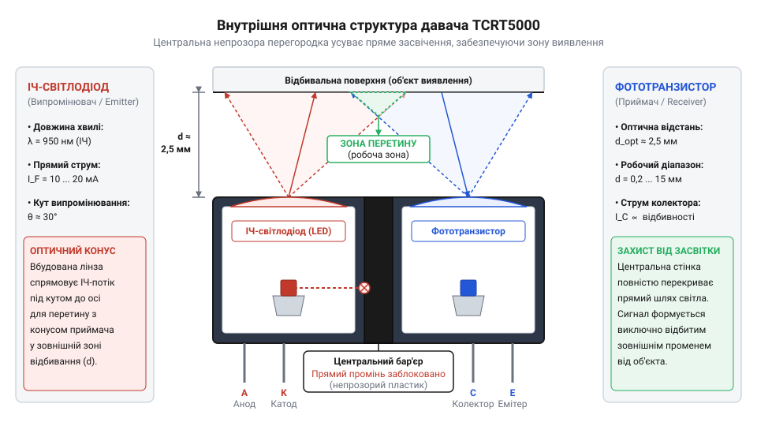
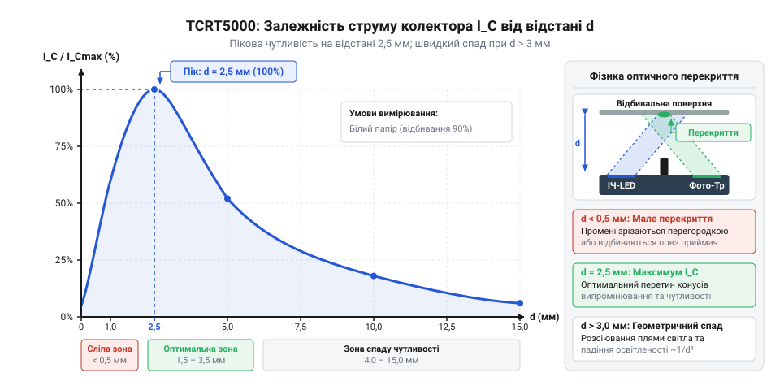
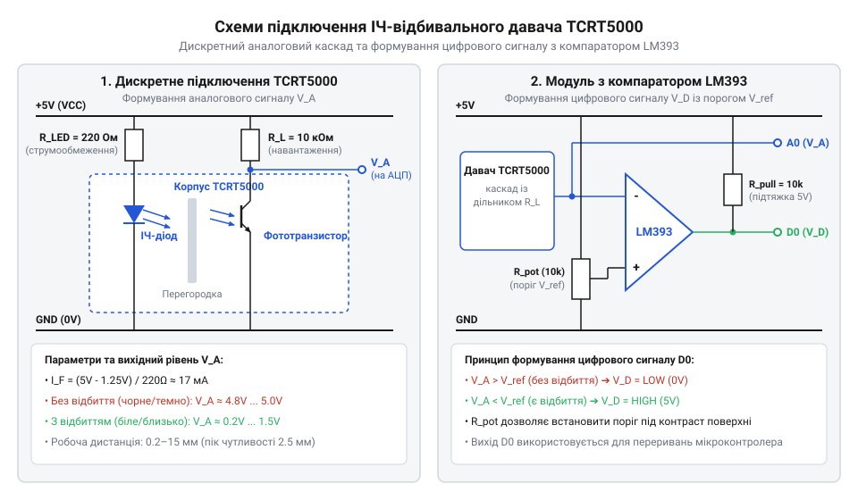

# TCRT5000 — ІЧ-відбивальний давач

<preknowlist>
- [KY-010 — оптичний переривач](root:cat-hw-sensors/ky-010-interrupter) — принцип роботи оптопари з ІЧ-світлодіода та фототранзистора у режимах відсічки та насичення
- [IR-давачі перешкод (FC-51 / KY-032)](root:cat-hw-sensors/ir-obstacle) — поняття про відбивання інфрачервоного променя та компараторну обробку оптичного сигналу
</preknowlist>

## Проблема механічного зношування контактних вимикачів

Фізичний контакт у механічних вимикачах спричиняє @@en|абразивне зношування@@ (від лат. *abrasio* — зіскрібання) і @@en|деренччання контактів@@ (від англ. *contact bounce*). Пружні пластини під час замикання відскочують, генеруючи хибні імпульси та викликаючи електроерозію. Крім того, механіка не здатна розрізняти контрастні колірні межі чи підраховувати оберти без гальмування.

Усуває тертя безконтактне оптичне зондування, але видиме світло перебивається фоновим освітленням. Тому оптичні давачі працюють у вузькому інфрачервоному діапазоні з довжиною хвилі `λ = 950 нм`. Темний полімерний корпус виконує роль вибіркового @@en|світлофільтра@@, що відсікає видимий спектр. Це гарантує стабільну роботу таких елементів, як [оптичні переривачі KY-010](root:cat-hw-sensors/ky-010-interrupter) та монолітні відбивальні @@en|оптопари@@ (від грец. *optikos* — зоровий та лат. *par* — пара).

## Внутрішня оптична геометрія давача TCRT5000

У корпусі відбивальної @@en|оптопари@@ TCRT5000 ІЧ-світлодіод та @@en|фототранзистор@@ (від грец. *phos* — світло та англ. *transistor*) розташовані під кутом, щоб їхні оптичні конуси перетиналися перед давачем. Непрозора внутрішня @@en|перегородка@@ (від англ. *baffle*) розділяє канали й блокує пряме оптичне @@en|перехресне завадання@@ (від англ. *crosstalk*) між елементами.


*Перетин конусів випромінювання та чутливості TCRT5000 визначає пік сигналу на відстані 2.5 мм.*

Оптична геометрія задає залежність струму колектора `I_C` від відстані:
1. **@@en|Сліпа зона@@ (0–0.5 мм):** упритул відбите світло оминає вікно фототранзистора або блокується перегородкою (`I_C ≈ 0`). 2. **Пікова зона (2.5 мм):** площа перетину світлової плями та зони чутливості максимальна, тому `I_C` найвищий. 3. **Зона спаду (> 2.5 мм):** інтенсивність відбитого світла згасає пропорційно квадрату відстані через розходження променів.

## Залежність вихідного сигналу від відбивання

Струм колектора `I_C` фототранзистора залежить не лише від відстані, а й від оптичних властивостей поверхні: коефіцієнта відбивання, текстури та кута нахилу.

Текстура поверхні визначає характер поширення світла:
- **@@en|Дифузне відбивання@@ (від лат. *diffusus* — розсіяний):** матові поверхні розсіюють світло в усіх напрямках, забезпечуючи передбачуваний відгук навіть при нахилі. - **@@en|Дзеркальне відбивання@@ (від англ. *specular reflection*):** глянцеві поверхні відбивають світло під кутом падіння; при нахилі промінь оминає фототранзистор, викликаючи хибну відсутність об'єкта.


*Характеристика струму колектора TCRT5000: пік на 2.5 мм із подальшим згасанням сигналу.*

Нелінійність відгуку створює проблему @@en|оптичної невизначеності@@: однаковий струм `I_C = 0.5 мА` відповідає і білій поверхні у сліпій зоні, і чорній на пікових `2.5 мм`, і білій на `8 мм`. Тому на відміну від [інфрачервоних давачів перешкод](root:cat-hw-sensors/ir-obstacle), TCRT5000 потребує фіксованої робочої відстані (1–3 мм) для надійного розпізнавання контрастних меж.

## Схемотехнічне підключення, завадостійкість і калібрування

Робочі режими обох компонентів TCRT5000 задаються резисторами: струмообмежувальним `R_D` для ІЧ-діода та навантажувальним `R_L` для фототранзистора.

Струмообмежувальний резистор `R_D` обчислюють із різниці між напругою живлення `V_CC` та прямим падінням напруги на діоді `V_F` для заданого прямого струму `I_F`. При `V_CC = 5.0 В`, `V_F = 1.25 В` та `I_F = 20 мА`:

```
R_D = (V_CC - V_F) / I_F
    = (5.0 - 1.25) / 0.020      [обчислення для струму 20 мА]
    = 187.5 Ом                  [найближчий стандартний номінал 200 Ом]
```
Отримане значення заокруглюють до стандартного номіналу 200 Ом.

Для аналогового зчитування навантажувальний резистор `R_L = 10 кОм` підключають у коло @@en|фототранзистора@@, утворюючи резистивний дільник. Номінал `R_L` добирають так, щоб транзистор не входив у режим @@en|насичення@@ (від лат. *saturatio* — насичення), зберігаючи пропорційність напруги інтенсивності світла.

У готових модулях аналоговий сигнал знімають з виходу `A0`, а цифровий `D0` формує @@en|компаратор@@ (від лат. *comparare* — порівнювати) LM393 з апаратним @@en|гістерезисом@@ (від грец. *hysteresis* — відставання) для усунення брязкіту. Докладніше про функціонування вихідного каскаду з відкритим колектором та налаштування гістерезису читайте у статті про [компаратор напруги LM393](root:hw-analog/lm393-differential-comparator-module).


*Схемотехніка включення TCRT5000: аналоговий дільник напруги та цифровий каскад на компараторі LM393 з гістерезисом.*

Зовнішнє ІЧ-засвічення спотворює сигнал, тому поруч зі світлозахисними кожухами застосовують @@en|адаптивне калібрування@@ (від лат. *adaptare* — пристосовувати). При старті система зчитує напругу на білому `V_white` та чорному `V_black` тлі, обчислюючи поріг `V_th = (V_white + V_black) / 2`. Докладніше про алгоритми динамічного визначення порогу та компенсацію фонового освітлення читайте у статті про [адаптивне калібрування оптичних давачів](root:hw-sensing/adaptive-sensor-calibration).

Приклад реалізації адаптивного зчитування:

:::tabs
@tab C++|arduino
```cpp|arduino
const int ANALOG_PIN = A0;
int thresholdVoltage = 512;

void calibrateSensor() {
    int valWhite = analogRead(ANALOG_PIN);
    delay(2000);
    int valBlack = analogRead(ANALOG_PIN);
    thresholdVoltage = (valWhite + valBlack) / 2;
}

bool isBlackLine() {
    return analogRead(ANALOG_PIN) > thresholdVoltage;
}
```
@tab C|esp-idf
```c|esp-idf
#include "driver/adc.h"

static int threshold_raw = 2048;

void sensor_calibrate(adc1_channel_t channel) {
    int val_white = adc1_get_raw(channel);
    vTaskDelay(pdMS_TO_TICKS(2000));
    int val_black = adc1_get_raw(channel);
    threshold_raw = (val_white + val_black) / 2;
}

bool sensor_is_black(adc1_channel_t channel) {
    return adc1_get_raw(channel) > threshold_raw;
}
```
:::