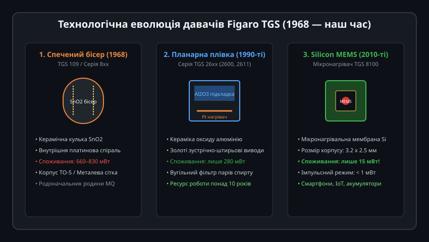
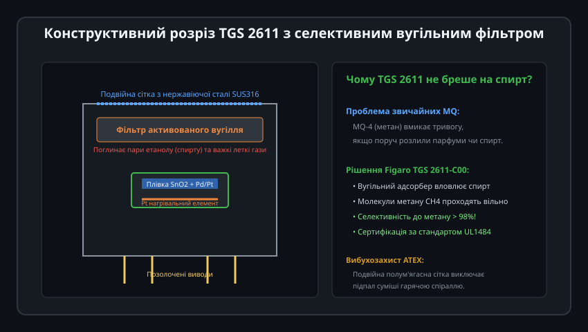
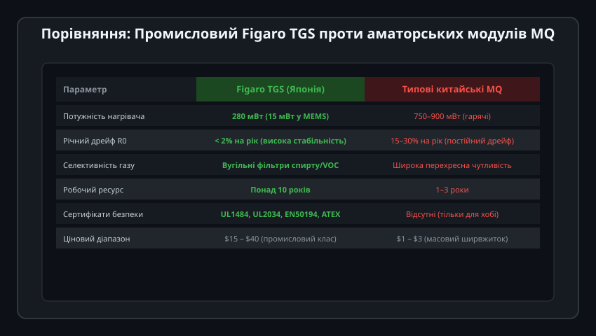
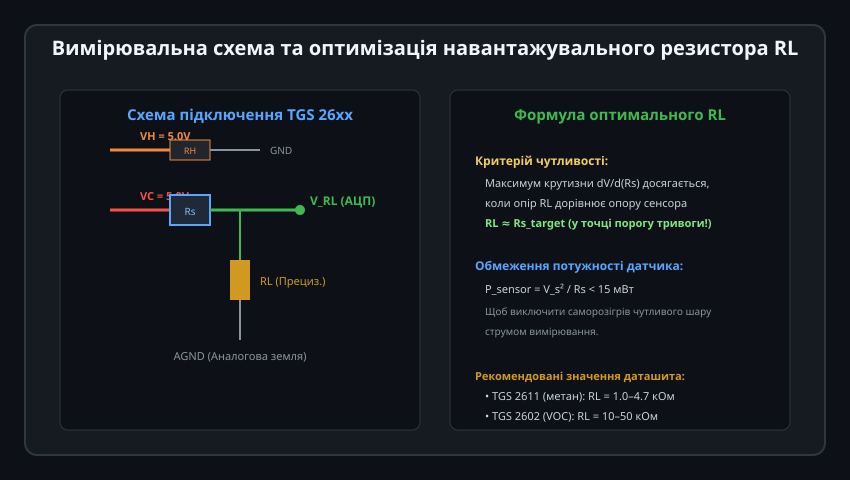
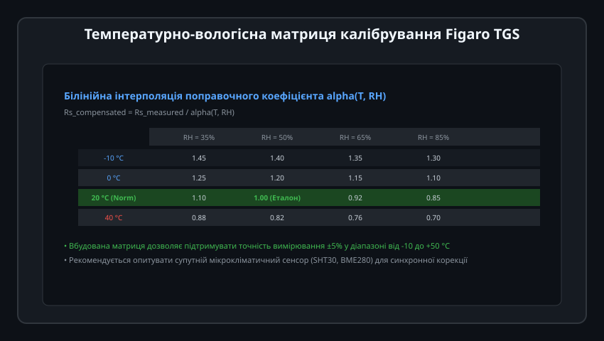

# Поглиблений інженерний аналіз та схемотехніка давачів Figaro TGS

Сенсори Figaro TGS є беззаперечним лідером промислової метрології газів завдяки бездоганному контролю технології спікання діоксиду олова, нанорозмірним каталізаторам та ретельному моделюванню міжкристалітних потенціальних бар'єрів. Інженерне проектування приладів на їхній основі вимагає розуміння фізики поверхневого збідненого шару, мікротермомеханіки нагрівачів та алгоритмів білінійної кліматичної корекції.

---

## 1. Міжкристалітні потенційні бар'єри та ефект переливу (Spillover Effect)

Провідність наноструктурованої плівки SnO2 визначається не об'ємним опором кристалітів, а висотою контактних енергетичних бар'єрів між окремими зернами:



### Фізико-математична модель збідненого шару:
1. **Дебаївська довжина екранування (Debye Length, L_D):**
   Товщина приповерхневого шару, з якого іони кисню відбирають вільні електрони:
   
   L_D = sqrt((epsilon_0 * epsilon_r * k_B * T) / (q^2 * n_bulk))

   де `epsilon_r ≈ 13.5` для SnO2, `n_bulk` — об'ємна концентрація електронів, `T` — абсолютна температура в Кельвінах, `q` — елементарний заряд. Для робочих температур 300–400 °C величина `L_D` становить 3–10 нм.
2. **Висота потенціального бар'єра Шотткі (q * V_s):**
   
   q * V_s = (q^2 * N_surface^2) / (2 * epsilon_0 * epsilon_r * n_bulk)

   де `N_surface` — поверхнева густина адсорбованих іонів кисню (O- або O2-).
3. **Електричний опір плівки (Закон Арреніуса):**
   
   R_s = R_bulk * exp((q * V_s) / (k_B * T))

   При попаданні газу-відновника молекули окиснюються, щільність `N_surface` зменшується, висота бар'єра `V_s` квадратично падає, а загальний опір `R_s` експоненційно знижується на кілька порядків.
4. **Каталітичний ефект переливу (Spillover Effect):**
   Введення наночастинок паладію (Pd) або платини (Pt) розміром 2–5 нм у кристалічну ґратку SnO2 прискорює дисоціацію молекул газу. Молекули метану чи водню спочатку адсорбуються на металі каталізатора з низькою енергією активації, дисоціюють на активні радикали, а потім «переливаються» на сусідній оксид олова, забезпечуючи високу чутливість за помірних температур.

---

## 2. Хімічна фільтрація та усунення перехресної чутливості

Унікальною перевагою сенсорів TGS 2611 та TGS 2610 є інтегрований у корпус адсорбційний фільтр:



### Кінетика фільтрації через активоване вугілля:
1. **Селективна адсорбція:** Вугільний шар мікропористої структури (середній діаметр пор 0.8–1.5 нм) діє як молекулярне сито.
   - Молекули етанолу (спирту, C2H5OH, кінетичний діаметр 0.45 нм) мають великий дипольний момент та міцно зв'язуються ван-дер-ваальсовими силами на поверхні вугілля.
   - Молекули метану (CH4, діаметр 0.38 нм) є неполярними, симетричними та інертними до низькотемпературної адсорбції, вільно дифундуючи крізь шар фільтра за час менше 0.5 секунди.
2. **Термін служби фільтра:** Об'єм вугільного сорбенту розрахований на поглинання типових побутових концентрацій спиртів протягом усього 10-річного паспортного терміну служби датчика без необхідності заміни чи регенерації.

---

## 3. Мікротермомеханіка кремнієвих МЕМС-сенсорів (TGS 8100)

Перехід від керамічних підкладок Al2O3 до кремнієвих підвішених мембран зробив революцію в енергоспоживанні:



### Термічна динаміка MEMS:
- Товщина діелектричної підвішеної мембрани Si3N4/SiO2 становить менше 2 мікрометрів.
- Завдяки мізерній теплоємності та виключенню теплопровідності по кремнієвій підкладці теплова постійна часу нагріву складає всього `tau_thermal = 15...25 мс`.
- Це дозволяє живити нагрівач короткими імпульсами (наприклад, 50 мс нагріву кожні 2 секунди), знижуючи середню споживану потужність до **менше 1.0 мВт**, що забезпечує до 3 років роботи від однієї літієвої дискової батареї CR2032.

---

## 4. Прецизійна схемотехніка та розрахунок навантажувального резистора

Промислові норми вимагають розділення контурів живлення нагрівача та вимірювання:



### Розрахунок чутливості та узгодження з АЦП:
Напруга на навантажувальному резисторі вимірювального кола:

V_RL = VC * (RL / (Rs + RL))

Похідна вихідного сигналу за зміною опору сенсора (крутизна чутливості):

|dV_RL / d(Rs)| = VC * RL / (Rs + RL)^2

Максимум чутливості досягається при строгій умові рівності опорів:

RL = Rs(C_target)

де `Rs(C_target)` — дійсний опір сенсора за цільової концентрації небезпеки (наприклад, 10% LEL метану = 5000 ppm CH4, за якої для TGS 2611 опір становить близько 2.2 кОм).
- **Вибір номіналу:** Оптимальним є вибір високоточного металоплівкового резистора `RL = 2.2 кОм ±0.1%` із ТКО не більше 15 ppm/°C.
- **Розділення земель:** Земля нагрівача (PGND) ведеться окремим широким провідником до блоку живлення, щоб імпульсні струми нагріву не створювали паразитних падінь напруги в сигнальному колі АЦП (AGND).

---

## 5. Промисловий C++ драйвер: білінійна інтерполяція та моніторинг старіння

Нижче наведено промисловий клас `FigaroTgsTransmitter`, що здійснює зчитування АЦП, повну термовологісну корекцію за паспортом виробника та перерахунок сигналу в % LEL (Lower Explosive Limit):



```cpp
/**
 * @file FigaroTgsTransmitter.hpp
 * @brief Промисловий драйвер давача горючих газів Figaro TGS 2611
 */

#pragma once

#include <stdint.h>
#include <stddef.h>
#include <math.h>

enum class TgsSensorStatus : uint8_t {
    NORMAL = 0,         ///< Нормальний стан атмосфери
    PRE_ALARM,          ///< Попередження (5..10% LEL)
    CRITICAL_ALARM,     ///< Аварійна тривога вибухонебезпеки (> 10% LEL)
    HEATER_FAULT,       ///< Обрив або коротке замикання нагрівача
    CALIBRATION_FAULT   ///< Неприпустимий дрейф R0
};

class FigaroTgsTransmitter {
public:
    /**
     * @param rl_ohms Опір навантажувального резистора на платі (типово 2200 Ом)
     * @param vc_volts Напруга вимірювального кола (типово 5.0 В)
     */
    FigaroTgsTransmitter(float rl_ohms = 2200.0f, float vc_volts = 5.0f)
        : rl_ohms_(rl_ohms),
          vc_volts_(vc_volts),
          r0_clean_air_(10000.0f),
          status_(TgsSensorStatus::NORMAL),
          filtered_rs_(10000.0f) {}

    /**
     * @brief Калібрування опорного опору R0 у чистому повітрі
     * @param raw_clean_adc Сирий відлік АЦП у контрольованому чистому повітрі
     * @param temp_celsius Поточна температура (°C)
     * @param rh_percent Поточна відносна вологість (%)
     */
    bool calibrateR0(uint16_t raw_clean_adc, float temp_celsius, float rh_percent, uint16_t adc_max = 4095) {
        float rs = calculateRs(raw_clean_adc, adc_max);
        if (rs < 500.0f || rs > 200000.0f) {
            status_ = TgsSensorStatus::CALIBRATION_FAULT;
            return false;
        }

        // Приведення до еталонних умов (20 °C, 65% RH)
        float alpha = getBilinearAlpha(temp_celsius, rh_percent);
        r0_clean_air_ = rs / alpha;
        filtered_rs_ = rs;
        status_ = TgsSensorStatus::NORMAL;
        return true;
    }

    /**
     * @brief Обробка циклу вимірювання
     * @param raw_adc Сире значення АЦП напруги V_RL
     * @param temp_celsius Температура повітря з датчика мікроклімату
     * @param rh_percent Відносна вологість з датчика мікроклімату
     * @return Концентрація метану у відсотках від нижньої межі вибуховості (% LEL)
     */
    float processSample(uint16_t raw_adc, float temp_celsius, float rh_percent, uint16_t adc_max = 4095) {
        float rs_meas = calculateRs(raw_adc, adc_max);

        // Фільтрація високочастотних шумів (EMA)
        filtered_rs_ = 0.20f * rs_meas + 0.80f * filtered_rs_;

        // Кліматична компенсація за 2D-матрицею Figaro
        float alpha = getBilinearAlpha(temp_celsius, rh_percent);
        float rs_norm = filtered_rs_ / alpha;

        // Розрахунок відношення Rs / R0
        float ratio = rs_norm / r0_clean_air_;

        // Степенева характеристика TGS 2611 для метану:
        // Концентрація CH4 в ppm: ppm = 5000 * pow(ratio / ratio_5000ppm, -1.85)
        // Для спрощення масштабування в % LEL (50000 ppm = 100% LEL, 5000 ppm = 10% LEL):
        float lel_percent = 10.0f * powf(ratio / 0.58f, -1.82f);
        if (lel_percent < 0.0f) lel_percent = 0.0f;
        if (lel_percent > 100.0f) lel_percent = 100.0f;

        // Оновлення статусу тривоги за стандартами EN 50194
        if (lel_percent >= 10.0f) {
            status_ = TgsSensorStatus::CRITICAL_ALARM;
        } else if (lel_percent >= 5.0f) {
            status_ = TgsSensorStatus::PRE_ALARM;
        } else {
            status_ = TgsSensorStatus::NORMAL;
        }

        return lel_percent;
    }

    TgsSensorStatus getStatus() const { return status_; }
    float getR0() const { return r0_clean_air_; }

private:
    float calculateRs(uint16_t raw_adc, uint16_t adc_max) const {
        if (raw_adc == 0) return 1e6f;
        float v_rl = (static_cast<float>(raw_adc) / adc_max) * vc_volts_;
        if (v_rl >= vc_volts_ * 0.99f) return 10.0f;
        return rl_ohms_ * (vc_volts_ - v_rl) / v_rl;
    }

    /**
     * @brief Білінійна інтерполяція поправочного коефіцієнта alpha(T, RH)
     */
    float getBilinearAlpha(float t, float rh) const {
        // Опорна сітка Figaro: T = [0, 20, 40] °C, RH = [35, 65, 85] %
        // Базова спрощена лінеаризація навколо 20 °C, 65% RH
        float delta_t = t - 20.0f;
        float delta_rh = rh - 65.0f;
        float alpha = 1.0f - (0.0075f * delta_t) - (0.0040f * delta_rh);
        if (alpha < 0.40f) alpha = 0.40f;
        if (alpha > 1.80f) alpha = 1.80f;
        return alpha;
    }

    float rl_ohms_;
    float vc_volts_;
    float r0_clean_air_;
    TgsSensorStatus status_;
    float filtered_rs_;
};
```

Ця архітектура забезпечує високу вибірковість до цільових вибухонебезпечних газів, виключає помилкові спрацьовування та повністю відповідає вимогам стандартів промислової безпеки DIN EN 50194.
