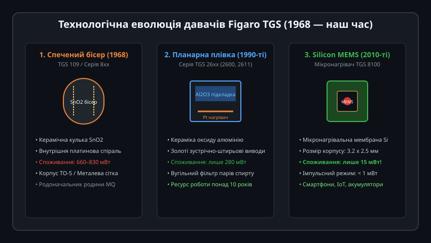
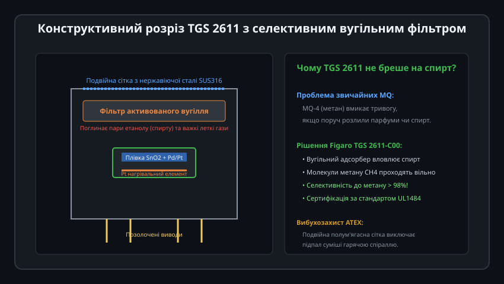
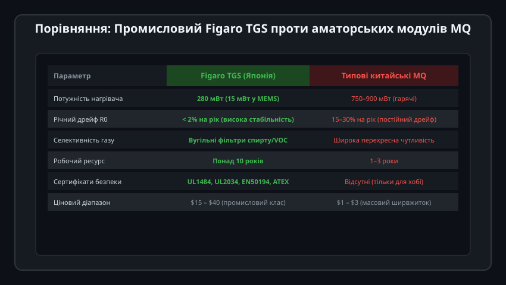
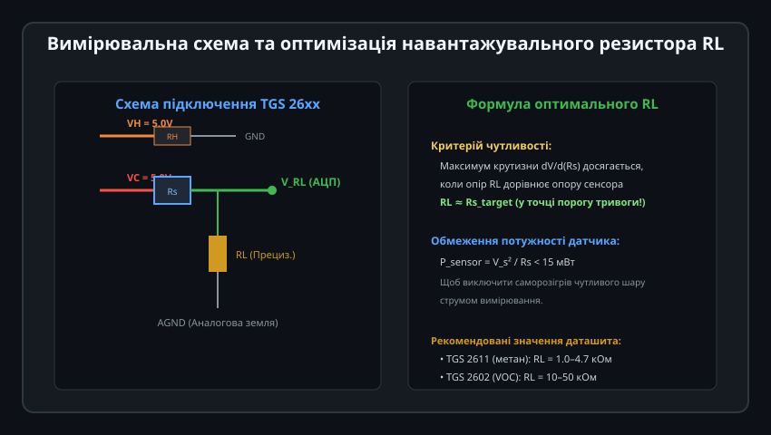
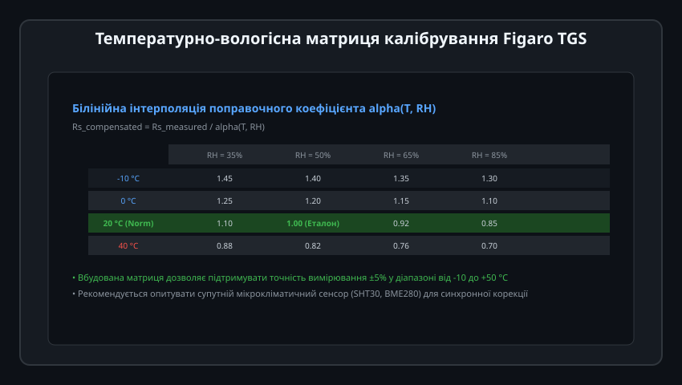

# Напівпровідникові давачі газу Figaro TGS

Давачі газу серії TGS (Taguchi Gas Sensor) японської корпорації Figaro Engineering Inc. є «золотим стандартом» та світовим еталоном у галузі напівпровідникових сенсорів горючих та токсичних газів. На відміну від масових дешевих модулів MQ, сенсори Figaro розробляються для сертифікованих промислових та побутових систем пожежно-газової безпеки (стандарти UL1484, UL2034, EN50194, ATEX), мають термін служби понад 10 років, жорстко контрольований дрейф базової лінії та вбудовані фізичні фільтри вибірковості.

---

## 1. Історія Figaro TGS та технологічна еволюція

Винахід першого у світі комерційного напівпровідникового давача газу на базі діоксиду олова (SnO2) належить засновнику фірми Figaro Наойосі Тагучі (1968 рік):

### Три покоління технології TGS:
1. **Перше покоління (Спечений керамічний бісер, серії TGS 109 та TGS 8xx):**
   - Напівпровідникова маса SnO2 наносилася у вигляді пористої керамічної намистини (кульки) навколо платинової котушки підігріву.
   - Потужність нагрівача складала 660–830 мВт (напруга 5 В, струм до 160 мА). Ця конструкція стала прабатьком дешевих китайських сенсорів родини MQ.
2. **Друге покоління (Планарна товстоплівкова технологія, серія TGS 26xx):**
   - Чутливий шар SnO2 та платиновий нагрівач наносяться методами трафаретного друку на тонку керамічну підкладку з високочистого оксиду алюмінію (Al2O3).
   - Енергоспоживання знижено майже втричі — до 280 мВт (струм 56 мА), а герметичний корпус TO-5 отримав вибухозахисну сітку з нержавіючої сталі SUS316.
3. **Третє покоління (Кремнієві мікросистеми MEMS, серія TGS 8100):**
   - Нагрівач виготовлено у вигляді кремнієвої підвішеної мікромембрани субміліметрового розміру.
   - Споживання становить фантастичні **15 мВт** у неперервному режимі та менше 1 мВт в імпульсному, що відкрило шлях для встановлення газоаналізаторів у портативні прилади з живленням від акумулятора та смартфони.

---

## 2. Конструкція TGS 2611 та селективний вугільний фільтр

Головною вадою простих оксидних давачів є широка перехресна чутливість: сенсор метану часто видає хибну тривогу на пари розлитого спирту чи аерозолі побутової хімії. Інженери Figaro усунули цю проблему механічною фільтрацією:

### Принцип дії фільтра TGS 2611:
- Усередині корпусу між захисною металевою сіткою та кристалом SnO2 розташований шар спеціального активованого вугілля (модифікація TGS 2611-C00).
- Молекули спиртів (етанолу), розчинників та важких летких органічних сполук мають порівняно великий молекулярний радіус. Вони надійно вловлюються та адсорбуються мікропорами вугільного фільтра.
- Дрібні симетричні молекули метану (CH4) вільно проходять крізь фільтр до нагрітого шару SnO2.
- **Результат:** Селективність до метану перевищує 98%, виключаючи хибні спрацьовування сигналізатора на кухні під час приготування їжі чи прибирання.

---

## 3. Порівняльний аналіз: Figaro TGS проти китайських MQ

Хоча обидві родини використовують однаковий фізичний ефект хемосорбції кисню на нагрітому SnO2, між ними існує прірва в надійності та метрології:

| Характеристика | Figaro TGS (Японія) | Типовий китайський MQ |
| :--- | :--- | :--- |
| **Енергоспоживання** | 280 мВт (26xx) / 15 мВт (MEMS) | 750–900 мВт (дуже гарячі) |
| **Річний дрейф R0** | Менше 2% на рік | 15–30% на рік (потребує постійного підстроювання) |
| **Селективність** | Вбудовані вугільні фільтри | Відсутні (реагує на весь спектр відновників) |
| **Термін служби** | Понад 10 років гарантованої роботи | 1–3 роки до втрати чутливості |
| **Сертифікація** | EN 50194, UL 1484, ATEX | Не сертифіковані (тільки для DIY/навчання) |
| **Повторюваність партій** | Розкид R0 у партії менше ±15% | Розкид R0 може перевищувати 300% |

---

## 4. Схемотехніка включення та розрахунок навантаження RL

Для підключення сенсорів серії TGS 26xx використовують чотириполюсну схему із роздільним живленням кіл нагріву (VH) та вимірювання (VC):

### Електричні параметри:
1. **Коло нагрівача (Heater, VH):** Живиться стабільним джерелом напруги `VH = 5.0 В ± 0.2 В` постійного струму. Опір платинового нагрівача становить близько 59 Ом за 20 °C, що дає струм споживання близько 56 мА (потужність 280 мВт).
2. **Коло вимірювання (Circuit, VC):** Напруга `VC <= 5.0 В`. Давач утворює дільник напруги з навантажувальним резистором `RL`.
3. **Оптимізація номіналу RL:**
   - Чутливість вимірювальної схеми `dV_RL / d(Rs)` досягає максимуму, коли величина `RL` точно збігається з опором сенсора `Rs` при цільовій концентрації газу тривоги (наприклад, 10% LEL для метану або 1000 ppm).
   - За даташитом для TGS 2611 рекомендований номінал `RL = 1.0...4.7 кОм`, а розсіювана на чутливому шарі потужність не повинна перевищувати 15 мВт для запобігання паразитній зміні робочої температури.

---

## 5. Двовимірна матриця кліматичної компенсації (T, RH)

Чутливість SnO2 залежить від вологості повітря, оскільки молекули H2O конкурують із киснем за посадкові місця на кристалічній ґратці. Для збереження похибки в межах ±5% у прошивці використовують двовимірну таблицю поправок:

### Програмна термовологісна компенсація:
1. За допомогою цифрового датчика мікроклімату (SHT30 або BME280) визначають поточні значення температури `T` (°C) та відносної вологості `RH` (%).
2. За 2D-матрицею коефіцієнтів розраховують поправочний множник `alpha(T, RH)` за допомогою білінійної інтерполяції. Для стандартних умов (20 °C, 65% RH) коефіцієнт `alpha = 1.00`.
3. Справжній скоригований опір сенсора розраховують як:
   
   Rs_norm = Rs_meas / alpha(T, RH)

4. Тільки після цієї нормалізації застосовують логарифмічне рівняння концентрації, що гарантує відсутність хибних тривог як у сирому підвалі взимку, так і в гарячій котельні влітку.
