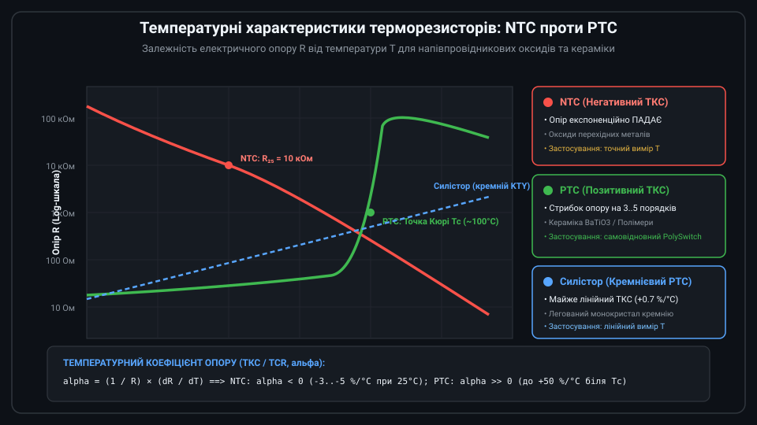
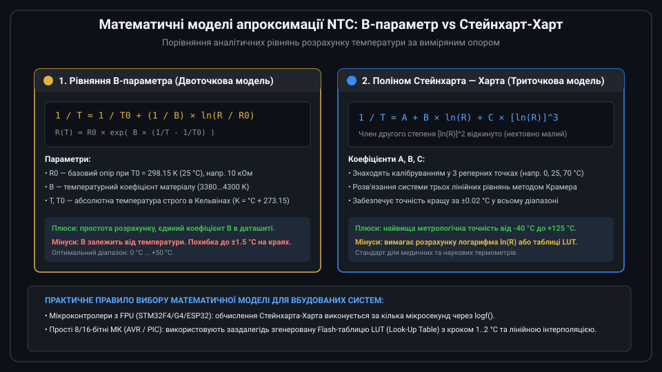
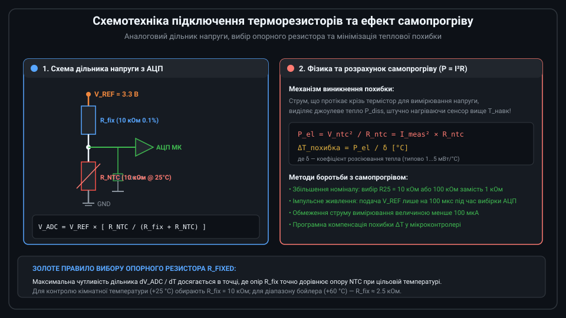
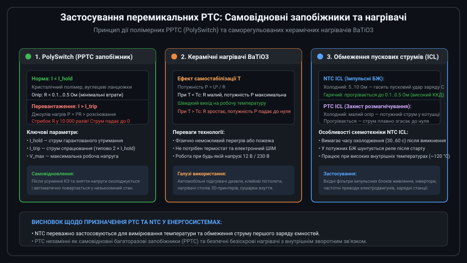

# Поглиблений інженерний аналіз напівпровідникових терморезисторів NTC та PTC

Напівпровідникові терморезистори (термістори) займають ключове місце у вимірювальних системах контролю температури, системах захисту силових ланцюгів від надструмів та енергоефективних саморегульованих нагрівачах. Проектування прецизійних вузлів на базі NTC та PTC вимагає врахування мікрофізичних процесів переносу носіїв заряду, нелінійної апроксимації, термодинаміки самопрогріву та динамічних теплових характеристик.



---

## 1. Мікрофізика переносу заряду: механізм стрибкової провідності в NTC та фазові переходи в PTC

Електричні властивості терморезисторів обумовлені квантовомеханічною структурою твердого тіла:

### Механізм стрибкової провідності (Polaron Hopping) в NTC
На відміну від класичних монокристалічних напівпровідників (Si, Ge), де провідність визначається тепловою генерацією носіїв у зону провідності через заборонену зону, оксидні NTC-термістори (шпінелі типу NiMn2O4 або CoMn2O4) є матеріалами з малою рухливістю носіїв. Провідність у них реалізується за механізмом стрибкової поляронної провідності (small polaron hopping) між іонами різної валентності (наприклад, Mn3+ та Mn4+):

```text
rho(T) = C × T × exp( E_a / (k_B × T) )
```

де E_a — енергія активації стрибка (близько 0.3...0.5 еВ), k_B — стала Больцмана, T — абсолютна температура в Кельвінах. Звідси виводиться експоненційна залежність опору та формула температурного коефіцієнта опору (ТКС, alpha):

```text
alpha = (1 / R) × (dR / dT) = -B / T^2
```

При T = 298.15 K (25 °C) і типовому B = 3950 K значення alpha становить:
alpha = -3950 / (298.15)^2 ≈ -0.0444 1/K = -4.44 %/°C.

### Ефект Хейванга-Йонкера (Heywang-Jonker) у керамічних PTC
Різкий стрибок опору в кераміці BaTiO3 пояснюється фазовим переходом кристалічної решітки. Нижче температури Кюрі Tc матеріал є сегнетоелектриком з високою діелектричною проникністю epsilon_r > 10 000. Вектори спонтанної поляризації компенсують потенційні бар'єри на межах зерен кераміки, забезпечуючи низький опір (десятки ом).

При переході через точку Tc сегнетоелектричний стан руйнується, кристалічна гратка переходить у параелектричну фазу за законом Кюрі-Вейса:
```text
epsilon_r = C / (T - Tc)
```
Діелектрична проникність падає у сотні разів. Внаслідок цього висота потенційного бар'єра Шотткі на межах кристалічних зерен стрімко зростає:
```text
Phi_b = (e × N_s^2) / (8 × epsilon_0 × epsilon_r × N_d)
```
Оскільки питомий опір зростає експоненційно з ростом бар'єра Phi_b, сумарний опір зразка зростає на 4–6 порядків у вузькому інтервалі температур (10–20 °C).

---

## 2. Математичне моделювання NTC: калібрування Стейнхарта-Харта та розрахунок матриці похибок

Для досягнення лабораторної точності (похибка < 0.05 °C) застосовують триточкове калібрування полінома Стейнхарта — Харта:



```text
1 / T = A + B × ln(R) + C × [ln(R)]^3
```

### Алгоритм визначення коефіцієнтів A, B, C
Вибирають три калібрувальні температури T1, T2, T3 (наприклад, 0 °C, 25 °C, 70 °C), переводять їх у Кельвіни та вимірюють опір R1, R2, R3 прецизійним мультиметром. Позначивши L1 = ln(R1), L2 = ln(R2), L3 = ln(R3) та Y1 = 1/T1, Y2 = 1/T2, Y3 = 1/T3, формують систему трьох лінійних рівнянь:

```text
| 1  L1  L1^3 |   | A |   | Y1 |
| 1  L2  L2^3 | × | B | = | Y2 |
| 1  L3  L3^3 |   | C |   | Y3 |
```

Розв'язання цієї системи за методом визначників (правило Крамера) дає унікальний набір коефіцієнтів A, B, C для конкретної партії сенсорів.

---

## 3. Теплодинаміка сенсора: теплова інерція та баланс самопрогріву

Поведінка термістора в реальному тепловому полі описується двома параметрами:

1. **Теплова постійна часу tau (Thermal Time Constant)**:
   Час, необхідний для зміни температури сенсора на 63.2% від повного стрибка температури навколишнього середовища:
   ```text
   T(t) = T_final + (T_initial - T_final) × exp(-t / tau)
   ```
   Для відкритого мікротермістора у спокійному повітрі tau становить 3–10 с, а при зануренні в проточну рідину падає до 0.1–0.5 с. У захисній металевій гільзі з епоксидним компаундом tau зростає до 15–30 с.
2. **Коефіцієнт розсіювання тепла delta (Dissipation Constant)**:
   Потужність, необхідна для підвищення температури сенсора на 1 °C за рахунок внутрішнього джоулевого тепла:
   ```text
   delta = P_diss / (T_sensor - T_ambient)  [мВт/°C]
   ```
   Тепловий баланс у стаціонарному режимі задається рівнянням:
   ```text
   P_el = I_meas^2 × R(T_sensor) = delta × (T_sensor - T_ambient)
   ```

Якщо знехтувати самопрогрівом, розрахована температура буде завищеною на величину Delta T = (I_meas^2 × R) / delta.



---

## 4. Силові застосування PTC: проектування захисту від надструмів (PPTC)

При проектуванні захисту ланцюгів на базі полімерних запобіжників PolySwitch інженер повинен розраховувати три режими роботи:



1. **Струм утримання I_hold**: Максимальний струм, який запобіжник може пропускати необмежено довго при максимальній робочій температурі навколишнього середовища (наприклад, +60 °C) без переходу у високомний стан. З ростом температури середовища допустимий I_hold зменшується через термічне розширення полімеру.
2. **Струм спрацювання I_trip**: Мінімальний струм, що гарантовано переводить запобіжник у високоомний стан (типово I_trip ≈ 2 × I_hold). Час спрацювання (Time to Trip, t_trip) залежить від кратності перевантаження:
   ```text
   t_trip ≈ C_th × (T_trip - T_amb) / (I^2 × R - delta × (T_trip - T_amb))
   ```
   При струмі КЗ (10 × I_hold) час відсічки становить мілісекунди, що захищає друковані провідники та ключі MOSFET від термічного руйнування.
3. **Залишковий опір після відновлення (R_1max)**: Після охолодження опір PPTC відновлюється не до початкового значення R_min, а стабілізується на дещо вищому рівні R_1max (на 10–30% вище початкового) через зміну орієнтації кристалітів полімеру.

---

## 5. Вбудоване програмне забезпечення: драйвер NTC з корекцією самопрогріву та детекцією аварій

Наведений нижче код мовою C демонструє повнофункціональний алгоритм розрахунку температури за методом Стейнхарта-Харта з одночасною фільтрацією шуму АЦП, корекцією похибки самопрогріву та детекцією обриву/КЗ сенсора.

```c
#include <stdint.h>
#include <stdbool.h>
#include <math.h>

// Результати діагностики стану сенсора
typedef enum {
    NTC_STATUS_OK = 0,
    NTC_STATUS_OPEN_CIRCUIT,  // Обрив лінії або відсутність сенсора
    NTC_STATUS_SHORT_CIRCUIT  // Коротке замикання датчика
} ntc_status_t;

// Структура конфігурації NTC та вимірювального ланцюга
typedef struct {
    float r_fixed_ohms;       // Опір верхнього резистора дільника (напр. 10000.0f)
    float v_ref_volts;        // Опорна напруга АЦП (напр. 3.3f)
    uint32_t adc_max_code;    // Максимальний код АЦП (4095 для 12-біт, 65535 для 16-біт)
    float dissipation_mw_c;   // Коефіцієнт розсіювання тепла (напр. 2.5 мВт/°C)
    // Коефіцієнти Стейнхарта-Харта
    float sh_a;               // Типово 1.129e-3f для 10 кОм NTC
    float sh_b;               // Типово 2.341e-4f
    float sh_c;               // Типово 8.775e-8f
} ntc_config_t;

// Функція розрахунку температури з корекцією самопрогріву
ntc_status_t ntc_calculate_temperature(const ntc_config_t *cfg, 
                                       uint32_t adc_raw, 
                                       float *out_temp_celsius) 
{
    // 1. Детекція граничних станів (обрив / коротке замикання)
    // Якщо дільник: VDD -> R_fix -> ADC_IN -> R_NTC -> GND
    // При КЗ R_NTC = 0 => ADC_RAW -> 0
    if (adc_raw < 15) {
        return NTC_STATUS_SHORT_CIRCUIT;
    }
    // При обриві R_NTC -> нескінченність => ADC_RAW -> ADC_MAX
    if (adc_raw >= (cfg->adc_max_code - 15)) {
        return NTC_STATUS_OPEN_CIRCUIT;
    }

    // 2. Обчислення напруги на термісторі
    float v_adc = ((float)adc_raw / (float)cfg->adc_max_code) * cfg->v_ref_volts;

    // 3. Розрахунок поточного опору термістора NTC
    // V_adc = V_ref * R_ntc / (R_fix + R_ntc) => R_ntc = R_fix * V_adc / (V_ref - V_adc)
    float r_ntc = cfg->r_fixed_ohms * v_adc / (cfg->v_ref_volts - v_adc);

    // 4. Розрахунок температури за рівнянням Стейнхарта-Харта
    float ln_r = logf(r_ntc);
    float ln_r3 = ln_r * ln_r * ln_r;
    float inv_t = cfg->sh_a + (cfg->sh_b * ln_r) + (cfg->sh_c * ln_r3);
    float t_kelvin = 1.0f / inv_t;
    float t_celsius = t_kelvin - 273.15f;

    // 5. Розрахунок потужності джоулевого самопрогріву та компенсація Delta T
    // P_el = V_adc^2 / R_ntc (у міліватах)
    float p_diss_mw = (v_adc * v_adc / r_ntc) * 1000.0f;
    float delta_t_self_heat = p_diss_mw / cfg->dissipation_mw_c;

    // Справжня температура середовища
    *out_temp_celsius = t_celsius - delta_t_self_heat;

    return NTC_STATUS_OK;
}
```

Такий підхід забезпечує точність і надійність зчитування у промислових виробах, термостатах та контролерах батарей (BMS).
