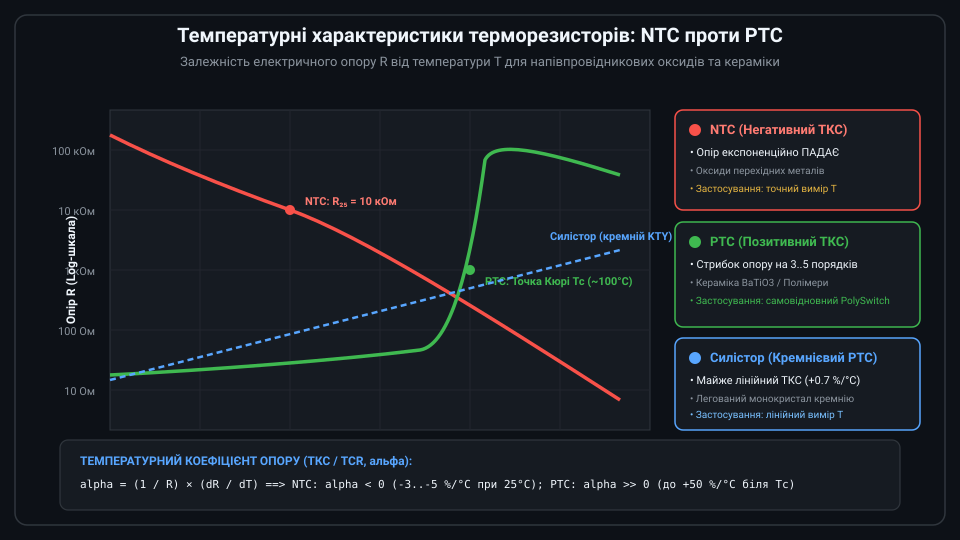
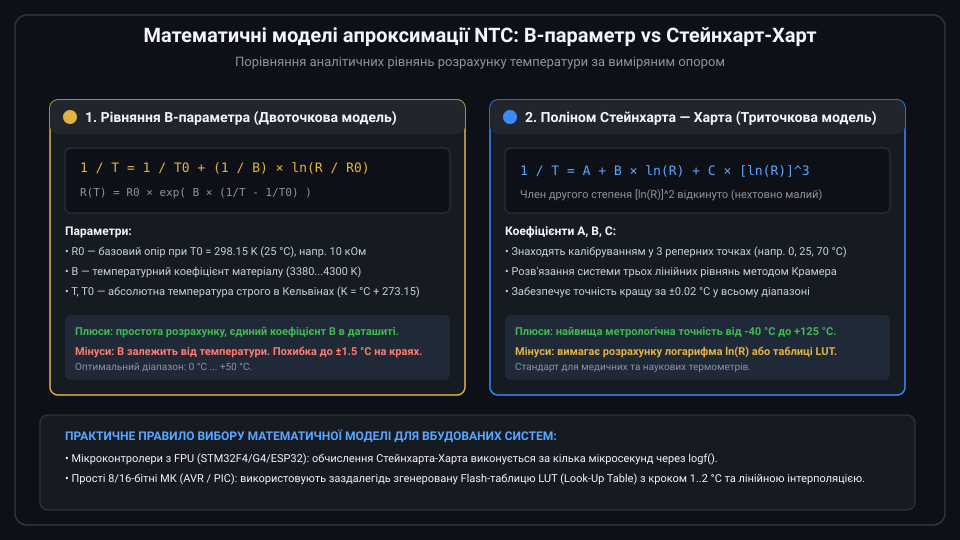
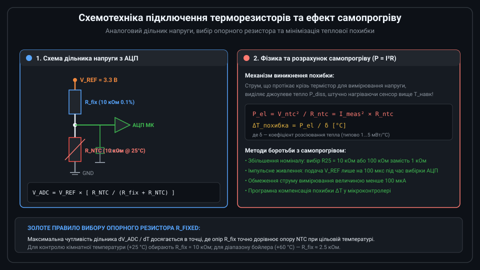
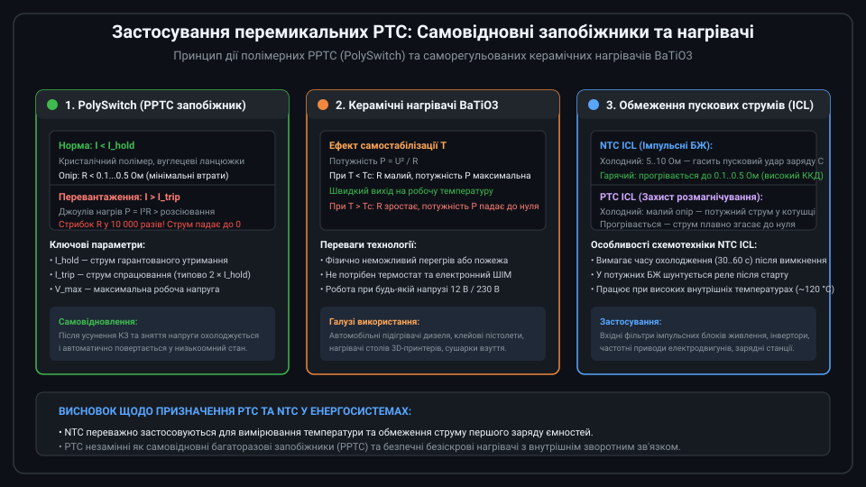
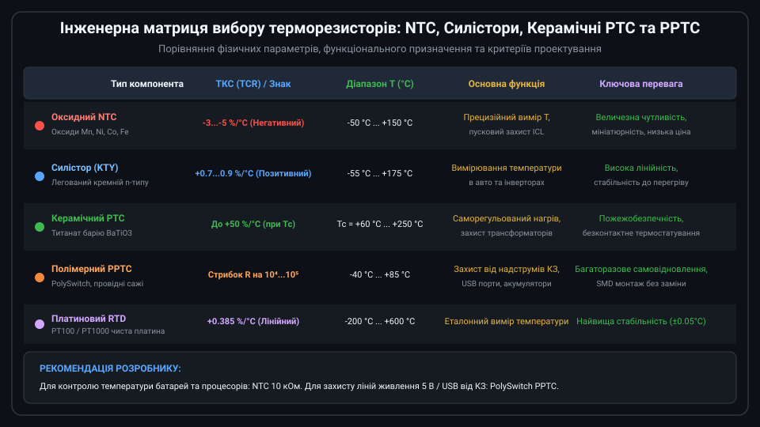

# Огляд напівпровідникових терморезисторів NTC та PTC

Терморезистори (термістори) — це напівпровідникові резистивні елементи, електричний опір яких суттєво й нелінійно залежить від температури. На відміну від металевих термометрів опору (RTD), у терморезисторах використовуються полікристалічні напівпровідникові оксиди або легована кераміка. Це забезпечує у 5–10 разів вищу температурну чутливість (ТКС), компактні габарити та мінімальну собівартість.



---

## 1. Класифікація: принципові відмінності NTC та PTC

За знаком температурного коефіцієнта опору (ТКС / TCR) терморезистори поділяються на два основні класи:

* **NTC (Negative Temperature Coefficient)**: Терморезистори з негативним ТКС. Їхній опір різко й експоненційно падає зі зростанням температури. Виготовляються шляхом спікання суміші оксидів перехідних металів (марганцю Mn, нікелю Ni, кобальту Co, заліза Fe та міді Cu). Основне призначення — точне вимірювання температури від -50 °C до +150 °C та обмеження пускових струмів (ICL).
* **PTC (Positive Temperature Coefficient)**: Терморезистори з позитивним ТКС. Їхній опір зростає з підвищенням температури. Поділяються на два підтипи:
  1. *Силістори (KTY)*: Монокристалічні кремнієві датчики з помірним лінійним позитивним ТКС (~+0.7 %/°C), що застосовуються для вимірювання температури.
  2. *Перемикальні керамічні та полімерні PTC*: Елементи на основі титанату барію BaTiO3 або полімерних композитів (PolySwitch PPTC). При досягненні температури фазового переходу (точки Кюрі Tc) їхній опір лавиноподібно зростає на 3–5 порядків, перетворюючи компонент на автоматичний ізолятор.

---

## 2. Математичні моделі терморезисторів NTC

Характеристика NTC-термісторів є суттєво нелінійною. Для розрахунку температури за виміряним опором в електронних блоках застосовують два аналітичні рівняння:



### Рівняння B-параметра (двоточкове наближення)
Більшість виробників вказують у документації номінальний опір R0 при базовій температурі T0 (зазвичай 25 °C = 298.15 K) та коефіцієнт матеріалу B (типово 3380...4300 K):

```text
1 / T = 1 / T0 + (1 / B) × ln(R / R0)
```

де T та T0 задаються виключно в Кельвінах (K = °C + 273.15). Це спрощене рівняння добре працює у вузькому діапазоні (0...+50 °C), але на краях діапазону дає похибку до 1...2 °C через температурну залежність самого коефіцієнта B.

### Рівняння Стейнхарта — Харта (прецизійна триточкова модель)
Для високоточних систем використовують поліном третього степеня від логарифма опору:

```text
1 / T = A + B × ln(R) + C × [ln(R)]^3
```

Коефіцієнти A, B, C розраховуються за результатами вимірювань опору в трьох точках калібрування. Модель Стейнхарта-Харта забезпечує точність кращу за ±0.02 °C у всьому робочому діапазоні від -40 °C до +125 °C.

---

## 3. Схемотехніка зчитування сигналу та проблема самопрогріву

Оскільки термістор є пасивним резистивним компонентом, для перетворення зміни його опору в напругу використовують аналоговий дільник напруги:



Сенсор NTC підключають послідовно з прецизійним резистором R_fix (з допуском 0.1% та низьким температурним дрейфом). Напруга в середній точці дільника подається на вхід АЦП мікроконтролера:

```text
V_ADC = V_REF × [ R_NTC / (R_fix + R_NTC) ]
```

### Ефект самопрогріву (Self-Heating)
Вимірювальний струм I_meas, протікаючи крізь термістор, розсіює потужність P = I^2 × R_NTC. Це тепло нагріває кристал сенсора вище температури навколишнього середовища, створюючи систематичну похибку:

```text
Delta_T = P_diss / delta
```

де delta — коефіцієнт розсіювання тепла (Dissipation Constant, типово 1–5 мВт/°C у повітрі). Якщо потужність розсіювання становить 2 мВт при delta = 2 мВт/°C, сенсор нагріється на 1.0 °C відносно істинного середовища! Для усунення цієї похибки вибирають номінал NTC не менше 10 кОм або вмикають дільник імпульсно лише на час перетворення АЦП.

---

## 4. Застосування перемикальних PTC: захист кіл та саморегульований нагрів

На відміну від NTC, перемикальні керамічні (BaTiO3) та полімерні (PPTC PolySwitch) терморезистори частіше використовуються не як сенсори температури, а як силові виконавчі та захисні компоненти:



1. **Самовідновні запобіжники (PolySwitch PPTC)**:
   При нормальному струмі опір елемента становить частки ома. У разі короткого замикання або перевантаження (I > I_trip) струм розігріває полімер вище температури плавлення кристалітів. Полімер розширюється, провідні вуглецеві ланцюжки розриваються, і опір стрибком зростає у 10 000 разів, обмежуючи струм до безпечного витоку. Після усунення аварії та охолодження запобіжник автоматично повертається у провідний стан без потреби заміни.
2. **Саморегульовані керамічні нагрівачі (PTC Heaters)**:
   При подачі живлення на холодний елемент BaTiO3 опір є малим, і споживана потужність P = U^2 / R максимальна (миттєвий нагрів). Коли температура досягає точки Кюрі Tc, опір лавиноподібно зростає, потужність спадає практично до нуля, і елемент стабілізує свою температуру на рівні Tc без використання зовнішніх терморегуляторів або термостатів.
3. **Обмежувачі пускових струмів (ICL)**:
   Потужні дискові термістори обмежують ударний струм заряду конденсаторів вхідних фільтрів імпульсних блоків живлення та інверторів.

---

## 5. Порівняння технологій та критерії інженерного вибору

Для вибору оптимального типу терморезистора інженер зіставляє умови експлуатації, діапазон та необхідну функцію:



Підсумкові критерії вибору:
* **Вимірювання температури від -40 °C до +125 °C**: Оптимальним є оксидний NTC 10 кОм (B = 3950 K). Він забезпечує високу крутість зміни опору (~4 %/°C) та високу роздільну здатність навіть з недорогим 10-бітним АЦП.
* **Захист портів USB, ліній живлення 5 В / 12 В та літієвих акумуляторів від КЗ**: Однозначним вибором є полімерні PPTC (PolySwitch) відповідного струму спрацювання.
* **Безпечний автономний підігрів**: Застосовуються керамічні нагрівальні блоки PTC BaTiO3, які принципово виключають можливість перегріву та пожежі.
