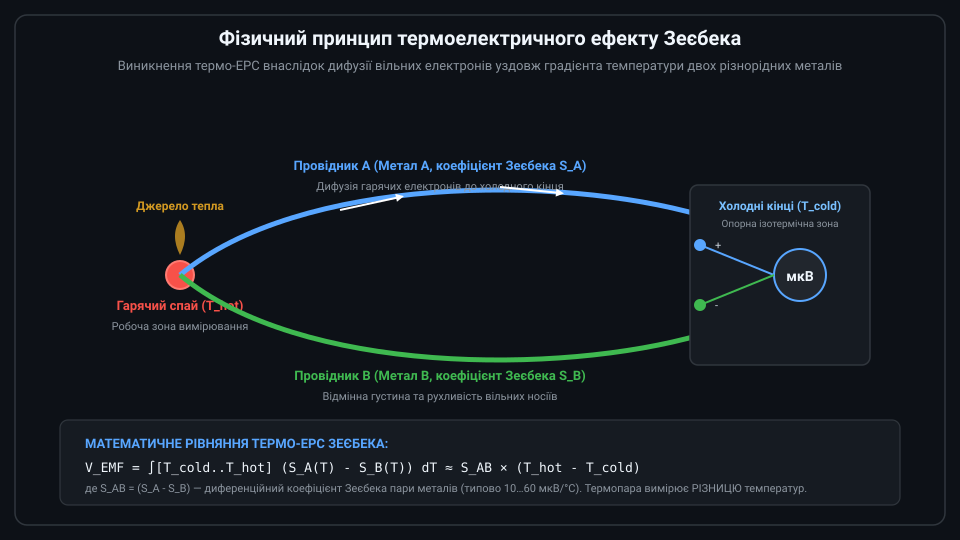
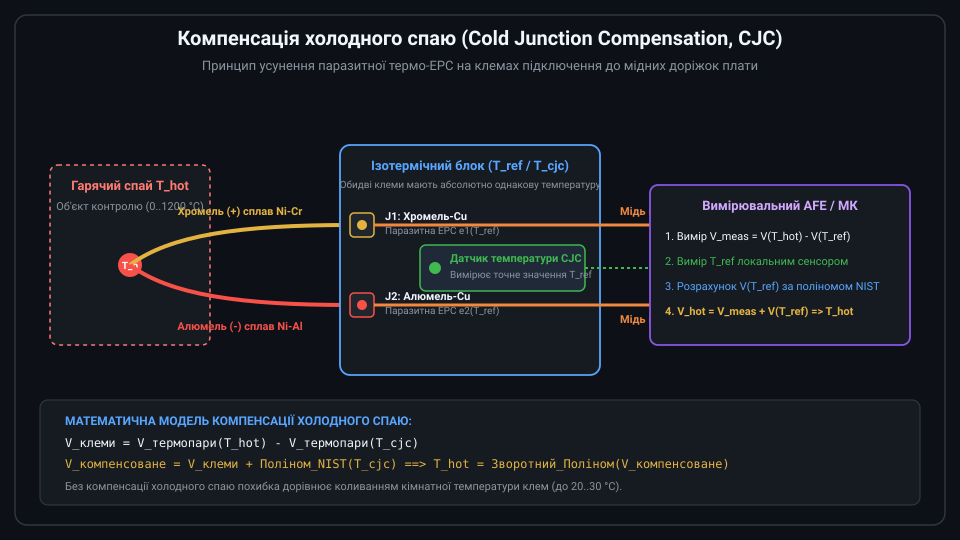
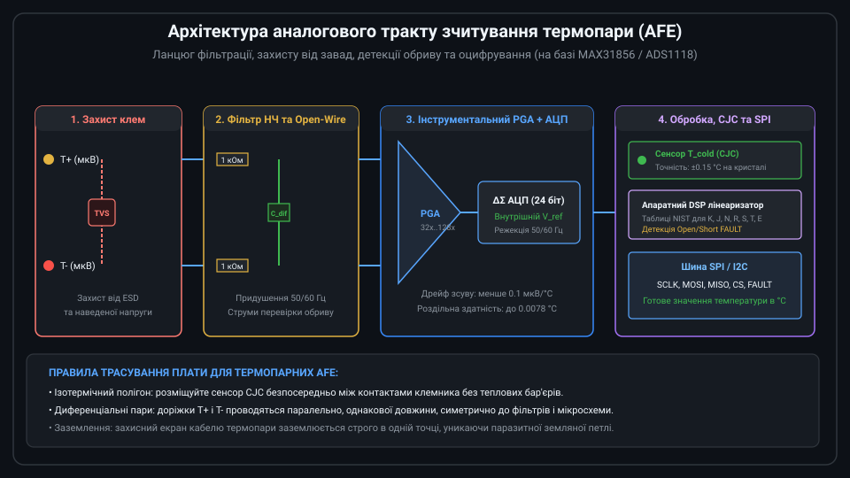

# Поглиблений інженерний аналіз термоелектричних перетворювачів температури

Термоелектричні перетворювачі (термопари) є фундаментальним інструментом високотемпературної термометрії в промисловості та наукових дослідженнях. Робота з термопарами вимагає глибокого розуміння фізики термоелектричних явищ, методів лінеаризації мікровольтових сигналів, прецизійної компенсації холодного спаю (CJC) та схемотехніки захисту від промислових електромагнітних завад.



---

## 1. Термоелектричні явища: взаємозв'язок Зеєбека, Пельтьє та Томсона

Термоелектричні процеси в неоднорідних металевих колах описуються трьома взаємопов'язаними ефектами, відкритими у XIX столітті:

1. **Ефект Зеєбека (1821)**: Виникнення різниці електричних потенціалів у розімкненому колі з двох різнорідних провідників, спаї яких мають різну температуру.
2. **Ефект Пельтьє (1834)**: Виділення або поглинання тепла на межі контакту двох різних провідників під час протікання постійного електричного струму.
3. **Ефект Томсона (1851)**: Виділення або поглинання тепла в однорідному провіднику зі струмом при наявності поздовжнього градієнта температури.

За термодинамічними співвідношеннями Вільяма Томсона (лорда Кельвіна), коефіцієнт Зеєбека S, коефіцієнт Пельтьє Pi та коефіцієнт Томсона mu пов'язані між собою формулами:

```text
Pi = S × T
mu = T × (dS / dT)
```

де T — абсолютна температура в Кельвінах.

У термометричній практиці термо-ЕРС замкненого кола інтегрується вздовж усієї довжини провідників:

```text
V_total = ∫[T1..T2] S_A(T) dT + ∫[T2..T1] S_B(T) dT = ∫[T1..T2] (S_A(T) - S_B(T)) dT
```

Звідси випливають три фундаментальні закони термопар:
* **Закон однорідного кола**: Температурний градієнт в однорідному за складом провіднику не породжує сумарної ЕРС у замкненому колі. ЕРС генерується лише там, де змінюється температура вздовж неоднорідності матеріалів.
* **Закон проміжних металів**: Введення третього провідника C у вимірювальне коло не змінює сумарну термо-ЕРС за умови, що обидва кінці провідника C перебувають за однакової температури. Саме це дозволяє паяти термопару припоєм або приєднувати її мідними клемами.
* **Закон проміжних температур**: Термо-ЕРС термопари зі спаями при температурах T1 і T3 дорівнює алгебраїчній сумі термо-ЕРС цієї ж пари при температурах (T1, T2) та (T2, T3). Цей закон є математичною базою для компенсації холодного спаю.

---

## 2. Математична модель та поліноми лінеаризації NIST ITS-90

Залежність термо-ЕРС від температури суттєво нелінійна. Наприклад, для найпоширенішої термопари типу K коефіцієнт Зеєбека коливається від 39 мкВ/°C при 0 °C до 42.5 мкВ/°C при 400 °C та падає нижче 36 мкВ/°C при 1200 °C.

Національний інститут стандартів і технологій США (NIST) на основі шкали ITS-90 регламентує прямі та зворотні поліноми високого порядку (від 6 до 10 степеня) для точного розрахунку:

```text
Прямий розрахунок напруги (T -> V):
V(T) = c0 + c1 × T + c2 × T^2 + c3 × T^3 + ... + cn × T^n + a0 × exp(a1 × (T - a2)^2)

Зворотний розрахунок температури (V -> T):
T(V) = d0 + d1 × V + d2 × V^2 + d3 × V^3 + ... + dm × V^m
```

Для термопари типу K у діапазоні від 0 °C до 500 °C поліном 6-го степеня забезпечує похибку апроксимації менше 0.05 °C:

```c
// Наближене поліноміальне перетворення напруги типу K (мкВ) у температуру (°C)
float thermocouple_k_voltage_to_temp(float microvolts) {
    const float d1 = 2.508355e-2f;
    const float d2 = 7.860106e-8f;
    const float d3 = -2.503131e-10f;
    const float d4 = 8.315270e-14f;
    const float d5 = -1.228034e-17f;
    const float d6 = 9.804036e-22f;

    float v = microvolts;
    float v2 = v * v;
    float v3 = v2 * v;
    float v4 = v3 * v;
    float v5 = v4 * v;
    float v6 = v5 * v;

    return (d1 * v) + (d2 * v2) + (d3 * v3) + (d4 * v4) + (d5 * v5) + (d6 * v6);
}
```

---

## 3. Проектування ізотермічного блоку та схемотехніка CJC

Точність вимірювання температури термопарою безпосередньо обмежується точністю компенсації холодного спаю. Похибка вимірювання температури опорного клемника в 1 °C спричиняє еквівалентну похибку вимірювання робочого спаю в 1 °C.



Інженерні правила проектування ізотермічного блоку на друкованій платі:
1. **Теплове вирівнювання клем**: Гвинтові або пружинні клеми T+ та T- повинні розміщуватися впритул одна до одної (відстань 3.5–5 мм) на суцільному мідному полігоні внутрішнього шару для мінімізації температурного градієнта.
2. **Розміщення датчика CJC**: Сенсор опорної температури (наприклад, термістор 10 кОм 0.1% або прецизійний цифровий датчик TMP117 / вбудований діод MAX31856) розміщується симетрично між клемами T+ та T- на відстані не більше 2–3 мм від клемних контактів.
3. **Теплова ізоляція від джерел тепла**: Клемний блок має бути відділений від гарячих компонентів плати (лінійних стабілізаторів, силових ключів, трансформаторів та процесора) тепловими прорізами у текстоліті (thermal slots / air gaps).
4. **Використання термоізоляційного кожуха**: Клеми закриваються пластиковим або пінополіуретановим кожухом для запобігання впливу конвекційних повітряних потоків охолоджуючих вентиляторів.

---

## 4. Аналоговий тракт AFE: придушення синфазних завад, фільтрація та захист

Термопара є низькоімпедансним генератором напруги з рівнем сигналу від десятків мікровольт до десятків мілівольт. Довгі з'єднувальні кабелі (іноді до 50–100 метрів у цехах) працюють як антени, вловлюючи потужні електромагнітні завади від частотних приводів, контакторів та зварювальних апаратів.



Схемотехнічні вимоги до тракту AFE:
* **Диференційний RC-фільтр низьких частот**:
  Для придушення високочастотних завад застосовують симетричний фільтр із двома резисторами R = 1 кОм, диференційним конденсатором C_diff = 100 нФ та двома синфазними конденсаторами C_cm = 10 нФ на землю:
  ```text
  f_cut_diff = 1 / (2 × pi × 2R × C_diff) ≈ 800 Гц
  f_cut_cm = 1 / (2 × pi × R × C_cm) ≈ 16 кГц
  ```
  Ємність C_diff обирається щонайменше у 10 разів більшою за C_cm, щоб розкид номіналів синфазних конденсаторів не перетворював синфазну заваду на диференційний шум.
* **Синфазний діапазон та заземлення**:
  Якщо термопара ізольована (ungrounded), її входи повинні мати шлях стікання вхідних струмів зміщення підсилювача (bias return resistor до віртуальної середньої точки 1.25 В). Якщо термопара заземлена на корпус печі (grounded), AFE зобов'язаний мати ізольоване живлення (гальванічну розв'язку ADuM/ISO) або підтримувати синфазну напругу в діапазоні зміщення нуля.
* **Детекція обриву спаю (Burnout / Open Fault Detection)**:
  Паралельно термопарі підключаються джерела струму мікроамперного рівня (наприклад, 10–100 нА). За умови цілісності спаю його опір становить 5–50 Ом, і падіння напруги від струму тестування не перевищує кількох мікровольт. При фізичному обриві термопари цей струм миттєво заганяє підсилювач у позитивне насичення, що програмно фіксується як аварія.

---

## 5. Практична реалізація драйвера на базі прецизійного перетворювача MAX31856

Мікросхема MAX31856 компанії Analog Devices (Maxim) є сучасним стандартом для зчитування термопар будь-яких типів (K, J, N, R, S, T, E, B). Вона містить 19-бітний дельта-сигма АЦП, вбудований термометр CJC з точністю ±0.7 °C, апаратні таблиці лінеаризації NIST та цифровий фільтр з придушенням частот 50 Гц та 60 Гц одночасно (режекція > 90 дБ).

```c
#include <stdint.h>
#include <stdbool.h>

// Регістри MAX31856
#define MAX31856_REG_CR0        0x00
#define MAX31856_REG_CR1        0x01
#define MAX31856_REG_MASK       0x02
#define MAX31856_REG_CJTO       0x09
#define MAX31856_REG_CJTH       0x0A
#define MAX31856_REG_CJTL       0x0B
#define MAX31856_REG_LTCBH      0x0C
#define MAX31856_REG_LTCBM      0x0D
#define MAX31856_REG_LTCBL      0x0E
#define MAX31856_REG_SR         0x0F

// Біти конфігурації CR0
#define CR0_AUTOMATIC_CONVERSION (1 << 7)
#define CR0_ONE_SHOT             (1 << 6)
#define CR0_OPEN_CIRCUIT_DETECT  (1 << 4)
#define CR0_FILTER_50HZ          (1 << 0) // 1 = 50Hz, 0 = 60Hz

// Типи термопар для CR1 (нижні 4 біти)
#define THERMOCOUPLE_TYPE_K     0x03
#define THERMOCOUPLE_TYPE_J     0x02
#define THERMOCOUPLE_TYPE_T     0x07
#define THERMOCOUPLE_TYPE_N     0x04

// Зовнішні апаратні функції SPI
extern void spi_select_chip(void);
extern void spi_deselect_chip(void);
extern uint8_t spi_transfer_byte(uint8_t byte);

// Ініціалізація мікросхеми MAX31856 для термопари типу K та фільтрації мережі 50 Гц
void max31856_init_type_k_50hz(void) {
    spi_select_chip();
    spi_transfer_byte(MAX31856_REG_CR0 | 0x80); // Режим запису (MSB = 1)
    // Вмикаємо автоконверсію, детекцію обриву та режекцію 50 Гц
    spi_transfer_byte(CR0_AUTOMATIC_CONVERSION | CR0_OPEN_CIRCUIT_DETECT | CR0_FILTER_50HZ);
    // Тип термопари K, усереднення на 4 вибірки (AVG 4)
    spi_transfer_byte(0x10 | THERMOCOUPLE_TYPE_K);
    spi_deselect_chip();
}

// Зчитування лінеаризованої температури гарячого спаю (роздільна здатність 0.0078125 °C)
bool max31856_read_temperatures(float *hot_junction_temp, float *cold_junction_temp) {
    uint8_t raw[4];
    uint8_t fault_reg;

    // Перевірка статусного регістра несправностей
    spi_select_chip();
    spi_transfer_byte(MAX31856_REG_SR); // Читання статусу
    fault_reg = spi_transfer_byte(0xFF);
    spi_deselect_chip();

    // Якщо біт 0 або 1 встановлений — виявлено обрив спаю або перевищення напруги
    if (fault_reg & 0x01) {
        return false; // Помилка: обрив термопари (Open Circuit)
    }

    // Зчитування температури холодного спаю (CJC, 2 байти)
    spi_select_chip();
    spi_transfer_byte(MAX31856_REG_CJTH);
    raw[0] = spi_transfer_byte(0xFF); // Старший байт
    raw[1] = spi_transfer_byte(0xFF); // Молодший байт
    spi_deselect_chip();

    int16_t cjc_raw = (int16_t)((raw[0] << 8) | raw[1]);
    *cold_junction_temp = (float)cjc_raw / 256.0f; // Крок 1/256 °C (~0.0039 °C)

    // Зчитування температури лінеаризованого гарячого спаю (3 байти, 19 біт значущих)
    spi_select_chip();
    spi_transfer_byte(MAX31856_REG_LTCBH);
    raw[0] = spi_transfer_byte(0xFF); // Byte 2
    raw[1] = spi_transfer_byte(0xFF); // Byte 1
    raw[2] = spi_transfer_byte(0xFF); // Byte 0
    spi_deselect_chip();

    int32_t tc_raw = ((int32_t)raw[0] << 16) | ((int32_t)raw[1] << 8) | raw[2];
    tc_raw >>= 5; // Зсув на 5 бітів праворуч для отримання 19-бітного числа зі знаком

    // Знаковий біт знаходиться на 19-й позиції (біт 18)
    if (raw[0] & 0x80) {
        tc_raw |= 0xFFF80000; // Розширення знака
    }

    *hot_junction_temp = (float)tc_raw * 0.0078125f; // Крок 1/128 °C
    return true;
}
```

Такий підхід забезпечує точне зчитування температури з захистом від обриву датчика та усуненням необхідності ручного розрахунку складних нелінійних поліномів NIST на мікроконтролері.
