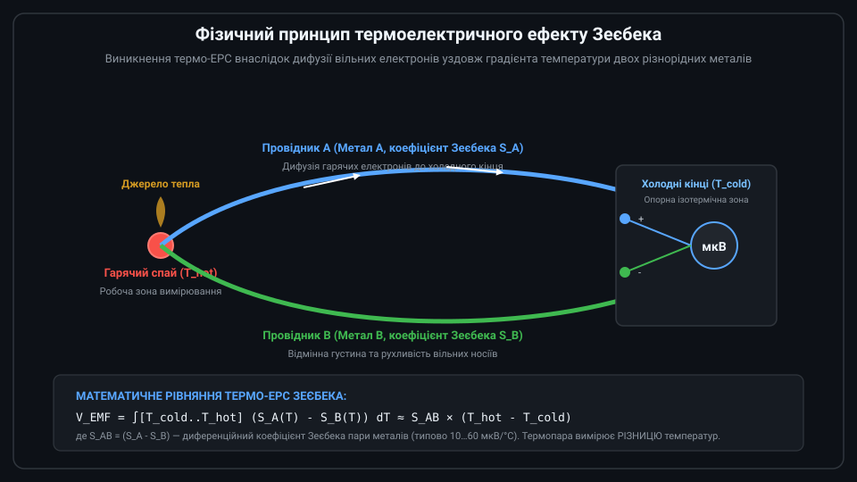
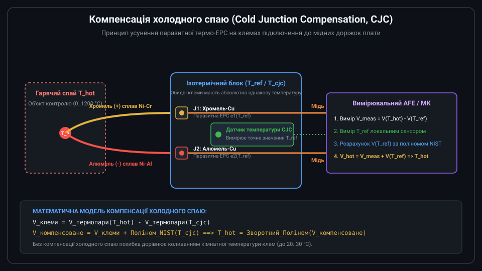
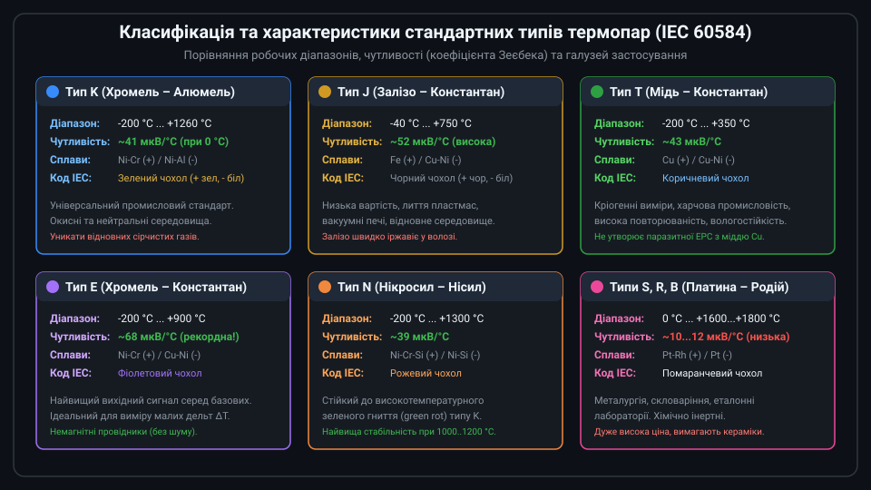
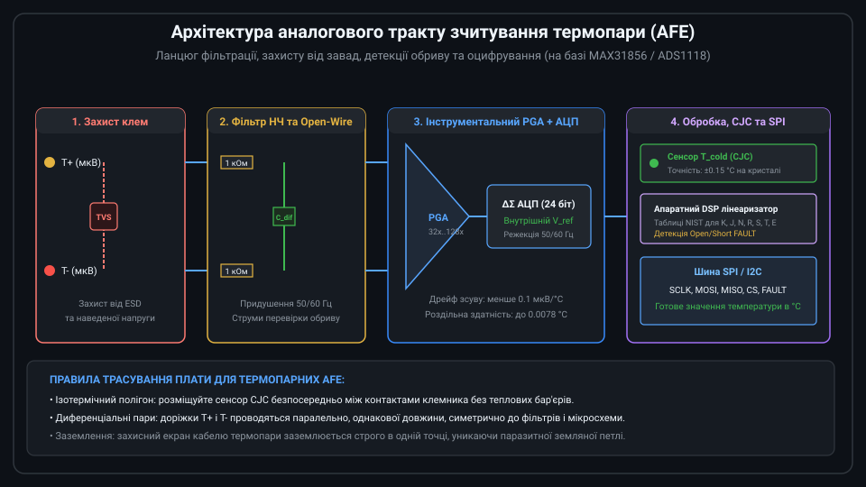
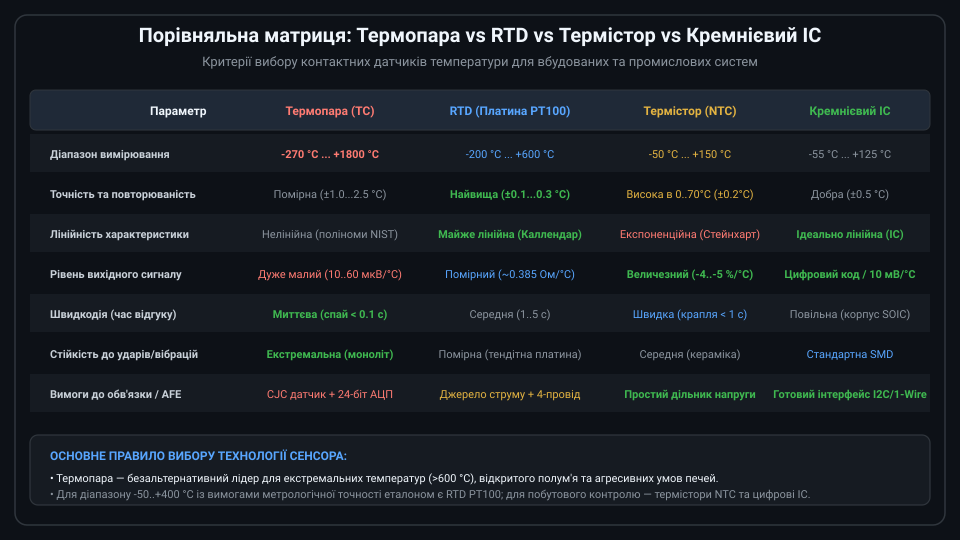

# Огляд термопар та термоелектричних перетворювачів температури

Термопара (термоелектричний перетворювач) — це один із найпоширеніших у промисловості первинних датчиків температури, що базується на прямому перетворенні теплової енергії в електричну напругу (ефект Зеєбека). Завдяки відсутності рухомих та крихких компонентів, здатності працювати в діапазоні від -270 °C до понад +1800 °C та стійкості до механічних вібрацій, термопари є незамінними у металургії, печах, двигунах внутрішнього згоряння, хімічних реакторах та екструдерах.



---

## 1. Фізичний принцип дії та ефект Зеєбека

В основі роботи будь-якої термопари лежить термоелектричний ефект Зеєбека, відкритий Томасом Зеєбеком у 1821 році. Якщо два різнорідні метали (провідники A та B) з'єднати на одному кінці (робочий або «гарячий» спай), а на протилежних кінцях підтримувати іншу температуру («холодний» спай), уздовж провідників виникає градієнт концентрації та кінетичної енергії вільних електронів.

Гарячі електрони дифундують у бік нижчої температури швидше, ніж холодні електрони рухаються у зворотному напрямку. Оскільки різні метали мають різну густину станів електронів і різну рухливість носіїв, виникає різниця потенціалів, що називається термо-ЕРС:

```text
V_EMF = ∫[T_cold..T_hot] (S_A(T) - S_B(T)) dT ≈ S_AB × (T_hot - T_cold)
```

де:
* S_A(T) та S_B(T) — абсолютні коефіцієнти Зеєбека відповідних металів;
* S_AB = S_A - S_B — результуючий коефіцієнт термопари (зазвичай від 10 до 70 мкВ/°C);
* T_hot — температура робочого спаю;
* T_cold — температура вільних опорних кінців.

Важливо розуміти фундаментальну особливість термопари: вона ніколи не генерує напругу, пропорційну абсолютній температурі гарячого кінця. Термо-ЕРС пропорційна виключно різниці температур між гарячим спаєм та точкою підключення до вимірювального приладу.

---

## 2. Проблема холодного спаю та методи компенсації (CJC)

Коли виводи термопари приєднуються до клем вимірювального приладу, у точці контакту неминуче утворюються вторинні паразитні термопари між металами термопари та мідними доріжками друкованої плати. Якщо обидві клеми перебувають за однакової температури T_ref, вимірювана на клемах напруга дорівнює:

```text
V_meas = V_термопари(T_hot) - V_термопари(T_ref)
```

Для визначення істинної температури T_hot необхідно точно компенсувати вплив опорної температури T_ref. Ця технологія називається компенсацією холодного спаю (Cold Junction Compensation, CJC).



Алгоритм компенсації холодного спаю в сучасних системах:
1. За допомогою високоточного локального датчика (RTD PT100, термістора NTC або вбудованого в мікросхему діодного сенсора) вимірюється фізична температура клемного блоку T_ref.
2. За математичною моделлю (поліномом NIST) обчислюється розрахункова напруга V_cjc = V(T_ref), яку згенерувала б термопара при температурі клем відносно 0 °C.
3. До апаратно виміряної мікровольтової напруги V_meas додається розрахована напруга V_cjc:
   `V_comp = V_meas + V(T_ref)`.
4. За зворотним поліномом NIST зі значення V_comp обчислюється кінцева температура об'єкта T_hot.

---

## 3. Стандартизовані типи термопар та їхні властивості

Міжнародний стандарт IEC 60584 регламентує сплави, чутливість, допустимі відхилення та кольорове маркування термопар.



Характеристики основних промислових типів:
* **Тип K (Хромель – Алюмель)**: Найпопулярніша універсальна термопара. Діапазон від -200 °C до +1260 °C, чутливість приблизно 41 мкВ/°C. Відмінно підходить для окисних середовищ.
* **Тип J (Залізо – Константан)**: Робочий діапазон від -40 °C до +750 °C, висока чутливість (~52 мкВ/°C). Застосовується в термопластавтоматах і вакуумних печах.
* **Тип T (Мідь – Константан)**: Діапазон від -200 °C до +350 °C, чутливість ~43 мкВ/°C. Оптимальний вибір для кріогенної техніки та харчових лабораторій.
* **Тип E (Хромель – Константан)**: Найвища чутливість серед базових сплавів (~68 мкВ/°C), діапазон -200 °C ... +900 °C.
* **Тип N (Нікросил – Нісил)**: Покращена версія типу K для діапазону до +1300 °C. Стійка до високотемпературного окислення.
* **Типи S, R, B (Платина – Родій)**: Високотемпературні термопари для металургії та вирощування кристалів (до +1600...+1800 °C).

---

## 4. Схемотехніка зчитування сигналу (AFE)

Оскільки вихідний сигнал термопари становить лише кілька десятків мікровольт на градус, побудова аналогового тракту (Analog Front-End, AFE) вимагає спеціальних рішень:



Ключові компоненти вимірювального тракту:
* **Вхідний диференційний фільтр низьких частот**: Резистори 1 кОм та конденсатор ємністю 100 нФ між лініями ефективно пригнічують синфазні та диференційні завади промислової мережі частотою 50/60 Гц.
* **Детекція обриву (Open-Wire Detection)**: Високоомні підтягуючі резистори або мікрострумові джерела, які у випадку перегорання чи фізичного розриву провідника виводять АЦП у стан насичення (Overflow).
* **Прецизійний підсилювач та АЦП**: Інструментальні підсилювачі з коефіцієнтом підсилення PGA від 32 до 128 і дельта-сигма АЦП із розрядністю 16–24 біти.
* **Спеціалізовані мікросхеми**: Готові конвертери MAX31855, MAX31856 або ADS1118 об'єднують на одному кристалі підсилювач, 24-біт АЦП, вбудований датчик CJC та цифровий інтерфейс SPI.

---

## 5. Порівняння з іншими датчиками температури та критерії вибору

Вибір типу температурного сенсора визначається вимогами до діапазону, точності, умов експлуатації та бюджету проекту.



Практичні правила вибору:
1. **Термопара** обирається тоді, коли температура виходить за межі діапазону -50...+400 °C (печі, вихлопні труби, плавильні ванни) або потрібен ультратонкий спай із часом відгуку в частки секунди.
2. **Платиновий терморезистор (RTD PT100/PT1000)** є найкращим вибором для діапазону від -200 °C до +500 °C, якщо критично важливою є метрологічна точність та стабільність калібрування.
3. **NTC-термістори** незамінні у вузькому діапазоні (-40...+125 °C) завдяки рекордно високій чутливості та мінімальній вартості.
4. **Кремнієві цифрові датчики** ідеальні для моніторингу плат, серверів та кліматичних приміщень, де потрібна проста інтеграція без зовнішніх аналогових ланцюгів.
