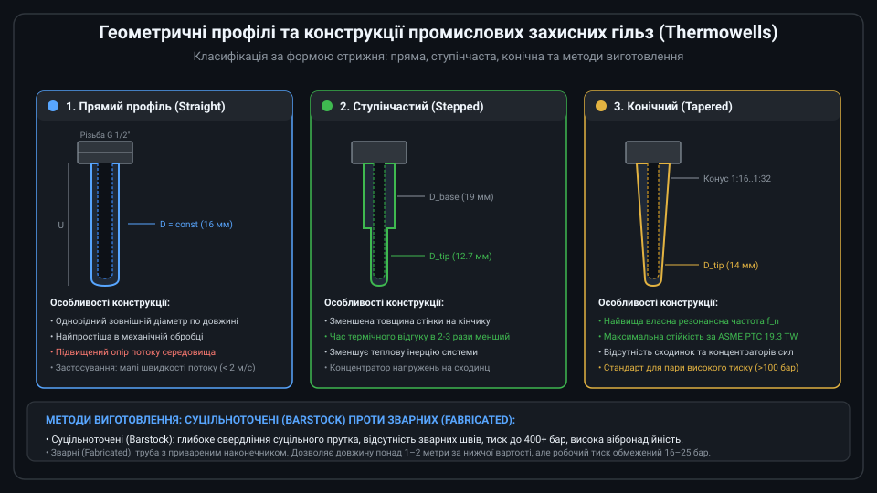
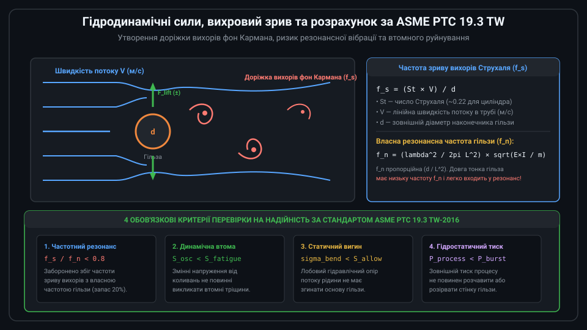
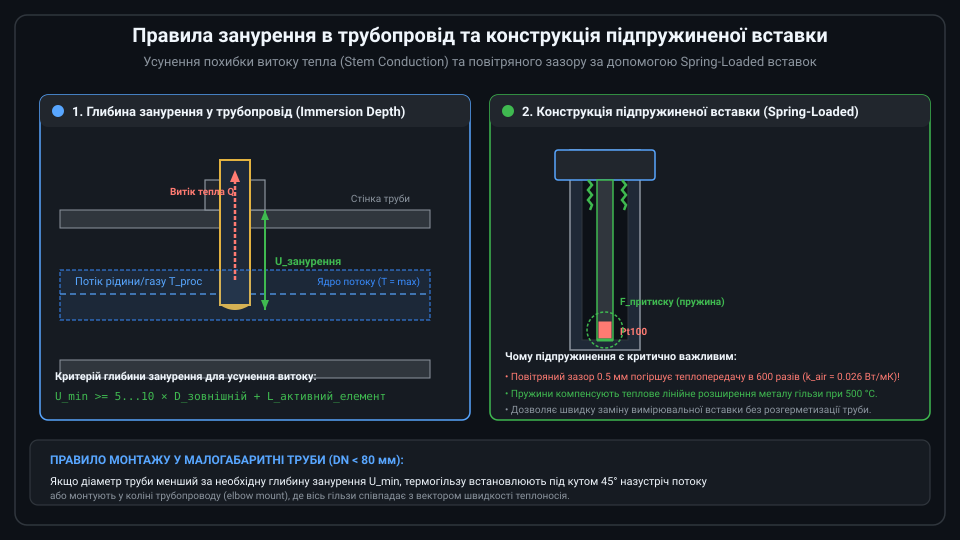

# Поглиблений інженерний аналіз захисних гільз та стандарту ASME PTC 19.3 TW

Проектування, гідродинамічний розрахунок та експлуатація захисних гільз (термогільз) на об'єктах критичної інфраструктури (ТЕС, АЕС, нафтопереробні заводи, магістральні нафто- і газопроводи) є складною задачею прикладної гідрогазодинаміки та матеріалознавства. Помилка у виборі геометричних параметрів або неврахування вихрового зриву може призвести до резонансного втомного зрізу гільзи, викиду горючих або токсичних продуктів під тиском та аварійної зупинки технологічного циклу.



---

## 1. Математична теорія теплопередачі термогільзи: дифрівняння ребра та витік тепла

Термогільза, занурена в потік гарячого або холодного середовища, функціонує як теплове ребро (fin). Стаціонарний розподіл температури вздовж осі гільзи описується класичним одновимірним диференціальним рівнянням теплопровідності другого порядку:

```text
d^2(Theta) / dx^2 - m^2 × Theta = 0
```

де:
* Theta(x) = T(x) - T_fluid — температурний напір між металом гільзи в точці x та вимірюваним середовищем;
* m = sqrt( (h × P) / (k × A_c) ) — характеристичний параметр теплового ребра;
* h — коефіцієнт конвективної тепловіддачі від середовища до поверхні гільзи (Вт/(м^2 × К));
* P — периметр перерізу гільзи (P = pi × D_outer);
* k — коефіцієнт теплопровідності металу гільзи (для 316L k ≈ 16 Вт/(м × К), для Hastelloy k ≈ 10 Вт/(м × К));
* A_c — площа поперечного перерізу металу стінки гільзи.

Розв'язок цього рівняння для кінчика гільзи (x = L_imm) з умовою тепловіддачі в основі до холодного фланця за температури T_wall дає аналітичну формулу систематичної похибки витоку тепла (Stem Conduction Error):

```text
Delta_T_stem = (T_fluid - T_wall) / cosh(m × L_imm)
```

Для того щоб похибка Delta_T_stem не перевищувала допустимі 0.05 °C при температурному перепаді T_fluid - T_wall = 300 °C, значення cosh(m × L_imm) має бути більше 6000, що відповідає умові:
`m × L_imm >= 8.7`.

Звідси випливає фундаментальне інженерне правило:
1. Збільшення занурюваної довжини L_imm експоненційно зменшує похибку витоку тепла.
2. Зменшення товщини стінки та діаметра гільзи (зменшення A_c) покращує тепловий контакт сенсора з потоком.
3. Матеріали з меншою теплопровідністю k (наприклад, нікелеві суперсплави) мають менший витік тепла вздовж стрижня, ніж високопровідні метали.

---

## 2. Гідродинамічний розрахунок за стандартом ASME PTC 19.3 TW-2016

Міжнародний стандарт ASME PTC 19.3 TW регламентує процедуру верифікації механічної надійності термогільз, що зазнають впливу силових потоків. Розрахунок включає чотири взаємопов'язані кроки:



### 1. Розрахунок частоти зриву вихорів (Strouhal Shedding Frequency)
Для поперечного зриву вихорів фон Кармана частота коливань підйомної сили дорівнює:
```text
f_s = (St × V) / B_tip
```
де St — число Струхаля (для конічних та прямих гільз у діапазоні чисел Рейнольдса 10^3...10^5 приймається рівним 0.21...0.22), V — швидкість руху теплоносія в стиснутому перерізі труби, B_tip — зовнішній діаметр наконечника.

Крім того, виникає поздовжній вихровий зрив вздовж осі потоку (In-line Drag Oscillation) з подвоєною частотою:
```text
f_s_inline = 2 × f_s
```

### 2. Розрахунок власної резонансної частоти гільзи (f_n)
Для консольної балки змінного перерізу в нерухомому середовищі власна частота першого тону згинальних коливань обчислюється як:
```text
f_n0 = (lambda^2 / (2 × pi × L^2)) × sqrt( (E × I_root) / m_unit )
```
де lambda = 1.875 для консолі, E — модуль пружності Юнга при робочій температурі, I_root — момент інерції кореневого перерізу, m_unit — погонна маса гільзи.
Далі вводиться поправка на масу приєднаної рідини (fluid added mass) та податливість монтажного фланця/бобишки, що знижує дійсну власну частоту в технологічному середовищі до величини f_n.

### 3. Критерії безпеки частотного співвідношення (Frequency Ratio)
Стандарт забороняє експлуатацію в зоні резонансу:
* Поперечні коливання (Lift): `f_s / f_n < 0.8`
* Поздовжні коливання (In-line): `2 × f_s / f_n < 0.4` або робота у строго визначеному безпечному діапазоні між 0.6 та 0.8 за умови проходження перевірки на втому.

### 4. Критерії механічних напружень
Сумарні динамічні знакозмінні напруження від вібрацій та статичні напруження вигину від гідродинамічного лобового опору F_drag = 0.5 × C_d × rho × V^2 × A_proj не повинні перевищувати допустимої межі втоми матеріалу з урахуванням концентратора напружень у корені гільзи.

---

## 3. Конструкція кабелю КТМС та підпружинених вимірювальних вставок

Всередині промислової термогільзи розміщується не "голий" чутливий елемент, а спеціалізована вимірювальна вставка на основі кабелю КТМС (кабель термопарний/терморезистивний мінералоізольований, у міжнародній термінології — MIMS, Mineral-Insulated Metal-Sheathed):



Конструктивні особливості кабелю MIMS:
* **Зовнішня безшовна оболонка**: Трубка з нержавіючої сталі 316L або сплаву Inconel 600 діаметром 3.0, 4.5 або 6.0 мм.
* **Пресована мінеральна ізоляція**: Високочистий оксид магнію (MgO 99.4%) з питомим електричним опором понад 10^12 Ом×см при 25 °C та щільністю пресування не менше 3.2 г/см^3. Забезпечує електричну міцність пробою до 1000 В і відмінну радіальну теплопровідність.
* **Гнучкість**: Кабель MIMS можна плавно вигинати за радіусом не менше 3–5 зовнішніх діаметрів без пошкодження внутрішніх платинових або мідних жив, що полегшує монтаж у важкодоступних місцях.

### Механізм підпружинення в сполучній головці
Стандартні сполучні головки (форми B, BUZ, Ex d вибухозахищені) містять клемний блок з двома направляючими гвинтами та сталевими циліндричними пружинами стиску. При загвинчуванні головки на штуцер гільзи пружини стискаються на величину 10–20 мм, створюючи постійне осьове зусилля. Якщо температура гільзи зростає від 20 °C до 500 °C, її глибина збільшується на кілька міліметрів за рахунок коефіцієнта лінійного теплового розширення alpha_L. Пружини вибирають цей тепловий зазор, запобігаючи відриву чутливого елемента від дна гільзи.

---

## 4. Методи неруйнівного контролю (NDE/NDT) та сертифікація гільз

Для вибухопожежонебезпечних виробництв кожна виготовлена термогільза проходить обов'язковий комплекс випробувань:

1. **Гідростатичні випробування тиском (Hydrostatic Pressure Test)**:
   Гільзу навантажують внутрішнім або зовнішнім тиском води, що перевищує розрахунковий тиск у 1.5 раза (за стандартом ASME B31.3), з витримкою не менше 10–30 хвилин. Падіння тиску або вологість на зовнішній поверхні неприпустимі.
2. **Контроль ексцентриситету свердління (Bore Concentricity Check)**:
   При свердлінні отвору діаметром 6.6 мм на глибину 400–600 мм довге свердло може відхилятися від осі. Ультразвуковим товщиноміром або радіографічним просвічуванням (X-ray) контролюють мінімальну залишкову товщину стінки по колу. Різниця товщини протилежних стінок не повинна перевищувати 10% від номіналу.
3. **Капілярна дефектоскопія (Dye Penetrant Testing, PT)**:
   Перевірка зварних швів фланця та бобишки за допомогою флуоресцентного пенетранту для виявлення мікротріщин, пор та непроварів розміром від 1 мкм.
4. **Спектральний аналіз металу (Positive Material Identification, PMI)**:
   Неруйнівний рентгенофлуоресцентний спектральний аналіз сплаву готової деталі безпосередньо перед монтажем для запобігання випадковій підміні марок сталі.

---

## 5. Програмна реалізація перевірки вихрової безпеки за стандартом ASME PTC 19.3 TW

Наведений модуль мовою C реалізує процедуру перевірки коефіцієнта частотного співвідношення та допустимої швидкості потоку для прямої та конічної термогільзи.

```c
#include <stdio.h>
#include <stdbool.h>
#include <math.h>

// Результат оцінки безпеки гільзи
typedef struct {
    float vortex_frequency_hz;       // Розрахункова частота вихорів Струхаля f_s
    float natural_frequency_hz;      // Власна резонансна частота гільзи f_n
    float frequency_ratio;           // Співвідношення частот f_s / f_n
    float max_allowable_velocity;    // Максимально допустима швидкість потоку (м/с)
    bool is_safe_frequency;          // Чи виконано умову f_s / f_n < 0.8
} asme_tw_result_t;

// Вхідні геометричні та гідродинамічні параметри
typedef struct {
    float immersion_length_m;        // Занурювана довжина L (напр. 0.25 м)
    float root_diameter_m;           // Діаметр біля основи D_root (напр. 0.022 м)
    float tip_diameter_m;            // Діаметр на кінчику D_tip (напр. 0.016 м)
    float bore_diameter_m;           // Діаметр внутрішнього каналу (напр. 0.0066 м)
    float fluid_velocity_m_s;        // Швидкість потоку теплоносія V (напр. 15.0 м/с)
    float fluid_density_kg_m3;       // Густина середовища rho (напр. 950.0 кг/м3 для рідини)
    float young_modulus_pa;          // Модуль Юнга матеріалу E (напр. 1.93e11 Па для 316L)
    float material_density_kg_m3;    // Густина металу гільзи (напр. 8000.0 кг/м3)
} asme_tw_input_t;

// Розрахунок за стандартом ASME PTC 19.3 TW
asme_tw_result_t evaluate_thermowell_safety(const asme_tw_input_t *in) {
    asme_tw_result_t res;
    const float strouhal_number = 0.22f; // Число Струхаля

    // 1. Частота зриву вихорів фон Кармана
    res.vortex_frequency_hz = (strouhal_number * in->fluid_velocity_m_s) / in->tip_diameter_m;

    // 2. Наближений розрахунок власної частоти конічної консольної балки
    // Момент інерції кільцевого перерізу в основі: I = (pi/64) * (D^4 - d_bore^4)
    float d_root4 = in->root_diameter_m * in->root_diameter_m * in->root_diameter_m * in->root_diameter_m;
    float d_bore4 = in->bore_diameter_m * in->bore_diameter_m * in->bore_diameter_m * in->bore_diameter_m;
    float inertia_root = (3.14159265f / 64.0f) * (d_root4 - d_bore4);

    // Середня площа металу перерізу для погонної маси
    float d_avg = 0.5f * (in->root_diameter_m + in->tip_diameter_m);
    float area_metal_avg = (3.14159265f / 4.0f) * (d_avg * d_avg - in->bore_diameter_m * in->bore_diameter_m);
    float mass_per_meter = area_metal_avg * in->material_density_kg_m3;

    // Фактор конусності H_f для конічних гільз (від 1.0 до 1.5)
    float taper_ratio = in->tip_diameter_m / in->root_diameter_m;
    float taper_factor = 1.0f + 0.35f * (1.0f - taper_ratio);

    // Власна частота у вакуумі: f_n0 = (lambda^2 / 2pi L^2) * sqrt(E * I / m) * H_f
    float l_sq = in->immersion_length_m * in->immersion_length_m;
    float f_n0 = (3.516f / (2.0f * 3.14159265f * l_sq)) * 
                 sqrtf((in->young_modulus_pa * inertia_root) / mass_per_meter) * taper_factor;

    // Корекція на приєднану масу технологічної рідини
    float fluid_added_mass = (3.14159265f / 4.0f) * d_avg * d_avg * in->fluid_density_kg_m3;
    float fluid_mass_factor = sqrtf(mass_per_meter / (mass_per_meter + fluid_added_mass));
    res.natural_frequency_hz = f_n0 * fluid_mass_factor;

    // 3. Перевірка критерію співвідношення частот
    res.frequency_ratio = res.vortex_frequency_hz / res.natural_frequency_hz;
    res.is_safe_frequency = (res.frequency_ratio < 0.80f);

    // 4. Максимально допустима швидкість потоку з запасом 20% по частоті
    res.max_allowable_velocity = (0.80f * res.natural_frequency_hz * in->tip_diameter_m) / strouhal_number;

    return res;
}
```

Використання таких алгоритмів автоматизованого проектування виключає людський фактор і гарантує безаварійну експлуатацію датчиків температури у відповідальних технологічних контурах.
