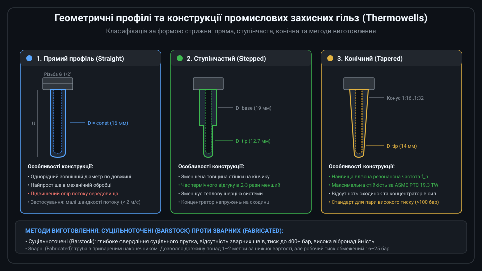
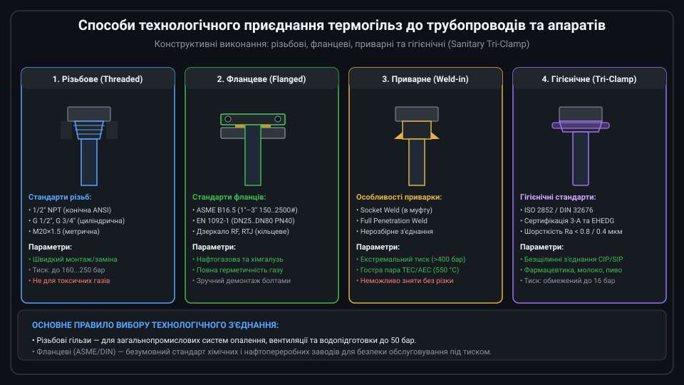
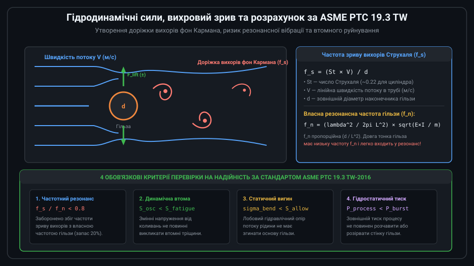
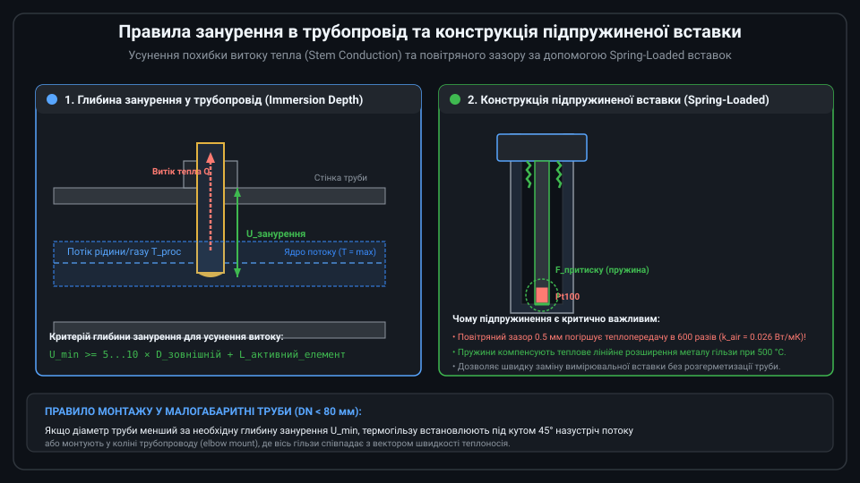

# Конструкції захисних гільз, арматури та термогільз для промислових датчиків температури

Захисна термогільза (Thermowell) — це герметична металева або керамічна циліндрична гільза, яка стаціонарно встановлюється в технологічний трубопровід або реактор для захисту первинного вимірювального перетворювача (RTD PT100 або термопари) від руйнівного впливу тиску робочого середовища, високої швидкості потоку, корозійної агресивності та абразивного зносу. Використання термогільзи дозволяє проводити метрологічну повірку, калібрування або заміну несправного сенсора без зупинки технологічного процесу та без розгерметизації системи.



---

## 1. Геометричні форми та конструктивні типи гільз

За зовнішнім геометричним профілем стрижня промислові захисні гільзи поділяються на три основні категорії:

1. **Прямі гільзи (Straight)**: Мають однаковий зовнішній діаметр по всій занурюваній довжині (найчастіше 16 мм або 1/2"). Вони прості у виробництві та мають високу механічну жорсткість, проте володіють найбільшою гідродинамічною парусністю та значною тепловою інерцією. Застосовуються у середовищах з низькою швидкістю руху (&lt; 2 м/с для рідин).
2. **Ступінчасті гільзи (Stepped)**: Мають базовий діаметр 19–22 мм біля кріплення та різке ступінчасте зменшення діаметра до 12.7 мм (1/2") на останніх 50–70 мм наконечника. Зменшення товщини стінки в зоні розміщення чутливого елемента скорочує час теплового відгуку в 2–3 рази.
3. **Конічні гільзи (Tapered)**: Зовнішній діаметр плавно зменшується від основи до наконечника з постійною конусністю (наприклад, від 22 мм до 14 мм). Завдяки відсутності сходинок-концентраторів напружень та оптимальному розподілу маси конічні гільзи мають найвищу власну частоту коливань і є стандартом для високих швидкостей пари та газів.

За технологією виготовлення гільзи бувають **суцільноточеними (Barstock)**, виготовленими глибоким свердлінням монолітного металевого прутка (для тиску до 400+ бар), та **зварними (Fabricated)**, виготовленими з труби з привареним круглим денцем (для низького тиску до 25 бар).

---

## 2. Способи технологічного приєднання до процесу

Метод герметичного монтажу термогільзи в технологічну установку обирається виходячи з робочого тиску, температури, токсичності середовища та вимог до швидкості демонтажу:



* **Різьбові з'єднання (Threaded)**: Гільза вкручується в приварену до труби різьбову бобишку. Найпоширеніші різьби — конічна дюймова 1/2" або 3/4" NPT (самоущільнююча за рахунок деформації витків), циліндрична трубна G 1/2" (BSPP) з мідною або фторопластовою прокладкою та метрична М20×1.5. Використовуються при тисках до 150–250 бар у безпечних середовищах.
* **Фланцеві з'єднання (Flanged)**: Гільза приварюється до стандартного фланця за стандартом ASME B16.5 (класи 150#...2500#) або EN 1092-1 (PN16...PN100). Фланцевий монтаж є обов'язковим стандартом на нафтопереробних, хімічних та газових підприємствах завдяки найвищій надійності та можливості візуального контролю герметичності міжфланцевої прокладки (RF або RTJ).
* **Приварні гільзи (Weld-in / Socket Weld)**: Вварюються безпосередньо в колектор або паропровід суцільним швом. Забезпечують абсолютну монолітність при надкритичних параметрах пари (ТЕС, АЕС, тиск понад 300 бар, температура до 560 °C), де будь-які різьби або фланці з часом втрачають герметичність через повзучість металу.
* **Гігієнічні приєднання (Sanitary Tri-Clamp)**: Спеціалізовані безрізьбові з'єднання за стандартами 3-A та EHEDG для харчової, молочної та біофармацевтичної промисловості. Відсутність застійних зон та якісна поліровка (шорсткість Ra &lt; 0.8 мкм) забезпечують можливість безрозбірного автоматичного миття та стерилізації (CIP/SIP).

---

## 3. Гідродинаміка та вихровий резонанс: стандарт ASME PTC 19.3 TW

Найбільш небезпечним фактором руйнування термогільз у швидкісних потоках є гідродинамічне явище зриву вихорів:



Коли потік рідини або газу обтікає циліндричну гільзу, за нею виникають періодичні вихори, що зриваються по черзі з верхнього та нижнього боку, утворюючи доріжку вихорів фон Кармана. Зрив кожного вихору створює поперечну підйомну силу (Lift force), яка діє на гільзу з частотою Струхаля:

```text
f_s = (St × V) / d
```

де St — число Струхаля (~0.22 для циліндра), V — швидкість потоку, d — діаметр наконечника.

Якщо частота вихорів f_s збігається з власною частотою згинальних коливань гільзи f_n, виникає механічний резонанс. Амплітуда вібрації зростає у десятки разів, викликаючи втомне руйнування металу біля кореня гільзи за лічені години. Стандарт **ASME PTC 19.3 TW-2016** вимагає обов'язкового розрахункового контролю співвідношення частот (f_s / f_n &lt; 0.8), динамічних напружень втоми та статичного тиску процесу перед монтажем гільзи.

---

## 4. Забезпечення теплопередачі та конструкція підпружиненої вставки

Термогільза є додатковим термічним бар'єром між вимірюваним середовищем та сенсором. Для виключення похибок вимірювання необхідно суворо дотримуватися двох інженерних правил:



1. **Глибина занурення та витік тепла (Stem Conduction)**:
   Металевий корпус гільзи має високу теплопровідність, тому тепло від спаю стікає вздовж стінки до масивного зовнішнього фланця та охолоджується навколишнім повітрям. Щоб похибка відведення тепла була нехтовно малою (&lt; 0.05 °C), робочий кінець гільзи повинен занурюватися на глибину не менше 5–10 зовнішніх діаметрів для рідин і 10–15 діаметрів для газів, досягаючи центральної третини труби.
2. **Конструкція підпружиненої вимірювальної вставки (Spring-Loaded Insert)**:
   Повітряний зазор на дні гільзи є теплоізолятором (теплопровідність сталі 16 Вт/мК проти 0.026 Вт/мК для повітря). Промислові сенсори виготовляються у вигляді підпружинених змінних вставок: сталеві пружини всередині сполучної головки постійно притискають денце трубки сенсора до дна термогільзи із зусиллям 20–50 Н. Це гарантує прямий металевий тепловий контакт та компенсує різницю теплового лінійного розширення при нагріванні.

---

## 5. Вибір матеріалів для агресивних технологічних середовищ

Довговічність та безпека експлуатації термогільзи визначаються правильно підібраним конструкційним матеріалом:


* **AISI 316L (1.4404)**: Універсальна аустенітна нержавіюча сталь з вмістом молібдену (2–3%). Застосовується у 80% випадків: водопостачання, пара до 400 °C, нафтопродукти та харчові середовища.
* **Hastelloy C-276**: Спеціальний нікель-молібден-хромовий сплав для важкої хімії. Стійкий до гарячої соляної, сірчаної та фосфорної кислот, вологого хлору та сильних окисників.
* **Inconel 600 / 625**: Жароміцні нікелеві сплави для роботи при температурах до +1150 °C в печах спалювання, вихлопних трактах турбін та установках термічного крекінгу.
* **Корундова кераміка (Al2O3 Alsint 99.7%)**: Застосовується у високотемпературних плавильних печах металургії та випалу кераміки (до +1700...+1800 °C), де будь-які жароміцні сталі плавляться або окислюються газами горіння.
