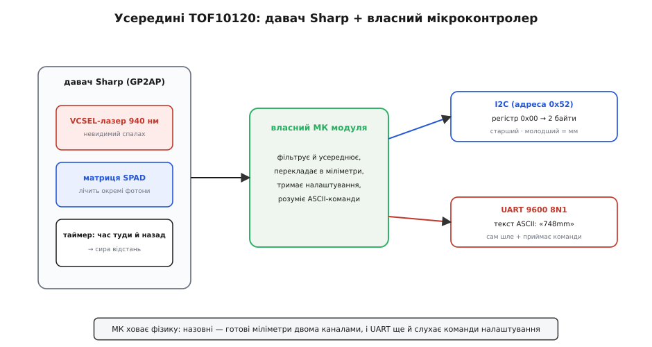
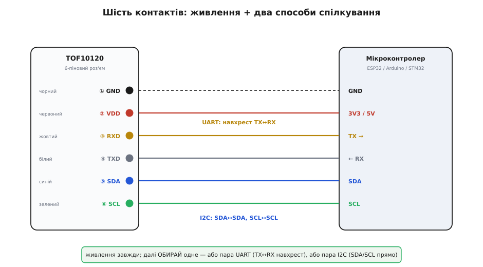
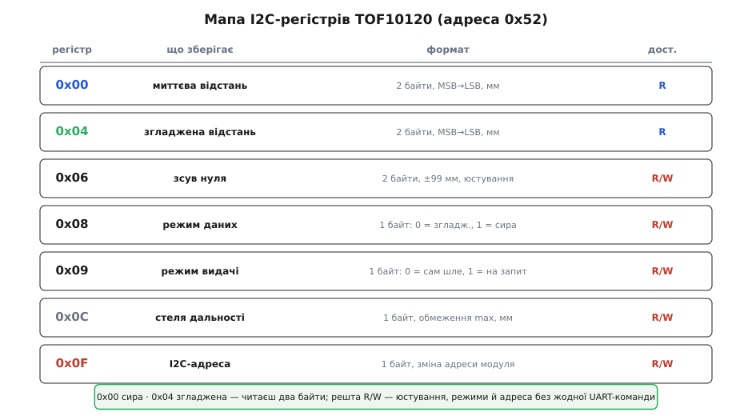
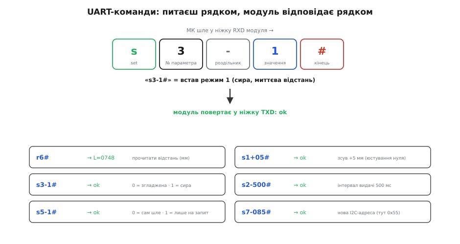

# TOF10120 — лазерний далекомір (ToF, до ~180 см)

Модуль TOF10120 — це високоточний субнаносекундний оптичний далекомір, побудований на технології вимірювання часу польоту фотонів (Time-of-Flight, ToF). Завдяки інтеграції напівпровідникового лазера VCSEL з довжиною хвилі 940 нм, матриці лавинних фотодіодів SPAD від корпорації Sharp та власного бортового мікроконтролера модуль вимірює відстані від 10 см до 180 см з точністю близько 4–5%, повністю нівелюючи залежність від кольору чи відбивної здатності перешкоди.

## 1. Концепція ToF та особливості модуля TOF10120

На відміну від звичайних інфрачервоних датчиків наближення, які орієнтуються на амплітуду відбитого сигналу (де чорні предмети видаються далекими через слабке відбиття), TOF10120 спирається на незмінну швидкість світла (300 000 км/с). Модуль відправляє ультракороткі світлові імпульси та вимірює часову затримку між моментом випромінювання та реєстрацією перших повернених фотонів:
```
відстань = (швидкість_світла * час_прольоту) / 2
```
Це гарантує, що як біла глянцева стіна, так і чорна матова тканина покажуть абсолютно однакову дистанцію в міліметрах.

## 2. Кремнієва база Sharp та вбудований процесор

Поширеною помилкою є твердження, що всі бюджетні ToF-модулі побудовані на базі чипів STMicroelectronics. У модулі TOF10120 застосовано кремнієвий оптичний тракт Sharp класу GP2AP:



- **Лазер VCSEL 940 нм:** вертикально-випромінюючий лазерний кристал генерує пучок в невидимому інфрачервоному діапазоні. Потужність оптичного імпульсу відповідає стандарту безпеки лазерного обладнання Класу 1 (IEC 60825-1:2014) — випромінювання абсолютно безпечне для зору людини та тварин.
- **Матриця SPAD (Single-Photon Avalanche Diode):** матриця лавинних фотодіодів працює при напрузі вище пробою, генеруючи потужний електричний імпульс навіть при попаданні одного фотона. Внутрішній пікосекундний хронометр фіксує момент реєстрації з наносекундною роздільною здатністю.
- **Власний мікроконтролер модуля:** виконує роль моста та цифрового фільтра. Він усереднює вимірювання, відсікає шуми, обчислює кінцеву відстань і зберігає конфігураційні параметри у вбудованій пам'яті.

## 3. Схема підключення та фізичні інтерфейси

Модуль виконаний у мініатюрному керамічному корпусі (20 × 13.2 × 2.0 мм) з 6-контактним роз'ємом:



Призначення проводів кольорового шлейфа:
- **GND (чорний):** спільний провід живлення.
- **VCC (червоний):** напруга живлення від 3.0 В до 5.0 В (струм споживання близько 35 мА, імпульсний пік лазера до 59 мА).
- **RXD (жовтий):** лінія прийому UART (приймає текстові команди від мікроконтролера).
- **TXD (білий):** лінія передачі UART (видає текстовий потік дистанції або відповіді на команди).
- **SDA (зелений):** лінія даних шини I2C.
- **SCL (синій):** тактова лінія шини I2C.

## 4. Карта регістрів I2C та керування текстовими командами UART

Модуль надає два паралельні способи опитування та конфігурації:



- **Зчитування по шині I2C:** за замовчуванням 7-бітна адреса пристрою становить `0x52` (8-бітна форма запису — `0xA4`). Запит двох байтів з регістру `0x00` повертає 16-бітне ціле значення поточної відстані у міліметрах.



- **Керування через текстові команди UART (9600 бод, 8N1):**
  - За замовчуванням модуль самостійно транслює в UART рядок формату `xxxmm\r\n` з частотою близько 30 Гц.
  - Команда `s2-0#` вимикає автотрансляцію UART (перехід у пасивний режим за запитом).
  - Команда `s2-1#` відновлює потокову трансляцію.
  - Команда `s3-0#` активує згладжений режим виводу (фільтрація тремтіння), а `s3-1#` перемикає регістр на сирі відліки.
  - Команда `s5-1#` зберігає змінені параметри в енергонезалежну пам'ять EEPROM модуля.

## 5. Робочі характеристики, дальність та вплив середовища

Для забезпечення високої надійності вимірювань слід враховувати експлуатаційні межі модуля:
- **Діапазон роботи:** гарантована робоча дистанція в приміщенні становить від 10 см до 180 см для світлих матових поверхонь. Мінімальна відстань обмежена 10 см (ближче сенсор входить у зону перекриття оптичних осей).
- **Вплив кольору цілі на дистанцію:** для сірої матової цілі максимальна дальність у приміщенні знижується до ~80 см через малу кількість відбитих фотонів.
- **Вплив сонячного світла:** денне освітлення високої інтенсивності містить природний спектр 940 нм, який створює фоновий шум на SPAD-матриці. На вулиці під прямим сонцем дальність зменшується до 40–60 см.
- **Оптичні перешкоди:** бруд, конденсат чи пил на захисному вікні модуля спричиняють ефект внутрішнього відбиття (Optical Crosstalk), через що модуль починає помилково занижувати показання дистанції.
