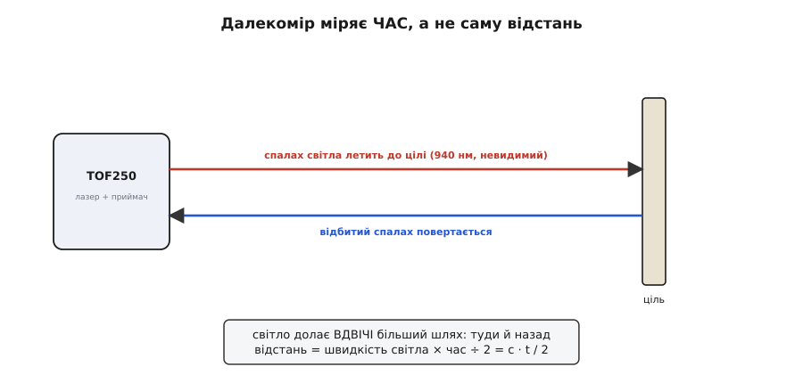
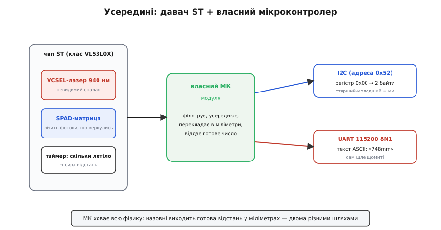
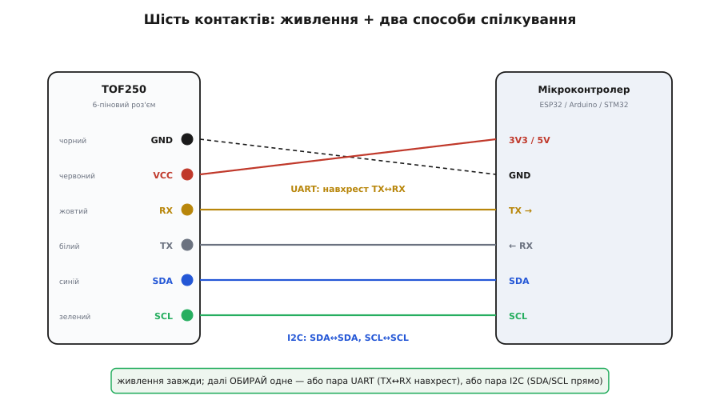
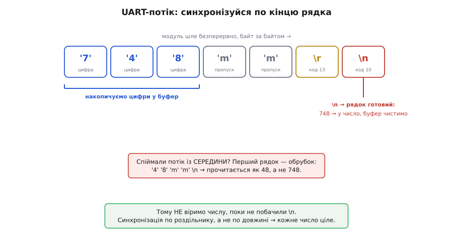

# TOF250 — лазерний далекомір

Модуль TOF250 — це компактний високоточний лазерний далекомір, що працює за технологією безпосереднього вимірювання часу польоту світла (Time-of-Flight, ToF). Завдяки вбудованому безпечному інфрачервоному лазеру та надчутливій кремнієвій матриці одиночних фотонів сенсор вимірює відстань до перешкоди в діапазоні від 5 см до 250 см з міліметровою роздільною здатністю, не залежачи від кольору, текстури та відбивної здатності цілі.

## 1. Концепція Time-of-Flight та переваги над ультразвуком та ІЧ

Традиційні оптичні давачі відстані на базі фотодіодів вимірюють амплітуду відбитого світла: чим ближче перешкода, тим вона яскравіша. Проте цей метод фатально залежить від кольору поверхні: чорна стіна за 10 см повертає стільки ж світла, скільки біла за півтора метра. Ультразвукові датчики (як-от HC-SR04), зі свого боку, мають широкий конус випромінювання і не здатні розрізняти дрібні деталі або дзеркально розсіюються від нахилених поверхонь.



Технологія Time-of-Flight долає ці обмеження завдяки фундаментальній фізичній константі — швидкості світла (близько 300 000 км/с):
- Модуль випромінює субнаносекундний світловий імпульс.
- Промінь відбивається від об'єкта та повертається на приймальну матрицю.
- Вбудований хронометр фіксує точний час польоту `t`.
- Відстань обчислюється за формулою:
  ```
  відстань = (швидкість_світла * час_польоту) / 2
  ```
Оскільки швидкість світла однакова для будь-яких матеріалів, чорні, білі або кольорові поверхні вимірюються з однаково високою точністю.

## 2. Фізична реалізація: лазер VCSEL та матриця SPAD

Вимірювання проміжків часу порядку одиниць наносекунд (за 1 наносекунду світло проходить лише 30 см туди й назад) стало можливим завдяки кремнієвим технологіям компанії STMicroelectronics:



- **Лазер VCSEL (Vertical-Cavity Surface-Emitting Laser):** випромінює вузькоспрямований пучок на довжині хвилі 940 нм. Це невидимий інфрачервоний діапазон, повністю безпечний для людського ока (лазер Класу 1 згідно зі стандартом IEC 60825-1).
- **Матриця лавинних фотодіодів SPAD (Single-Photon Avalanche Diode):** надзвичайно чутливі напівпровідникові детектори, що працюють у режимі зворотного пробою (Geiger mode). Приліт навіть одного-єдиного фотона ініціює лавинний розряд, фіксуючи часову мітку з субпікосекундною роздільною здатністю.
- **Вузький конус огляду (FoV):** поле зору сенсора становить близько 25 градусів, що дозволяє точно локалізувати перешкоду без захоплення випадкових об'єктів з боків.

## 3. Дворівнева архітектура: сенсор ST та вбудований мікроконтролер

Ключова перевага модуля TOF250 над «голими» мікросхемами серії VL53L0X полягає у наявності **власного бортового мікроконтролера**:
- Голий сенсор вимагає від керуючого процесора складних бібліотек (ST API), займає багато оперативної пам'яті та потребує постійного опитування внутрішніх калібрувальних регістрів.
- Модуль TOF250 бере всю низькорівневу математику на себе: вбудований чіп безперервно запускає вимірювання, фільтрує шумові спалахи, проводить компенсацію температури й оптичного скла та виставляє готову відстань у міліметрах.

## 4. Інтерфейси взаємодії: шина I2C та послідовний порт UART

Модуль надає розробнику максимальну гнучкість завдяки наявності двох незалежних інтерфейсів на єдиній 6-контактній колодці:



Призначення проводів шлейфа:
- **GND (чорний):** спільна земля.
- **VCC (червоний):** живлення від 3.3 В до 5.0 В (вбудований стабілізатор забезпечує живлення логіки).
- **RX / TX (жовтий / білий):** лінії послідовного порту UART (швидкість за замовчуванням 115200 бод, 8N1).
- **SDA / SCL (зелений / синій):** інтерфейс шини I2C (7-бітна адреса `0x52`, що відповідає 8-бітній адресі `0xA4`).



- **Робота по I2C:** модуль виступає класичним веденим (Slave). Мікроконтролер звертається до регістру `0x00` та вичитує два байти, які безпосередньо утворюють 16-бітне число поточної дистанції в міліметрах.
- **Робота по UART:** за замовчуванням модуль працює в активному режимі, кожні 100 мс відправляючи текстовий рядок формату `d: 748mm\r\n`. Для читання достатньо налаштувати апаратний UART мікроконтролера та парсити отримані символи.

## 5. Експлуатаційні обмеження та типові помилки

Під час інтеграції далекоміра TOF250 слід враховувати фізичні особливості оптичних систем:
1. **Засвічення прямим сонячним світлом:** спектр сонячного випромінювання на відкритому просторі містить потужну складову 940 нм. На яскравому сонці матриця SPAD може перенасичуватися фоновими фотонами, через що максимальна дальність вимірювання падає з 2.5 метрів до 0.8–1.2 метра.
2. **Прозорі та дзеркальні поверхні:** звичайне віконне скло пропускає лазерний промінь, тому датчик виміряє відстань до предметів за склом, а не до самого скла. Дзеркальні та поліровані металеві поверхні дзеркально відбивають промінь убік під кутом падіння, що призводить до втрати сигналу.
3. **Забруднення захисного скла:** відбитки пальців, пил або краплі води на захисному віконці викликають оптичне перехресне випромінювання (Optical Crosstalk) — частина світла лазера відбивається безпосередньо в приймач, викликаючи стале заниження вимірюваної дистанції.
