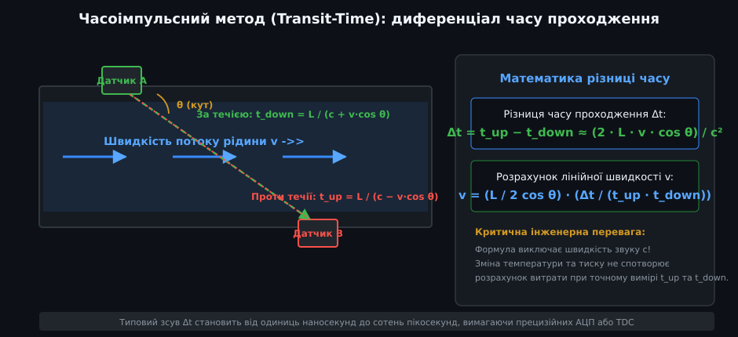
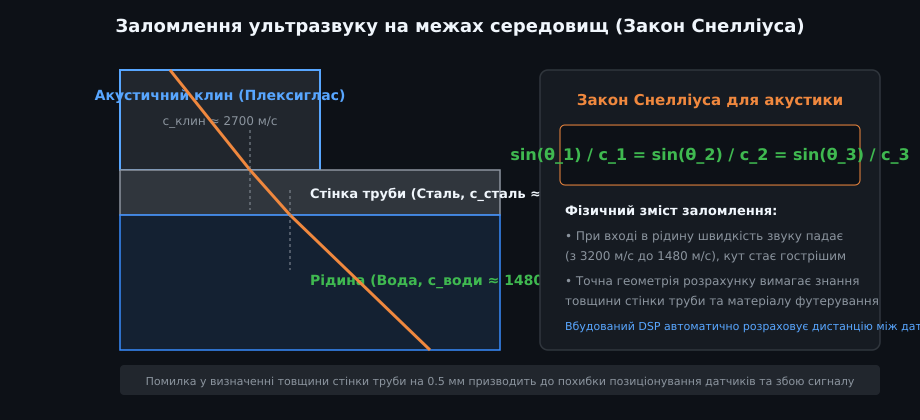
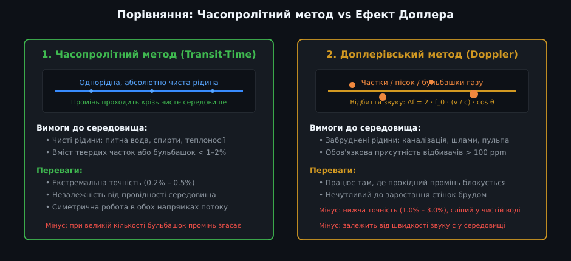
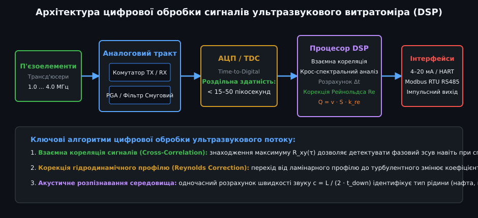
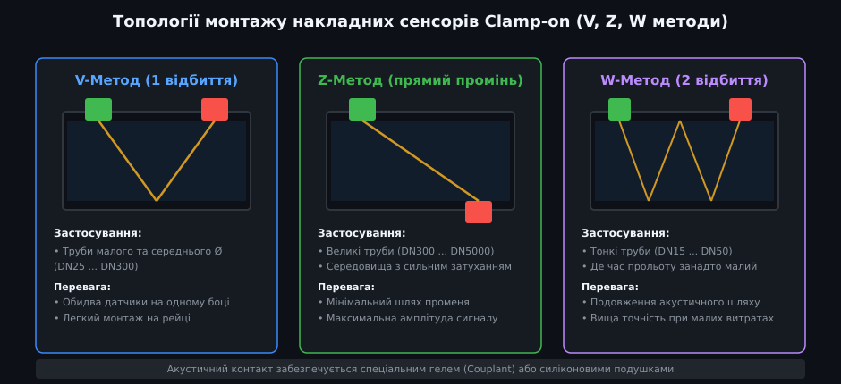

# Поглиблений аналіз ультразвукових витратомірів рідини

Ультразвукові витратоміри належать до прецизійних вимірювальних приладів вищого класу точності. Їхнє застосування охоплює комерційний облік теплової енергії та води у ЖКГ, моніторинг нафтопроводів високого тиску, хімічну промисловість та фармацевтичні біореактори. У цьому поглибленому посібнику детально розглядаються акустичні хвильові процеси, алгоритми цифрової обробки сигналів на базі TDC і крос-кореляції, корекція гідродинамічного профілю потоку та інженерна реалізація обчислювального ядра на мові C++.

---

## 1. Акустична теорія часопролітного методу (Transit-Time)

Часопролітний метод базується на прямому впливі конвективного перенесення акустичної хвилі рухомим потоком рідини.



### Точне математичне виведення швидкості
Нехай L — геометрична довжина прямого акустичного шляху між п'єзоелементами в рідині, а θ — кут між напрямком акустичного променя та вектором швидкості потоку.
- **Час поширення хвилі за течією:**
  
  t_down = L / (c + v · cos θ)

- **Час поширення хвилі проти течії:**
  
  t_up = L / (c − v · cos θ)

де `c` — швидкість звуку в нерухомій рідині, `v` — осереднена за променем швидкість потоку.

Визначимо різницю часу проходження Δt:
  
Δt = t_up − t_down = L · [ (c + v · cos θ) − (c − v · cos θ) ] / [ c² − (v · cos θ)² ]
Δt = (2 · L · v · cos θ) / [ c² − (v · cos θ)² ]

Оскільки швидкість руху рідини v (рідко перевищує 1–5 м/с) на три порядки менша за швидкість звуку c (у воді c ≈ 1500 м/с), членом `(v · cos θ)²` у знаменнику зневажають:
  
Δt ≈ (2 · L · v · cos θ) / c²

Перемноживши вирази для t_up та t_down:
  
t_up · t_down = L² / [ c² − (v · cos θ)² ] ≈ L² / c²  ==>  c² ≈ L² / (t_up · t_down)

Підставивши вираз для c² у формулу Δt, отримуємо остаточне інженерне рівняння для швидкості:
  
v = (L / (2 · cos θ)) · (Δt / (t_up · t_down))

### Оцінка пікосекундної чутливості
Для водопровідної труби DN50 (внутрішній діаметр D = 50 мм, кут θ = 45°, L = 70.7 мм, c = 1482 м/с):
- При швидкості потоку v = 0.01 м/с (повільний рух води):
  
  Δt ≈ (2 · 0.0707 · 0.01 · cos 45°) / (1482)² ≈ 1.00 · 10⁻³ / 2.196 · 10⁶ ≈ 0.455 наносекунди (455 пікосекунд!).

- Для забезпечення похибки вимірювання не гірше ±1% прилад повинен фіксувати різницю часу з роздільною здатністю від 5 до 15 пікосекунд (1 пс = 10⁻¹² с). Це досягається за допомогою спеціалізованих мікросхем TDC (наприклад, серії Texas Instruments TDC1000/TDC7200 або ScioSense GP30).

---

## 2. Акустична фізика клинів, імпеданс та закон Снелліуса

У накладних датчиках Clamp-on акустична хвиля долає кілька меж поділу фаз: п'єзокераміка -> призма (клин) -> акустичний гель -> стінка труби -> вимірювана рідина.



### Акустичний імпеданс та узгодження фаз
Характеристичний питомий акустичний опір (імпеданс) середовища визначається як:
  
Z = ρ · c

- При переході звуку між двома матеріалами з імпедансами Z_1 та Z_2 коефіцієнт відбиття за тиском дорівнює:
  
  R_p = (Z_2 − Z_1) / (Z_2 + Z_1)

- Для сталі Z_сталь ≈ 45 · 10⁶ Па·с/м, для води Z_води ≈ 1.5 · 10⁶ Па·с/м, а для повітря Z_повітря ≈ 415 Па·с/м.
- **Чому повітря неприпустиме:** Коефіцієнт відбиття на межі сталь-повітря становить 99.998%! Навіть мікронна повітряна плівка повністю відбиває промінь. Застосування високов'язкого силіконового гелю або ультразвукового мастила є обов'язковою фізичною вимогою.

### Закон Снелліуса для заломлення поздовжніх та поперечних хвиль
На кожній плоскій межі поділу кути падіння та заломлення пов'язані співвідношенням:
  
sin(θ_клин) / c_клин = sin(θ_стінка) / c_стінка = sin(θ_рідина) / c_рідина

- **Трансформація хвиль у металі стінки:** У твердій стінці труби виникають як поздовжні (Longitudinal), так і поперечні зсувні хвилі (Shear waves). Кут клина датчика зазвичай обирають так, щоб збуджувати переважно поперечні хвилі, оскільки вони мають меншу швидкість (у сталі c_shear ≈ 3200 м/с проти c_long ≈ 5900 м/с), що зменшує просторовий зсув променя вздовж труби.

---

## 3. Порівняння: Часопролітний метод проти ефекту Доплера



### Фізична модель ефекту Доплера
Якщо в потоці присутні сторонні оптично або акустично неоднорідні частки (пісок, іржа, волокна целюлози, мікробульбашки повітря), ультразвук частотою f_0 розсіюється на них. Приймач реєструє відбитий сигнал зі зсувом частоти Δf:
  
Δf = 2 · f_0 · (v / c) · cos θ

- Доплерівський метод принципово не здатний працювати в чистій дегазованій воді, оскільки в ній відсутні акустичні відбивачі.
- Часопролітний метод, навпаки, втрачає сигнал при концентрації твердих часток або бульбашок понад 2–5% за об'ємом, оскільки висока щільність розсіювачів викликає дифузне розсіювання та згасання прямого пучка.

---

## 4. Алгоритми цифрової обробки сигналів (DSP) та гідродинамічна корекція



### Крос-кореляційний аналіз (Cross-Correlation)
У промислових шумних умовах (вібрація від насосів, кавітація) пряме детектування переднього фронту імпульсу компаратором призводить до фазових помилок на цілий період хвилі (Cycle skipping). Процесор DSP використовує обчислення взаємної кореляції:
  
R_xy(m) = ∑ [k=0..N-1] x(k) · y(k + m)

Положення максимуму кореляційної функції дає точний цілочисельний зсув у відліках АЦП, а параболічна субдискретна інтерполяція навколо піку забезпечує роздільну здатність у частки пікосекунди:
  
m_peak = m_0 + (R(m_0 - 1) − R(m_0 + 1)) / (2 · (R(m_0 - 1) − 2·R(m_0) + R(m_0 + 1)))

### Число Рейнольдса та корекція гідродинамічного профілю (Reynolds Correction)
Ультразвуковий промінь інтегрує швидкість уздовж своєї лінії проходження, а не по всьому поперечному перерізу труби.
- Співвідношення між середньою об'ємною швидкістю v_avg та осьовою швидкістю v_line залежить від гідродинамічного режиму (числа Рейнольдса Re):
  
  Re = (v · D) / ν

  де ν — кінематична в'язкість середовища (для води за 20 °C ν ≈ 1.004 · 10⁻⁶ м²/с).
- **Ламінарний режим (Re < 2300):** Параболічний профіль Пуазейля. Променева швидкість відрізняється від середньої: k_re = 0.75.
- **Турбулентний режим (Re > 4000):** Профіль логарифмічно сплощений за формулою Прандтля-Нікурадзе. Коефіцієнт корекції становить:
  
  k_re = 1.0 / (1.119 − 0.011 · log10(Re)) ≈ 0.93 ... 0.96

---

## 5. Промислова програмна реалізація мовою C++



Нижче наведено виробничий клас мовою C++ для розрахунку параметрів монтажу Clamp-on накладних датчиків, обчислення числа Рейнольдса та знаходження об'ємної витрати в м³/год.

```cpp
/**
 * @file ultrasonic_flow_computer.hpp
 * @brief Обчислювальне ядро промислового ультразвукового витратоміра (Transit-Time)
 */

#include <stdint.h>
#include <stdbool.h>
#include <math.h>

class UltrasonicFlowComputer {
public:
    enum MountingMethod {
        METHOD_V = 1, // V-подібний метод (1 відбиття від стінки)
        METHOD_Z = 2, // Z-подібний прямий метод
        METHOD_W = 4  // W-подібний метод (2 відбиття)
    };

    struct PipeGeometry {
        float outer_diameter_mm;  // Зовнішній діаметр труби
        float wall_thickness_mm;  // Товщина стінки труби
        float c_wall_m_s;         // Швидкість звуку в стінці (сталь ~3200 м/с)
        float c_wedge_m_s;        // Швидкість звуку в клині датчика (~2700 м/с)
        float wedge_angle_deg;    // Кут клина датчика (зазвичай 38° ... 45°)
        MountingMethod method;    // Топологія променя
    };

    UltrasonicFlowComputer(const PipeGeometry &geo) : geo_(geo) {}

    /**
     * @brief Розрахунок міліметрової дистанції монтажу між датчиками вздовж труби
     * @param c_fluid_m_s Швидкість звуку в рідині (вода ~1482 м/с при 20 °C)
     * @return Дистанція розведення сенсорів між передніми гранями клинів (мм)
     */
    float calculateSensorSpacing(float c_fluid_m_s) const {
        const float deg2rad = 3.14159265f / 180.0f;
        float theta_wedge = geo_.wedge_angle_deg * deg2rad;

        // Закон Снелліуса для заломлення в рідині
        float sin_theta_fluid = (c_fluid_m_s / geo_.c_wedge_m_s) * sinf(theta_wedge);
        if (sin_theta_fluid >= 1.0f) return -1.0f; // Повне внутрішнє відбиття!

        float cos_theta_fluid = sqrtf(1.0f - (sin_theta_fluid * sin_theta_fluid));
        float tan_theta_fluid = sin_theta_fluid / cos_theta_fluid;

        // Внутрішній діаметр труби
        float inner_diameter_mm = geo_.outer_diameter_mm - (2.0f * geo_.wall_thickness_mm);

        // Проекція шляху променя в рідині на вісь труби для одного проходу
        float path_in_fluid_mm = inner_diameter_mm * tan_theta_fluid;

        // Загальна дистанція залежно від кількості відбиттів
        float total_spacing_mm = path_in_fluid_mm * (float)geo_.method;
        return total_spacing_mm;
    }

    /**
     * @brief Обчислення об'ємної витрати за різницею часу Δt
     * @param delta_t_ns Різниця часу (t_up - t_down) у наносекундах
     * @param t_up_us Повний час прольоту проти течії в мікросекундах
     * @param t_down_us Повний час прольоту за течією в мікросекундах
     * @param temperature_c Температура середовища для розрахунку в'язкості
     * @param out_flow_m3_h Розрахована об'ємна витрата рідини (м³/год)
     * @return true якщо розрахунок валідний
     */
    bool computeFlowRate(float delta_t_ns, float t_up_us, float t_down_us,
                         float temperature_c, float &out_flow_m3_h) const {
        if (t_up_us <= 0.0f || t_down_us <= 0.0f) return false;

        const float deg2rad = 3.14159265f / 180.0f;
        float theta_wedge = geo_.wedge_angle_deg * deg2rad;

        // 1. Переведення одиниць у систему СІ (секунди, метри)
        float dt_sec = delta_t_ns * 1.0e-9f;
        float t_up_sec = t_up_us * 1.0e-6f;
        float t_down_sec = t_down_us * 1.0e-6f;

        float inner_diameter_m = (geo_.outer_diameter_mm - (2.0f * geo_.wall_thickness_mm)) * 0.001f;
        float area_m2 = (3.14159265f * inner_diameter_m * inner_diameter_m) / 4.0f;

        // Розрахункова довжина променя L у рідині
        float l_fluid_m = inner_diameter_m / cosf(theta_wedge);

        // 2. Обчислення сирої лінійної швидкості потоку за променем
        float v_raw = (l_fluid_m / (2.0f * cosf(theta_wedge))) * (dt_sec / (t_up_sec * t_down_sec));

        // 3. Розрахунок кінематичної в'язкості води [м²/с] залежно від температури
        // Спрощена формула Пуазейля для води
        float nu = 1.78e-6f / (1.0f + 0.0337f * temperature_c + 0.00022f * temperature_c * temperature_c);

        // 4. Розрахунок числа Рейнольдса Re та гідродинамічного коефіцієнта k_re
        float abs_v = fabsf(v_raw);
        float reynolds = (abs_v * inner_diameter_m) / nu;
        float k_re = 1.0f;

        if (reynolds < 2000.0f) {
            // Ламінарний профіль
            k_re = 0.75f;
        } else if (reynolds < 4000.0f) {
            // Перехідна зона
            float blend = (reynolds - 2000.0f) / 2000.0f;
            k_re = 0.75f + (0.19f * blend);
        } else {
            // Турбулентний логарифмічний профіль Нікурадзе
            k_re = 1.0f / (1.119f - 0.011f * log10f(reynolds));
        }

        // 5. Осереднена швидкість та підсумкова витрата в м³/год
        float v_corrected = v_raw * k_re;
        float flow_m3_s = v_corrected * area_m2;
        out_flow_m3_h = flow_m3_s * 3600.0f;

        return true;
    }

private:
    PipeGeometry geo_;
};
```

### Практичні інженерні правила застосування
1. **Якість поверхні труби:** Перед установкою накладних датчиків Clamp-on поверхню сталевої труби зачищають металевою щіткою до чистого металу, видаляючи фарбу, іржу та окалину. Шорсткість понад 100 мкм суттєво розсіює акустику.
2. **Звукоізоляція прямого зв'язку:** При встановленні на коротких дистанціях металева стінка труби проводить акустичний імпульс швидше, ніж рідина. Спеціальний зазор або демпфуючі стяжки усувають παραзитний сигнал акустичного обходу (Pipe wall crosstalk).
3. **Стабільність температури:** При зміні температури теплоносія на 20 °C швидкість звуку в плексигласовому клині також зазнає невеликого дрейфу, тому сучасні ультразвукові контролери використовують температурні датчики RTD для динамічного перерахунку кута заломлення.
