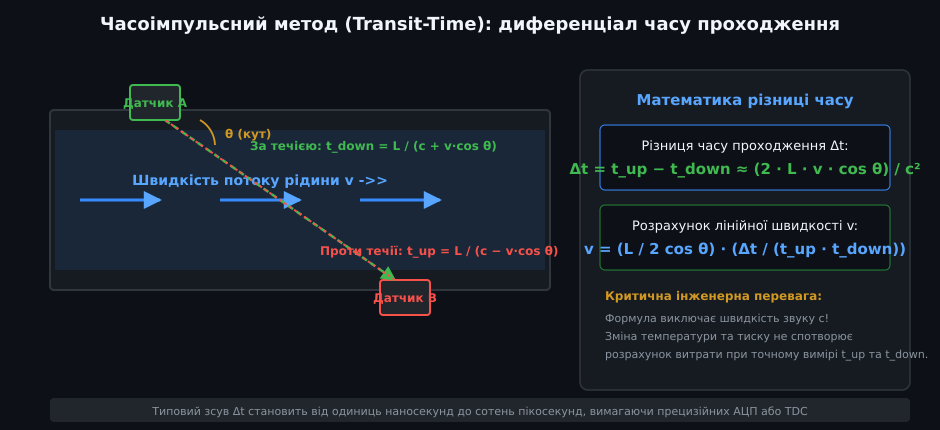
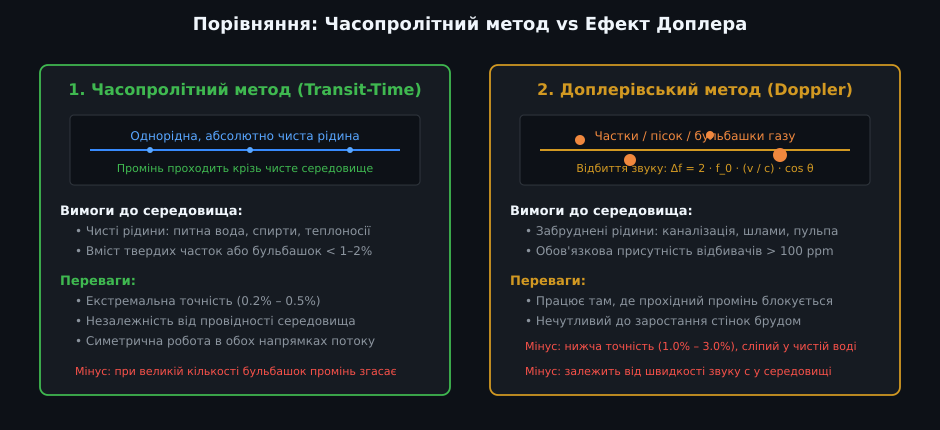
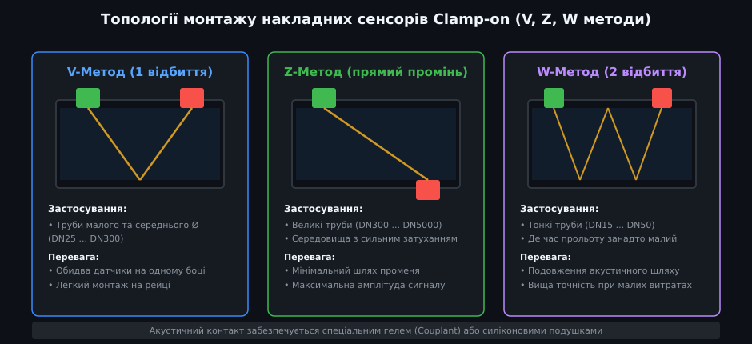
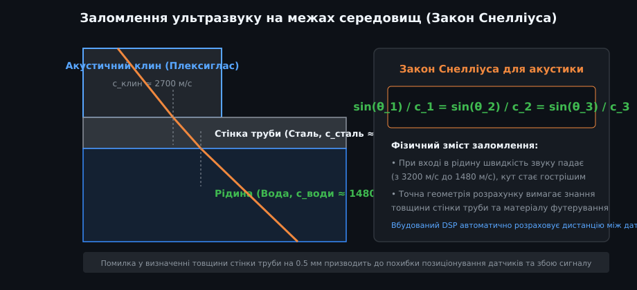
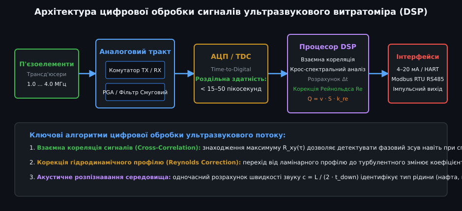

# Ультразвукові витратоміри рідини

Ультразвукові витратоміри (Ultrasonic Flow Meters) — це високоточні промислові прилади для безперервного обліку об'ємної витрати та швидкості руху рідких середовищ у напірних трубопроводах. Головними перевагами ультразвукової технології є відсутність будь-яких рухомих деталей у потоці, нульовий гідравлічний опір і можливість неінвазивного монтажу (накладні датчики Clamp-on) без зупинки технологічного процесу та різання труб.

---

## 1. Фізичний принцип дії: диференціал часу проходження (Transit-Time)

В основі більшості ультразвукових лічильників чистої води та теплоносіїв лежить часопролітний метод (Transit-Time Method):

- **Акустичне зондування за течією та проти течії:** Два п'єзоелектричні перетворювачі (датчики A та B) встановлюються на трубопроводі під кутом `θ` до осі потоку. Вони по черзі випромінюють ультразвукові імпульси частотою від 1.0 до 4.0 МГц.
- **Вплив руху середовища:**
  - Коли звукова хвиля поширюється від датчика A до датчика B (за течією рідини), вектор швидкості звуку `c` додається до проекції швидкості потоку `v · cos θ`. Час проходження скорочується:
    
    t_down = L / (c + v · cos θ)

  - Коли звукова хвиля йде від B до A (проти течії), швидкість руху рідини гальмує ультразвук, і час проходження збільшується:
    
    t_up = L / (c − v · cos θ)

- **Різниця часу проходження (Δt):**
  
  Δt = t_up − t_down ≈ (2 · L · v · cos θ) / c²

- **Незалежність від швидкості звуку:** Перемноживши t_up та t_down, інженери отримують вираз для швидкості потоку `v`, який не залежить від швидкості звуку `c`:
  
  v = (L / (2 · cos θ)) · (Δt / (t_up · t_down))

  Завдяки цьому температурні коливання, тиск чи сольовий склад води не спотворюють результат вимірювання швидкості потоку.

---

## 2. Порівняння технологій: Часопролітний метод проти ефекту Доплера

Залежно від фізичних властивостей рідини в промисловості застосовують дві різні ультразвукові технології:

| Параметр порівняння | Часопролітний метод (Transit-Time) | Доплерівський метод (Doppler) |
| :--- | :--- | :--- |
| **Фізичний принцип** | Різниця часу поширення звуку за і проти течії | Частотний зсув відбитої хвилі від рухомих часток |
| **Вимоги до чистоти** | Чисті однорідні середовища (домішки < 1–2%) | Забруднені рідини з частками чи бульбашками (> 100 ppm) |
| **Типові середовища** | Питна вода, теплоносії котелень, спирти, розчинники | Неочищені каналізаційні стоки, шлами, пульпа, буровий розчин |
| **Метрологічна точність** | Висока: ±0.2% ... ±0.5% від виміряного значення | Помірна: ±1.5% ... ±3.0% від діапазону шкали |
| **Чутливість до швидкості звуку** | Незалежний (швидкість звуку c скорочується) | Прямо залежить від швидкості звуку c у рідині |
| **Двонапрямленість** | Повна симетрія вимірювання вперед і назад | Переважно однонапрямлені потоки |

---

## 3. Топології монтажу: накладні сенсори Clamp-on та врізні модулі Inline

Ультразвукові витратоміри випускаються у двох принципових варіантах виконання: стаціонарні врізні секції (Inline) та портативні або накладні системи (Clamp-on).

Для накладних систем Clamp-on використовують три стандартні схеми проходження акустичного променя:
1. **V-метод (одне відбиття від протилежної стінки):** Обидва датчики закріплюються на одному боці труби за допомогою монтажної рейки. Промінь відбивається від протилежної стінки. Це найпопулярніша конфігурація для труб малого та середнього діаметра (DN25 – DN300).
2. **Z-метод (прямий наскрізний промінь):** Датчики монтуються на діаметрально протилежних боках труби. Промінь перетинає потік один раз без відбиття. Застосовується на великих трубопроводах (DN300 – DN5000) або у в'язких середовищах із підвищеним згасанням акустичного сигналу.
3. **W-метод (подвійне відбиття від стінок):** Промінь формує траєкторію у вигляді літери W. Застосовується виключно на тонких трубках (DN15 – DN40) для збільшення довжини акустичного шляху та підвищення часової роздільної здатності.

> 💡 **Акустичний контакт:** Оскільки повітряний прошарок між датчиком і трубою повністю блокує ультразвук, під підошву кожного сенсора обов'язково наносять силіконовий гель, мастило високої в'язкості або встановлюють акустичні гумові прокладки.

---

## 4. Акустичне заломлення на межах середовищ та закон Снелліуса

Під час проходження через накладний клин, стінку металевої труби та товщу рідини ультразвуковий промінь заломлюється відповідно до оптико-акустичного закону Снелліуса:

- **Рівняння Снелліуса для акустики:**
  
  sin(θ_клин) / c_клин = sin(θ_стінка) / c_стінка = sin(θ_рідина) / c_рідина

- **Вплив матеріалу труби:** Швидкість поширення поздовжніх хвиль у сталі становить близько 3200 м/с, у плексигласі клина — 2700 м/с, а у воді за 20 °C — лише 1482 м/с.
- **Розрахунок відстані між датчиками:** Перед початком вимірювання оператор вводить у процесор точний зовнішній діаметр труби, матеріал стінки (сталь, чавун, мідь, ПВХ), товщину стінки та товщину внутрішнього футерування. Процесор розраховує міліметрову відстань між датчиками вздовж осі труби для точного потрапляння променя у фокус приймача.

---

## 5. Архітектура цифрової обробки сигналів DSP та розрахунок витрати

Сучасний ультразвуковий витратомір є високошвидкісним цифровим обчислювальним комплексом:

1. **Аналоговий тракт (AFE) та швидкісний TDC:**
   - Драйвер формує імпульси збудження п'єзокристалів напругою 12–50 В.
   - Спеціалізований перетворювач часу в код (TDC — Time-to-Digital Converter) фіксує моменти проходження нулів (Zero-crossing) або переднього фронту імпульсів із роздільною здатністю 15–50 пікосекунд (1 пс = 10⁻¹² с).
2. **Алгоритм крос-кореляції:** Для виявлення слабких сигналів на фоні шумів процесор DSP обчислює функцію взаємної кореляції між еталонним та прийнятим імпульсом:
   
   R_xy(τ) = ∫ x(t) · y(t − τ) dt

3. **Обчислення об'ємної витрати Q:**
   
   Q = v · S · k_re

   де `S = π · D² / 4` — площа внутрішнього поперечного перерізу труби, а `k_re` — гідродинамічний коефіцієнт Рейнольдса, що коригує профіль швидкостей потоку (від ламінарного параболічного k_re ≈ 0.75 до турбулентного сплощеного k_re ≈ 0.93–0.96).

### Практичні інженерні правила монтажу:
- **Прямі ділянки труби:** Для стабілізації профілю швидкостей витратомір вимагає прямої ділянки труби довжиною не менше **10 · D** перед датчиками та **5 · D** після датчиків (де D — внутрішній діаметр труби).
- **Повне заповнення труби:** Трубопровід повинен бути завжди на 100% заповнений рідиною. Монтаж на верхній точці системи заборонено, оскільки там накопичуються повітряні пробки.
- **Горизонтальне розташування сенсорів:** Датчики завжди монтують у горизонтальній площині труби (на 3 і 9 годин), щоб уникнути впливу повітряних бульбашок угорі та осілого осаду внизу.
