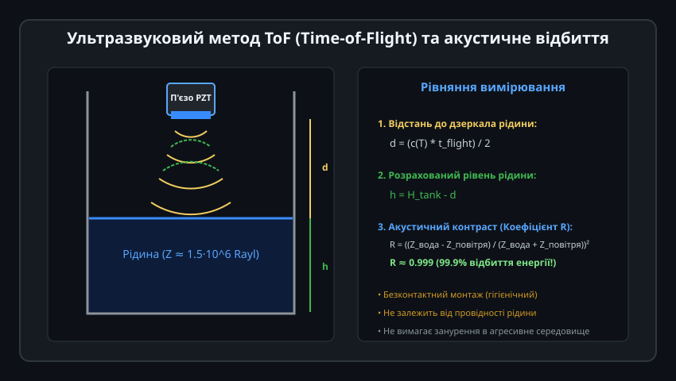
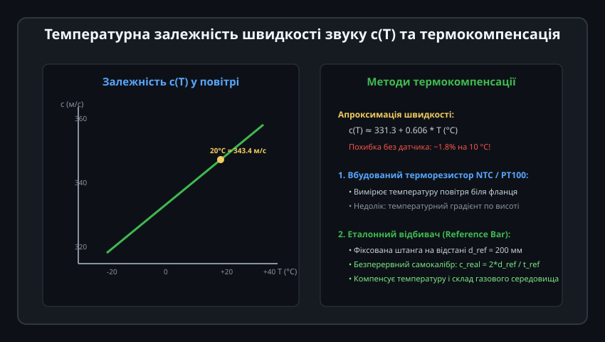
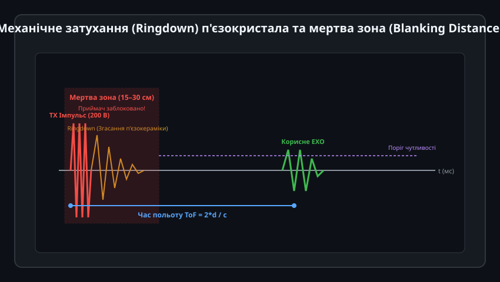
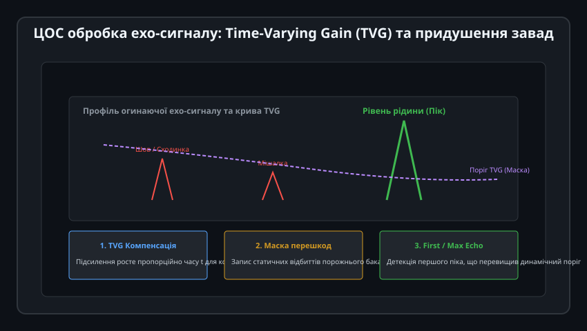
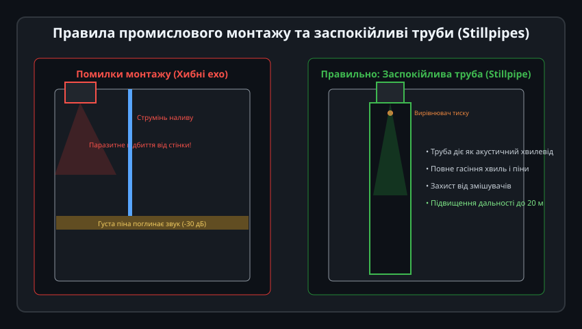

# Поглиблений інженерний аналіз та ЦОС ультразвукових рівнемірів

Ультразвукові промислові рівнеміри поєднують хвильову електроакустику, матеріалознавство п'єзокерамічних випромінювачів та складну цифрову обробку слабких радіочастотних сигналів (ЦОС). Проектування надійного приладу вимагає врахування узгодження хвильових опорів, температурної дисперсії швидкості звуку в газових сумішах та алгоритмів адаптивної фільтрації паразитних відбиттів.

---

## 1. Електроакустика перетворювача та чвертьхвильове узгодження

Ефективна передача механічних коливань із твердотільного п'єзокристала в газове середовище ускладнюється колосальним перепадом акустичних імпедансів:



### Проблема узгодження імпедансів:
1. **Акустичні опори матеріалів:**
   - П'єзокераміка PZT-5A (титанат-цирконат свинцю): `Z_pzt ≈ 30 * 10^6 Па·с/м (Rayl)`.
   - Повітряне середовище резервуара: `Z_air ≈ 415 Rayl`.
   - Без перехідного шару коефіцієнт передачі енергії на прямій межі PZT-повітря становить:
     
     T_energy = (4 * Z_pzt * Z_air) / (Z_pzt + Z_air)^2 ≈ 0.000055 (лише 0.0055%!)
     
     99.994% випроміненої енергії відбивається назад усередину кристала.

2. **Чвертьхвильовий узгоджувальний шар (Quarter-Wave Matching Layer):**
   На випромінювальну поверхню кристала наносять шар спеціального полімерного компаунда (синтактичної епоксидної смоли з мікросферами скла або пористого силікону) товщиною рівно в одну четверту довжини хвилі в матеріалі: `d_layer = lambda_layer / 4`.
   Оптимальний імпеданс шару є середнім геометричним:
   
   Z_layer = sqrt(Z_pzt * Z_air) ≈ sqrt(30 * 10^6 * 415) ≈ 110 000 Rayl

   Це збільшує коефіцієнт передачі акустичної енергії у сотні разів.

3. **Кут розкриття діаграми спрямованості (Beam Spread Angle):**
   Ширина акустичного пучка по рівню -3 дБ залежить від відношення довжини хвилі `lambda` до ефективного діаметра випромінювача `D_transducer`:
   
   sin(theta_half) = 0.51 * (lambda / D_transducer) = 0.51 * (c / (f * D_transducer))

   Для частоти `f = 50 кГц` (`lambda ≈ 6.8 мм`) та діаметра діафрагми `D = 50 мм` кут половинної потужності становить близько `theta_half ≈ 4.0°` (повний конус променя близько 8°).

---

## 2. Термодинаміка поширення звуку в газах та диференціальна калібровка

Швидкість звуку визначається адіабатичною стисливістю та молекулярною масою газової подушки над рідиною:



### Вплив складу атмосфери резервуара:
1. **Залежність від молекулярної маси газу `M`:**
   
   c = sqrt((gamma * R_gas * T) / M)

   - Сухе повітря (`M = 28.96 г/моль`): `c = 343.4 м/с` за 20 °C.
   - Пара метану CH4 (`M = 16.04 г/моль`, біогазові реактори): `c ≈ 445 м/с`.
   - Вуглекислий газ CO2 (`M = 44.01 г/моль`, бродіння пива/вина): `c ≈ 267 м/с`.
   Якщо замість повітря в баку накопичується CO2, прилад без аналізу газового середовища помилиться на 22%!

2. **Метод диференціального калібрувального штиря (Reference Target):**
   Для усунення впливу зміни концентрації газів та температурного розшарування перед випромінювачем монтують тонкий відбивач на прецизійно відомій відстані `d_ref` (наприклад, 200.0 мм):
   
   c_real = (2 * d_ref) / t_ref_measured
   d_liquid = c_real * (t_liquid_echo / 2) = d_ref * (t_liquid_echo / t_ref_measured)

   Це повністю виключає необхідність знання як температури, так і точного молекулярного складу газу в резервуарі.

---

## 3. Динаміка механічного затухання та керування мертвою зоною

Швидкість затухання коливань після вимкнення збудження визначає мінімальну дистанцію вимірювання (Blanking Distance):



### Методи демпфування п'єзоелемента:
1. **Механічне демпфування (Backing Material):**
   На тильний бік п'єзокерамічної таблетки наклеюють масивний демпфуючий блок зі свинцево-епоксидного компаунда з високим коефіцієнтом поглинання звуку. Це знижує механічну добротність `Q_mech` з 500 до 5–10, скорочуючи час дзвінка з 5 мс до менш ніж 0.8 мс.
2. **Електричне шунтування (Active Shunt Damping):**
   Одразу після закінчення пачки випромінювання паралельно виводам п'єзоелемента за допомогою польового MOSFET-транзистора підключається низькоомний резистор або протифазний електричний імпульс (Active Braking), який миттєво гасить залишкову коливальну енергію.
3. Це дозволяє скоротити мертву зону до 10–12 см для промислових датчиків середнього діапазону.

---

## 4. Алгоритми цифрової обробки ехограми (DSP Pipeline)

Сучасний ультразвуковий трансмітер оцифровує повну ехограму за допомогою високошвидкісного АЦП (1–2 Мвиб/с):



### Етапи конвеєра ЦОС:
1. **Виділення огинаючої (Envelope Extraction):**
   Перетворення Гільберта або квадратурна демодуляція I/Q з наступною низькочастотною фільтрацією:
   
   Env(t) = sqrt(I(t)^2 + Q(t)^2)

2. **Компенсація затухання (TVG / Time-Gain Compensation):**
   Амплітуда звуку затухає пропорційно `1/r` через геометричне розходження хвилі плюс експоненційне поглинання середовищем `exp(-2*alpha*r)`. Функція підсилення `G(t)` компенсує цей спад:
   
   G(t) = G_0 * (t / t_0) * exp(alpha_att * c * t)

3. **Адаптивний поріг CFAR (Constant False Alarm Rate):**
   Поріг виявлення піка динамічно розраховується як ковзне середнє значення фонового шуму плюс статистичний коефіцієнт надійності:
   
   Threshold(t) = Mean_noise(t) + k_sigma * StdDev_noise(t) + Static_Mask(t)

4. **Логіка вибору піка:**
   - *First Echo (Перша луна):* Для чистих спокійних резервуарів.
   - *Largest Echo (Найбільша луна):* Для усунення впливу пилу або дрібних бризок.

---

## 5. Промислова реалізація: C++ драйвер обробки сигналу рівнеміра

Нижче наведено модульний C++ клас `UltrasonicLevelTransmitter` для бортових контролерів систем автоматизації:



```cpp
/**
 * @file UltrasonicLevelTransmitter.hpp
 * @brief Промисловий обчислювальний модуль ультразвукового рівнеміра
 */

#pragma once

#include <stdint.h>
#include <stddef.h>
#include <math.h>

enum class UltrasonicHealth : uint8_t {
    OK = 0,             ///< Нормальне вимірювання ехо-сигналу
    LOST_ECHO,          ///< Втрата ехо (піна, сильне хвилювання, вихід за межі дальності)
    IN_DEAD_ZONE,       ///< Рівень зайшов у мертву зону перетворювача (переповнення!)
    TEMP_SENSOR_FAIL    ///< Несправність датчика температури компенсації
};

class UltrasonicLevelTransmitter {
public:
    /**
     * @param tank_height_mm Повна висота резервуара від випромінювача до дна (мм)
     * @param dead_zone_mm Довжина мертвої зони перетворювача (мм, наприклад 200 мм)
     */
    UltrasonicLevelTransmitter(float tank_height_mm, float dead_zone_mm = 200.0f)
        : tank_height_mm_(tank_height_mm),
          dead_zone_mm_(dead_zone_mm),
          filtered_distance_mm_(tank_height_mm),
          health_(UltrasonicHealth::OK),
          lost_echo_counter_(0),
          alpha_ema_(0.12f) {}

    /**
     * @brief Оновлення вимірювань за новим відліком часу ToF
     * @param tof_microseconds Зареєстрований час польоту імпульсу в мікросекундах (мкс)
     * @param temp_celsius Температура повітря з датчика NTC/PT100 (°C)
     * @param echo_amplitude_snr Відношення сигнал/шум піка (дБ)
     */
    void processToFSample(uint32_t tof_microseconds, float temp_celsius, float echo_amplitude_snr) {
        // Перевірка достовірності датчика температури
        if (temp_celsius < -40.0f || temp_celsius > 120.0f) {
            health_ = UltrasonicHealth::TEMP_SENSOR_FAIL;
            temp_celsius = 20.0f; // Аварійне значення за замовчуванням
        }

        // Перевірка втрати луни (слабкий сигнал або відсутність піка)
        if (tof_microseconds == 0 || echo_amplitude_snr < 6.0f) {
            lost_echo_counter_++;
            if (lost_echo_counter_ >= 5) {
                health_ = UltrasonicHealth::LOST_ECHO;
            }
            return;
        }

        lost_echo_counter_ = 0;

        // Термокомпенсована швидкість звуку в повітрі (м/с -> мм/мкс)
        // c(T) = 331.3 + 0.606 * T (м/с) = (331.3 + 0.606*T) * 1e-3 (мм/мкс)
        float speed_of_sound_mm_per_us = (331.3f + 0.606f * temp_celsius) * 1.0e-3f;

        // Дистанція: d = (c * t) / 2
        float raw_distance_mm = (speed_of_sound_mm_per_us * tof_microseconds) / 2.0f;

        // Перевірка потрапляння в мертву зону
        if (raw_distance_mm < dead_zone_mm_) {
            health_ = UltrasonicHealth::IN_DEAD_ZONE;
            filtered_distance_mm_ = dead_zone_mm_;
            return;
        }

        health_ = UltrasonicHealth::OK;

        // Експоненційне згладжування (EMA) для фільтрації випадкових коливань хвиль
        filtered_distance_mm_ = alpha_ema_ * raw_distance_mm + (1.0f - alpha_ema_) * filtered_distance_mm_;
    }

    /**
     * @brief Отримання поточного рівня рідини в міліметрах (від дна резервуара)
     */
    float getLevelMm() const {
        if (health_ == UltrasonicHealth::IN_DEAD_ZONE) {
            return tank_height_mm_ - dead_zone_mm_; // Максимально можливий рівень
        }
        float level = tank_height_mm_ - filtered_distance_mm_;
        return (level < 0.0f) ? 0.0f : level;
    }

    /**
     * @brief Отримання рівня рідини у відсотках (0..100%)
     */
    float getLevelPercent() const {
        float effective_height = tank_height_mm_ - dead_zone_mm_;
        if (effective_height <= 0.0f) return 0.0f;
        float pct = (getLevelMm() / effective_height) * 100.0f;
        return (pct > 100.0f) ? 100.0f : pct;
    }

    /**
     * @brief Масштабування вихідного струму стандарту 4–20 мА (NAMUR NE43)
     */
    float getLoopCurrentMa() const {
        switch (health_) {
            case UltrasonicHealth::OK:
                return 4.0f + (getLevelPercent() / 100.0f) * 16.0f;
            case UltrasonicHealth::LOST_ECHO:
                return 3.6f; // Аварійний струм нижче шкали
            case UltrasonicHealth::IN_DEAD_ZONE:
                return 21.0f; // Аварійний струм вище шкали (тривога переливу)
            case UltrasonicHealth::TEMP_SENSOR_FAIL:
                return 3.8f;
            default:
                return 3.6f;
        }
    }

    UltrasonicHealth getHealth() const { return health_; }
    float getFilteredDistanceMm() const { return filtered_distance_mm_; }

private:
    float tank_height_mm_;
    float dead_zone_mm_;
    float filtered_distance_mm_;
    UltrasonicHealth health_;
    uint8_t lost_echo_counter_;
    float alpha_ema_;
};
```

Ця архітектура забезпечує безперебійний захист резервуарних парків, підтримує діагностику відповідно до стандарту NAMUR NE43 та гарантує метрологічну точність вимірювання рівня рідини в межах ±2 мм у реальних польових умовах.
