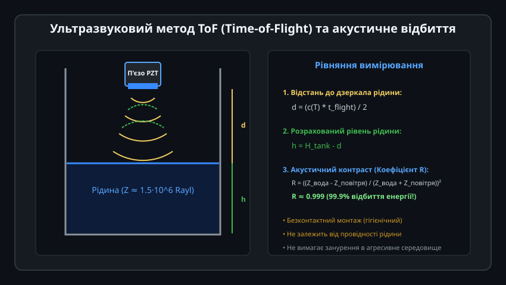
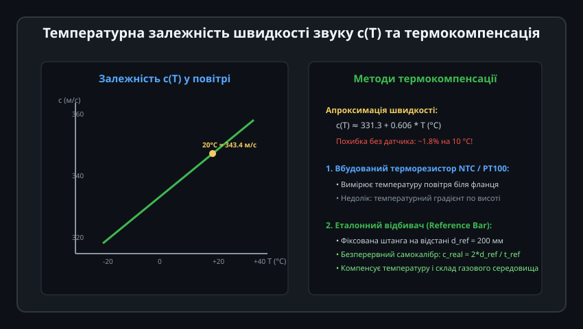
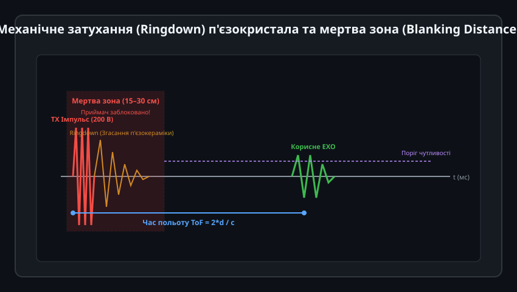
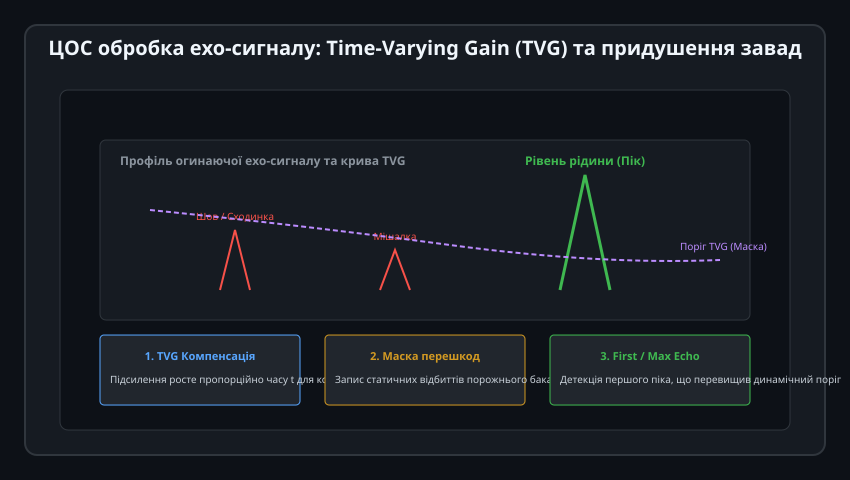
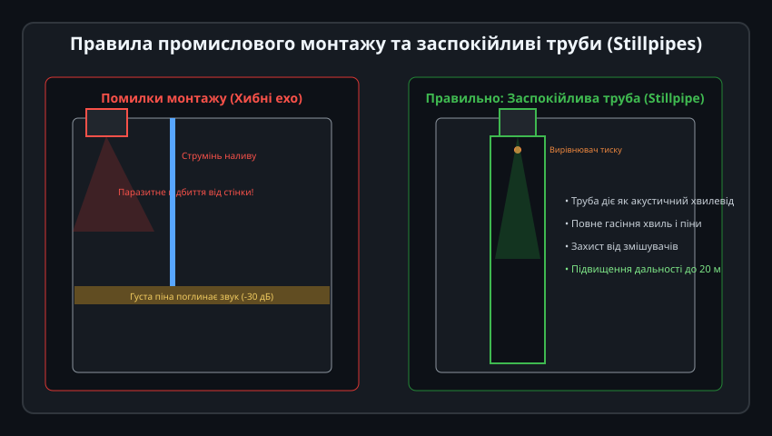

# Ультразвуковий давач рівня

Ультразвукові рівнеміри — це безконтактні промислові прилади, які здійснюють неперервне вимірювання рівня рідин та сипучих матеріалів за часом проходження відбитого звукового імпульсу. Оскільки датчик монтується над дзеркалом рідини і не занурюється в середовище, він ідеально підходить для моніторингу агресивних кислот, стічних вод, в'язких пульп та харчових продуктів, усуваючи корозію, механічний знос та заклинювання.

---

## 1. Фізичний принцип акустичного відбиття Time-of-Flight (ToF)

В основі роботи приладу лежить метод вимірювання часу польоту (Time-of-Flight, ToF) акустичної хвилі ультразвукового діапазону (зазвичай від 30 кГц до 120 кГц):

### Принцип роботи:
1. **Випромінювання імпульсу:** П'єзоелектричний перетворювач (PZT-кераміка), розташований у верхній частині резервуара, збуджується коротким високовольтним пакетом коливань і випромінює акустичний конус звукових хвиль у напрямку рідини.
2. **Акустичне відбиття на межі фаз:**
   - Акустичний імпеданс повітря становить `Z_повітря ≈ 415 Па·с/м (Rayl)`.
   - Акустичний імпеданс води становить `Z_вода ≈ 1.5 * 10^6 Rayl`.
   - Через гігантську різницю імпедансів межа рідина–газ діє як майже ідеальне акустичне дзеркало з коефіцієнтом відбиття енергії `R ≈ 0.999` (99.9% енергії відбивається назад).
3. **Розрахунок рівня:**
   Датчик фіксує відбиту луну через інтервал часу `t_flight`:
   
   d = (c * t_flight) / 2
   h = H_tank - d

   де `H_tank` — відома висота встановлення датчика від дна ємності, `d` — виміряна дистанція, `c` — швидкість звуку в повітрі.

---

## 2. Температурна залежність швидкості звуку та термокомпенсація

Швидкість звуку в повітрі не є фіксованою величиною, а суттєво залежить від абсолютної температури газу в резервуарі:

### Термодинамічна модель:
Для ідеального газу швидкість звуку описується формулою Лапласа:

c(T) = sqrt((gamma * R_gas * (T_celsius + 273.15)) / M_air) ≈ 331.3 + 0.606 * T_celsius (м/с)

- При 0 °C швидкість становить 331.3 м/с.
- При 20 °C швидкість зростає до 343.4 м/с.
- При 50 °C швидкість досягає 361.6 м/с.

Якщо знехтувати зміною температури на 10 °C, похибка розрахунку рівня складе близько 1.8%, що для бака глибиною 5 метрів еквівалентно помилці майже в 10 сантиметрів (сотні літрів рідини!).
- **Вбудований термосенсор:** Усі промислові ультразвукові голівки мають високоточний датчик температури (NTC або PT100), вбудований безпосередньо у випромінювальну мембрану для автоматичного динамічного перерахунку `c(T)` під час кожного циклу вимірювання.

---

## 3. Механічний дзвін п'єзокристала та мертва зона (Blanking Distance)

Ультразвуковий перетворювач не може одночасно випромінювати звук і приймати відбиту луну:

### Фізична природа мертвої зони:
1. Після закінчення електричного імпульсу збудження масивна п'єзоелектрична керамічна таблетка та узгоджувальний шар компаунда продовжують за інерцією механічно коливатися (ефект дзвону, Ringdown decay) протягом 0.5–2.0 мілісекунд.
2. Протягом цього часу вхідний підсилювач залишається повністю заблокованим або перевантаженим власними затухаючими коливаннями.
3. **Мертва зона (Blanking Distance):** Будь-яке відбиття від дзеркала рідини, розташованого ближче ніж `d_min = (c * t_ringdown) / 2` (зазвичай 15–30 см для частоти 40 кГц або 10–15 см для 80 кГц), губиться в дзвоні кристала.
4. Якщо рідина підніметься в мертву зону, прилад покаже небезпечний хибний рівень (наприклад, переключиться на дно бака від подвійної луни).

---

## 4. Цифрова обробка ехо-сигналу: Time-Varying Gain (TVG) та маскування завад

Сигнал луни, що повертається з великої глибини, сильно затухає в повітрі через розходження пучка та в'язке тертя:

### Алгоритми ЦОС у сучасному рівнемірі:
1. **Time-Varying Gain (TVG / TGC):** Коефіцієнт підсилення вхідного підсилювача експоненційно зростає з часом польоту імпульсу, вирівнюючи амплітуду відбиттів як від близьких, так і від далеких цілей на відстанях до 10–20 метрів.
2. **Картування хибних відбиттів (False Echo Mapping):**
   - Усередині порожнього резервуара можуть бути сходи, зварні шви або патрубки, які створюють паразитні відбиття звуку.
   - Під час пусконалагодження процесор записує профіль відбиттів порожнього бака в енергонезалежну пам'ять (створює адаптивну криву порогового маскування).
   - У робочому режимі луна детектується лише тоді, коли амплітуда піка суттєво перевищує попередньо збережену маску перешкод.

---

## 5. Промисловий монтаж та застосування заспокійливих труб (Stillpipes)

Правильний вибір місця встановлення датчика на кришці резервуара визначає 90% успіху вимірювання:

### Головні правила монтажу:
- **Відступ від стінки:** Датчик монтують на відстані не менше `D_tank / 6` від металевих стінок, щоб конус променя (діаграма спрямованості 5°–10°) не торкався зварних швів або гофрованих ребер.
- **Віддалення від зони наливу:** Заборонено розміщувати сенсор над струменем наливної труби: падаючий потік рідини розсіює звук, а повітряні бульбашки створюють непереборні акустичні шуми.
- **Заспокійливі труби (Stillpipes):**
  - Якщо рідина бурхливо кипить, перемішується механічною лопатевою мішалкою або вкрита товстим шаром піни, звук повністю поглинається чи розсіюється.
  - Рішенням є вертикальна заспокійлива труба з пластику або нержавіючої сталі з отвором для вирівнювання тиску вгорі. Труба фокусує акустичну хвилю як хвилевід, повністю гасить поверхневі хвилі й піну та багаторазово збільшує дальність і стабільність вимірювання.
