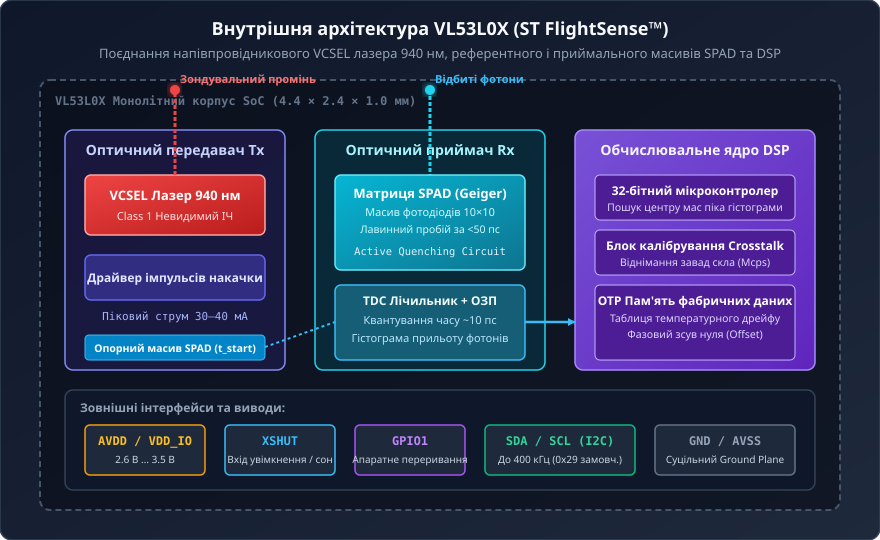
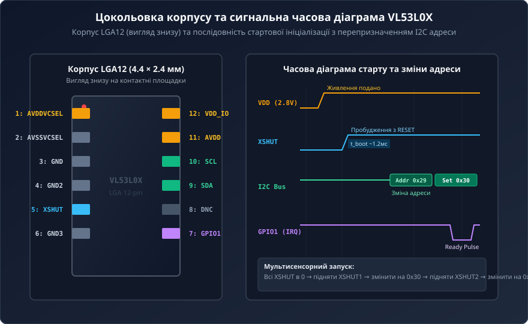
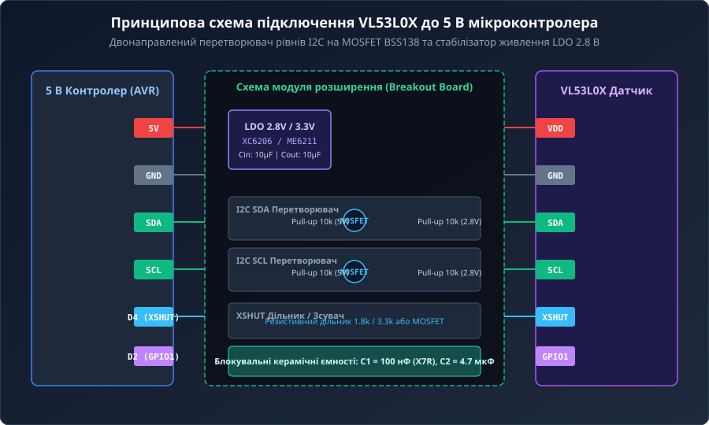
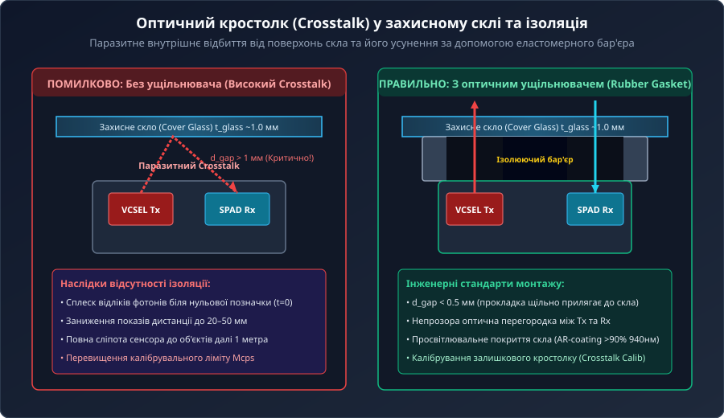
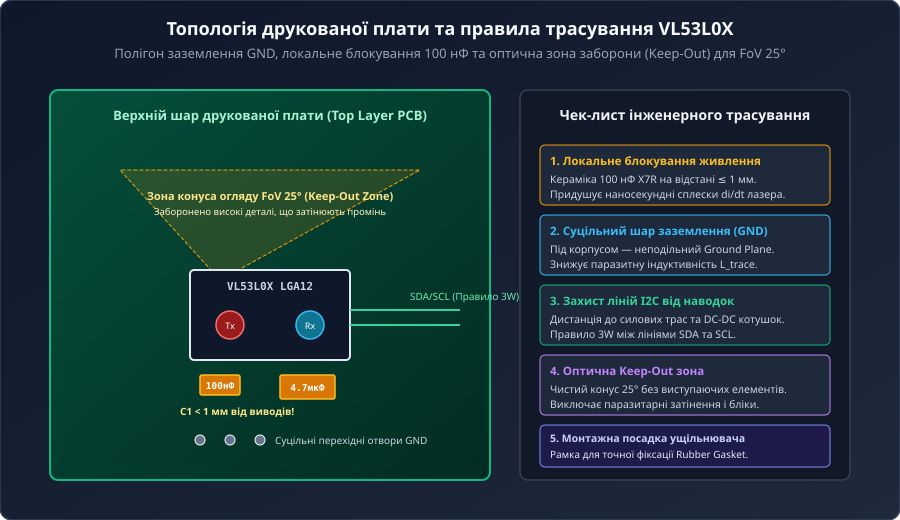

# Апаратна структура та принципова схема далекоміра VL53L0X

<preknowlist>
- [VL53L0X](root:cat-hw-sensors/vl53l0x) — базові функціональні характеристики далекоміра, призначення модулів розширення та типові сфери застосування пристрою
- [Оптичні далекоміри: триангуляційні, ToF та амплітудні](root:cat-hw-sensors/optical-distance-sensors-overview) — фізичні методи вимірювання відстані світловим променем та базові принципи фазової дальнометрії
</preknowlist>

## Обмеження оптичного вимірювання та фотометрії

У багатьох практичних робототехнічних системах спроба виміряти відстань до об'єкта за допомогою світла зіштовхується з фундаментальною перешкодою: колір та текстура поверхні спотворюють результат вимірювання швидше, ніж зміна реальної дистанції. Якщо взяти класичний [аналоговий ІЧ-сенсор Sharp](root:cat-hw-sensors/sharp-gp2y0a21), який оцінює відстань за інтенсивністю відбитого інфрачервоного променя, білий аркуш паперу на відстані 1 метра може повернути на фотоприймач точно такий самий оптичний потік, як і шматок чорного оксамиту на відстані 15 сантиметрів. Давач не здатний розрізнити, чи об'єкт розташований близько і має низьку відбивну здатність, чи об'єкт віддалений, але якраз добре відбиває світло.

Фізична причина цього обмеження криється у законах фотометрії. Оптична потужність `P_rx`, що повертається на фотоприймач від віддаленого об'єкта, описується залежністю від початкової потужності випромінювача `P_tx`, коефіцієнта відбиття поверхні `R` (від англ. *reflectance* — відбиваність, що змінюється від 0.02 для вугільно-чорного пластику до 0.95 для білого екрана), площі приймальної лінзи `A` та відстані `d`:

```
P_rx = (P_tx × R × A) / (π × d²)      [фотометричне рівняння повернення потужності]
```

З цього рівняння видно, що зареєстрована амплітуда сигналу `P_rx` є функцією двох незалежних змінних — відстані `d` та коефіцієнта `R`. Оскільки приймач вимірює лише сумарний електричний струм фотодіода, розділити ці два параметри в амплітудних системах математично неможливо.

Для подолання амплітудної залежності були розроблені оптичні триангуляційні давачі та фазові вимірювачі, які детально аналізуються у матеріалі про [базові оптичні далекоміри](root:cat-hw-sensors/optical-distance-sensors-overview). Триангуляція проектує світлову пляму під кутом і вимірює зміщення зображення на лінійці фотодіодів. Проте триангуляційні схеми потребують значного фізичного базису (відстані між випромінювачем і приймачем), що унеможливлює їхню мініатюризацію до розмірів однієї мікросхеми. Крім того, на великих відстанях кутове зміщення стає мікроскопічним, а під прямим сонячним світлом фоновий фотонний шум повністю перекриває корисний сигнал. На відміну від звукових хвиль, де [ультразвуковий далекомір HC-SR04](root:cat-hw-sensors/hc-sr04) вимірює затримку відбиття акустичного імпульсу, оптичні приймачі тривалий час не могли прямим чином засікати час прольоту світла через його колосальну швидкість.

Еволюційний перехід від вимірювання інтенсивності світла та кутових зміщень до прямого фіксування часових інтервалів ознаменував нову еру в оптичній далекометрії. Детальніше розглядаючи [історію розвитку далекометрії](root:cat-hw-sensors/vl53l0x-hardware/hist-flightsense-tof-evolution.md), можна простежити, як прогрес у напівпровідниковій фотоніці дозволив перейти від громіздких фазових далекомірів до компактних імпульсних систем.

Фундаментальним розв'язком проблеми залежності від кольору поверхні є перехід до концепції прямого часу прольоту — @@en|Time-of-Flight@@ (від англ. *time* — час, *flight* — політ), або скорочено @@en|ToF@@. Швидкість поширення світла у повітряному середовищі `c ≈ 2.9979 × 10⁸ м/с` є фізичною константою, яка абсолютно не залежить від кольору, шорсткості чи температури об'єкта, від якого відбився промінь. Якщо випромінити надкороткий світловий імпульс у бік цілі та зафіксувати точний момент повернення відбитої фотонної хвилі, то пройдений світлом шлях дорівнює подвоєній відстані до об'єкта:

```
d = (c × Δt) / 2      [базове рівняння прямого часу прольоту ToF]
```

У цій формулі коефіцієнт відбиття поверхні `R` повністю відсутній. Чорний об'єкт відіб'є 5% фотонів, а білий — 90%, але ті фотони, які все ж повернуться на приймач від чорної поверхні, подолають відстань за абсолютно такий самий час `Δt`, як і фотони від білої поверхні.

Проте реалізація прямого @@en|ToF@@ вимірювання на мікроконтинетальному рівні висуває надзвичайно жорсткі вимоги до часової роздільної здатності електроніки. Розрахуємо часовий інтервал `Δt`, який відповідає зміні відстані на `Δd = 1 мм`:

```
Δt = (2 × Δd) / c
= (2 × 0.001 м) / (2.9979 × 10⁸ м/с)      [розрахунок часового кванту на 1 мм відстані]
≈ 6.67 × 10⁻¹² с                          [результат у секундах]
= 6.67 пс                                 [переведення у пікосекунди]
```

Для того щоб забезпечити міліметрову точність вимірювання відстані, електронно-оптична система повинна мати часову роздільну здатність порядка 6.67 пікосекунд (`6.67 пс`). Звичайні світлодіоди нездатні формувати оптичні імпульси з тривалістю наростання фронту менше кількох наносекунд. Це вимагає використання специфічного класу напівпровідникових лазерів — поверхнево-випромінювальних лазерів із вертикальним резонатором @@en|VCSEL@@ (від англ. *Vertical-Cavity Surface-Emitting Laser*), які здатні вмикатися за частки наносекунди та формувати стабільні імпульси з надзвичайно гострими часовими фронтами.

## Внутрішня архітектура та масив SPAD

Щоб досягти пікосекундної точності фіксації фотонів у крихітному корпусі розміром `4.4 × 2.4 × 1.0 мм`, розробники компанії STMicroelectronics об'єднали лазерний випромінювач, оптичні матриці фотоприймачів та цифровий обчислювальний сердечник у єдиній системі на кристалі далекоміра [базовий модуль VL53L0X](root:cat-hw-sensors/vl53l0x). Фірмова технологія отримала назву @@en|FlightSense@@ (від англ. *flight* — політ, *sense* — відчуття).


*Внутрішня оптико-електронна структура VL53L0X: взаємодія лазера VCSEL, референтного та приймального масивів SPAD і обчислювального ядра FlightSense.*

Джерелом оптичного випромінювання у далекомірі виступає лазерний діод @@en|VCSEL@@. На відміну від класичних смугових лазерних діодів, що випромінюють світло вздовж площини напівпровідникового кристала, @@en|VCSEL@@ формує промінь перпендикулярно до поверхні підкладки через систему багатошарових бреґґівських дзеркал. Це дає змогу отримати симетричний конічний пучок світла з вузьким спектром випромінювання. Лазер працює на довжині хвилі `940 нм` в інфрачервоному діапазоні, який є абсолютно невидимим для людського ока і відповідає ІЧ-безпеці класу 1 (Class 1 Eye Safety). Вибір довжини хвилі `940 нм` є принциповим рішенням для компенсації зовнішніх завад: саме на цій довжині хвилі у сонячному спектрі спостерігається глибокий провал інтенсивності через поглинання світла водяною парою в атмосфері Землі, що суттєво знижує фоновий шум від сонячного засвітлення.

Для реєстрації поодиноких фотонів відбитого світла у далекомірі застосовується матриця однофотонних лавинних фотодіодів — @@en|SPAD@@ (від англ. *Single-Photon Avalanche Diode*). Звичайний p-n фотодіод у пробійній зоні виключає швидке визначення часу, тоді як @@en|SPAD@@ працює у так званому режимі Ґайґера @@en|Geiger mode@@ (названому на честь німецького фізика Ганса Ґайґера). Зворотна напруга зміщення `V_bias`, що прикладається до p-n переходу @@en|SPAD@@, перевищує напругу пробою `V_breakdown`:

```
V_bias = V_breakdown + V_excess      [умова роботи SPAD у режимі Ґайґера]
```

У цьому стані фотодіод перебуває у метастабільному високовольтному режимі. Як тільки єдиний фотон світла з довжиною хвилі `940 нм` потрапляє в збеднену зону p-n переходу, він вибиває первинну електронно-діркову пару. Під дією надвисокого електричного поля носії заряду прискорюються і викликають лавинне розмноження носіїв. В результаті струм через діод стрибкоподібно зростає від нуля до декількох міліампер за час, менший ніж `50 пс`. Цей лавинний струм створює чіткий цифровий логічний імпульс, часова невизначеність (@@en|jitter@@, від англ. *jitter* — тремтіння) якого становить частки пікосекунди. Після виникнення лавини спеціальна схема гасіння (@@en|quenching circuit@@) миттєво знижує напругу на діоді нижче `V_breakdown`, припиняючи струм і готуючи @@en|SPAD@@ до прийому наступного фотона.

Матриця фотоприймачів у @@en|VL53L0X@@ фізично розділена на дві автономні зони: референтну (@@en|Reference SPAD Array@@) та приймальну (@@en|Return SPAD Array@@). 1. **Референтний масив** оминає зовнішню лінзу: частина світла від лазера @@en|VCSEL@@ спрямовується через внутрішній оптичний канал безпосередньо на цей масив всередині корпусу. Це дозволяє зафіксувати точний момент вильоту оптичного імпульсу `t_start`, нівелюючи температурний дрейф напівпровідника, затримки включення драйвера лазера та зміну напруги живлення. 2. **Приймальний масив** складається з 100 активних елементів @@en|SPAD@@ (матриця 10×10), згрупованих під приймальною лінзою. Він вловлює фотони, що повернулися після відбиття від зовнішнього об'єкта, і фіксує момент їхнього приходу `t_stop`.

Окремий фотон, що потрапив на приймальний масив, може виявитися не відбитим фотоном лазера, а випадковим фотоном фонового сонячного світла або результатом теплового самозбудження діода. Щоб виділити корисний сигнал із шуму, система @@en|FlightSense@@ використовує статистичний метод накопичення подій. Лазер @@en|VCSEL@@ генерує серію високочастотних оптичних імпульсів із частотою модуляції в кілька мегагерц. Вбудований перетворювач часу у цифру @@en|TDC@@ (від англ. *Time-to-Digital Converter*) реєструє моменти спрацьовування діодів @@en|SPAD@@ і будує гістограму розподілу приходу фотонів у часових осередках. Фоновий шум створює рівномірний п'єдестал на гістограмі, тоді як повернення лазерних фотонів утворює гострий гауссів пік.

Осмислення математичного апарату обробки цієї гістограми, розрахунку центру мас піка та вилучення завад розкрито у матеріалі про [математичну модель ToF](root:cat-hw-sensors/vl53l0x-hardware/math-vl53l0x-tof-photonics-and-crosstalk-math.md).

Вбудований 32-розрядний мікроконтролер обробляє сформовану гістограму, обчислює часовий зсув між референтним та приймальним піками, застосовує внутрішні коефіцієнти калібрування та обчислює точну відстань у міліметрах. Готовий результат передається зовнішній системі через [програмний інтерфейс I2C](root:cat-hw-sensors/vl53l0x-hardware/api-vl53l0x-register-and-driver-interface.md), а швидку синхронізацію та апаратне керування живленням забезпечують [апаратні лінії керування](root:cat-hw-sensors/vl53l0x-hardware/api-vl53l0x-hardware-interface.md). Для порівняння з іншими рішеннями на ринку можна розглянути [лазерний сенсор TOF250](root:cat-hw-sensors/tof250) або [далекомір TOF10120](root:cat-hw-sensors/tof10120), а також пристрої наступного покоління, такі як [сенсор другого покоління VL53L1X](root:cat-hw-sensors/vl53l1x-tof-sensor).

## Сигнали керування та електричний інтерфейс

Складне обчислення часу прольоту фотонів усередині далекоміра [далекоміра VL53L0X](root:cat-hw-sensors/vl53l0x) втрачає практичний сенс, якщо керуючий мікроконтролер не здатний вчасно подати живлення, вивести сенсор зі стану сну або зчитати результат вимірювання без блокування центрального процесора. Кристал далекоміра виготовлено за напівпровідниковим техпроцесом із номінальною напругою живлення ядерних систем 2.8 В, тоді як більшість керуючих плат працюють на рівнях 3.3 В або 5 В. Для надійного сполучення кристала з зовнішньою мікроконтролерною периферією розроблено спеціалізований апаратний інтерфейс, що охоплює лінії живлення, цифровий канал зв'язку та керуючі сигнальні виводи.

Живлення лазерного сенсора розділено на дві внутрішні підсистеми: аналогову лінію `AVDD` та цифрову лінію `VDD_IO`. Аналогова лінія живить драйвер інфрачервоного лазера `@@en|VCSEL@@` та схему зміщення фотодіодів `@@en|SPAD@@`, а цифрова лінія встановлює логічні рівні сигнальних виводів інтерфейсу. Номінальний діапазон напруги `VDD_IO` становить від 2.6 В до 3.5 В. Внутрішній імпульсний струм лазера під час випромінювання коротких спалахів досягає пікових значень у 30–40 мА тривалістю в кілька наносекунд. Якщо в безпосередній близькості до виводів живлення кристала відсутні фільтрувальні конденсатори, ці швидкі кидки струму викликають локальне просідання напруги, що призводить до збоїв внутрішнього тактового генератора та помилок накопичення статистичних гістограм. Для пригнічення високочастотних завад паралельно виводам живлення встановлюють керамічний конденсатор ємністю 100 нФ та накопичувальний керамічний або танталовий конденсатор ємністю 4.7–10 мкФ.

Керування станами роботи та обмін даними здійснюються через чотири основні сигнальні лінії: вивід апаратного скидання `@@en|XSHUT@@`, вивід апаратних переривань `@@en|GPIO1@@` та двопровідну послідовну шину `@@en|I2C@@` (лінії `SDA` та `SCL`).


*Цокольовка корпусу VL53L0X та часові діаграми сигналів керування XSHUT, GPIO1 і шини I2C при стартовій ініціалізації.*

Вивід `@@en|XSHUT@@` слугує для апаратного увімкнення та повного скидання внутрішніх систем кристала. Цей вхід має активний низький рівень. Коли на лінію `XSHUT` подано логічний нуль (напруга нижче 0.6 В), внутрішній лінійний регулятор напруги вимикається, а кристал переходить у режим глибокого апаратного сну із струмом споживання не більше 5 мкА. У цьому стані всі внутрішні регістри втрачають свій вміст, а цифровий блок шини `@@en|I2C@@` перестає відповідати на будь-які запити. Подача логічної одиниці на вхід `XSHUT` запускає внутрішню послідовність початкового скидання за живленням (англ. *Power-On Reset*, POR). За час близько 1.2 мс кристал завантажує замовчувані конфігураційні калібрувальні коди з внутрішньої одноразово програмованої пам'яті (OTP) і стає готовим до взаємодії по шині `@@en|I2C@@`.

Вивід `@@en|GPIO1@@` виконує функцію програмованого апаратного переривання. За умовчанням вихід GPIO1 реалізовано за схемою `@@en|open-drain@@` (англ. *open drain*, від *open* — відкритий та *drain* — стік), що вимагає обов'язкового підключення зовнішнього підтягувального резистора `@@en|pull-up@@` (англ. *pull-up*, від *pull* — тягнути та *up* — вгору) до лінії `VDD_IO`. Коли далекомір працює в режимі безперервного вимірювання, опитування внутрішнього регістру готовності через шину `@@en|I2C@@` створює невиправдане навантаження на обчислювальне ядро мікроконтролера та захаращує шину. Замість опитування цифровий процесор сенсора самостійно формує короткий спадний або наростаючий імпульс на виході `GPIO1`, щойно черговий розрахунок відстані завершено і дані записано у вихідний буфер. Крім сповіщення про готовність кадру, вивід `GPIO1` можна запрограмувати на спрацьовування при виході об'єкта за межі заданого діапазону відстаней (пороговий інтервальний компаратор).

Обмін даними та конфігурування регістрів здійснюється через стандартну двонаправлену шину `@@en|I2C@@` на тактових частотах до 400 кГц (Fast Mode). Після початкового подачі живлення або скидання через вивід `XSHUT` кристал завжди займає замовчувану 7-бітну систему адресу `0x29` (у 8-бітному побітовому поданні зі збереженням біта читання/запису це відповідає `0x52`/`0x53`).

Замовчувана адреса створює критичну проблему під час побудови мультисенсорних систем, наприклад, у мобільних роботах або просторових сканерах, де на одній шині `@@en|I2C@@` необхідно розмістити від трьох до шести далекомірів. Оскільки адреса `0x29` жорстко зашита у вихідний стан кристала, одночасне вмикання кількох сенсорів призведе до конфлікту на шині `@@en|I2C@@`, коли всі пристрої одночасно відповідатимуть на один запит. Для вирішення цієї задачі застосовують алгоритм динамічного перепризначення мережевих адрес за допомогою індивідуального керування лініями `@@en|XSHUT@@` кожного пристрою.

Алгоритм каскадної ініціалізації декількох далекомірів на спільній шині реалізується за такими кроками:
1. Керуючий мікроконтролер переводить усі лінії `XSHUT`, підключені до окремих виходів GPIO, у стан логічного нуля. Усі сенсори шини переходять у глибокий сон. 2. Мікроконтролер виставляє логічну одиницю лише на лінії `XSHUT` першого сенсора. Пристрій прокидається й ініціалізується за замовчуваною адресою `0x29`. 3. По шині `@@en|I2C@@` на адресу `0x29` надсилається команда запису в регістр `I2C_SLAVE_DEVICE_ADDRESS` із новим значенням адреси (наприклад, `0x30`). Перший сенсор негайно зберігає нову адресу і відтепер реагує лише на неї. 4. Мікроконтролер піднімає лінію `XSHUT` другого сенсора. Другий далекомір прокидається і стає доступним за замовчуваною адресою `0x29`, тоді як перший сенсор вже працює на адресі `0x30`, тому конфлікт на шині відсутній. 5. На адресу `0x29` надсилається команда зміни адреси другого пристрою на `0x31`. 6. Процедура повторюється послідовно для всіх наявних далекомірів.

Оскільки змінена адреса зберігається в оперативній пам'яті кристала, при будь-якому короткочасному збої живлення або перезавантаженні процедуру динамічної адресації необхідно виконувати повторно.

При підключенні далекоміра до мікроконтролерів із логічними рівнями 5 В (наприклад, плат на базі AVR) безпосереднє з'єднання ліній `SDA`, `SCL` та `XSHUT` спричинить електричний пробій входів далекоміра. Для безпечної адаптації застосовують двонаправлені перетворювачі рівнів `@@en|level shifter@@` (англ. *level shifter*, від *level* — рівень та *shift* — зсувати) на польових N-канальних транзисторах (наприклад, BSS138).


*Схема узгодження рівнів на польових транзисторах та обв'язка живлення для безпечної підключення далекоміра до 5-вольтних логічних рівнів.*

Для практичної реалізації алгоритму каскадного розгортання кількох далекомірів на спільній шині використовують спеціалізовані процедури керування GPIO та шиною `@@en|I2C@@`. Нижче наведено приклади коду для систем на базі фреймворку ESP-IDF та середовища Arduino.

:::tabs
@tab ESP-IDF (C)
:::code vl53l0x-hardware-d/c/esp-idf/vl53l0x-change-address.c
@tab Arduino (C++)
:::code vl53l0x-hardware-d/cpp/arduino/reassigni2caddress.cpp
:::

Детальний описовий довідник з описом сигнальних рівнів містить [апаратний інтерфейс кристала](root:cat-hw-sensors/vl53l0x-hardware/api-vl53l0x-hardware-interface.md), покрокову розробку схем обв'язки висвітлено у матеріалі [принципової схеми підключення](root:cat-hw-sensors/vl53l0x-hardware/proj-vl53l0x-schematics-and-level-shifting.md), а реєстрову карту драйвера надає розбір [програмного інтерфейсу драйвера](root:cat-hw-sensors/vl53l0x-hardware/api-vl53l0x-register-and-driver-interface.md). Порівняти схеми узгодження з іншими лазерними модулями можна, ознайомившись із [модулем TOF250](root:cat-hw-sensors/tof250) та [лазерним сенсором TOF10120](root:cat-hw-sensors/tof10120).

## Оптичне перехресне завадоутворення та покриття

Забезпечення електричного живлення та налаштування цифрової шини створюють умови для зчитування даних, проте точність вимірювання лазерного далекоміра критично залежить від механічних та оптичних умов його фізичного монтажу. У реальних приладах кристал далекоміра не залишають відправленим у відкритий простір: його інтегрують усередину корпусу пристрою за захисним прозорим вікном — `@@en|cover glass@@` (англ. *cover glass*, від *cover* — покривати та *glass* — скло). Саме на цій фізичній межі виникає явище оптичного перехресного завадоутворення — `@@en|optical crosstalk@@` (англ. *optical crosstalk*, від *cross* — перехресний і *talk* — наводка/розмова), яке без належної ізоляції здатне повністю викривити результати дальнометрії.

Паразитне перехресне завадоутворення виникає через те, що випромінюваний лазером `@@en|VCSEL@@` пучок світла не проходить крізь товщу захисного скла безперешкодно. На межах розділу середовищ «повітря–скло» та «скло–повітря» через стрибок показника заломлення (від 1.0 для повітря до 1.5 для оптичного скла чи полікарбонату) відбувається френелівське відбиття частини лазерних фотонів. Крім того, внутрішні мікродефекти, пил, відбитки пальців на поверхні скла та відбиття від його бічних граней змушують частину випромінювання змінювати напрямок і повертатися безпосередньо у приймальну апертуру кристала на масив `@@en|SPAD@@`.


*Шляхи паразитних внутрішніх відбиттів лазерного променя від захисного скла та механізм їх усунення за допомогою оптичного перегороджувального бар'єра.*

Фізична небезпека паразитних відбиттів полягає у відстані, яку проходять паразитні фотони. Оскільки захисне скло розташоване на відстані кількох часток міліметра від кристала, відбиті від нього фотони повертаються на лавинні фотодіоди `@@en|SPAD@@` майже миттєво — із затримкою в кілька пікосекунд. У статистичній гістограмі накопичення фотонів це створює колосальний штучний пік на нульовій відстані.

Коли пристрій вимірює відстань до близького об'єкта, паразитний нульовий пік накладається на корисний відбитий сигнал від цілі, зміщуючи обчислений центр мас гістограми в бік зменшення відстані. Якщо ж реальний об'єкт знаходиться далеко (понад 1–1.5 метра), корисний фотонний відгук стає слабким. У такому разі інтенсивність внутрішнього перевідбиття від захисного скла значно перевищує інтенсивність сигналу від цілі, через що далекомір повністю втрачає здатність бачити об'єкт і постійно повертає помилкову мінімальну відстань.

Для усунення оптичного перехресного завадоутворення застосовують комплекс апаратних та алгоритмічних заходів.

Основою апаратного захисту є встановлення спеціального еластомерного (гумового або силіконового) ущільнювача — оптичної прокладки (англ. *air seal / rubber gasket*). Ущільнювач має дві окремі оптичні апертури для випромінювача та приймача, розділені суцільною внутрішньою непрозорою перегородкою (перебором). Прокладка встановлюється між верхньою площиною корпусу далекоміра та внутрішньою поверхнею захисного скла. Перегородка повинна щільно прилягати до внутрішньої грані скла, повністю перекриваючи прямий шлях поширення розсіяного світла в повітряному проміжку між апертурами.

Крім використання ущільнювача, при проєктуванні конструктиву дотримуються суворих геометричних обмежень:
*   **Величина повітряного зазору (`d_gap`)**: Відстань від оптичної поверхні сенсора до внутрішньої грані захисного скла має бути мінімальною і не перевищувати 0.5 мм (абсолютний технологічний максимум — 1.0 мм). Збільшення зазору призводить до того, що конуси випромінювання та прийому перетинаються всередині зазору, створюючи перехресний об'єм. *   **Товщина та якість скла (`t_glass`)**: Оптимальна товщина покриття становить від 1.0 до 1.5 мм. Скло повинно мати високий коефіцієнт пропускання на довжині хвилі 940 нм (понад 90%). Використання просвітлювального антиблікового покриття (AR-coating) знижує коефіцієнт френелівського відбиття з 4% до менш ніж 0.5%. *   **Паралельність монтажу**: Захисне скло має бути суворо паралельним площині кристала. Перекіс скла спрямовує дзеркально відбитий пучок лазера безпосередньо у приймальну апертуру.


*Топологічне розміщення оптичного модуля на друкованій платі із зазорами монтажу та ізолюючою рамкою ущільнювача.*

Навіть при ідеальній механічній ізоляції частина фотонів відбивається всередині товщі самого скла. Для компенсації цього залишку в програмному забезпеченні далекоміра передбачено процедуру калібрування перехресних завад (англ. *crosstalk calibration*).

Під час калібрування сенсор, встановлений за захисним склом, виконує серію вимірювань у бік темного поглинача або у відкритий простір на відстані понад 800 мм. Оскільки відбитий від віддаленої цілі сигнал прямує до нуля, усі зареєстровані фотони вважаються паразитними внутрішніми відбиттями. Обчислена інтенсивність завади вимірюється в одиницях `@@en|Mcps@@` (мільйони відліків за секунду, англ. *Mega counts per second*) і записується у регістр компенсації `SYSRANGE_START`. У подальшій роботі внутрішній цифровий процесор перед розрахунком фазового зсуву автоматично віднімає каліброване значення фонового струму завади з кожного накопичувального інтервалу гістограми.

Математичний апарат обчислення та віднімання статистичних відліків фотонів розкрито у матеріалі [математику пригнічення завад](root:cat-hw-sensors/vl53l0x-hardware/math-vl53l0x-tof-photonics-and-crosstalk-math.md). Практичні креслення та топологію захисних рамок деталізовано у [топології друкованої плати](root:cat-hw-sensors/vl53l0x-hardware/proj-vl53l0x-pcb-layout-and-optical-seal.md). Фізику еволюції оптичних систем від амплітудного згасання до ToF висвітлює огляд [еволюцію ToF систем](root:cat-hw-sensors/vl53l0x-hardware/hist-flightsense-tof-evolution.md). Для порівняння оптичних характеристик із новішими поколіннями далекомірів можна ознайомитися з описом [сенсора VL53L1X](root:cat-hw-sensors/vl53l1x-tof-sensor), а порівняння з іншими фізичними методами наведено в [оглядовій статті далекомірів](root:cat-hw-sensors/optical-distance-sensors-overview). Приклади аналогових та ультразвукових альтернатив доступні у статтях про [ІЧ-далекомір Sharp GP2Y0A21YK0F](root:cat-hw-sensors/sharp-gp2y0a21) (з описом обробки сигналу у [програмним API Sharp](root:cat-hw-sensors/gp2y0a21-sw-api)) та [ультразвуковий далекомір HC-SR04](root:cat-hw-sensors/hc-sr04).

## Схеми живлення та узгодження рівнів

Спроба підключити кристал інфрачервоного далекоміра напряму до нестабілізованої шини живлення мікроконтролера або п'ятивольтової логіки неминуче призводить до втрати точності вимірювання чи апаратного виходу сенсора з ладу. Кристал [далекоміра VL53L0X](root:cat-hw-sensors/vl53l0x) спроєктовано під номінальну напругу живлення 2.8 В. Внутрішня електронна система кристала розділена на два автономні контури: аналогову лінію `AVDD`, яка живить напівпровідниковий лазер `@@en|VCSEL@@` та аналогові схеми зміщення фотодіодів `@@en|SPAD@@`, і цифрову лінію `VDD_IO`, що визначає напругу вихідних буферів шини `@@en|I2C@@` та сигналів керування `@@en|XSHUT@@` й `@@en|GPIO1@@`.

Критична проблема живлення далекометричного модуля виникає під час випромінювання оптичних спалахів. Для формування імпульсів тривалістю в одиниці наносекунд драйвер лазера `@@en|VCSEL@@` короткочасно споживає з аналогової шини струм у піку від 30 мА до 40 мА. Якщо провідники живлення мають помітну паразитну індуктивність або опір, цей імпульсний кидок струму створює локальне просідання напруги `ΔV` на виводах кристала. Зміна напруги живлення спотворює рівень внутрішньої напруги зміщення лавинних діодів `@@en|SPAD@@` та збиває фазову синхронізацію перетворювача часу в цифру (англ. *Time-to-Digital Converter*, TDC). В результаті статистична гістограма накопичення фотонів розмивається, а далекомір починає видавати нестабільні відліки з високою середньоквадратичною похибкою.

Розрахуємо амплітуду просідання напруги `ΔV` без використання локальних фільтрувальних ємностей при піковому струмі лазера `I_peak = 40 мА` та загальному імпедансі траси живлення `Z_trace = 2.0 Ом`:

```
ΔV = I_peak × Z_trace
= 0.040 А × 2.0 Ом      [обчислення імпульсного падіння напруги]
= 0.080 В                [результат у вольтах]
= 80 мВ                  [переведення у мілівольти]
```

Падіння напруги на `80 мВ` перевищує допустимий поріг завадостійкості аналогового блоку кристала (`50 мВ`) і здатне спровокувати лок-ап (англ. *lock-up*) внутрішнього регулятора напруги або помилкове спрацьовування схеми апаратного скидання за живленням.

Для пригнічення високочастотних завад застосовують двохрівневу схему розв'язки за допомогою фільтрувальних конденсаторів — `@@en|decoupling capacitor@@` (від англ. *decouple* — розв'язувати та *capacitor* — конденсатор). Безпосередньо біля виводів `AVDD` та `VDD_IO` (на відстані не більше 1.5 мм від корпусу) встановлюють високочастотний керамічний конденсатор ємністю 100 нФ з низьким еквівалентним послідовним опором (ESR) та індуктивністю (ESL), наприклад із діелектриком X7R або C0G. Цей конденсатор віддає накопичений заряд упродовж наносекундних спалахів лазера, не допускаючи просідання напруги на кристалі. Паралельно йому в схему додають накопичувальний керамічний або танталовий конденсатор ємністю 4.7–10 мкФ для згладжування низькочастотних пульсацій шини. Крім того, внутрішньому аналоговому регулятору напруги 2.8 В (вивід `AVDD_VCSEL`) потрібен власний зовнішній стабілізаційний конденсатор ємністю 4.7 мкФ, підключений до спільного контуру заземлення (`GND`).

Підключення кристала до зовнішніх мікроконтролерів має особливості залежно від робочої напруги керуючої плати. При використанні 3.3-вольтних мікроконтролерів (наприклад, систем на базі STM32 або ESP32) лінія `VDD_IO` підключається напряму до шини 3.3 В, оскільки допустимий діапазон цифрового живлення `@@en|VL53L0X@@` становить від 2.6 В до 3.5 В. Лінії `SDA`, `SCL`, `@@en|XSHUT@@` та `@@en|GPIO1@@` з'єднуються з виводами мікроконтролера через підтягувальні резистори `@@en|pull-up@@` номіналом 2.2–10 кОм.

Однак у робототехніці широко розповсюджені мікроконтролери з 5-вольтовою логікою (як-от платформи Arduino на базі процесорів AVR). Пряма подача 5 В на лінії шини `@@en|I2C@@` або вхід `@@en|XSHUT@@` спричинить електричний пробій внутрішніх захисних діодів кристала та його незворотне пошкодження.

Для безпечної інтеграції використовують [модуля розширення VL53L0X](root:cat-hw-sensors/vl53l0x-breakout-circuit) або будують схему узгодження рівнів на базі двохнаправленого перетворювача рівнів — `@@en|level shifter@@`. На платі модуля розширення встановлюють малопотужний лінійний регулятор напруги з низьким падінням — `@@en|low-dropout regulator@@` (LDO, від англ. *low* — низький, *drop* — спад та *out* — вихід), який знижує вхідні 5 В до стабільних 2.8 В або 3.3 В для живлення далекоміра.

Узгодження цифрових сигнальних ліній `SDA` та `SCL` реалізують на польових N-канальних МОП-транзисторах (наприклад, BSS138). Затвор транзистора підключають до низьковольтного джерела живлення 2.8 В, витік (англ. *source*) — до сигнальної лінії далекоміра, а стік (англ. *drain*) — до сигнальної лінії 5-вольтового мікроконтролера. Обидва боки лінії підтягують резисторами `@@en|pull-up@@` номіналом 10 кОм до своїх відповідних шин живлення (3.3 В та 5 В).

Коли мікроконтролер формує на лінії логічну одиницю (5 В), транзистор закритий, і лінія з боку далекоміра підтягнута до 3.3 В через свій резистор. Коли мікроконтролер або далекомір притягує лінію до нуля (0 В), внутрішній паразитний діод транзистора відкривається, знижуючи напругу на протилежному боці й змушуючи транзистор повністю відкритися, передаючи логічний нуль без викривлення.

Сигнал апаратного скидання `@@en|XSHUT@@` має активний низький рівень і може керуватися з 5-вольтового виводу мікроконтролера через простий резистивний дільник напруги (наприклад, 1.8 кОм / 3.3 кОм) або через аналогічний канал перетворювача рівнів `@@en|level shifter@@`. Лінія переривань `@@en|GPIO1@@`, працюючи за схемою `@@en|open-drain@@`, вимагає підтяжки до шини живлення мікроконтролера.

Покрокову схему обв'язки виводів, вибір компонентів фільтрації та розрахунок підтягувальних резисторів наведено у матеріалі про [принципову схему підключення](root:cat-hw-sensors/vl53l0x-hardware/proj-vl53l0x-schematics-and-level-shifting.md), а повний специфікований перелік електричних параметрів надає [апаратний інтерфейс кристала](root:cat-hw-sensors/vl53l0x-hardware/api-vl53l0x-hardware-interface.md). Порівняти схеми електричного живлення з іншими лазерними модулями дальнометрії можна, переглянувши описи для [модуля TOF10120](root:cat-hw-sensors/tof10120) та [лазерного далекоміра TOF250](root:cat-hw-sensors/tof250). Реєстрове налаштування режимів живлення та енергозбереження описує [програмний інтерфейс драйвера](root:cat-hw-sensors/vl53l0x-hardware/api-vl53l0x-register-and-driver-interface.md), а загальні відомості про роботу далекоміра містить [базову статтю VL53L0X](root:cat-hw-sensors/vl53l0x).

## Трасування плати та оптичне ущільнення

Принципова схема гарантує електричну працездатність далекоміра лише в ідеальних теоретичних умовах. Перенесення схеми на фізичну друковану плату вимагає дотримання суворих правил топологічного розміщення провідників — `@@en|PCB layout@@` (від англ. *printed circuit board* — друкована плата та *layout* — компонування/розпланування), а також забезпечення фізичної оптичної ізоляції випромінювача від приймача.

Найбільшою апаратною загрозою при розведенні друкованої плати є паразитна індуктивність провідників живлення `L_trace`. Кожен міліметр мідної траси володіє індуктивністю приблизно `1 нГн/мм`. Під час увімкнення драйвера лазера `@@en|VCSEL@@` швидкість наростання струму `di/dt` сягає значень `40 мА / 1 нс = 40 × 10⁶ А/с`. За законами електромагнітної індукції, на трасі живлення довжиною всього 10 мм виникає імпульсна ЕРС самоіндукції `V_L`:

```
V_L = L_trace × (di/dt)
= (10 × 10⁻⁹ Гн) × (40 × 10⁶ А/с)      [обчислення індуктивного сплеску напруги]
= 0.40 В                               [результат у вольтах]
= 400 мВ                               [переведення у мілівольти]
```

Індуктивний сплеск у `400 мВ` миттєво перезавантажує цифрове обчислювальне ядро `@@en|FlightSense@@` або викривляє відліки перетворювача часу в цифру. Щоб звести паразитну індуктивність до мінімуму, фільтрувальний керамічний конденсатор ємністю 100 нФ розміщують на відстані не більше 1 мм від виводів кристала, з'єднуючи його широкими провідниками (шириною не менше 0.3 мм) і перехідними отворами безпосередньо з суцільним шаром заземлення (`GND`).

На другому шарі друкованої плати безпосередньо під корпусом сенсора формують суцільний полігон заземлення (англ. *Ground Plane*). Він забезпечує найкоротший шлях повернення зворотних струмів лазера та екранує високочутливі лавинні фотодіоди `@@en|SPAD@@` від зовнішніх високочастотних радіозавад. Лінії цифрової шини `@@en|I2C@@` (`SDA` та `SCL`) трасують паралельною парою на віддалі від силових індуктивностей, імпульсних перетворювачів напруги та аналогових виводів живлення, дотримуючись правила `3W` (відстань між трасами утричі більша за їхню ширину) для запобігання ємнісним перехресним наводкам.

Механічна та оптична інтеграція далекоміра висуває специфічні вимоги до геометрії плати. Корпус `@@en|VL53L0X@@` містить дві окремі оптичні апертури: випромінювач лазера та приймач фотодіодів. Загальна конусоподібна зона огляду далекоміра — `@@en|Field of View@@` (`FoV`, від англ. *field* — поле та *view* — зір) становить `25°`. Усередині цього конуса огляду на друкованій платі заборонено розміщувати високі компоненти (електролітичні конденсатори, роз'єми, високі резистори), які можуть створювати паразитне оптичне затінення або відбивати промені лазера назад у приймач.

При монтажі сенсора всередину корпусу приладу за захисним прозорим вікном — `@@en|cover glass@@` застосовують спеціальний еластомерний ущільнювач (англ. *air seal / rubber gasket*). Гумова прокладка має дві окремі апертури для випромінювача й приймача та суцільну внутрішню непрозору перегородку, яка щільно притискається до внутрішньої поверхні скла. Якщо прокладка відсутня або встановлена з зазором, випромінюване лазером `@@en|VCSEL@@` світло відбивається від внутрішньої грані скла і потрапляє напряму у приймальну матрицю `@@en|SPAD@@`. Це створює критичне оптичне перехресне завадоутворення — `@@en|optical crosstalk@@`, яке повністю блокує можливість вимірювання великих відстаней.

Величина повітряного зазору `d_gap` між оптичними лінзами сенсора та захисним склом не повинна перевищувати `0.5 мм` (граничний технологічний максимум — `1.0 мм`). При збільшенні зазору понаднормово конуси випромінювання та прийому перетинаються у повітряному проміжку, через що внутрішній рівень паразитних відбитків перевищує допустимий поріг програмної компенсації в `@@en|Mcps@@`.

При виникненні апаратних несправностей у зібраному модулі застосовують послідовну діагностику:
1. **Збої адресації та відсутність відповіді на шині `I2C`**: За допомогою осцилографа перевіряють рівень напруги `VDD_IO` під час звернення до пристрою (відсутність просідань нижче 2.6 В), крутизну фронтів сигналів `SDA`/`SCL` (при завалених фронтах зменшують опір `@@en|pull-up@@` резисторів) та стан лінії `@@en|XSHUT@@` (напруга повинна бути вище 1.2 В). 2. **Фіксація постійної мінімальної відстані (20 мм) при віддаленій цілі**: Свідчить про пошкодження або відсутність ущільнювача `air seal / rubber gasket`, зазору між склом понад 1 мм або про наявність бруду й подряпин на захисному склі `@@en|cover glass@@`, що генерує високий рівень `@@en|optical crosstalk@@`. 3. **Високий рівень шуму вимірювання та випадання кадрів**: Викликані високим опором траси живлення, відсутністю високочастотного керамічного конденсатора 100 нФ або відсутністю суцільного полігону заземлення `GND`.

Практичні креслення посадкового місця, топологію захисних рамок та рекомендації з монтажу наведено у матеріалі про [топології друкованої плати](root:cat-hw-sensors/vl53l0x-hardware/proj-vl53l0x-pcb-layout-and-optical-seal.md), а вимоги до геометрії провідників містить опис [друкованої плати VL53L0X](root:cat-hw-sensors/vl53l0x-pcb-design). Математичне обґрунтування вилучення фонових відліків розкрито у матеріалі про [математичну модель ToF](root:cat-hw-sensors/vl53l0x-hardware/math-vl53l0x-tof-photonics-and-crosstalk-math.md), а історичні передумови створення ToF-датчиків висвітлює огляд про [історію розвитку далекометрії](root:cat-hw-sensors/vl53l0x-hardware/hist-flightsense-tof-evolution.md). Для порівняння конструктивних вимог із датчиками другого покоління можна ознайомитися з описом [сенсора VL53L1X](root:cat-hw-sensors/vl53l1x-tof-sensor), а загальний аналог оптичних систем подано в [оглядовій статті далекомірів](root:cat-hw-sensors/optical-distance-sensors-overview). Порівняння з іншими принципами вимірювання доступне у статтях про [ІЧ-далекомір Sharp GP2Y0A21YK0F](root:cat-hw-sensors/sharp-gp2y0a21) (із програмуванням у [програмним API Sharp](root:cat-hw-sensors/gp2y0a21-sw-api)) та [ультразвуковий далекомір HC-SR04](root:cat-hw-sensors/hc-sr04).