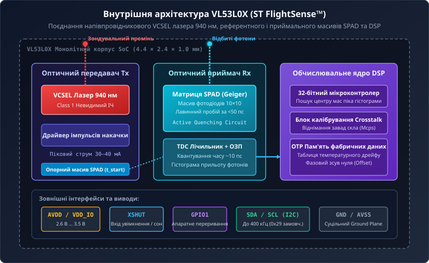
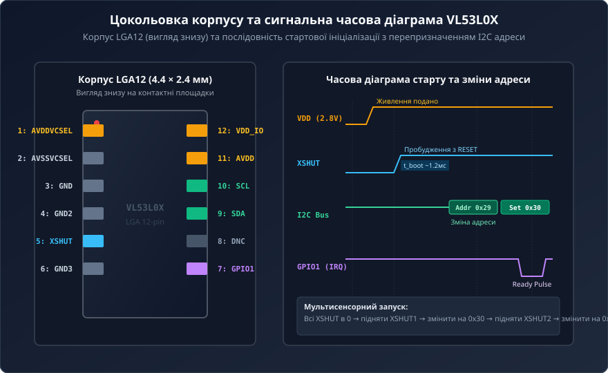
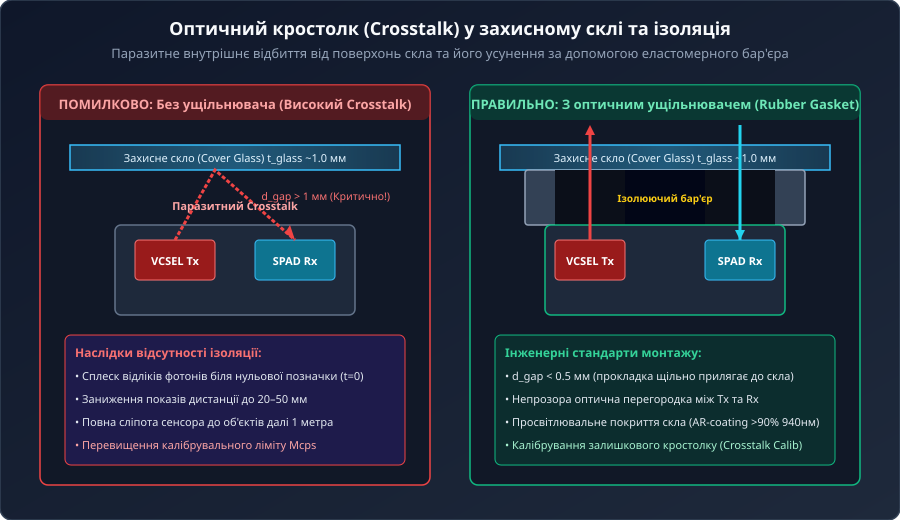
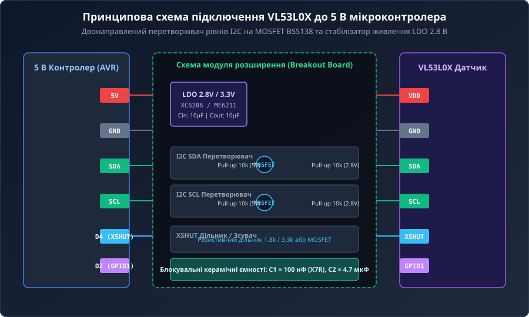
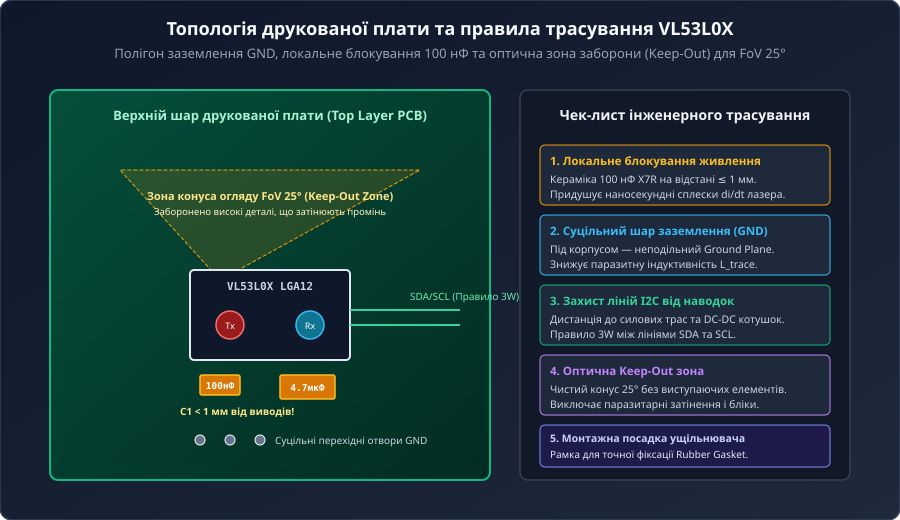

# Апаратна структура та принципова схема далекоміра VL53L0X

Мікросхема VL53L0X від компанії STMicroelectronics є мініатюрною однокристальною системою (SoC), що реалізує технологію прямого вимірювання часу польоту світла (Time-of-Flight, ToF) у компактному оптичному корпусі розміром 4.4 × 2.4 × 1.0 мм. На відміну від класичних аналогових оптичних сенсорів, показання VL53L0X не залежать від коефіцієнта відбиття поверхні цілі (альбедо), кольору чи фактури матеріалу.

## 1. Фізична концепція прямого ToF та усунення фотометричної залежності

В амплітудних оптичних давачах повернена світлова потужність `P_rx` залежить від двох незалежних величин — відстані `d` та коефіцієнта відбиття поверхні `R`:
```
P_rx = (P_tx * R * A) / (π * d²)
```
Через це білий аркуш паперу на відстані 1 м відбиває стільки ж фотонів, скільки чорний оксамит на відстані 15 см.



Перехід до концепції прямого вимірювання часу польоту (dToF) усуває параметр `R` з розрахунку відстані. Швидкість поширення світла в повітрі `c ≈ 300 000` км/с є фізичною константою, тому дистанція визначається виключно затримкою `Δt`:
```
d = (c * Δt) / 2
```
Для забезпечення точності 1 мм система вимірює часові інтервали порядка 6.67 пікосекунд (`6.67 пс`).

## 2. Внутрішня архітектура: лазер VCSEL 940 нм, масиви SPAD та TDC

Корпус VL53L0X містить три функціональні домени:

1. **Оптичний передавач Tx:** напівпровідниковий лазер із вертикальним резонатором (VCSEL), що випромінює імпульси тривалістю менше 1 нс на довжині хвилі 940 нм. Це невидимий ІЧ-діапазон, що відповідає стандарту безпеки очей Class 1. Спектральна лінія 940 нм збігається з мінімумом сонячного випромінювання на поверхні Землі, що знижує рівень фонового шуму.
2. **Оптичний приймач Rx:** матриця однофотонних лавинних фотодіодів (SPAD) розміром 10×10 елементів, що працюють у метастабільному режимі Гейгера (Geiger mode). Приліт фотона спричиняє лавинний пробій за час <50 пс.
3. **Опорний масив SPAD (Reference Array):** внутрішній оптичний канал фіксує точний момент випромінювання імпульсу `t_start`, компенсуючи температурний дрейф та напругу живлення.
4. **Обчислювальне ядро FlightSense:** перетворювач часу в код (TDC) квантує затримку фотонів із дискретністю ~10 пс та будує статистичну часову гістограму для фільтрації корисного піка від рівномірного сонячного засвічення.

## 3. Цокольовка корпусу LGA12, сигнали керування та динамічна адресація

VL53L0X виконаний у 12-вивідному корпусі LGA. Електричний інтерфейс включає лінії живлення, цифровий канал I2C та дискретні лінії керування.



Ключові сигнальні лінії:
- **AVDD / VDD_IO:** живлення ядра та ліній вводу/виводу (номінально 2.8 В, допустимо 2.6–3.5 В).
- **XSHUT:** активний низький вхід апаратного скидання та глибокого сну (струм менше 5 мкА). Подача логічної 1 запускає ініціалізацію тривалістю ~1.2 мс.
- **GPIO1:** вихід апаратного переривання за схемою «відкритий стік» (Open-Drain). Формує імпульс при готовності виміряного значення дистанції.
- **SDA / SCL:** шина I2C Fast Mode (до 400 кГц). Базова заводська 7-бітна адреса після скидання — `0x29`.

Для підключення кількох сенсорів до однієї шини I2C застосовують послідовну динамічну ініціалізацію: усі виводи XSHUT переводяться в 0, після чого мікроконтролер по черзі активує кожен сенсор і записує унікальну адресу (наприклад, 0x30, 0x31, 0x32) у внутрішній регістр `I2C_SLAVE_DEVICE_ADDRESS`.

## 4. Оптичний кростолк (Crosstalk) та правила встановлення захисного скла

У кінцевих пристроях далекомір встановлюється всередині корпусу за захисним вікном (Cover Glass). Якщо між лінзами сенсора та склом відсутня оптична ізоляція, виникає явище оптичного перехресного завадоутворення (Optical Crosstalk).



Світло лазера відбивається від внутрішніх і зовнішніх граней скла безпосередньо у приймальну матрицю SPAD, створюючи фальшивий сплеск на нульовій затримці. Це призводить до постійного заниження вимірюваної дистанції (до 20–30 мм) та повної втрати чутливості до віддалених об'єктів.

Правила механічної та оптичної ізоляції:
1. **Еластомерний ущільнювач (Rubber Gasket):** використання прокладки з непрозорою перегородкою між апертурами Tx та Rx, яка щільно прилягає до захисного скла.
2. **Мінімальний зазор (d_gap):** відстань від кристала до скла повинна бути меншою за 0.5 мм (максимум 1.0 мм).
3. **Просвітлювальне покриття (AR-coating):** захисне скло товщиною 1.0–1.5 мм із коефіцієнтом пропускання >90% на 940 нм.
4. **Програмне калібрування:** замір паразитного фотонного потоку скла (в одиницях Mcps) та його автоматичне віднімання процесором сенсора.

## 5. Схемотехніка підключення, узгодження рівнів та трасування друкованої плати

Під час роботи драйвер лазера VCSEL споживає пікові імпульсні струми амплітудою 30–40 мА тривалістю в кілька наносекунд. Висока швидкість наростання струму `di/dt` вимагає суворого дотримання схемотехнічних правил.



Для підключення до мікроконтролерів із напругою 5 В (Arduino AVR) використовують стабілізатор LDO на 2.8 В/3.3 В та двонаправлені перетворювачі рівнів I2C на польових N-канальних транзисторах BSS138 з підтягувальними резисторами 10 кОм.



Основні правила проектування друкованої плати:
- **Локальні конденсатори:** керамічний конденсатор 100 нФ (діелектрик X7R) розміщують на відстані не більше 1 мм від виводів живлення для придушення індуктивних викидів `V = L * (di/dt)`. Паралельно встановлюють накопичувальну ємність 4.7–10 мкФ.
- **Суцільний полігон GND:** під корпусом далекоміра розташовують неподільний шар заземлення з перехідними отворами для екранування SPAD.
- **Оптична зона відчуження (Keep-Out Zone):** вільний конічний простір з кутом розходження FoV 25°, вільний від роз'ємів та габаритних компонентів.
