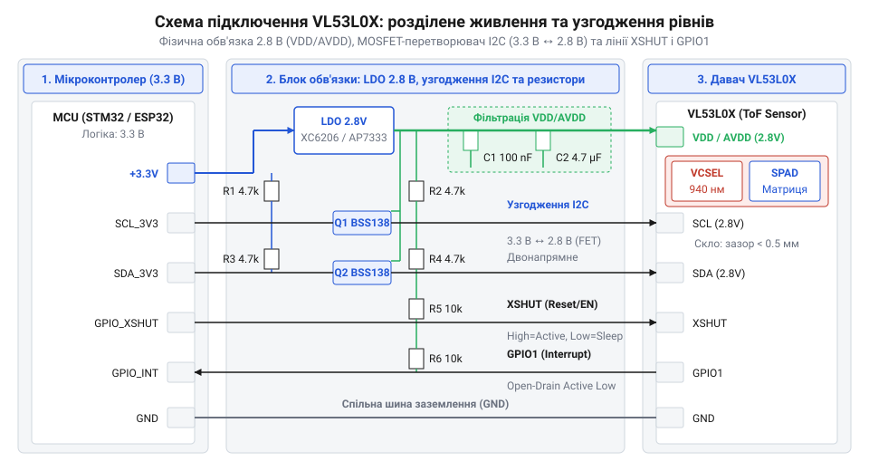
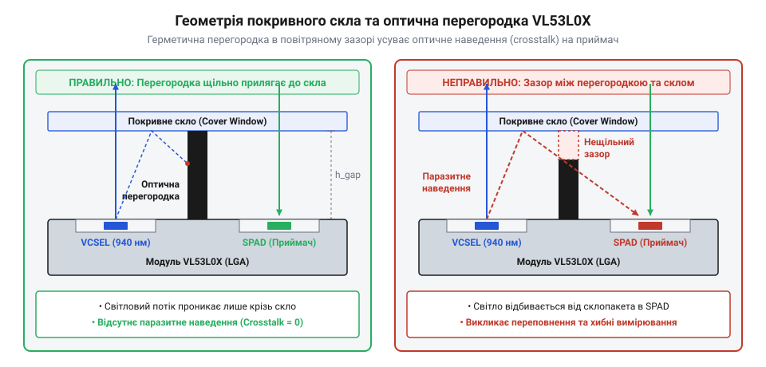

# Залізний інтерфейс та апаратне підключення VL53L0X

<preknowlist>
- [TOF10120 — лазерний далекомір (ToF, до ~180 см)](root:cat-hw-sensors/tof10120) — базовий принцип вимірювання часопролітного сигналу (Time-of-Flight) та загальна схема взаємодії з мікроконтролерами
</preknowlist>

## Проблеми прямого підключення лазерного далекоміра

Коли розробники замінюють простіші давачі відстані, як-от [аналоговий ІЧ-далекомір Sharp GP2Y0A21YK0F](root:cat-hw-sensors/sharp-gp2y0a21) або [лазерний модуль TOF10120](root:cat-hw-sensors/tof10120), на високоточний компонент @@en|VL53L0X@@, вони часто намагаються підключати його напряму до сигнальних та силових ліній мікроконтролера. Проте `@@en|VL53L0X@@` побудований на вимірюванні часопролітного сигналу `@@en|Time-of-Flight@@` (від @@en|time@@ — час, @@en|flight@@ — політ) з пікосекундною точністю, що накладає жорсткі вимоги до схемотехніки обв'язки.

Для формування зондувального імпульсу світла всередині чипу встановлено інфрачервоний лазер — `@@en|VCSEL@@` (від @@en|Vertical-Cavity Surface-Emitting Laser@@ — лазер поверхоневого випромінювання з вертикальним резонатором). У момент випромінювання лазерний драйвер споживає короткі струмові імпульси тривалістю в кілька наносекунд із піковими значеннями від 20 до 40 мА. Якщо чип підключений через довгі провідники або від спільної цифрової лінії живлення без локальних шунтувальних конденсаторів, ці кидки струму викликають імпульсне просідання напруги (@@en|voltage dip@@). Це призводить до спонтанного внутрішнього скидання мікрокоду чипу, збою регістрової конфігурації або появи фазового шуму у вимірювальних осередках `@@en|SPAD@@` (від @@en|Single-Photon Avalanche Diode@@ — однофотонний лавинний діод), що проявляється як зсув відліків дистанції та нестабільність значень.

Другою критичною проблемою є невідповідність логічних рівнів. Номінальна напруга живлення цифрового ядра та сигнальних ліній `@@en|VL53L0X@@` становить 2.8 В. Пряме підключення ліній `@@en|SDA@@`, `@@en|SCL@@` або `@@en|XSHUT@@` до 5-вольтних мікроконтролерів викликає протікання струму через внутрішні захисні діоди від `@@en|ESD@@` (від @@en|Electrostatic Discharge@@ — електростатичний розряд) в лінію живлення 2.8 В. Це спричиняє паразитне живлення (@@en|parasitic powering@@), перегрів напівпровідникового кристала та його незворотне теплове руйнування. Навіть у системах із 3.3 В логікою без належних підтягувальних резисторів `@@en|pull-up@@` (від @@en|pull@@ — тягти, @@en|up@@ — вгору) або узгоджувачів рівнів виникають зависання шини `@@en|I2C@@` (від @@en|Inter-Integrated Circuit@@ — міжмікросхемна шина) через спотворення фронтів сигналів.

## Призначення виводів та розділене живлення

Для стабільної роботи далекоміра `@@en|VL53L0X@@` апаратна схема має чітко розмежовувати цифрові лінії керування та потужні оптичні кола. Корпус пристрою містить 12 контактних майданчиків, основними з яких є:
- `@@en|VDD@@` — лінія живлення цифрового ядра та периферії (2.8 В);
- `@@en|AVDD@@` — аналогове живлення фотоприймальної матриці `@@en|SPAD@@` та драйвера `@@en|VCSEL@@` (2.8 В);
- `@@en|GND@@` — спільна апаратна земля;
- `@@en|SDA@@` та `@@en|SCL@@` — сигнальні лінії інтерфейсу `@@en|I2C@@`;
- `@@en|XSHUT@@` — вхід апаратного вимкнення та скидання (активний низький рівень);
- `@@en|GPIO1@@` — програмований вихід апаратного переривання та індикації готовності даних.

Розділення живлення на `@@en|VDD@@` та `@@en|AVDD@@` необхідне для ізоляції чутливого аналогового тракту від високочастотного шуму перемикання цифрових вентилів. Для формування напруги 2.8 В використовують окремий лінійний стабілізатор `@@en|LDO@@` (від @@en|Low Dropout Regulator@@ — стабілізатор з малою різницею напруг) з високим коефіцієнтом пригнічення пульсацій (наприклад, MIC5219-2.8 або AP2127K-2.8). На виході `@@en|LDO@@` встановлюють накопичувальний керамічний конденсатор ємністю 10 мкФ типу `@@en|X7R@@`.

Лінія `@@en|VDD@@` підключається до виходу `@@en|LDO@@` з шунтувальним керамічним конденсатором ємністю 100 нФ, розміщеним найближче до відповідної ніжки. Для лінії `@@en|AVDD@@` формують додатковий фільтр, який складається з послідовного резистора опором 10 Ом (або феритової намистини `@@en|ferrite bead@@`) та двох паралельних конденсаторів: 100 нФ та 4.7 мкФ. Цей фільтр відсікає імпульсні наведення та гасить високочастотні коливання при спрацьовуванні лазера `@@en|VCSEL@@`.

Через високу швидкість наростання струму паразитна індуктивність `L_p` доріжок друкованої плати створює падіння напруги `V_dip`:

падіння напруги живлення обчислюється через паразитну індуктивність та швидкість зміни струму:

```
V_dip = L_p × (di / dt)
```

З цієї формули видно: що більша індуктивність `L_p` (тобто що далі від виводу чипу стоїть конденсатор), то більшим буде просідання напруги `V_dip` при швидкій зміні струму `di / dt`. Саме тому шунтувальні конденсатори ємністю 100 нФ мають запаюватися впритул до корпусу `@@en|VL53L0X@@`.

## Шина I2C та узгодження рівнів

Інтерфейс `@@en|I2C@@` давача `@@en|VL53L0X@@` підтримує режими `@@en|Standard-mode@@` (100 кГц) та `@@en|Fast-mode@@` (400 кГц). Лінії `@@en|SDA@@` та `@@en|SCL@@` побудовані за схемою з відкритим стоком (`@@en|open-drain@@`), що вимагає встановлення зовнішніх підтягувальних резисторів (`@@en|pull-up@@`) до лінії 2.8 В.

Вибір номіналу підтягувального резистора `R_pullup` визначається компромісом між швидкістю наростання сигналу та енергоспоживанням. Верхня межа опору `R_max` обмежена максимально припустимим часом наростання фронту `t_r` (для `@@en|Fast-mode@@` `t_r` = 300 нс) та загальною паразитною ємністю лінії `C_bus`:

```
R_max = t_r / (0.8473 × C_bus)
```

Нижня межа опору `R_min` обмежена максимально припустимим струмом виходу чипу у стані логічного нуля `I_OL` (для `@@en|VL53L0X@@` `I_OL` = 3 мА при вихідній напрузі логічного нуля `V_OL` = 0.4 В):

```
R_min = (V_DD - V_OL) / I_OL
```

**Розрахунок номіналів підтяжки для шини I2C**

Розрахуємо допустимий діапазон підтягувальних резисторів для шини `@@en|I2C@@` з напругою живлення `V_DD` = 2.8 В, паразитною ємністю плати `C_bus` = 100 пФ та часом наростання фронту `t_r` = 300 нс.

Спочатку знайдемо мінімально припустимий опір `R_min`:

```
R_min = (V_DD - V_OL) / I_OL
= (2.8 V - 0.4 V) / 0.003 A      [підстановка параметрів VL53L0X]
= 800 Ω                          [обчислення мінімального опору]
```

Тепер обчислимо максимально припустимий опір `R_max`:

```
R_max = t_r / (0.8473 × C_bus)
= 300 × 10⁻⁹ s / (0.8473 × 100 × 10⁻¹² F)    [підстановка часових параметрів Fast Mode]
= 300 × 10⁻⁹ s / 84.73 × 10⁻¹² F
≈ 3540 Ω                                      [обчислення максимального опору]
```

Отже, для стабільної роботи на частоті 400 кГц опір підтяжки має перебувати в межах від 800 Ом до 3.54 кОм. Оптимальним вибором для більшості схем є резистори номіналом 2.2 кОм або 3.3 кОм.

Оскільки `@@en|VL53L0X@@` працює від напруги 2.8 В, його безпосереднє підключення до мікроконтролерів із логікою 3.3 В або 5 В вимагає застосування двонапрямного узгоджувача логічних рівнів (@@en|level shifter@@) на польових транзисторах `@@en|MOSFET@@` (від @@en|Metal-Oxide-Semiconductor Field-Effect Transistor@@ — польовий транзистор із структурою метал-оксид-напівпровідник), таких як BSS138.


*Принципова схема апаратної обв'язки VL53L0X із розділеним аналоговим та цифровим живленням, транзисторними узгоджувачами рівнів для I2C та підключенням ліній XSHUT і GPIO1.*

Схема узгоджувача працює в трьох режимах:
1. **Стан спокою (лог. 1 з обох боків):** затвор транзистора підключено до 2.8 В. Оскільки витік і витік підтягнуті резисторами відповідно до 2.8 В та 3.3 В / 5 В, різниця напруг затвор-витік `V_GS` дорівнює 0 В. Транзистор закрито, лінії ізольовані. 2. **Передавач 2.8 В притягує лінію до 0 В:** витік притягується до землі (0 В). Різниця напруг `V_GS` стає 2.8 В, що перевищує порогову напругу `V_GS(th)`. Транзистор відкривається і притягує високовольтну сторону до 0 В. 3. **Передавач 5 В притягує лінію до 0 В:** високовольтна сторона притягується до 0 В. Вбудований паразитна діод транзистора (@@en|body diode@@) починає проводити струм, знижуючи напругу на витоку до ~0.7 В. Це створює `V_GS` = 2.8 В - 0.7 В = 2.1 В > `V_GS(th)`, транзистор повністю відкривається і притягує сторону 2.8 В до нуля.

## Лінії керування XSHUT та переривань GPIO1

Крім шини `@@en|I2C@@`, для ефективної роботи з `@@en|VL53L0X@@` використовуються дві додаткові сигнальні лінії: `@@en|XSHUT@@` та `@@en|GPIO1@@`.

Вхід `@@en|XSHUT@@` відповідає за апаратне вимкнення та скидання давача. Коли на виводі `@@en|XSHUT@@` встановлено логічний нуль (підключено до `GND`), внутрішній стабілізатор чипу вимикається, і споживання струму знижується до апаратного мінімуму (менше 5 мкА). При подачі логічної одиниці (2.8 В) чип проходить процедуру внутрішнього запуску (@@en|power-on reset@@) тривалістю близько 1.2 мс, після чого стає доступним для команд по `@@en|I2C@@`.

Важливо пам'ятати, що вхід `@@en|XSHUT@@` не є толерантним до напруги 5 В. Для керування ним від 5 В мікроконтролера слід використовувати відкритий колектор/стік, резистивний дільник або транзисторний ключ.

**Динамічна зміна адреси на спільній шині I2C**

За замовчуванням після подачі живлення або скидання через `@@en|XSHUT@@` давач `@@en|VL53L0X@@` має фіксовану 7-бітну адресу `@@en|I2C@@` `0x29`. Якщо на одну шину необхідно підключити кілька далекомірів, виникає колізія адрес. Ця проблема вирішується апаратним керуванням лініями `@@en|XSHUT@@`:

1. На початку роботи мікроконтролер притягує лінії `@@en|XSHUT@@` усіх давачів до землі, утримуючи їх у стані скидання. 2. Мікроконтролер подає високий рівень на `@@en|XSHUT@@` першого давача. Після завершення паузи запуску першого давача йому по `@@en|I2C@@` надсилається команда запису в регістр `I2C_SLAVE_DEVICE_ADDRESS` для зміни адреси (наприклад, на `0x30`). 3. Потім подається високий рівень на `@@en|XSHUT@@` другого давача, і його адреса змінюється на `0x31`. 4. Процедура повторюється для всіх пристроїв на шині.

При цьому слід враховувати, що змінена адреса зберігається лише в оперативній пам'яті чипу і скидається до `0x29` при кожному перезапуску живлення або притягненні `@@en|XSHUT@@` до нуля.

Вивід `@@en|GPIO1@@` призначений для видачі апаратних переривань від давача до мікроконтролера. Через регістри налаштування `@@en|VL53L0X@@` цей вихід можна сформувати як `@@en|open-drain@@` або `@@en|push-pull@@` (від @@en|push@@ — штовхати, @@en|pull@@ — тягти) з активним низьким або високим рівнем. `@@en|GPIO1@@` сповіщає мікроконтролер про закінчення вимірювання чи вихід об'єкта за задані пороги відстані, що позбавляє МК від потреби постійного програмного опитування (`@@en|polling@@`) по шині `@@en|I2C@@`. Це суттєво заощаджує процесорний час та знижує загальне енергоспоживання системи, що критично для мобільних роботизованих платформ, де використовуються [ультразвукові далекоміри HC-SR04](root:cat-hw-sensors/hc-sr04) або лазерні давачі.

## Геометрія оптичного вікна та розводка

Корпус `@@en|VL53L0X@@` містить два оптичних вікна: випромінювач `@@en|VCSEL@@` та приймач `@@en|SPAD@@`. Лазер випромінює інфрачервоний промінь у формі конуса з повним кутом охоплення близько 25°.

При інтеграції далекоміра у реальний пристрій його часто закривають захисним покривним склом (@@en|cover glass@@) або прозорим пластиковим віконцем. Якщо змонтувати скло без урахування оптичної геометрії, частина лазерного випромінювання відіб'ється від внутрішньої або зовнішньої грані скляної пластини та потрапить безпосередньо у приймальну матрицю `@@en|SPAD@@`. Це явище називається оптичним перехресним наведенням (@@en|crosstalk@@). Перехресне наведення спричиняє появу хибного сигналу близької відстані та засліплює фотоприймач, унеможливлюючи вимірювання дистанцій до віддалених об'єктів (на відміну від [довгокрокових лазерних далекомірів TOF250](root:cat-hw-sensors/tof250), де застосовується роздільна оптика великого діаметра).


*Геометрія монтажу VL53L0X під покривним склом з урахуванням кута конуса випромінювання VCSEL, повітряного зазору та бар'єра для усунення оптичного наведення.*

Для усунення оптичного перехресного наведення дотримуються чотирьох конструктивних вимог:
1. **Мінімальний повітряний зазор (`@@en|air gap@@`):** відстань між верхньою площиною корпусу `@@en|VL53L0X@@` та внутрішньою поверхнею покривного стекла має бути якомога меншою (ідеально ≤ 0.5 мм, максимально 1.5 мм). 2. **Світлонепроникна перегородка (неопренова або силіконова манжета):** у повітряному зазорі обов'язково встановлюється непрозорий ущільнювач (@@en|optical gasket@@), який фізично розділяє канали випромінювача та приймача, блокуючи бокове розсіювання світла усередині зазору. 3. **Оптична прозорість на довжині хвилі 940 нм:** покривне скло має виготовлятися з матеріалу з високим коефіцієнтом пропускання в інфрачервоному діапазоні (наприклад, оптичний акрил `@@en|PMMA@@` або загартоване скло без ІЧ-поглинального покриття). 4. **Паралельність поверхонь:** покривне скло має встановлюватися суворо паралельно лицьовій грані чипу, щоб уникнути заломлення променя під кутом.

**Правила трасування друкованої плати (PCB Layout)**

При проектуванні друкованої плати під `@@en|VL53L0X@@` дотримуються схемотехнічних правил:
- Безпосередньо під чипом на внутрішньому шарі плати розгортають суцільний земляний полігон (`@@en|ground plane@@`), який знижує індуктивність контуру повернення струмів та забезпечує відведення тепла від напівпровідника. - Фізична відстань від виводів `@@en|VDD@@` та `@@en|AVDD@@` до фільтрувальних керамічних конденсаторів ємністю 100 нФ не повинна перевищувати 2 мм. Перехідні отвори на землю (`@@en|via@@`) ставлять упритул до контактних майданчиків конденсаторів. - Високочастотні сигнальні лінії `@@en|I2C@@` (`@@en|SDA@@`/`@@en|SCL@@`) трасують якомога далі від чутливого аналогового кола `@@en|AVDD@@`, щоб уникнути наведення цифрових завад на аналоговий вимірювальний тракт.