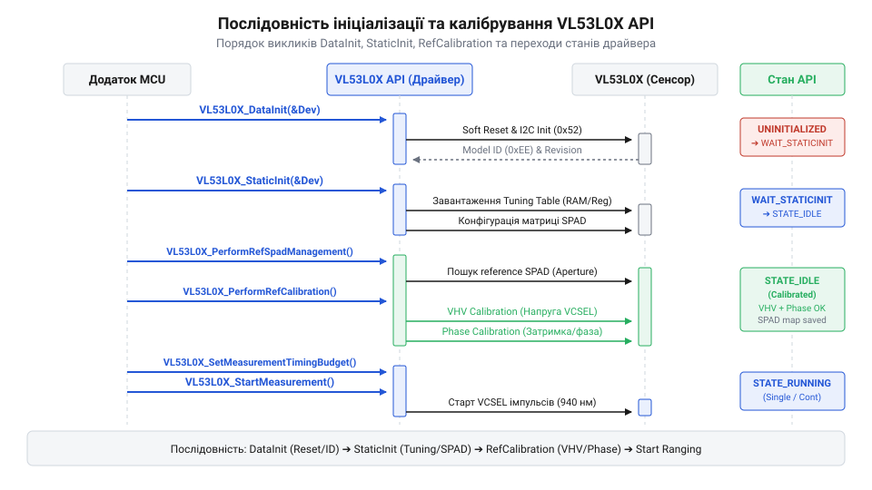
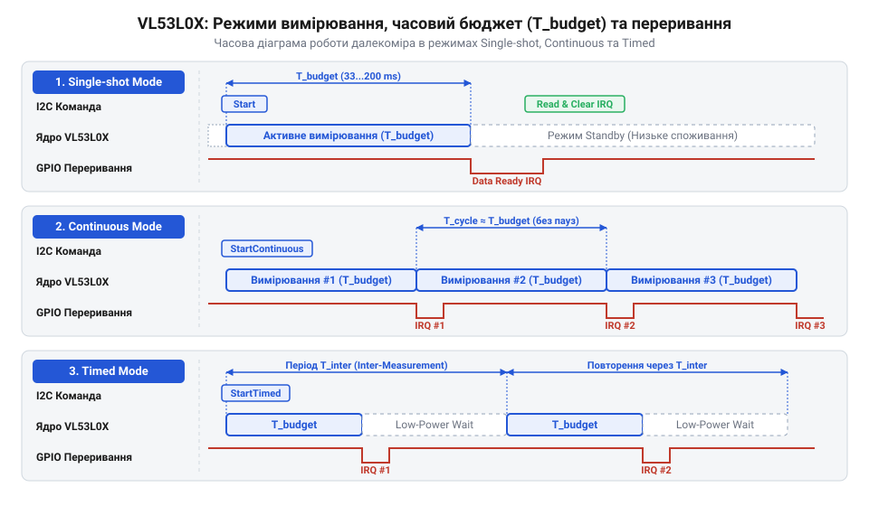

# Програмний інтерфейс драйвера ST API та регістрова карта VL53L0X

<preknowlist>
- [TOF10120](root:cat-hw-sensors/tof10120) — Фізичний принцип вимірювання відстані за часом прольоту світла (Time-of-Flight) та базове поняття фазового зсуву.
</preknowlist>

## Складність прямого зчитування лазерного давача

При спробі задіяти лазерний далекомір `@@en|VL53L0X@@` розробники часто очікують звичного сценарію роботи через шину `@@en|I2C@@`: записати адресу внутрішнього регістру, зчитати два байти даних та перевести їх у міліметри за лінійною формулою. Проте відправка звичайного запиту на зчитування повертає нулі або хаотичні значення. На відміну від пристроїв на кшталт [інфрачервоного далекоміра Sharp GP2Y0A21YK0F](root:cat-hw-sensors/sharp-gp2y0a21), де вихідний аналоговий сигнал пропорційний відстані, або [готового модуля TOF10120](root:cat-hw-sensors/tof10120), який має власний проміжний мікроконтролер для первинної обробки, чип `@@en|VL53L0X@@` є чисто фотонним приймально-передавачем без високорівневого обчислювального ядра. Пристрій також принципово відрізняється від [ультразвукового далекоміра HC-SR04](root:cat-hw-sensors/hc-sr04), який вимірює тривалість одного відбитого акустичного імпульсу.

Функціонування давача спирається на технологію `@@en|ToF@@` (від @@en|Time-of-Flight@@ — час прольоту). Всередині кристала встановлено напівпровідниковий випромінювач `@@en|VCSEL@@` (від @@en|Vertical-Cavity Surface-Emitting Laser@@ — поверхнево-випромінювальний лазер із вертикальним резонатором) з довжиною хвилі 940 нм та приймальну матрицю `@@en|SPAD@@` (від @@en|Single Photon Avalanche Diode@@ — лавинний фотодіод для реєстрації поодиноких фотонів). Оскільки світло долає відстань у 1 см приблизно за 33 пікосекунди, прямий відлік часу за допомогою звичайного таймера мікроконтролера неможливий. Натомість пристрій випромінює серію високочастотних модульованих імпульсів і реєструє статистичний розподіл затримок повернення поодиноких фотонів на матриці `@@en|SPAD@@`.

Складність полягає в тому, що для отримання одного точного заміру необхідно виконати складний комплекс дій:
1. Визначити кількість і конфігурацію активних діодів у матриці `@@en|SPAD@@`, щоб уникнути насичення фотоприймача відбитим світлом. 2. Провести підготовче вимірювання (попередній діапазон, або `@@en|Pre-range@@`) для оцінки рівня завад і вибору підсилення. 3. Здійснити обчислення фазового зсуву модульованої хвилі та вирахувати статистичне відхилення (сигму). 4. Застосувати температурну компенсацію для дрейфу часових ланцюгів та високовольтного генератора зміщення `@@en|SPAD@@`.

Для виконання цих кроків потрібно провести десятки послідовних записів у недокументовані регістри пристрою, обчислити дробові коефіцієнти та динамічно змінити внутрішні налаштування апаратного конвеєра. Компанія-виробник STMicroelectronics свідомо не публікує повну карту регістрів `@@en|VL53L0X@@`. Натомість надається офіційний програмальний інтерфейс драйвера — `@@en|ST API@@` (від @@en|Application Programming Interface@@ — програмальний інтерфейс застосунків).

Драйвер `@@en|ST API@@` інкапсулює низькорівневу роботу з I2C-регістрами, керує внутрішнім автоматом станів пристрою та надає розробнику зручний абстрагований шар. Замість прямих маніпуляцій з регістрами розробник оперує структурою стану `@@en|VL53L0X_Dev_t@@` та високорівневими функціями ініціалізації, калібрування й зчитування відстані безпосередньо в міліметрах.

## Архітектура ST API та послідовність ініціалізації

Офіційний драйвер `@@en|ST API@@` побудовано за двошаровою архітектурою. Верхній шар складається з платформно-незалежних файлів (зокрема `vl53l0x_api.c`), які містять математичні алгоритми, розрахунки часових параметрів та логіку автомата станів. Нижній шар називається `@@en|PAL@@` (від @@en|Platform Abstraction Layer@@ — рівень абстракції платформи) і реалізується у файлі `vl53l0x_platform.c`. Рівень `@@en|PAL@@` адаптується під конкретний мікроконтролер та операційну систему — саме в ньому описуються базові операції читання й запису байтів через шину `@@en|I2C@@`.

Запуск давача `@@en|VL53L0X@@` після подачі живлення або апаратного скидання вимагає суворого дотримання послідовності викликів функцій ініціалізації.


*Послідовність викликів функцій ініціалізації та зміна внутрішніх станів драйвера ST API.*

Процес ініціалізації складається з трьох послідовних етапів:

1. **Первинне завантаження конфігурації (`@@en|DataInit@@`)**: Функція `@@en|VL53L0X_DataInit()@@` зчитує заводські калібрувальні дані з постійного запам'ятовувального пристрою (ПЗП) давача, скидає внутрішню структуру `@@en|VL53L0X_Dev_t@@` і переводить автомат станів у режим `@@en|VL53L0X_STATE_WAIT_STATICINIT@@`. Також на цьому етапі налаштовується адреса пристрою на шині `@@en|I2C@@`.

2. **Статичне налаштування (`@@en|StaticInit@@`)**: Функція `@@en|VL53L0X_StaticInit()@@` завантажує в приховані регістри далекоміра оптимальні параметри роботи аналогового тракту, налаштовує генератор високої напруги для матриці `@@en|SPAD@@` та конфігурує параметри за замовчуванням. Після успішного виконання пристрій переходить у стан `@@en|VL53L0X_STATE_IDLE@@`.

3. **Опорне калібрування (`@@en|RefCalibration@@`)**: Виконується процедура `@@en|VL53L0X_PerformRefSpadManagement()@@`, яка визначає кількість і тип (апертурні чи неапертурні) активних лавинних фотодіодів в залежності від рівня відбиття корпусу. Далі викликається `@@en|VL53L0X_PerformRefCalibration()@@` для калібрування опорної температури й напруги `@@en|VHV@@` (від @@en|Very High Voltage@@ — дуже висока напруга).

Приклад виконання послідовності ініціалізації на мовах C та C++:

:::tabs
@tab C (ESP-IDF)
:::code api-vl53l0x-software/c/esp-idf/init-vl53l0x.c
@tab C++ (Arduino Framework)
:::code api-vl53l0x-software/cpp/arduino/initvl53l0x.cpp
:::

## Вимірювальні профілі та часовий бюджет

Після завершення ініціалізації давач переходить у стан готовності, однак його параметри за замовчуванням є усередненими. Для досягнення оптимальних результатів необхідно налаштувати `@@en|timing budget@@` (часовий бюджет вимірювання) — максимальний час у мікросекундах, який драйвер виділяє давачу на виконання одного повного циклу вимірювання відстані.

Часовий бюджет розподіляється між кількома послідовними апаратними фазами:
1. **Підготовка та автокалібрування** (`@@en|VHV/Phase calibration@@`). 2. **Попереднє вимірювання** (`@@en|Pre-range@@`): швидкий спалах лазера для визначення наявності об'єкта поблизу та налаштування підсилення. 3. **Основне вимірювання** (`@@en|Final-range@@`): накопичення фотонів для точного розрахунку відстані.

Збільшення часу, виділеного на фазу `@@en|Final-range@@`, підвищує співвідношення сигнал/шум (`@@en|SNR@@`, від @@en|Signal-to-Noise Ratio@@ — співвідношення сигналу до шуму). Це дозволяє надійніше реєструвати слабкий відбитий сигнал від темних поверхонь або віддалених об'єктів. Проте це зменшує частоту оновлення даних та збільшує енергоспоживання.

Драйвер `@@en|ST API@@` пропонує три готові вимірювальні профілі, які адаптують часовий бюджет та обмеження сигналу під конкретні умови застосування:

* **Профіль високої точності (`@@en|High Accuracy@@`)**:
  Часовий бюджет збільшується до 200 000 мкс (200 мс). Похибка вимірювання зменшується до ±3% у закритих приміщеннях. Використовується в задачах точного вимірювання рівня рідини або мікропозиціонування робототехнічних платформ.

* **Профіль великої дальності (`@@en|Long Range@@`)**:
  Збільшує тривалість фази `@@en|Final-range@@` та зменшує порогові вимоги до поверненого сигналу. Дозволяє вимірювати відстань до 200 см у темряві або при слабому фоновому освітленні. Однак при яскравому сонячному світлі цей профіль стає вразливим до фотонного шуму, поступаючись за стійкістю потужнішим вимірювальним системам, таким як [промисловий лазерний далекомір TOF250](root:cat-hw-sensors/tof250).

* **Високошвидкісний профіль (`@@en|High Speed@@`)**:
  Часовий бюджет скорочується до мінімально припустимих 20 000 мкс (20 мс), що забезпечує частоту опитування до 50 Гц. При цьому похибка вимірювання зростає до ±10 мм. Профіль підходить для відстеження швидкорухомих об'єктів або динамічного уникнення перешкод.

Налаштування часового бюджету в `@@en|ST API@@` здійснюється викликом функції `@@en|VL53L0X_SetMeasurementTimingBudgetMicroSeconds()@@`.

## Режими вимірювання та зчитування даних

Режим роботи далекоміра визначає, як саме запускається процес вимірювання та як результати передаються до мікроконтролера. Драйвер `@@en|ST API@@` підтримує три основні режими запуску:


*Часові інтервали випромінювання, обробки й генерації переривань для режимів Single-shot, Continuous та Timed.*

1. **Одноразовий режим (`@@en|Single-shot@@`)**:
   Запуск вимірювання відбувається за запитом через функцію `@@en|VL53L0X_PerformSingleRangingMeasurement()@@`. Давач прокидається зі стану спокою, виконує фази `@@en|Pre-range@@` та `@@en|Final-range@@`, записує результат у внутрішній буфер і повертається в режим очікування. Цей режим є найбільш енергоефективним для автономних пристроїв із низькою частотою опитування.

2. **Безперервний режим (`@@en|Continuous@@`)**:
   Запускається функцією `@@en|VL53L0X_StartMeasurement()@@`. Давач безперервно виконує вимірювальні цикли один за одним із максимально можливою частотою, обмеженою лише встановленим часовим бюджетом.

3. **Періодичний режим (`@@en|Timed@@`)**:
   Встановлюється за допомогою виклику `@@en|VL53L0X_SetInterMeasurementPeriodMilliSeconds()@@` перед запуском `@@en|VL53L0X_StartMeasurement()@@`. Внутрішній таймер давача самостійно пробуджує апаратний конвеєр через задані інтервали часу (наприклад, кожні 100 мс при виділеному бюджеті 33 мс), зменшуючи середній струм споживання порівняно з безперервним режимом.

Зчитування даних можна реалізувати двома шляхами: програмним опитуванням (полінгом) або за допомогою апаратного переривання на виході `@@en|GPIO1@@`. При використанні переривань лінія `@@en|GPIO1@@` давача опускається в низький рівень щоразу, коли нова дистанція обчислена та готова до зчитування. Докладніше про принципову схему підключення, призначення виводів GPIO1 та XSHUT, а також рівні підтяжки I2C читайте у матеріалі про [апаратну структуру та принципову схему далекоміра VL53L0X](root:cat-hw-sensors/vl53l0x/api-vl53l0x-hardware.md).

Приклад зчитування відстані в безперервному режимі з перевіркою прапорця готовності на C та C++:

:::tabs
@tab C (ESP-IDF)
:::code api-vl53l0x-software/c/esp-idf/read-distance-continuous.c
@tab C++ (Arduino Framework)
:::code api-vl53l0x-software/cpp/arduino/getdistanceifready.cpp
:::

## Програмне калібрування зсуву та завад

Навіть при коректно працюючому циклі вимірювання отримані показники відстані можуть відхилятися від реальних через два основних фізичних фактори: механічний зсув монтажу та оптичні відбиття всередині корпусу пристрою. Драйвер `@@en|ST API@@` надає програмні механізми для компенсації цих ефектів.

### 1. Калібрування зсуву (`@@en|offset@@`)
Механічна установка давача всередині корпусу приладу часто створює постійний просторовий зазор між оптичним вікном та кристалом. Це призводить до систематичної додатної або від'ємної похибки на всьому діапазоні вимірювань.

Процедура калібрування зсуву полягає в тому, що давач спрямовують на плоску білу мішень із відомим відбиттям (наприклад, 88% сіра/біла карта) на фіксованій відстані (наприклад, 100 мм). За допомогою функції `@@en|VL53L0X_PerformOffsetCalibration()@@` API автоматично робить серію замірів, обчислює середнє значення та розраховує компенсаційний параметр зсуву:

```
distance_actual = 100
distance_measured = 108
offset = distance_actual - distance_measured
       = 100 - 108                    [різниця еталонної та виміряної відстані]
       = -8                           [значення зсуву в міліметрах]
```

Отримане значення `@@en|offset@@` зберігається у внутрішній конфігурації драйвера викликом `@@en|VL53L0X_SetOffsetCalibrationDataMicroMeter()@@` і автоматично додається до кожного наступного заміру.

### 2. Компенсація оптичного перехресного заваду (`@@en|crosstalk@@`)
При встановленні захисного скла або акрилового вікна перед оптичним вікном давача частина випромінених лазерних імпульсів відбивається від внутрішньої поверхні скла безпосередньо назад у приймальну матрицю `@@en|SPAD@@`. Це явище називається оптичним перехресним завадом (`@@en|crosstalk@@`). 

Перехресний завад створює фазову помилку, через яку давач занижує відстань до реальних об'єктів або взагалі втрачає здатність вимірювати віддалені цілі, оскільки паразитна інтенсивність від скла перевищує слабкий корисний сигнал від об'єкта.

Інтенсивність заваду вимірюється в одиницях `@@en|Mcps@@` (від @@en|Mega Count Per Second@@ — мільйон відліків на секунду).

Для калібрування оптичного заваду давач із встановленим захисним склом спрямовують на чорну або темно-сіру мішень на відстані 400 мм. На такій відстані відбитий корисний сигнал є мінімальним, що дозволяє виділити частку паразитних фотонів від скла. Функція `@@en|VL53L0X_PerformXTalkCalibration()@@` вираховує швидкість паразитних відліків `@@en|XTalkCompensationRateMegaCps@@`. Отриманий коефіцієнт записується через `@@en|VL53L0X_SetXTalkCompensationRateMegaCps()@@`, після чого математичне ядро `@@en|ST API@@` віднімає вектор паразитного фону під час обробки гістограми фотонів.

## Обробка статусів якості та діагностика

У реальних умовах експлуатації виміряне значення відстані не завжди є достовірним. Давач може бути спрямований у порожнечу поза межами максимальної дальності, на дзеркальну поверхню під кутом або працювати під прямим сонячним світлом. Сліпа довіра числовому значенню у полі `RangeMilliMeter` може призвести до помилок керування в робототехнічних системах.

Для оцінки надійності заміру структура `@@en|VL53L0X_RangingMeasurementData_t@@` містить спеціальне поле `@@en|RangeStatus@@`. Інтерпретація основних кодів статусу якості наведена нижче:

* **Статус 0 (`@@en|Range Valid@@`)**:
  Вимірювання виконано успішно, рівень сигналу та статистична дисперсія знаходяться в межах норми. Дані у міліметрах є повністю достовірними.

* **Статус 1 (`@@en|Sigma Fail@@`)**:
  Статистичне відхилення фотонного рахунку (сигма) перевищує встановлений поріг. Зазвичай виникає при сильному фоновому освітленні або при вимірюванні відстані до поверхонь із низьким коефіцієнтом відбиття.

* **Статус 2 (`@@en|Signal Fail@@`)**:
  Рівень корисного відбитого сигналу нижчий за мінімально допустимий поріг `@@en|FinalRangeSignalLimit@@`. Означає, що об'єкт розташований занадто далеко або має занадто темну поверхню.

* **Статус 4 (`@@en|Phase Fail@@`)**:
  Помилка розрахунку фазового зсуву. Виникає при перевищенні фізичної межі діапазону (понад 2 метри) або при появі множинних оптичних відбиттів.

* **Статус 5 (`@@en|Hardware Fail@@`)**:
  Апаратна помилка внутрішньої системи керування лазером `@@en|VCSEL@@` або фазового автопідлаштування частоти (PLL).

Окрім перевірки поля `@@en|RangeStatus@@`, розробник повинен обробляти коди повернення самих функцій `@@en|ST API@@`, які мають тип `@@en|VL53L0X_Error@@`. Значення `@@en|VL53L0X_ERROR_NONE@@` (0) свідчить про успішне виконання команди на шині I2C, тоді як від'ємні коди або коди на кшталт `@@en|VL53L0X_ERROR_CONTROL_INTERFACE@@` вказують на апаратний збій обміну даними (наприклад, обрив лінії SDA/SCL чи відсутність живлення).

Приклад побудови захисної логіки для обробки даних вимірювання на мовах C та C++:

:::tabs
@tab C (ESP-IDF)
:::code api-vl53l0x-software/c/esp-idf/get-verified-distance.c
@tab C++ (Arduino Framework)
:::code api-vl53l0x-software/cpp/arduino/getsafedistance.cpp
:::

Завдяки комбінуванню перевірки статусу викликів API та статусу придатності виміряного значення `@@en|RangeStatus@@` досягається висока надійність роботи системи та унеможливлюється прийняття хибних рішень на основі спотворених даних.