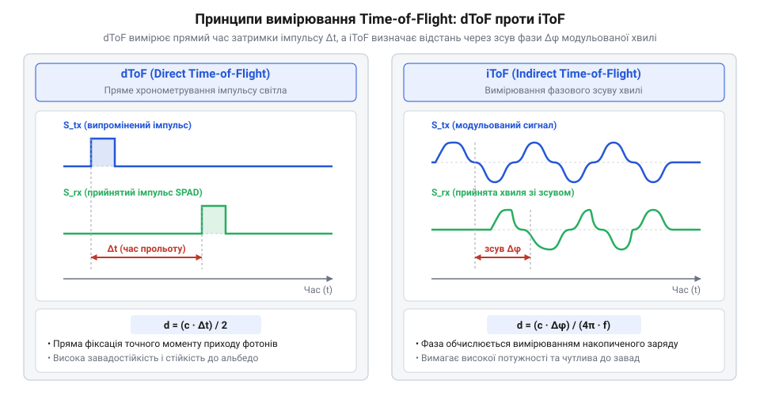
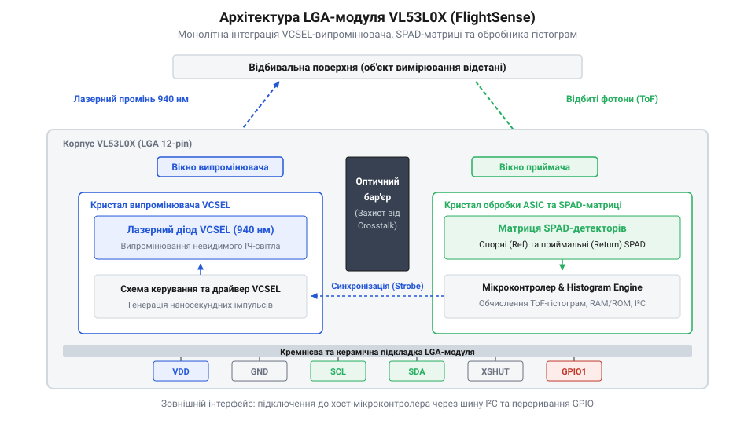

# Еволюція методів оптичного вимірювання відстані та поява FlightSense

<preknowlist>
- [Sharp GP2Y0A21YK0F](root:cat-hw-sensors/sharp-gp2y0a21) — Принцип роботи аналогового інфрачервоного далекоміра на основі оптичної триангуляції та залежність його показань від альбедо поверхні об'єкта.
</preknowlist>

## Ненадійність триангуляційних та інтенсивносних давачів

Перші масові оптичні далекоміри оцінювали відстань за інтенсивністю відбитого інфрачервоного світла. Однак потужність світлового потоку на приймачі пропорційна зворотному квадрату відстані й водночас лінійно залежить від оптичних властивостей поверхні — її @@la|albedo@@ (від лат. *albedo* — білість, коефіцієнт відбиття). Чорна поверхня з альбедо близько 5 % відбиває у вісімнадцять разів менше світла, ніж біла з альбедо 90 %. Через це інтенсивносний давач безсилий розрізнити близький темний об'єкт і далекий світлий. До того ж зовнішнє фонове освітлення засліплює фотодіод.

Щоб позбутися залежності від амплітуди, компанія @@en|Sharp Corporation@@ у 1980-х роках розробила оптичні далекоміри на основі геометричної триангуляції @@en|triangulation@@ (від лат. *triangulum* — трикутник), реалізованої в [аналогових інфрачервоних давачах Sharp](root:cat-hw-sensors/sharp-gp2y0a21). Випромінювач спрямовує промінь на об'єкт, а приймальна лінза фокусує відбиту пляму на лінійному детекторі — @@en|Position Sensitive Detector@@ (від англ. *Position Sensitive Detector*, PSD) або мікролінійці @@en|CCD@@.

Відстань `d` обчислюють із геометричної подібності трикутників, де `B` — оптична база між випромінювачем і приймачем, `f` — фокусна відстань лінзи, а `x` — зсув плями на детекторі від оптичної осі:

```
x / f = B / d
d = (B · f) / x            [розрахунок відстані за геометричною триангуляцією]
```

Ця геометрія розкриває дві інженерні проблеми триангуляції:

1. Зсув плями `x` обернено пропорційний відстані `d`. Похідна `∂x/∂d = -B · f / d²` показує, що чутливість детектора падає як квадрат відстані. Для вимірювання дистанцій понад 1–2 метри доводиться збільшувати базу `B` до десятків сантиметрів, що унеможливлює мініатюризацію. 2. Колірні градієнти та нахил поверхні зміщують оптичний центр ваги плями на PSD-детекторі, спричиняючи хибне трактування кута й помилку в кілька сантиметрів.

На відміну від [акустичних ультразвукових далекомірів](root:cat-hw-sensors/hc-sr04), які вимірюють час повернення хвилі, інтенсивносні та триангуляційні оптичні давачі оцінювали простір через кількість світла або кутову геометрію. Потреба у точних і компактних сенсорах змусила перейти до безпосереднього вимірювання часу прольоту фотонів зі швидкістю світла.

## Формування методів dToF та iToF

Непридатність інтенсивносних методик змусила перейти до вимірювання часу прольоту фотонів — @@en|Time-of-Flight@@ (від англ. *time of flight* — час прольоту, ToF). Світло поширюється у повітрі зі сталою швидкістю `c ≈ 299 792 458 м/с`. Тому вимірювану відстань `d` обчислюють за часовим інтервалом `Δt`, за який світло долає шлях до цілі й повертається назад:

```
d = (c · Δt) / 2            [визначення відстані за часом прольоту]
```

Дільник `2` ураховує подвійний шлях світлового імпульсу. Головний виклик методу ToF полягає в масштабі часу: 30 см світло долає за 1 нс (10⁻⁹ с), а для точності в 1 мм потрібна роздільна здатність таймера близько 6.67 пс (6.67 · 10⁻¹² с). Для розв'язання цієї задачі виникли два підходи: прямий (dToF) та непрямий (iToF).

Прямий метод — @@en|Direct Time-of-Flight@@ (dToF) — вимірює час затримки короткого світлового імпульсу тривалістю 1–5 нс. Спеціалізований лічильник — часо-цифровий перетворювач @@en|Time-to-Digital Converter@@ (від англ. *time to digital converter* — перетворювач часу в цифру, TDC) — фіксує моменти випромінювання та прибуття фотонів. Накопичення статистики багатьох імпульсів у часову гістограму дає змогу dToF відсіювати фонове сонячне світло й отримувати високу точність.

Непрямий метод — @@en|Indirect Time-of-Flight@@ (iToF) — обходить потребу в пікосекундних таймерах TDC. Випромінювач непреривно надсилає світло, модульоване високочастотним сигналом `f_mod` (20–100 МГц), а приймальна матриця вимірює зсув фази `Δϕ` відбитої хвилі:

```
d = (c · Δϕ) / (4 · π · f_mod)            [розрахунок відстані за фазовим зсувом]
```

Фазовий зсув пропорційний відстані, що дозволило будувати 3D-камери глибини на базі стандартних CMOS-матриць.


*Порівняння сигналів dToF та iToF: у методі dToF вимірюється безпосередній час затримки світлового імпульсу, а в непрямому методі iToF — зсув фази огинаючої модульованого випромінювання.*

Проте iToF має обмежувальну пастку циклічної невизначеності — @@en|aliasing@@ (від англ. *alias* — інше ім'я, накладання сигналів). Якщо відстань перевищує `d_max = c / (2 · f_mod)` (7.5 м для 20 МГц), фаза робить повний оберт (2π), і сенсор плутає 1 м із 8.5 м. Крім того, iToF чутливий до багатошляхової інтерференції — @@en|multipath interference@@, коли світло відбивається від кількох предметів одночасно. Натомість dToF позбавлений фазової невизначеності й споживає менше енергії, але вимагає фотодетекторів, здатних реагувати на поодинокі фотони.

## Детектори SPAD та спростування міфів

Для реалізації компактного dToF-далекоміра звичайні фотодіоди непридатні: відбитий світловий імпульс від далекого об'єкта містить лише кілька десятків фотонів, що створює аналоговий струм, нерозрізнений на тлі шумів підсилювача. Проблему вирішили [SPAD-діоди](root:hw-sensing/spad-semiconductor-physics) (@@en|Single-Photon Avalanche Diode@@), які працюють у режимі Гейгера (@@en|Geiger mode@@).

У 1960-х роках Роланд Хайц (Roland Haitz) та Роберт Макінтайр (Robert McIntyre) описали фізику лавинного пробою в кремнієвих p-n переходах. У SPAD зворотна напруга зміщення перевищує поріг пробою (`V_bias > V_br`). Один фотон генерує електронно-діркову пару, викликаючи лавинне розмноження носіїв: діод за частки пікосекунди відкривається і генерує імпульс струму. Схема гасіння — @@en|quenching circuit@@ — швидко знижує напругу нижче порогу пробою, зупиняючи струм і готуючи SPAD до прийому наступного фотона.

Паралельно у 1977 році Кенічі Іга (Kenichi Iga) з Токійського технологічного інституту запропонував новий клас напівпровідникових лазерів — [VCSEL-лазери](root:hw-components/vcsel-diode-technology) (@@en|Vertical-Cavity Surface-Emitting Laser@@). На відміну від торцевих лазерів, VCSEL випромінює світло перпендикулярно до поверхні підкладки, має вузький спектр, низьке споживання та може перемикатися за частки наносекунди.

Твердження, ніби компанія [STMicroelectronics](root:hw-components/stmicroelectronics) винайшла принцип Time-of-Flight чи детектори SPAD — міф. Фізичний принцип вимірювання часу прольоту світла відомий з XIX століття за експериментами Армана Фізо та Леона Фуко, а перші військові [лазерні далекоміри](root:cat-hw-sensors/tof250) використовували dToF ще в 1960-х роках. Дискретні SPAD розробила у 1970–1980-х роках група Серджіо Кова (Sergio Cova) у Міланському політехнічному інституті для квантової оптики.

Чому ж системи dToF довго залишалися громіздкими лабораторними приладами? До 2010-х років SPAD вимагали високих напруг живлення (десятки або сотні вольт), дискретних резисторів гасіння та охолодження для зменшення темнового шуму — @@en|Dark Count Rate@@ (DCR). Таймери TDC та блоки обробки гістограм будували на окремих дорогих платах.

Вирішальним внеском STMicroelectronics стала революція в мікроелектроніці. У 2010-х роках компанія на основі напрацювань шотландського стартапу Vision Group (придбаного у 1999 році) розробила процес сумісної інтеграції під маркою @@en|FlightSense@@. Розташування масиву SPAD, драйвера VCSEL, мікрооптики та мікроконтролера обробки гістограм у єдиному кремнієвому чипі перетворило лабораторну установку на масовий модуль VL53L0X у корпусі LGA (4.4 × 2.4 мм) для смартфонів та робототехніки.

## Технологія FlightSense та чип VL53L0X

До появи монолітних ToF-сенсорів побудова системи прямого вимірювання часу прольоту (від англ. @@en|direct Time-of-Flight@@, або @@en|dToF@@) вимагала дискретного складання з лазерного випромінювача, масиву фотодіодів, лінз та часо-цифрових перетворювачів (від англ. @@en|Time-to-Digital Converter@@, або @@en|TDC@@). Такі лабораторні установки були занадто громіздкими, дорогими й енергоємними для споживчих пристроїв.

Вирішальним кроком у середині 2010-х років стала розробка технології @@en|FlightSense@@ компанією @@en|STMicroelectronics@@. Справа була не у винаході самих принципів @@en|ToF@@ чи однофотонних лавинних діодів (від англ. @@en|Single-Photon Avalanche Diode@@, або @@en|SPAD@@), відомих давно, а в напівпровідниковій інтеграції. Інженери вперше об'єднали оптичні елементи, кремнієвий детектор та цифрову обробку в єдиному @@en|LGA@@-корпусі (від англ. @@en|Land Grid Array@@ — сітка контактних майданчиків) розміром 4.4 × 2.4 × 1.0 мм чипа @@en|VL53L0X@@.


*Архітектура модуля VL53L0X за технологією FlightSense: інтеграція VCSEL-лазера, масиву SPAD та цифрового обробника гістограм у єдиному корпусі LGA.*

Усередині модуля @@en|VL53L0X@@ реалізовано повний оптико-обчислювальний тракт:

1. **Лазер @@en|VCSEL@@** (від англ. @@en|Vertical-Cavity Surface-Emitting Laser@@ — лазер із вертикальним резонатором і поверхневим випромінюванням). Випромінює імпульси на довжині хвилі 940 нм, яка безпечна для очей (стандарт @@en|Class 1 Laser@@) та стійка до сонячних завад.

2. **Масив @@en|SPAD@@**. Розділений на опорні діоди (від англ. @@en|Reference SPADs@@), що фіксують точний момент спалаху біля лазера й компенсують внутрішній дрейф затримки, та робочі діоди (від англ. @@en|Return SPADs@@), які приймають фотони, відбиті від цілі.

3. **Гістограмний процесор @@en|DSP@@** (від англ. @@en|Digital Signal Processor@@ — цифровий сигнальний процесор). Накопичує час прибуття фотонів від тисяч спалахів у внутрішню гістограму. Її пік дає відстань, а плато визначає темновий шум (від англ. @@en|Dark Count Rate@@, або @@en|DCR@@) та фонове освітлення.

4. **Інтерфейс @@en|I2C@@** (від англ. @@en|Inter-Integrated Circuit@@ — міжмікросхемна шина). Внутрішній мікроконтролер обробляє гістограму та видає готову відстань у міліметрах, позбавляючи хост-контролер потреби обробляти високочастотні сигнали.

Так чип @@en|VL53L0X@@ перетворив складний оптико-фізичний метод на стандартний напівпровідниковий компонент.

## Інженерні компроміси та критерії вибору

Мініатюризація чипа @@en|VL53L0X@@ висуває суворі вимоги до оптичних умов та середовища.

Головним оптичним викликом є перехресні завади (англ. @@en|optical cross-talk@@): захисне скло (англ. @@en|Cover Glass@@) відбиває частину випромінювання лазера @@en|VCSEL@@ назад у матрицю @@en|SPAD@@. Це утворює фальшивий оптичний пік на нульовій відстані, який прошивка @@en|VL53L0X@@ усуває програмним відніманням профілю завад під час калібрування.

Другий чинник — фонове сонячне засвічення (англ. @@en|ambient light@@). Інфрачервоні фотони сонця хаотично запускають лавинні пробої в @@en|SPAD@@, підвищуючи рівень шуму й насичуючи масив. Через це корисний пік лазерного відбиття тоне в шумах, а максимальна дальність зменшується з 2 м у приміщенні до 40–80 см на вулиці.

Вибір оптичного далекоміра визначається умовами завдання:

1. **Інфрачервона триангуляція**. [Аналогові триангуляційні далекоміри](root:cat-hw-sensors/sharp-gp2y0a21) дешеві, але залежать від коефіцієнта відбиття (лат. @@en|albedo@@) поверхні та кута нахилу. 2. **Ультразвукове вимірювання**. [Ультразвукові сенсори](root:cat-hw-sensors/hc-sr04) бачать прозоре скло й рідини, але мають широке поле зору (15–30°) та низьку частоту вимірювань. 3. **Непрямий ToF (@@en|iToF@@)**. Оптимальний для 2D/3D-матрицій глибини, але вимагає значних обчислювальних ресурсів для розрахунку фазового зсуву та схильний до циклічної невизначеності (англ. @@en|aliasing@@). 4. **Прямий ToF (@@en|dToF@@) на SPAD/VCSEL**. Чип @@en|VL53L0X@@ та [сумісні ToF-сенсори](root:cat-hw-sensors/tof10120) дають міліметрову точність до 2 м із вузьким полем зору (англ. @@en|Field of View@@, або @@en|FoV@@) ~25° незалежно від кольору поверхні. Вони ідеальні для лазерного автофокуса та кімнатної робототехніки. Для роботи на відкритому повітрі до 5–10 м обирають [довгофокусні ToF-модулі](root:cat-hw-sensors/tof250) з потужнішим лазером.