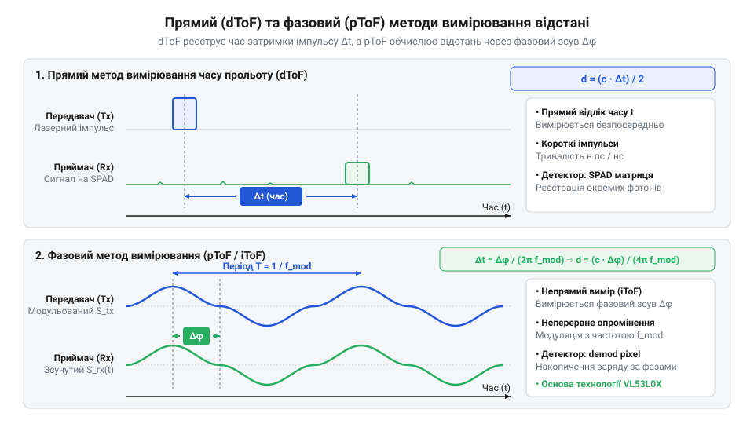
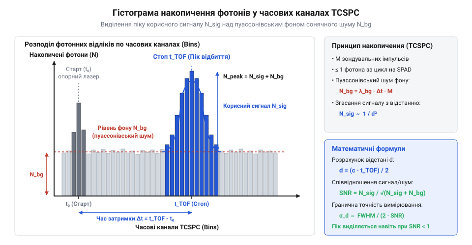
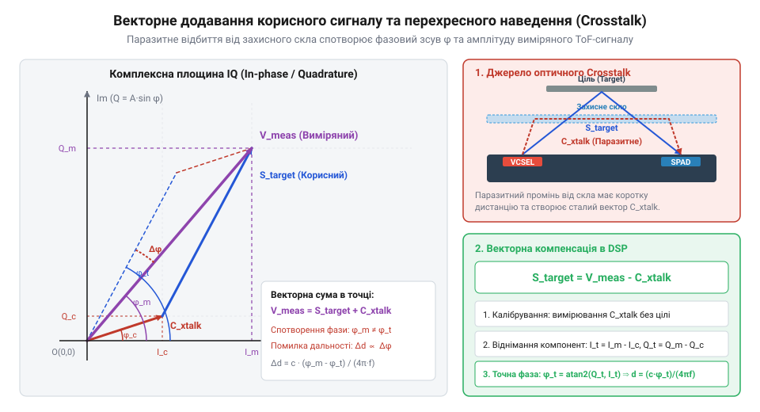

# Математичні моделі ToF-вимірювання, статистична обробка та компенсація завад

<preknowlist>
- [TOF10120 — лазерний далекомір (ToF, до ~180 см)](root:cat-hw-sensors/tof10120) — фізичні принципи роботи лазерного ToF-випромінювача та базову концепцію вимірювання відстані за часом прольоту світла
- [TOF250 — лазерний далекомір](root:cat-hw-sensors/tof250) — особливості функціонування прецизійних оптичних далекомірів та проблему згасання світлового сигналу на відстані
- [Sharp GP2Y0A21YK0F — ІЧ-далекомір (10–80 см)](root:cat-hw-sensors/sharp-gp2y0a21) — принципи поширення ІЧ-випромінювання та фізичну різницю між амплітудно-триангуляційним та часовим методами вимірювання
</preknowlist>

## Неточність прямого заміру часу прольоту

Вимірювання відстані за допомогою оптичного випромінювання базується на фундаментальній константі — швидкості світла у вакуумі та повітрі `c ≈ 299 792 458 м/с` (або спрощено `3 · 10⁸ м/с`). Коли оптичний випромінювач посилає короткий світловий імпульс у напрямку об'єкта, світло долає відстань до цілі й повертається назад до фотоприймача. Технологія вимірювання цього часового інтервалу називається @@en|Time-of-Flight@@ (від англ. *time* — час, *flight* — політ, скорочено @@en|ToF@@). Проте спроба безпосередньо виміряти цей час за допомогою звичайного лічильника імпульсів стикається з жорсткими фізичними обмеженнями мікроелектроніки.

Для забезпечення практичної точності вимірювання відстані в `1 мм` світловий промінь має пройти сумарний шлях у обидва боки `2 мм` (або `0.002 м`). Необхідна роздільна здатність вимірювача часу `Δt` обчислюється напряму зі співвідношенням відстані та швидкості:

Δt = (2 · Δd) ÷ c
   = (2 · 0.001 м) ÷ (299 792 458 м/с)      [підстановка відстані 1 мм та швидкості світла]
   ≈ 6.671 · 10⁻¹² с                        [обчислення часового інтервалу]

З виведеної формули видно, що для фіксації зміщення об'єкта на кожен міліметр електронна схема повинна реєструвати часові інтервали тривалістю близько `6.67 пікосекунди`. На відміну від [ультразвукових аналогів](root:cat-hw-sensors/hc-sr04), де швидкість звуку становить близько `343 м/с` і кожному міліметру відповідає доступна для мікроконтролерів затримка у `5.8 мікросекунди`, світло поширюється майже у 900 000 разів швидше.

Пряме цифрове вимірювання інтервалу у `6.67 пікосекунди` вимагає від заповнювального генератора тактової частоти `f = 1 ÷ Δt ≈ 150 ГГц`. Створення та інтеграція тактових генераторів надвисоких частот у компактний давач неможлива через колосальне енергоспоживання, тепловиділення та технологічні межі кремнієвих транзисторів. Застосування спеціалізованих схем — часово-цифрових перетворювачів (англ. @@en|Time-to-Digital Converter@@, від англ. *convert* — перетворювати, далі @@en|TDC@@) — дозволяє інтерполювати часові інтервали за допомогою ліній затримки, проте виникає проблема часового тремтіння (англ. @@en|jitter@@, від англ. *jitter* — тремтіння, далі @@en|джиттер@@). Тепловий шум напівпровідників та дрейф живлення створюють @@en|джиттер@@ фронтів сигналу порядку десятків пікосекунд, що перевищує цільовий часовий інтервал вимірювання. Докладніше про принципи побудови ліній затримки та апаратну структуру перетворювачів читайте в описі [архітектури часово-цифрових перетворювачів (TDC)](root:hw-sensing/tdc-architecture).

Окрім обмежень електронного хронометражу, існує хвильова та просторова межа самого оптичного імпульсу. Лазерний світлодіод створює спалах тривалістю `τ ≈ 1–5 наносекунд`. За час тривалості імпульсу у `1 нс` передній фронт світлової хвилі встигає віддалитися від заднього на `30 см` у просторі. Приймальний фотодіод реєструє не розривну математичну точку, а розмиту в часі огинаючу фотонного потоку. Форма цього відгуку змінюється залежно від відбивальної здатності поверхні та кута падіння променя, що призводить до зміщення точки спрацювання порогового компаратора.

Отже, пряма реєстрація часу прольоту поодинокого імпульсу за допомогою одного порогового таймера не здатна забезпечити міліметрову точність у компактних пристроях. Для подолання пікосекундного бар'єра без використання гігагерцових лічильників математика ToF-вимірювань розгалужується на два підходи: фазову модуляцію безперервного оптичного сигналу та статистичне накопичення фотонних відліків у часі.

## Математика прямого та фазового ToF

Формалізація вимірювання відстані в оптичних системах спирається на дві математичні моделі: пряму імпульсну затримку та фазовий зсув модульованої хвилі. В обох випадках вихідними даними є швидкість поширення випромінювання `c` та параметри приймального сигналу.

Пряма модель ToF визначає відстань `d` через виміряний часовий інтервал `Δt = t₁ - t₀` між моментом випромінювання імпульсу `t₀` та моментом його реєстрації приймачем `t₁`:

d = (c · Δt) ÷ 2

Формула містить дільник `2`, оскільки світловий імпульс проходить відстань `d` двічі: від випромінювача до об'єкта та від об'єкта до фотоприймача. Як показано у попередньому аналізі, точність такої моделі прямо залежить від здатності схеми фіксувати дискретні моменти часу `t₀` та `t₁`.

Альтернативний підхід усуває потребу в пікосекундних хронометрах шляхом використання фазової модуляції (від грец. *фаза* — поява, лат. *modulatio* — розміреність, далі @@la|фазова модуляція@@). Випромінювач безперервно модулює інтенсивність світлового потоку гармонійним сигналом із частотою `fₘₒₚ`. Випромінений сигнал описується функцією інтенсивності `s(t) = A₀ + A · sin(2 · π · fₘₒₚ · t)`. Пройшовши відстань `2 · d`, відбитий сигнал повертається із часовою затримкою `Δt = 2 · d ÷ c`, що викликає фазовий зсув `ϕ` відносно опорного генератора.


*Схема порівняння часових діаграм прямого лазерного імпульсу та гармонійно модульованого світлового сигналу з виділенням фазового зсуву φ та часової затримки Δt.*

Математичний зв'язок між фазовим зсувом `ϕ` (у радіанах) та часовою затримкою `Δt` виводиться з циклічної частоти модуляції `ω = 2 · π · fₘₒₚ`:

ϕ = 2 · π · fₘₒₚ · Δt
  = 2 · π · fₘₒₚ · (2 · d ÷ c)             [підстановка часової затримки Δt]
  = (4 · π · fₘₒₚ · d) ÷ c                 [перемноження коефіцієнтів]

Виражаючи шукану відстань `d` через виміряний фазовий зсув `ϕ`, отримуємо базову формулу фазового ToF:

d = (c · ϕ) ÷ (4 · π · fₘₒₚ)

Оскільки фазометричні схеми вимірюють фазу лише в межах одного повного періоду `0 ≤ ϕ < 2 · π`, виникає ефект фазової неоднозначності. Якщо відстань перевищує довжину модульованої хвилі, фаза повертається в початковий стан (`ϕ + 2 · π · k`, де `k ∈ ℤ`). Математична межа однозначності (англ. @@en|unambiguous range@@, від англ. *unambiguous* — однозначний, *range* — діапазон, далі @@en|межа однозначності@@) `dₘ₁ₓ` відповідає максимальному куту `ϕ = 2 · π`:

dₘ₁ₓ = (c · 2 · π) ÷ (4 · π · fₘₒₚ)
     = c ÷ (2 · fₘₒₚ)                      [скорочення спільного множника 2·π]

Розглянемо практичний розрахунок межі однозначності для модуляційної частоти `fₘₒₚ = 50 МГц` (`50 · 10⁶ Гц`):

dₘ₁ₓ = (299 792 458 м/с) ÷ (2 · 50 · 10⁶ Гц)
     = (299 792 458) ÷ (100 · 10⁶)          [перемноження частоти на коефіцієнт 2]
     ≈ 2.998 м                              [обчислення граничної відстані]

Зі зростанням частоти модуляції `fₘₒₚ` зростає чутливість фазового зсуву до зміни відстані (більша зміна `Δϕ` на один міліметр), що підвищує роздільну здатність вимірювання. Проте межа однозначності `dₘ₁ₓ` при цьому пропорційно зменшується. Для подолання цього компромісу [прецизійні оптичні далекоміри](root:cat-hw-sensors/tof250) та серійні давачі на зразок [лазерного далекоміра](root:cat-hw-sensors/tof10120) застосовують вимірювання на декількох модуляційних частотах, що дозволяє обчислювати повну відстань через систему лінійних порівнянь за модулем.

## Пуассонівська статистика SPAD та сонячний шум

На великих відстанях або при низькій відбивальній здатності поверхні оптичний сигнал послаблюється до рівня поодиноких фотонів. Для реєстрації таких слабких сигналів застосовують матриці однофотонних лавинних діодів (англ. @@en|Single-Photon Avalanche Diode@@, від англ. *avalanche* — лавина, далі @@en|SPAD@@). Діод @@en|SPAD@@ працює в гейгерівському режимі: поглинання навіть одного фотона викликає лавинний пробій напівпровідникового p-n переходу та генерує вимірюваний електричний імпульс. Докладніше про фізику лавинного пробою p-n переходу та гейгерівський режим роботи фотоприймачів читайте у матеріалі про [фізику напівпровідникових SPAD-діодів](root:hw-sensing/spad-semiconductor-physics).

Процес реєстрації фотонів фотоприймачем описується ймовірнісною моделлю. Оскільки випромінювання та поглинання поодиноких квантів світла є дискретними незалежними подіями, кількість зареєстрованих фотонів `k` за фіксований часовий інтервал `Δt` підпорядковується розподілу Пуассона (від імені французького математика Симона Дені Пуассона, @@fr|Poisson distribution@@, далі @@fr|розподіл Пуассона@@):

P(k; λ) = (λᵏ · e⁻ˡᵃᵐᵇᵈᵃ) ÷ k!

Тут `λ` — середня кількість фотонів, зареєстрованих сенсором за інтервал `Δt`. Вона пов'язана з інтенсивністю фотонного потоку `μ` (кількість фотонів за секунду) співвідношенням `λ = μ · Δt`.

У реальних умовах на приймальну матрицю @@en|SPAD@@ одночасно потрапляють фотони двох джерел: корисний сигнал від лазера та фонове сонячне або штучне освітлення. Фоновий шум характеризується постійною середньою інтенсивністю `μ_bg`. Корисний сигнал лазера створює сплеск інтенсивності `μ_sig(t)` лише протягом тривалості імпульсу. Сумарна середня кількість фотонів `λ_total` у часовому вікні `[t, t + Δt]` визначається виразом:

λ_total(t) = (μ_sig(t) + μ_bg) · Δt

Для виділення корисного сигналу на тлі сонячного шуму застосовують метод часово-корельованого лічби поодиноких фотонів (англ. @@en|Time-Correlated Single Photon Counting@@, від англ. *correlated* — корельований, далі @@en|TCSPC@@). Пристрій повторює цикл випромінювання лазерного імпульсу десятки тисяч разів на секунду. Після кожного спалаху @@en|TDC@@ вимірює час приходу першого фотона та збільшує лічильник у відповідному осередку (часовому каналі) цифрової гістограми.

Оскільки фонові фотони сонячного світла прибувають випадково й рівномірно в часі, вони формують плоску пуассонівську підкладку по всіх часових каналах гістограми з математичним сподіванням `λ_bg = μ_bg · Δt`. Натомість фотони корисного сигналу відбиваються від цілі й прибувають суворо у конкретний часовий канал `t_target = 2 · d ÷ c`. У результаті накопичення багатьох випромінювань у часовому каналі `t_target` виникає чіткий статистичний пік із середньою інтенсивністю `λ_total = (μ_sig + μ_bg) · Δt`.


*Гістограма накопичення фотонних відліків у часових каналах TCSPC, що ілюструє формування чіткого статистичного піку корисного сигналу над рівномірним пуассонівським фоном сонячного шуму.*

Ймовірність фіксації принаймні одного фотона `P(k ≥ 1)` у часовому вікні `Δt` обчислюється через ймовірність відсутності подій `P(0)`:

P(k ≥ 1) = 1 - P(0; λ)
         = 1 - e⁻ˡᵃᵐᵇᵈᵃ                        [підстановка формули Пуассона для k = 0]

Співвідношення сигнал/шум (англ. @@en|Signal-to-Noise Ratio@@, від англ. *ratio* — співвідношення, далі @@en|SNR@@) виражається як відношення кількості накопичених корисних фотонів `N_sig = N_cycles · μ_sig · Δt` до флуктуацій загального фотонного потоку. Оскільки дисперсія пуассонівського процесу дорівнює його математичному сподіванню, стандартне відхилення (шум) становить `σ = √(N_total)`. Математична формула @@en|SNR@@ для `N_cycles` вимірювальних циклів має вигляд:

SNR = (N_cycles · μ_sig · Δt) ÷ √(N_cycles · (μ_sig + μ_bg) · Δt)
    = (√N_cycles · μ_sig · √Δt) ÷ √(μ_sig + μ_bg)   [скорочення √N_cycles та √Δt]

На відміну від [ІЧ-далекомірів триангуляційного типу](root:cat-hw-sensors/sharp-gp2y0a21), які вимірюють геометричне зміщення світлової плями аналоговим фотоприймачем і втрачають працездатність при сильному сонячному засвіченні через насичення підсилювачів, статистична накопичувальна матриця @@en|SPAD@@ із часовим гістограмуванням @@en|TCSPC@@ здатна достовірно виявляти об'єкти навіть за умов `μ_bg >> μ_sig`. Збільшення кількості накопичувальних циклів `N_cycles` дозволяє досягти необхідного рівня @@en|SNR@@ за рахунок часової фільтрації шуму.

## Згасання сигналу та гранична точність SNR

Уявіть оптичний далекомір, який бездоганно вимірює відстань до білої стіни на дистанції пів метра, але геть втрачає точність і видає хаотичні покази, коли ціль віддаляється на два метри або змінює колір на темно-сірий. Навіть за ідеально стабільної частоти лазера та відсутності апаратного джиттера приймальний тракт починає відчувати брак фотонів. Головна перешкода для оптичних вимірювань у реальному середовищі полягає у фізичному згасанні випромінювання під час поширення в просторі та розсіюванні від поверхні об'єкта.

Випромінювач далекоміра — напівпровідниковий лазер @@en|VCSEL@@ (від англ. *Vertical-Cavity Surface-Emitting Laser* — лазер із вертикальним резонатором і поверхневим випромінюванням) — випромінює імпульси світла з початковою оптичною потужністю `P_emit`. Досягаючи об'єкта, світловий потік відбивається від його поверхні. Більшість реальних матеріалів поводяться як @@en|Lambertian reflector@@ (названого на честь німецького фізика Йоганна Ламберта, англ. *Lambertian reflector* — дифракційно-розсіяний відбивач), що рівномірно розсіює світло у напівсферу з тілесним кутом `2 × π` стерадіан. Вторинна хвиля поширюється у зворотному напрямку, формуючи сферичний фронт. Площа цього фронту зростає пропорційно квадрату відстані `d²`, через що приймальна апертура давача площею `A_rx` вловлює лише крихітну частку фотонів.

Кількість корисних фотонів `N_sig`, зареєстрованих матрицею діодів за час інтегрування `T_int`, описується законом зворотних квадратів:

```
N_sig = (P_emit × T_int ÷ (h × ν)) × ρ × (A_rx ÷ (π × d²)) × η_opt × η_spad
      = k_opt × ρ ÷ d²           [об'єднання оптико-електронних констант у k_opt]
```

У цьому виразі `P_emit` позначає випромінювану оптичну потужність, `T_int` — час накопичення фотонів, `h` — сталу Планка, `ν` — частоту оптичного випромінювання, `ρ` — коефіцієнт відбиття поверхні (від 0 для абсолютно чорного тіла до 1 для ідеального білого відбивача), `A_rx` — площу приймальної лінзи, `η_opt` — оптичний коефіцієнт корисної дії світлофільтра, `η_spad` — квантову ефективність матриці діодів, а `k_opt` — узагальнений оптичний коефіцієнт системи.

Якщо відстань `d` збільшується вдвічі, кількість фотонів `N_sig` зменшується в чотири рази. Для віддалених об'єктів у [прецизійному далекомірі TOF250](root:cat-hw-sensors/tof250) це згасання стає головним фізичним обмеженням.

Окрім корисного лазерного сигналу, на приймальну лінзу постійно потрапляє фонове сонячне або штучне освітлення. Воно створює паразитивний світловий потік `E_bg`, який генерує випадкові фотонні відліки `N_bg = E_bg × A_rx × η_opt × η_spad × T_int`. На відміну від акустичних систем, як-от [ультразвуковий далекомір HC-SR04](root:cat-hw-sensors/hc-sr04), оптичні давачі безперервно приймають шум навіть під час пауз між випромінювальними імпульсами.

Оскільки реєстрація фотонів підпорядковується пуассонівській статистиці, середньоквадратичне відхилення (шум) кожної складової дорівнює квадратному кореню з її математичного очікування. Сумарний флуктуаційний шум обчислюється як `σ_noise = √(N_sig + N_bg)`. Завдяки цьому співвідношення сигнал/шум @@en|SNR@@ (від англ. *Signal-to-Noise Ratio* — співвідношення сигнал/шум) набуває вигляду:

```
SNR = N_sig ÷ √(N_sig + N_bg)
    = (k_opt × ρ ÷ d²) ÷ √((k_opt × ρ ÷ d²) + N_bg)
```

У фазових ToF-системах невизначеність виміряної фази `σ_φ` (у радіанах) обернено пропорційна співвідношенню сигнал/шум: `σ_φ = 1 ÷ SNR`. Оскільки відстань обчислюється через фазу як `d = (c ÷ (4 × π × f_mod)) × φ`, математичне очікування середньоквадратичної похибки вимірювання відстані `σ_d` виводиться наступним чином:

```
σ_d = (c ÷ (4 × π × f_mod)) × σ_φ
    = (c ÷ (4 × π × f_mod)) × (1 ÷ SNR)          [підстановка σ_φ = 1 / SNR]
    = (c × √(N_sig + N_bg)) ÷ (4 × π × f_mod × N_sig) [підстановка виразу SNR]
```

Де `c` — швидкість світла у вакуумі (`3.0 × 10⁸` м/с), а `f_mod` — частота амплітудної модуляції лазера.

Для оцінки граничної точності розрахуємо конкретний приклад.

**Розрахунок граничної точності ToF-далекоміра на відстані 1.5 метра**

Нехай частота модуляції лазера `f_mod = 30` МГц, кількість зареєстрованих фотонів від цілі `N_sig = 400`, а фоновий шум становить `N_bg = 1200` фотонів.

```
SNR = N_sig ÷ √(N_sig + N_bg)
    = 400 ÷ √(400 + 1200)               [підстановка кількості фотонів]
    = 400 ÷ √1600                       [обчислення підкореневої суми]
    = 400 ÷ 40                          [добування квадратного кореня]
    = 10                                [значення співвідношення сигнал/шум]

σ_d = c ÷ (4 × π × f_mod × SNR)
    = (3.0 × 10⁸) ÷ (4 × 3.14159 × 30 × 10⁶ × 10) [підстановка швидкості світла, частоти та SNR]
    = (3.0 × 10⁸) ÷ (3.7699 × 10⁹)      [перемноження знаменника]
    ≈ 0.07957 м                         [розрахунок у метрах]
    ≈ 79.6 мм                           [переведення в міліметри]
```

Розрахунок показує, що за сильного фонового освітлення флуктуаційна похибка вимірювання становить `79.6` мм. Якщо ж повністю усунути фоновий шум (`N_bg = 0`), співвідношення `SNR` зросте до `√400 = 20`, а похибка зменшиться вдвічі — до `39.8` мм.

Зовнішній світловий шум знівелювати простіше за допомогою оптичних фільтрів, проте найбільша системна проблема виникає всередині самого пристрою при його інкапсуляції в корпус із захисним склом.

## Модель паразитного перехросного наведення та зсуву

Коли розробник інтегрує далекомір у кінцевий корпус пристрою і закриває оптичні вікна випромінювача та приймача захисним склом, прилад раптово починає вимірювати неіснуючі відстані. Навіть у суцільній темряві, коли зовнішнє тлове освітлення дорівнює нулю, далекомір показує відстань у кілька сантиметрів замість кількох метрів до реальної стіни. Причина полягає в тому, що частина випромінених світлових фотонів відбивається від внутрішньої та зовнішньої поверхонь захисного скла безпосередньо у приймальну апертуру діодної матриці.

Цей ефект називається @@en|crosstalk@@ (від англ. *cross* — перехресний та *talk* — наведення/зв'язок — паразитне оптичне перехресне наведення). На відміну від простих аналогових систем, таких як [ІЧ-далекомір Sharp GP2Y0A21YK0F](root:cat-hw-sensors/sharp-gp2y0a21), які вимірюють лише амплітуду світлової плями, фазовий ToF-далекомір обробляє світло як високочастотну хвилю. Паразитне відбиття від скла накладається на корисне відбиття від цілі за законами векторного додавання на комплексній площині.

При квадратурній демодуляції (@@en|quadrature demodulation@@, від лат. *quadratura* — надання квадратної форми та англ. *demodulation* — відновлення сигналу) приймач вимірює дві ортогональні складові оптичного сигналу: синфазну `I` (@@en|in-phase@@) та квадратурну `Q` (@@en|quadrature@@). На комплексній площині виміряний вектор `S_meas` є сумою вектора корисного сигналу `S_target` та стаціонарного вектора паразитного наведення `S_cross`:

```
I_meas = A_sig × cos(φ_target) + A_cross × cos(φ_cross)
Q_meas = A_sig × sin(φ_target) + A_cross × sin(φ_cross)
```

Де `A_sig` та `φ_target` — амплітуда й фаза хвилі, що повернулася від об'єкта, а `A_cross` та `φ_cross` — амплітуда й фаза паразитного відбиття від захисного скла. Оскільки захисне скло розташоване на фіксованій відстані від кристала (зазвичай `1–3` мм), фаза `φ_cross` є постійною і практично дорівнює нулю.


*Векторне додавання корисного оптичного сигналу від цілі та паразитного наведення від захисного скла на комплексній площині, що ілюструє спотворення виміряної фази та амплітуди.*

Обчислення фази підсумкового виміряного вектора `φ_meas` виконується через арктангенс відношення квадратурних компонент:

```
φ_meas = arctan(Q_meas ÷ I_meas)
       = arctan((A_sig × sin(φ_target) + A_cross × sin(φ_cross)) ÷ (A_sig × cos(φ_target) + A_cross × cos(φ_cross)))
```

З цієї формули чітко видно спотворення вимірювань:
- Коли ціль розташована близько, корисний сигнал `A_sig` значно перевищує заваду `A_cross`, і виміряна фаза `φ_meas` практично дорівнює істинній фазі `φ_target`. - Коли ціль віддаляється, амплітуда `A_sig` стрімко згасає за законом `1 ÷ d²`. На великих відстанях `A_sig` стає меншим за `A_cross`. Сумарний вектор `S_meas` повертається в бік вектора завади `S_cross`, і далекомір замість відстані до об'єкта починає показувати відстань до захисного скла.

Окрім векторного спотворення фази через `crosstalk`, у ToF-системах існує постійна лінійна похибка — @@en|offset@@ (від англ. *off* — геть та *set* — встановлення — постійний лінійний зсув). Вона спричинена системними часовими затримками: затримкою поширення сигналу в драйвері лазера, часом лавинного розгону SPAD-діода, затримками в лініях часово-цифрового перетворювача та зміщенням геометричного нуля пристрою.

Математична модель невідкаліброваного вимірювання відстані `d_raw` враховує обидва джерела похибок:

```
d_raw = (c ÷ (4 × π × f_mod)) × φ_meas + d_offset
```

Розуміння цієї векторної структури спотворень дає змогу побудувати математичний апарат програмного калібрування давача.

## Калібрування та обчислення поправкових коефіцієнтів

Оскільки оптичне перехресне наведення та внутрішні затримки неминуче спотворюють покази розпаяного в корпус давача, єдиним способом відновлення істинного значення відстані є математична корекція сигнатурних векторів у прошивці мікроконтролера. Замість намагання механічно прибрати скло чи вгадувати похибку табличними зсувами, ми виконуємо серію еталонних вимірювань для розрахунку поправкової матриці компенсації.

Калібрування виконується у два послідовні етапи: вимірювання вектора `crosstalk` та розрахунок лінійного зсуву `offset`.

На першому етапі необхідно повністю усунути корисний сигнал від цілі (`A_sig = 0`). Для цього далекомір спрямовують у світлопоглинаючу пастку (або на абсолютно чорне тіло з `ρ ≈ 0` на великій відстані) в темній камері із встановленим захисним склом. Оскільки `A_sig = 0`, отримані квадратурні складові `I_meas` та `Q_meas` є чистими значеннями завади від скла:

```
I_cross = I_meas_cal1
Q_cross = Q_meas_cal1
```

Ці два коефіцієнти записуються в неенергонезалежну пам'ять @@en|NVM@@ (від англ. *Non-Volatile Memory* — неенергонезалежна пам'ять) мікроконтролера. Під час робочих вимірювань драйвер виконує векторне віднімання завади від кожного нового виміряного кадру:

```
I_target = I_meas - I_cross
Q_target = Q_meas - Q_cross
```

Відновлена фаза корисного сигналу `φ_target` обчислюється за формулою:

```
φ_target = arctan(Q_target ÷ I_target)
```

На другому етапі обчислюється постійний зсув `d_offset`. Для цього після застосування компенсації `crosstalk` давач спрямовують на білу еталонну мішень (`ρ = 0.85`) на точній фіксованій відстані `d_ref` (наприклад, `100` мм). Драйвер обчислює скориговану за фазою відстань `d_uncorrected = (c ÷ (4 × π × f_mod)) × φ_target` і визначає лінійний зсув:

```
d_offset = d_uncorrected - d_ref
```

Повний математичний конвеєр відновлення істинної відстані описується матричним рівнянням компенсації:

```
[ I_target ]   [ 1   0 ]   [ I_meas ]   [ I_cross ]
[          ] = [       ] × [        ] - [         ]
[ Q_target ]   [ 0   1 ]   [ Q_meas ]   [ Q_cross ]

φ_true = arctan(Q_target ÷ I_target)

d_final = (c ÷ (4 × π × f_mod)) × φ_true - d_offset
```

У готових модулях, таких як [лазерному далекомірі TOF10120](root:cat-hw-sensors/tof10120), первинне калібрування виконується на заводі, проте при встановленні власного захисного скла цей математичний апарат реалізується в прошивці головного контролера.

Розглянемо практичну реалізацію алгоритму компенсації в коді.

:::tabs
:::code math-tof-distance-and-calibration/c/esp-idf/tof-calculate-true-distance.c
:::code math-tof-distance-and-calibration/cpp/arduino/tofcalibparams.cpp
:::

Математична компенсація перехресного наведення та лінійного зсуву закриває повний цикл обробки даних у ToF-системах, перетворюючи зашумлені фазові відліки матриці діодів на точні фізичні вимірювання відстані.