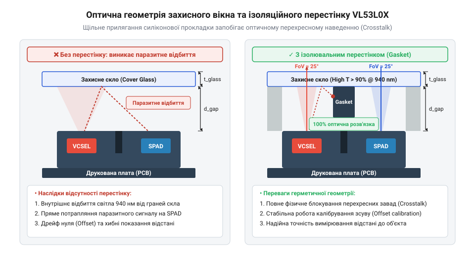
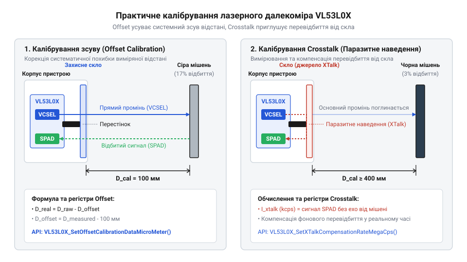

# Конструювання оптичного вікна та процедура системного калібрування

<preknowlist>
- [TOF10120 — лазерний далекомір (ToF, до ~180 см)](root:cat-hw-sensors/tof10120) — Базові принципи вимірювання відстані методом часу польоту світла (ToF) та функціонування оптичних каналів випромінювання й приймання.
</preknowlist>

## Спотворення вимірювань після корпусування давача

Коли ви берете макет із розробки, де відкритий лазерний далекомір @@en|VL53L0X@@ чудово вимірює відстань до цілі, і намагаєтесь вставити його в закритий пластиковий корпус із захисним склом, ви раптом стикаєтесь із повною відмовою системи або повним хаосом у вимірюваннях. Навіть ідеально чисте прозоре скло перетворюється на джерело серйозних оптичних завад, оскільки частина випромінювання напівпровідникового лазера @@en|VCSEL@@ відбивається від його передньої та задньої поверхонь. Це відбите світло в обхід реальної цілі повертається назад у приймальну матрицю @@en|SPAD@@, створюючи потужний паразитивний сигнал, який повністю заглушує слабкі фотони віддаленого об'єкта.

Захисне скло стає дзеркалом для ближнього інфрачервоного випромінювання, через що давач починає фіксувати хибно коротку відстань, сприймаючи власне відбите світло за перешкоду. Оптичний вузол давача вимагає повного розуміння того, як світло поширюється всередині замкнутого простору між кристалом та захисним бар'єром. Весь подальший опис побудований так, щоб розкрити цей механізм і показати шлях до чистого сигналу. На схемі нижче наведено структуру такого вузла з оптичним перестінком.



Поперечний розріз оптичного вузла давача VL53L0X із захисним склом та силіконовим перестінком демонструє шляхи поширення інфрачервоних променів та виникнення паразитного відбиття.

Коли випромінювач @@en|VCSEL@@ випускає світловий імпульс, частина його фотонів неминуче зустрічає передню та задню поверхні захисного скла корпусу, де за законами оптики частково відбивається назад всередину пристрою. Оскільки захисне скло розташоване в безпосередній близькості від кремнієвого кристала далекоміра, ці паразитні фотони повертаються на приймальну матрицю @@en|SPAD@@ надзвичайно швидко — задовго до того, як імпульс встигне вийти назовні, досягти реальної цілі та повернутися назад. Внаслідок цього внутрішнього відбиття приймач реєструє потужний передчасний сигнал, який маскує слабкі відлуння віддалених об'єктів і змушує далекомір хибно звітувати про мінімальну або нульову дистанцію до перешкоди. Для детального розуміння природи та способів мінімізації паразитної засвітки зверніться до матеріалу про [коригування перехресного наведення](root:cat-hw-sensors/crosstalk-compensation). Перед початком програмної компенсації варто ознайомитися з процедурою виконання [калібрування зсуву вимірювань](root:cat-hw-sensors/vl53l0x-hardware).

## Геометрія зазору та оптичного перестінку

Щойно лазерний далекомір інтегрується в корпус пристрою, інженер зіштовхується з тим, що вимірювання стають хибними або впираються у хибну максимальну відстань, навіть за відсутності перешкод попереду. Причина криється у внутрішньому відбитті світла від захисного вікна назад у приймач, що створює потужну перешкоду. Щоб усунути цей ефект, недостатньо просто закрити мікросхему склом — необхідно ретельно розрахувати повітряний зазор між кристалом та захисною поверхнею, спираючись на кут огляду випромінювача.

Якщо повітряний зазор зробити занадто великим, конус розходження світла від випромінювача встигне охопити значну площу захисного скла. Частина цього світла неминуче відіб'ється від внутрішньої та зовнішньої поверхонь скла прямо в приймальну матрицю, створюючи багаторазово посилене паразитне перехресне наведення @@en|crosstalk@@. Щоб світло від випромінювача не потрапляло в приймач в обхід зовнішнього середовища, максимальна товщина повітряного зазору обмежується геометричними розмірами активної площі та кутом конуса огляду @@en|FoV@@, який для давача становить 25°.

Розрахунок максимального повітряного зазору базується на геометрії розходження променя та необхідності рознести оптичні шляхи випромінювача і приймача на захисному склі. Нехай ширина активної зони випромінювача дорівнює `d`, а відстань між центрами випромінювача VCSEL та приймача SPAD становить `s`. Тоді максимальна висота повітряного зазору `h`, за якої конуси світла від сусідніх елементів не перекриваються на внутрішній поверхні скла до досягнення критичного кута відбиття, визначається через тангенс кута половинного розходження променя:

```
h = (s - d) / (2 × tan(FoV / 2))
= (s - d) / (2 × tan(12.5°))
= 3.7 мм [гранична висота повітряного зазору без перестінку]
```

З наведеного виразу видно, що збільшення повітряного зазору понад розрахункове значення різко збільшує пляму засвітки на склі, що перевантажує приймач відбитими фотонами.

Окрім повітряного зазору, критично важливою є фізична ізоляція каналів за допомогою спеціальної еластичної прокладки або силіконового перестінку — gasket, який герметично прилягає до поверхні мікросхеми та внутрішнього боку скла. Цей перестінок повністю блокує бокове просочування світла всередині корпусу, не дозволяючи променям від випромінювача перетікати на приймальну матрицю в обхід зовнішнього середовища. Правильно спроєктована геометрія gasket запобігає зрізанню робочого кута огляду та гарантує, що приймач бачитиме лише простір назовні. Як описано в матеріалах про [апаратну структуру та принципову схему далекоміра VL53L0X](root:cat-hw-sensors/vl53l0x-hardware), відсутність щільного прилягання перестінку робить подальше програмне калібрування неможливим через нестабільність оптичного зв'язку.

У цьому розділі розкрито фізичні причини виникнення внутрішнього перехресного наведення через повітряний зазор і захисне скло, наведено методику розрахунку максимальної висоти зазору за кутом розходження FoV, а також обґрунтовано роль герметичного силіконового перестінку (gasket) для оптичної розв'язки каналів VCSEL і SPAD.

## Матеріали та покриття захисного скла

Після того як геометрія зазору та захисного перестінку визначена, наступає черга вибору оптичного матеріалу для самого захисного вікна. Звичайне будівельне скло або дешевий прозорий акрил є непридатними, оскільки вони поглинають або неконтрольовано розсіюють інфрачервоне випромінювання на довжині хвилі 940 нм, спотворюючи результати вимірювань. Для стабільної роботи пристрою застосовують спеціальний оптичний пластик на основі поліметилметакрилату @@en|PMMA@@ зі спеціальними добавками або забарвлене в масі інфрачервоне скло, яке візуально здається чорним, але має високе пропускання в робочому діапазоні далекоміра.

Навіть найкращий матеріал відбиває кілька відсотків світла на кожній поверхні через різницю показників заломлення повітря та скла, тому на поверхню захисного вікна обов'язково наносять просвітлювальне покриття @@en|AR-coating@@. Таке покриття деструктивно інтерферує з відбитими хвилями, знижуючи початковий коефіцієнт відбиття на довжині хвилі 940 нм до мінімальних значень. Завдяки цьому кількість світла, що повертається всередину корпусу, зменшується на порядки, що полегшує подальшу програмну компенсацію.

## Процедура системного калібрування далекоміра

Маючи зібраний корпус із захисним склом, прозорими каналами та ізолювальним перестінком, ми не можемо одразу отримати абсолютно точні значення відстані. Навіть найкраще просвітлювальне покриття @@en|AR-coating@@ та ідеальний силіконовий @@en|gasket@@ залишають мінімальне паразитне відбиття, а геометричні допуски збирання створюють постійний початковий зсув вимірювань. Щоб усунути ці похибки, лазерний далекомір @@en|VL53L0X@@ вимагає обов'язкової двоетапної процедури калібрування в реальних умовах збирання. Цей процес дозволяє програмно компенсувати як внутрішні перехресні наведення, так і сталий зсув відстані.

На першому етапі проводиться калібрування зсуву або @@en|offset calibration@@, яке компенсує затримку поширення світла в самій схемі та початковий механічний зсув корпусу. Для цього пристрій встановлюють на точній фіксованій відстані — зазвичай рівно 100 міліметрів — перед абсолютно білою мішенню з відомим коефіцієнтом відбиття світла. На схемі нижче наведено практичний стенд для проведення обох етапів калібрування.



Схема практичних стендів для калібрування зсуву та перехресного наведення VL53L0X демонструє розташування давача відносно білої та сірої мішеней для точного визначення похибок.

Програмне забезпечення давача робить серію вимірювань у цьому положенні, порівнює отримане значення з реальною еталонною відстанню та обчислює системну поправку зсуву за таким виразом:

```
Offset_Correction = Target_Distance - Measured_Distance
= 100 - 94
= +6 [обчислення поправки зсуву для калібрування на відстані 100 мм]
```

Отриманий чисельний результат записується у спеціальний регістр зсуву, після чого всі подальші вимірювання автоматично коригуються на це значення.

Другим критичним етапом є калібрування перехресного наведення або @@en|crosstalk calibration@@, яке усуває вплив світла, що відбивається від захисного скла всередині самого пристрою. Оскільки повністю позбутися відбиття всередині @@en|PMMA@@ неможливо, частина фотонів від напівпровідникового лазера @@en|VCSEL@@ неминуче потрапляє на приймальну матрицю @@en|SPAD@@ в обхід зовнішнього простору. Для вимірювання цього паразитного потоку давач спрямовують на спеціальну темно-сіру мішень із дуже низьким коефіцієнтом відбиття, розташовану на чітко заданій віддалі, наприклад 400 міліметрів.

Оскільки реальний відбитий сигнал від такої темної мішені надзвичайно слабкий, увесь виміряний фотонний потік вище очікуваного рівня сприймається як паразитна засвітка. Давач обчислює швидкість перехресного відбиття за допомогою внутрішніх алгоритмів API, визначаючи кількість відбитих від скла фотонів за секунду. Значення @@en|crosstalk rate@@ зберігається в пам'яті та використовується мікроконтролером для щосекундного віднімання паразитного сигналу під час реальних вимірювань на будь-яких відстанях.

## Збереження та застосування калібрувальних параметрів

Отримані в результаті калібрування чисельні коефіцієнти зсуву та перехресного наведення є унікальними для кожного конкретного екземпляра пристрою через мікроскопічні відхилення товщини скла та збирання корпусу. Якщо ці дані залишати лише в оперативній пам'яті мікроконтролера, вони зникнуть одразу після вимкнення живлення, що зробить кожне нове увімкнення непридатним для точних вимірювань. Щоб пристрій був готовим до роботи одразу після подачі живлення, розробник мусить надійно зберегти ці параметри в енергонезалежній пам'яті мікроконтролера, наприклад у внутрішній @@en|Flash@@-пам'яті або збереженому просторі @@en|EEPROM@@ / @@en|NVS@@.

Процес інтеграції калібрувальних даних у прошивку мікроконтролера полягає у зчитуванні збережених значень під час старту системи та їх записі у відповідні апаратні регістри @@en|VL53L0X@@ через інтерфейс @@en|I2C@@. Нижче наведено приклад коду на мовах C та C++ для платформ ESP-IDF та Arduino, який демонструє ініціалізацію давача та завантаження раніше збережених коефіцієнтів із пам'яті.

:::tabs
:::code proj-vl53l0x-encapsulation-calibration/c/esp-idf/vl53l0x-load-calibration-data.c
:::code proj-vl53l0x-encapsulation-calibration/cpp/arduino/calibrationdata.cpp
:::

Цей програмний алгоритм гарантує, що пристрій не потребує ручного повторного калібрування після кожного перезавантаження чи оновлення живлення в умовах серійного виробництва. Завдяки автоматичному завантаженню параметрів із @@en|NVS@@ у регістри давача, кожен зібраний прилад одразу забезпечує високу точність вимірювання відстані через захисне скло.