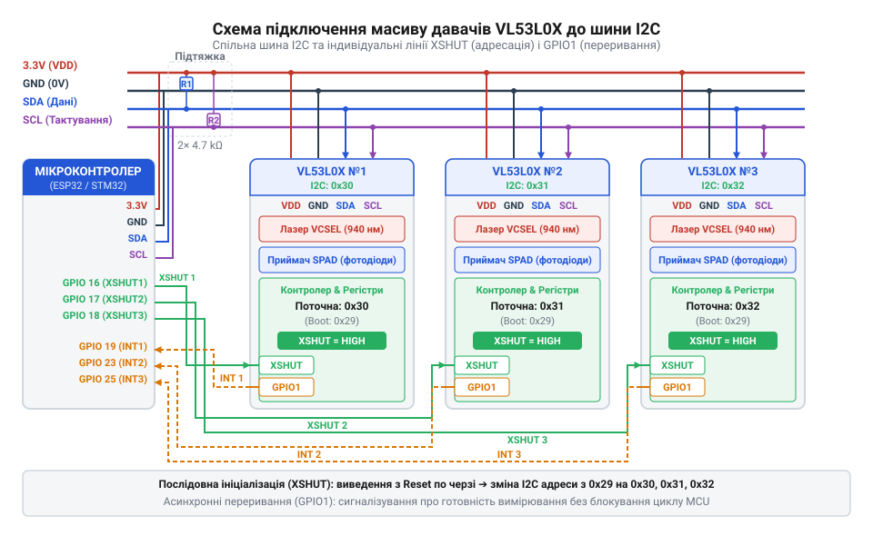
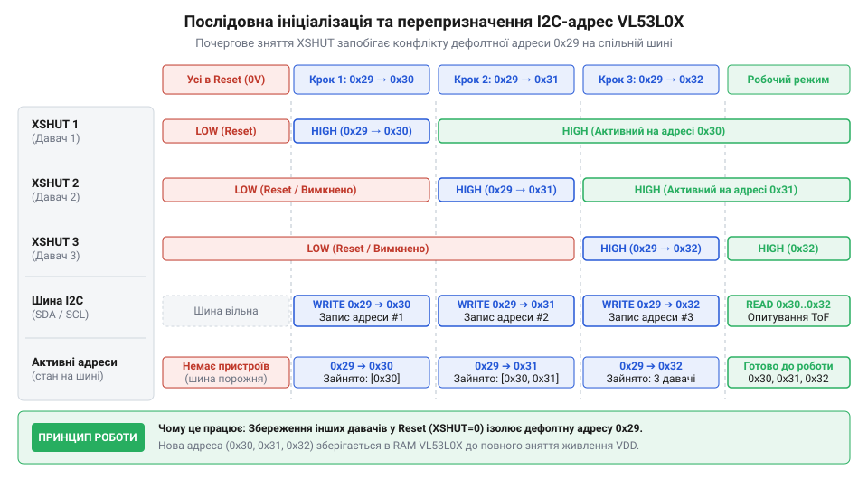

# Практична реалізація масиву ToF-давачів на єдиній шині I2C

<preknowlist>
- [TOF10120 — лазерний далекомір (ToF, до ~180 см)](root:cat-hw-sensors/tof10120) — фізичні принципи вимірювання відстані Time-of-Flight та особливості обміну даними через шину I2C в оптичних далекомірах
- [HC-SR04 — ультразвуковий далекомір](root:cat-hw-sensors/hc-sr04) — проблемні аспекти акустичного перехресного завадання та порівняльні вимоги до часових інтервалів опитування далекомірів у просторових масивах
</preknowlist>

## Конфлікт шини при підключенні ToF-давачів

Паралельне підключення кількох лазерних далекомірів VL53L0X на єдину апаратну шину I2C неминуче призводить до системного конфлікту адрес та повної втрати зв'язку. Після подачі живлення кожен окремий датчик ініціалізує власний внутрішній контролер із замовчуваною фабричною 7-бітною адресою `0x29` (або 8-бітною `0x52` з урахуванням біта читання/запису). 

Фізичною основою колізії є схемотехніка шини I2C, яка використовує лінії з відкритим стоком (Open-Drain) та підтягувальні резистори (Pull-up resistors, зазвичай від 2.2 кОм до 10 кОм до лінії живлення 3.3V). Коли хост-мікроконтролер надсилає стартовий байт звернення до адреси `0x29`, усі підключені далекоміри сприймають запит як призначений їм. У відповідь на старті транзакції кожен із датчиків намагається виставити сигнал підтвердження (ACK), притягуючи лінію даних SDA до низького рівня (0V). 

Оскільки датчики мають різні внутрішні вихідні транзистори та різну довжину провідників, одночасне притягнення лінії до землі кількома пристроями не призводить до критичного короткого замикання в сенсі руйнування кремнію, але спричиняє непередбачувані перехідні процеси, спотворення фронтів та збій арбітражу бітів. Найголовніше: під час подальшої передачі даних або читання результатів мікроконтролер намагається читати з адреси `0x29`, а в цей час усі датчики одночасно виводять на шину SDA свої бітові потоки. Накладення кількох потоків даних у режимі монтажного АБО (Wired-AND) спотворює біти, викликає помилку контролю парності або NACK від хоста, апаратне зависання контролера I2C у мікроконтролері та повну відсутність валідного обміну.

Оскільки мікросхема VL53L0X не має виведених назовні апаратних пінів вибору адреси (як-от ADR0/ADR1 у багатьох сенсорах температури чи акселерометрах), усі пристрої стартують із єдиною фіксованою адресою в NVM ROM. Це зумовлює неминучу потребу в апаратній ізоляції через лінії XSHUT та наступному динамічному перепризначенні адрес під час ініціалізації масиву.

## Апаратна ізоляція та керування через XSHUT

Для вирішення проблеми адресної колізії кожен датчик VL53L0X оснащений спеціальним апаратним виводом `XSHUT` (Shutdown). Цей пін керує внутрішнім станом схем живлення і скидання чипа: коли на `XSHUT` подається низький рівень (`0V`), датчик перебуває в стані глибокого апаратного сну (Hardware Standby / Reset), його внутрішні тактові генератори зупинені, а I2C-трансивер повністю відключений від спільної шини (перебуває у високому імпедансі) і не створює жодних перешкод чи колізій для інших пристроїв. Подача високого рівня (`3.3V`) виводить чип зі стану скидання, після чого він завантажує внутрішній мікрокод із вбудованої пам'яті та стає доступним за стандартною адресою `0x29`.

Схемотехнічно підключення масиву ToF-давачів реалізується таким чином, що лінії `XSHUT` кожного окремого датчика заведені на виділені цифрові виводи хост-мікроконтролера, тоді як лінії даних `SDA` та тактування `SCL` об'єднані паралельно на єдину шину I2C із підтягувальними резисторами до лінії живлення `3.3V`. Для наочності топології з'єднань та розведення сигналів готовності перегляньте схему: .

## Покрокова ініціалізація та динамічне адресування

Маючи апаратну можливість ізолювати датчики через лінії `XSHUT`, прошивка мікроконтролера реалізує алгоритм каскадної ініціалізації масиву. Процедура починається з того, що мікроконтролер примусово переводить усі лінії `XSHUT` у низький стан, вимикаючи весь масив. Потім по черзі (один за одним) кожен датчик розконсервується шляхом підняття його лінії `XSHUT` у високий рівень, витримується час завантаження мікрокоду (`t_boot ≥ 1.2 мс`), після чого здійснюється запис нової унікальної 7-бітної адреси у спеціальний регістр перепризначення `VL53L0X_REG_I2C_SLAVE_DEVICE_ADDRESS` (`0x8A`). Оскільки за замовчуванням усі пристрої після подачі живлення відгукуються на стандартну базову адресу `0x29`, почергове увімкнення дозволяє уникнути будь-яких колізій на загальній двопровідній шині. Зміна значення у регістрі `0x8A` миттєво переносить поточний сенсор у призначений діапазон (наприклад, від `0x30` до `0x3F`), після чого наступний датчик може бути безпечно активований без ризику перехоплення команд сусідами. Увесь процес супроводжується обов'язковою верифікацією ідентифікатора моделі через регістр `0xC0` (`Model ID`), що гарантує надійність апаратного підключення перед переходом до конфігурації SPAD-матриці та запуску безперервних вимірювань.

Оскільки датчик на цей момент слухає лише стандартну адресу `0x29`, запис нової адреси (наприклад, `0x30`, `0x31`, `0x32` або `0x33`) миттєво змінює його ідентифікатор на шині, не зачіпаючи інші вимкнені пристрої. Після успішного перепризначення першого датчика мікроконтролер розконсервує другий датчик (який знову з'являється на шині зі стандартною адресою `0x29`) і призначає йому наступну унікальну адресу. Цей послідовний процес триває доти, доки всі давачі масиву не отримають унікальні адреси та не будуть готові до паралельної роботи. Часову послідовність цього процесу ілюструє діаграма: .

## Асинхронна обробка готовності через переривання GPIO1

Коли кілька далекомірів успішно ініціалізовані та переведені в режим безперервного вимірювання (Continuous Ranging), хост-мікроконтролер стикається з проблемою організації циклу опитування. Просте періодичне зчитування регістрів дистанції по шині I2C у нескінченному циклі (блокуюче опитування або polling) призводить до величезних витрат процесорного часу. Швидкість обміну по I2C навіть на частоті 400 кГц є обмеженою, а самі датчики виконують черговий оптичний замір дещо довше, ніж триває одна коротка транзакція. У результаті процесор марно витрачає такти на очікування готовності даних або зчитує застарілі чи повторювані значення.

Щоб уникнути цього навантаження, кожен датчик VL53L0X має спеціальний апаратний вихід готовності даних — `GPIO1` (також відомий як `INT`). Під час ініціалізації пристрою цей вихід конфігурується у режим переривання закінчення вимірювання. Щойно внутрішній оптичний модуль завершує обчислення дистанції та оновлює вихідні регістри, на лінії `GPIO1` формується активний перепад рівня (зазвичай спадний імпульс), який підключається до лінії зовнішніх переривань мікроконтролера (`EXTI`).

Апаратна підсистема переривань (`EXTI`) миттєво фіксує імпульс від конкретного датчика, зупиняючи поточне виконання програми для мінімально необхідного обробітку. У процедурі обробника переривання (ISR) категорично заборонено виконувати довгі транзакції по шині I2C, оскільки це блокує інші переривання та порушує детермінізм системи. Тому завдання ISR зводиться до двох швидких операцій: встановлення атомарного прапорця події для конкретного датчика та збереження ідентифікатора у внутрішню кільцеву чергу (ring buffer) подій. 

У головному циклі програми (`superloop`) мікроконтролер не опитує датчики наосліп, а перевіряє наявність нових подій у кільцевому буфері за допомогою функції `exti_pop_pending_sensor()`. Якщо черга містить запис, хост виконує швидку адресну транзакцію I2C для зчитування 12-байтового блока результатів, починаючи з регістру `0x14` (`RESULT_RANGE_STATUS`), де міститься як статус якості вимірювання, так і два байти самої дистанції (`0x28` / `0x29`). Це переводить систему на подієво-орієнтовану модель (event-driven architecture), де обмін даними відбувається лише тоді, коли дані реально готові.

## Архітектура неблокуючого конвеєра зчитування дистанцій

Поєднання апаратної ізоляції через лінії `XSHUT`, динамічного перепризначення адрес та асинхронних переривань `GPIO1` дозволяє побудувати високоефективний неблокуючий конвеєр обробки даних масиву ToF-давачів. Робототехнічна платформа, що використовує такий масив (наприклад, для кругового виявлення перешкод або точного позиціювання), потребує стабільної частоти оновлення всіх датчиків без зависань і затримок.

Архітектура драйвера реалізується на основі модульних компонентів. Низькорівневий апаратний шар (`i2c_hal.h`) забезпечує переносимість коду між різними мікроконтролерами за рахунок чіткого розділення функцій запису/читання I2C та керування пінами `GPIO` (`i2c_hal.h`). Шар управління масивом (`vl53l0x_array.h`) інкапсулює контексти кожного датчика, стани кінцевого автомата (`vl53l0x_state_t`), лічильники успішних вимірів та помилок (`vl53l0x_array.h`).

Для забезпечення надійності конвеєра в умовах реального середовища передбачено обробку виняткових ситуацій. Якщо під час асинхронного читання виникає помилка шини I2C (наприклад, через електромагнітні перешкоди від моторів робота) або статус вимірювання (`range_status`) вказує на недійсність даних через відсутність відбитого сигналу, драйвер інкрементує лічильник помилок (`error_count`) замість аварійного зупинення всієї програми. У разі критичного зависання окремого датчика допускається його програмне або апаратне перезавантаження через лінію `XSHUT` без впливу на решту пристроїв спільної шини.

Усі ці механізми втілені як у процедурному стилі мовою C (HAL), так і в об'єктно-орієнтованій парадигмі C++ з використанням класів `VL53L0X_Sensor` та `VL53L0X_Array`, які інкапсулюють роботу з апаратними інтерфейсами та забезпечують зворотні виклики (`callbacks`) для надходження нових вимірів (`main.c`). Такий підхід гарантує частоту оновлення масиву понад 50 Гц при мінімальному завантаженні центрального процесора, завершуючи створення надійної підсистеми просторового орієнтування.

:::tabs
:::code proj-vl53l0x-multi-sensor-bus/c/src/main.c
:::code proj-vl53l0x-multi-sensor-bus/cpp/src/main.cpp
:::