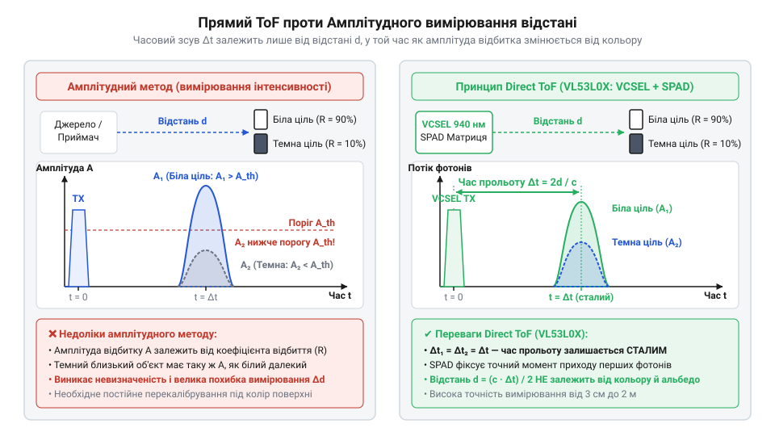
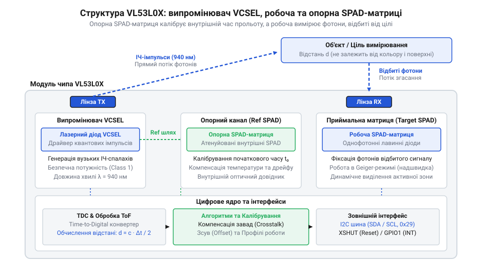
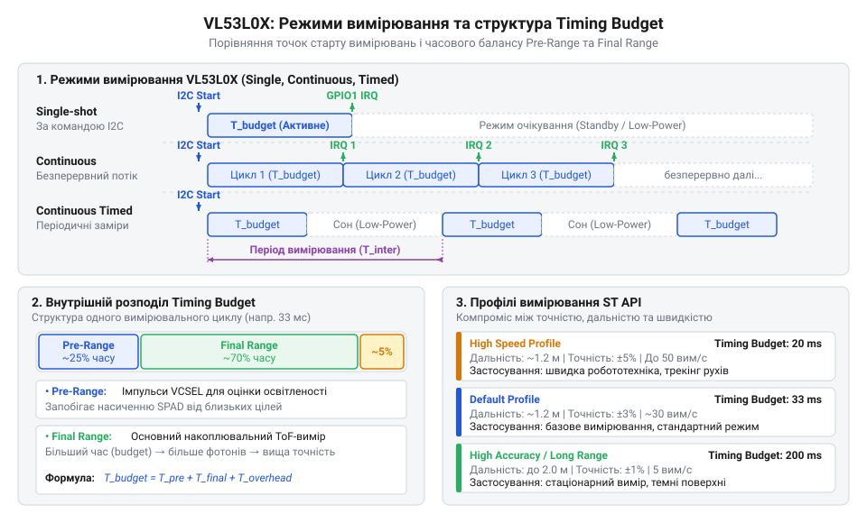
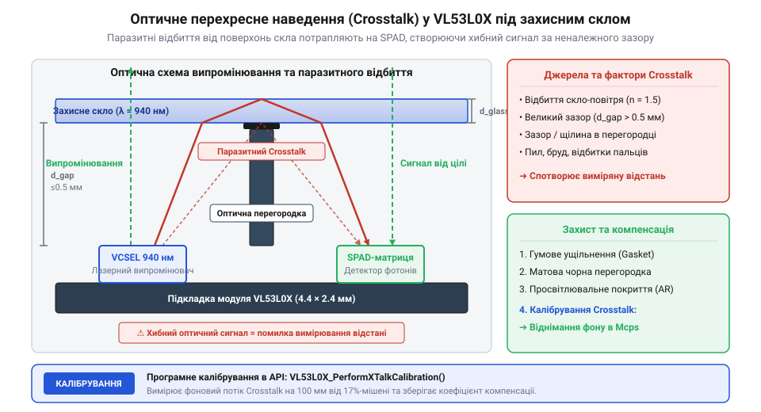
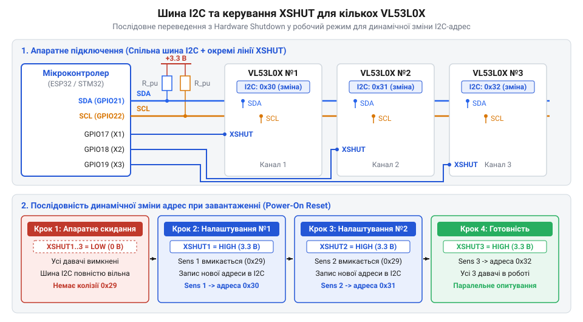
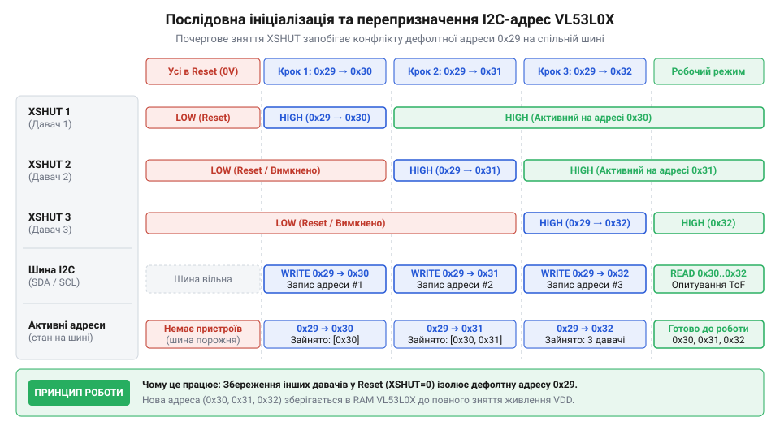

# VL53L0X — лазерний ToF-далекомір (940 нм)

<preknowlist>
- [Sharp GP2Y0A21YK0F — ІЧ-далекомір (10–80 см)](root:cat-hw-sensors/sharp-gp2y0a21) — обмеження оптичних вимірювань відстані за інтенсивністю відбитого світла та залежність амплітуди сигналу від кольору й текстури поверхні
- [HC-SR04 — ультразвуковий далекомір](root:cat-hw-sensors/hc-sr04) — базовий принцип обчислення відстані за часом затримки поширення сигналу у середовищі
- [TOF10120 — лазерний далекомір (ToF, до ~180 см)](root:cat-hw-sensors/tof10120) — загальне уявлення про оптичні ToF-системи ближнього радіуса дії та особливості обміну даними через послідовні інтерфейси
</preknowlist>

## Ненадійність інтенсивності та принцип ToF

Уявіть мобільного робота, який орієнтується у просторі за допомогою простих інфрачервоних сенсорів наближення. Робот випромінює інфрачервоний пучок світла і вимірює яскравість відбитого променя, що повертається на фотодіод. Коли робот наближається до білої стіни, відбитий сигнал виявляється потужним, і контролер розраховує, що до перешкоди лишилося 20 сантиметрів. Але коли перед роботом опиняється крісло з чорного оксамиту або корпус приладу з темного матового пластику на тій самій відстані в 20 сантиметрів, темна поверхня поглинає більшу частину інфрачервоного випромінювання. Фотодіод отримує лише слабкий відблиск і «вирішує», що об'єкт розташований за два метри, внаслідок чого робот на повній швидкості врізається в перешкоду.

Ця фізична пастка виникає тому, що класичні інфрачервоні давноміри, як-от [інфрачервоний давномір Sharp](root:cat-hw-sensors/sharp-gp2y0a21), намагаються визначити дистанцію за амплітудою зчитуваного світлового потоку. Потужність оптичного сигналу `Pᵣ`, яка повертається до фотоприймача, одночасно залежить від двох невідомих величин: геометричної відстані `d` (згідно із законом обернених квадратів) та коефіцієнта відбиття (альбедо) `ρ` самої поверхні:

```
Pᵣ = (Pₜ · Aᵣ · ρ · cos θ) / (π · d²)      [потужність відбитого світлового потоку на фотоприймачі]
```

Тут `Pᵣ` — оптична потужність прийнятого сигналу, `Pₜ` — потужність випромінювача, `Aᵣ` — площа апертури приймача, `ρ` — коефіцієнт відбиття (альбедо) поверхні у діапазоні від `0` (абсолютно чорна поверхня) до `1` (ідеально біла поверхня), `θ` — кут падіння променя відносно нормалі до поверхні, а `d` — відстань від давача до об'єкта. За ламбертівської моделі розсіяння світла кут `θ` додатково знижує амплітуду при похилому падінні променя. Оскільки єдиний вимірюваний аналоговий параметр — фотострум приймача — визначається кількома невідомими змінними (`ρ`, `θ` та `d`), математично неможливо однозначно розрахувати відстань `d`, не знаючи заздалегідь оптичних властивостей матеріалу та геометрії поверхні. Для чорного матеріалу з альбедо `ρ = 0.03` відбитий сигнал буде у 30 разів слабшим, ніж для білого паперу з `ρ = 0.90` на тій самій відстані, що призводить до величезних похибок у десятки сантиметрів.

Крім залежності від альбедо, амплітудне вимірювання страждає від зовнішнього фонового освітлення. Сонячні промені або лампи розжарювання випромінюють інтенсивний потік інфрачервоних фотонів, який створює постійне фонове засвічення. Цей фоновий струм зміщує робочу точку фотодіода та насичує підсилювальні каскади, роблячи вимірювання амплітуди повністю ненадійним за межами темноти.

Щоб подолати цю фундаментальну обмеженість, у мікроелектроніці відбувся перехід від вимірювання *кількості* відбитого світла до вимірювання *часу*, за який світло долає шлях до перешкоди й повертається назад.

У мікроелектроніці вимірювання відстаней тривалий час спиралося на оптичні триангуляційні датчики та вимірювачі амплітуди відбиття. Проте розвиток інтегрованих напівпровідникових технологій дозволив розмістити лазерне джерело й надшвидкий фотоприймач на одному силіцієвому кристалі. Це спричинило появу технології @@en|FlightSense@@ (англ. *flight* — політ, проліт та *sense* — відчуття, сприйняття; від @@en|FlightSense@@), де затримка прольоту світла обчислюється безпосередньо в мікросхемі, як деталізує огляд про [еволюцію методів FlightSense](root:cat-hw-sensors/vl53l0x/hist-tof-flightsense-evolution.md).

В основі прямого методу вимірювання часу прольоту — @@en|Time-of-Flight@@ (англ. *time* — час, *flight* — політ; час прольоту, або скорочено @@en|ToF@@) — лежить фундаментальна фізична константа: швидкість поширення світла у повітряному середовищі `c`, яка становить приблизно `299 792 458` метрів за секунду (або близько `0.3` міліметра за пікосекунду). 

Давач випромінює короткий імпульс інфрачервоного світла. Світловий фронт досягає поверхні об'єкта, відбивається від неї й повертається до детектора чипа. Повний шлях, пройдений фотонами, дорівнює подвоєній відстані до об'єкта (`2 · d`). Зв'язок між шуканою відстанню `d`, швидкістю світла `c` та інтервалом часу затримки `Δt` виражається формулою:

```
d = (c · Δt) / 2      [обчислення відстані за часом двостороннього прольоту фотонів]
```

У цій формулі `d` — відстань від давача до об'єкта у метрах, `c` — швидкість світла у повітрі (`299 792 458` м/с), а `Δt` — часовий інтервал між моментом випромінювання імпульсу та моментом його реєстрації приймачем. На відміну від акустичних хвиль, які застосовує [ультразвуковий далекомір HC-SR04](root:cat-hw-sensors/hc-sr04), світловий імпульс поширюється майже у мільйон разів швидше, що вимагає пікосекундної точності фіксації часу.

Оскільки швидкість світла `c` є сталою фізичною величиною, розрахована відстань `d` не залежить від кольору, альбедо чи текстури об'єкта. Чорна матова поверхня відіб'є значно меншу кількість фотонів, ніж біла глянцева, проте кожен фотон, який повернувся до давача, подолає шлях за один і той самий часовий інтервал `Δt`. Зменшення альбедо впливає лише на кількість зареєстрованих фотонів, але не на час їхнього прильоту.

Математичні моделі розрахунку відстані за часом затримки фотонів та фазовим зсувом розсіяного оптичного сигналу детально розкривають [математичні моделі ToF](root:cat-hw-sensors/vl53l0x/math-tof-distance-and-calibration.md).


*Порівняння амплітудного вимірювання та прямого ToF за часовим зсувом відбитого лазерного імпульсу 940 нм.*

Для випромінювання у чипі @@en|VL53L0X@@ обрано довжину хвилі 940 нм (нанометрів). Це рішення спирається на два критичні оптичні фактори. По-перше, у сонячному спектрі на рівні поверхні Землі існує природне просідання інтенсивності (смуга поглинання водяною парою атмосфери) саме в районі 940 нм. Завдяки цьому рівень паразитного сонячного фону на цій довжині хвилі суттєво нижчий, ніж на поширеній довжині хвилі 850 нм. По-перше, випромінювання 940 нм лежить за межею чутливості людського ока (видимий діапазон закінчується близько 700 нм). Це робить роботу лазера абсолютно непомітною та гарантує повну оптичну безпеку для зору згідно зі стандартом @@en|Class 1@@ (англ. *Class 1 Laser Safety* — клас 1 лазерної безпеки).

## Архітектура матриці SPAD і VCSEL

Щоб усвідомити складність апаратної реалізації чипа @@en|VL53L0X@@, обчислимо часовий інтервал `Δt`, який відповідає зміні відстані до об'єкта на 1 сантиметр (`0.01` метра). Повний шлях світлового променя туди й назад при цьому змінюється на 2 сантиметри (`0.02` метра). Застосуємо формулу зв'язку часу й відстані:

```
Δt = (2 · d) / c
   = (2 · 0.01) / 299 792 458      [підстановка відстані 1 см та швидкості світла]
   ≈ 6.671 · 10⁻¹¹                 [обчислення часового інтервалу в секундах]
   ≈ 66.7                          [переведення значення у пікосекунди]
```

Отримане значення `Δt ≈ 66.7` пс (пікосекунд) показує, що для забезпечення точності вимірювання відстані в 1 см вимірювальна система повинна розрізняти часові зсуви у десятки пікосекунд. Ззвичайні кремнієві фотодіоди у поєднанні з аналоговими підсилювачами не здатні обробляти такі короткі інтервали. Власна ємність `p-n`-переходу та тривалий час розсмоктування носіїв заряду (який становить від кількох наносекунд до мікросекунд) повністю розмивають пікосекундні світлові імпульси у згладжену хвилю.

Для розв'язання цієї задачі в чипі @@en|VL53L0X@@ застосовано комбінацію з випромінювача на основі напівпровідникового лазера @@en|VCSEL@@ (англ. @@en|Vertical-Cavity Surface-Emitting Laser@@ — лазер поверхневого випромінювання з вертикальним резонатором, від *vertical* — вертикальний, *cavity* — резонатор, *surface-emitting* — що випромінює з поверхні) та приймальної матриці з однофотонних лавинних діодів @@en|SPAD@@.

На відміну від класичних смугових лазерних діодів, які випромінюють світло з бічного торця кристала, [лазер поверхневого випромінювання](root:hw-components/vcsel-diode-technology) формує світловий промінь перпендикулярно до поверхні напівпровідникової пластини. Це дозволяє генерувати надзвичайно вузькі оптичні імпульси тривалістю менше 100 пікосекунд із крутими фронтами наростання. Лазери @@en|VCSEL@@ мають малий пороговий струм, високу температурну стабільність і легко інтегруються безпосередньо на один кристал із монокристалічними кремнієвими схемами керування.

Приймальна частина мікросхеми містить матрицю @@en|SPAD@@ (англ. @@en|Single-Photon Avalanche Diode@@ — однофотонний лавинний діод, від *single* — один, *photon* — фотон, *avalanche* — лавина). Кожен такий діод зміщений зворотною напругою `Vₚₒₗ`, яка перевищує напругу пробою `V₆ᵣ` `p-n`-переходу на величину надлишкової напруги зміщення `Vₑₓ` (англ. *excess bias voltage*):

```
Vₚₒₗ = V₆ᵣ + Vₑₓ      [зворотне зміщення SPAD вище межі пробою]
```

Цей стан називається @@en|Geiger mode@@ (від нім. прізвища *Geiger* — режим Гейгера, або лавинний режим). У цьому режимі [однофотонні лавинні діоди](root:hw-sensing/spad-photon-counting) перебувають у метастабільному стані. Поглинання навіть одного-єдиного фотона в збідненій зоні напівпровідника породжує електронно-діркову пару, яка в сильному електричному полі викликає самопідтримувану лавину вторинної іонізації. За частки наносекунди діод відкривається, формуючи стрімкий цифровий струмовий імпульс.

Після спрацювання лавину необхідно примусово зупинити, щоб підготувати діод до прийому наступного фотона. Для цього використовується схема гасіння @@en|quenching@@ (англ. *quench* — гасити; схема гасіння лавини), яка швидко знижує напругу на діоді нижче `V_br`, припиняє лавину та знову відновлює робочий потенціал `Vₚₒₗ`.


*Структурна схема внутрішніх блоків чипа VL53L0X з випромінювачем VCSEL, робочою матрицею SPAD та опорними фотодіодами.*

Внутрішня архітектура мікросхеми @@en|VL53L0X@@ об'єднує кілька взаємопов'язаних функціональних блоків:

1. **Драйвер та лазер VCSEL**: генерує послідовність ультракоротких світлових спалахів з частотою повторення до десятків мегагерц на довжині хвилі 940 нм. 2. **Матриця опорних діодів Reference SPAD**: розташована всередині корпусу чипа й повністю ізольована від зовнішнього світла. Вона сприймає внутрішній відблиск лазерного імпульсу безпосередньо від кристала @@en|VCSEL@@ і фіксує точний часовий момент старту `t₀`. Це повністю компенсує електричні затримки в драйвері, температурний дрейф елементів та процеси старіння напівпровідника. 3. **Матриця робочих діодів Return SPAD**: містить 280 фізичних пікселів @@en|SPAD@@, розміщених під приймальною лінзою. Для запобігання насиченню при роботі з яскравими об'єктами або на близьких відстанях чип може динамічно апаратно змінювати активну апертуру @@en|aperture@@ (англ. *aperture* — апертура, отвір), вмикаючи лише частину пікселів. 4. **Часоцифровий перетворювач Time-to-Digital Converter**: скорочено @@en|TDC@@ (англ. @@en|Time-to-Digital Converter@@ — часоцифровий перетворювач, від *time* — час, *digital* — цифровий, *converter* — перетворювач), який вимірює тривалість інтервалу між стартовим імпульсом `t₀` від опорних SPAD і моментами спрацювання робочих SPAD з дискретністю у десятки пікосекунд. 5. **Цифровий процесорний блок (ST Microcontroller Engine)**: накопичує статистичну гістограму розподілу часу прильоту фотонів за мільйони імпульсних циклів.

Оскільки поодинокий фотон може бути викликаний фоновим сонячним світлом або потемновим шумом діода, чип не робить висновків по одному фотону. За один вимірювальний такт випромінювач @@en|VCSEL@@ робить десятки мільйонів спалахів. Вбудований цифровий процесор будує гістограму розподілу кількості фотонів по часових осередках (кошиках). Корисний лазерний сигнал створює виражений математичний пік на гістограмі, висота якого відповідає інтенсивності, а положення за віссю часу — шуканій затримці `Δt`. Процесор розраховує математичне сподівання центру цього піку, віднімає фоновий шум і видає остаточне значення відстані в міліметрах через шину @@en|I2C@@.

## Режими вимірювання та timing-профілі

Автономний мобільний робот, що рухається в динамічному середовищі зі швидкістю понад 1 м/с, потребує оновлення даних про відстань кожні кілька мілісекунд для своєчасного виявлення перешкод і відвернення зіткнення. Натомість портативний пристрій або сенсорний вузол з акумуляторним живленням вимірює рівень у резервуарі чи наявність об'єкта лише раз на декілька секунд і мусить мінімізувати споживання струму до кількох мікроампер у стані спокою. Далекомір @@en|VL53L0X@@ розв'язує цю суперечність завдяки апаратному поділу циклу вимірювання на три режими роботи та гнучкому налаштуванню часового бюджету випромінювання.

Чип підтримує три базові режими вимірювання дистанції:
- **Одиночний режим** (англ. @@en|Single Shot@@, від *single* — один та *shot* — постріл): мікроконтролер надсилає команду запуску через інтерфейс @@en|I2C@@, чип здійснює один повний цикл накопичення фотонів, обчислює відстань, записує результат у внутрішні регістри, формує сигнал переривання на виводі @@en|GPIO1@@ та негайно повертається в режим зниженого енергоспоживання (англ. @@en|Standby Mode@@, струм близько 5 мкА). Це найкращий вибір для автономних пристроїв із низькою частотою опитування. - **Безперервний режим** (англ. @@en|Continuous Ranging@@, від *continuous* — безперервний та *ranging* — вимірювання відстані): чип автономно виконує вимірювальні цикли один за одним без переходу в стан сну. Щойно внутрішній цифровий процесор завершує розрахунок поточного кадру, драйвер лазера @@en|VCSEL@@ негайно запускає наступну серію імпульсів. Режим забезпечує максимальну частоту оновлення даних (до 50 Гц), що необхідно для швидкісних робототехнічних платформ та конвеєрних ліній. - **Таймований режим** (англ. @@en|Timed Ranging@@): чип самостійно пробуджується за внутрішнім таймером через заданий користувачем період між вимірюваннями (англ. @@en|Inter-Measurement Period@@), виконує один замір, видає імпульс переривання на виводі @@en|GPIO1@@ та знову засинає. Це повністю звільняє апаратні таймери мікроконтролера від завдання періодичного опитування сенсора.

Тривалість активної фази випромінювання та накопичення сигналу визначається параметром часового бюджету (англ. @@en|Timing Budget@@, від *time* — час і *budget* — бюджет розрахунку часу) — максимально дозволеним інтервалом часу, який чип витрачає на випромінювання лазерних імпульсів, накопичення фотонних подій у матриці @@en|SPAD@@ та математичний розрахунок гістограми. 


*Порівняльна часова діаграма режимів вимірювання (Single, Continuous, Timed) показує розподіл часового бюджету між випромінюванням, накопиченням фотонів та обчисленнями, що ілюструє різницю в частоті оновлення даних та енергоспоживанні.*

Фізичний компроміс між часовим бюджетом і точністю вимірювання базується на статистиці пуассонівського розподілу фотонних відліків. Потік фотонів лазерного відгуку є ймовірнісним процесом: збільшення тривалості вимірювання вдвічі підвищує загальну кількість зареєстрованих матрицею фотонів у 2 рази, що зменшує статистичний шум вимірювання (джитер) пропорційно квадратному кореню від кількості подій. Таким чином, довший часовий бюджет підвищує повторюваність вимірювань і граничну дальність, але знижує частоту оновлення даних.

Для швидкого налаштування вимірювального тракту під типові задачі інженери @@en|STMicroelectronics@@ передбачили три профілі роботи:
1. **Висока точність** (англ. @@en|High Accuracy profile@@): часовий бюджет збільшується до 200 мс. Це зменшує середньоквадратичне відхилення шуму до `σ ≈ 1 мм` та забезпечує похибку вимірювання в межах ±3%, проте обмежує частоту оновлення до 5 Гц. Призначений для точно позиціонованих маніпуляторів та вимірювання об'ємів. 2. **Далекий радіус** (англ. @@en|Long Range profile@@): збільшує тривалість фазових імпульсів лазера @@en|VCSEL@@ та знижує пороги детектування фазового зсуву. Це дозволяє вимірювати відстань до 2.0 метрів (проти стандартних 1.2 м за умови низького фонового освітлення). Профіль вимагає часового бюджету від 33 мс (рекомендовано 66–100 мс) і стає чутливішим до зовнішнього сонячного інфрачервоного фону. 3. **Висока швидкість** (англ. @@en|High Speed profile@@): часовий бюджет скорочується до мінімально можливих 20 мс. Це дає максимально можливу частоту оновлення 50 Гц, проте ціною прискорення є підвищений статистичний шум (`σ ≈ 5–10 мм`). Профіль застосовують у системах аварійного гальмування та виявлення швидких перешкод.

Історично перехід від аналогових триангуляційних датчиків, таких як [Sharp GP2Y0A21YK0F](root:cat-hw-sensors/sharp-gp2y0a21), чи ультразвукових датчиків типу [HC-SR04](root:cat-hw-sensors/hc-sr04) до цифрових ToF-систем докорінно змінив принципи керування вимірювальним трактом. Детальніше про те, як створення квантових однофотонних діодів дозволило реалізувати технологію FlightSense та програмне керування таймінгом, розкрито у матеріалі про [еволюцію FlightSense-технології](root:cat-hw-sensors/vl53l0x/hist-tof-flightsense-evolution.md).

Конфігурація режимів вимірювання, параметрів часового бюджету та регістрів переривань у прошивці здійснюється за допомогою низькорівневих викликів офіційної бібліотеки, архітектуру якої наведено у довіднику з [програмного інтерфейсу драйвера ST API](root:cat-hw-sensors/vl53l0x/api-vl53l0x-software.md).

Приклад програмування профілю високої точності та запуску безперервного вимірювання наведено нижче:

:::tabs
@tab C++ (Arduino)
:::code vl53l0x-d/cpp/arduino/setup.cpp
@tab C (ESP-IDF)
:::code vl53l0x-d/c/esp-idf/app-main.c
:::

## Оптичні перешкоди та захисне скло

Промисловий дизайн і вимоги до експлуатації готового пристрою не дозволяють залишати чип @@en|VL53L0X@@ у вигляді відкритої плати. Оптичний модуль інкапсулюють усередині корпусу, закриваючи прозорим захисним вікном (англ. @@en|Cover Glass@@ або @@en|Cover Window@@, від *cover* — закривати та *glass* — скло). Однак просте розміщення захисного скла перед оптичними апертурами випромінювача й приймача викликає серйозне фізичне викривлення вимірювань: частина випроміненого лазерного світла відбивається від внутрішньої та зовнішньої поверхонь скла безпосередньо назад у приймальну матрицю @@en|SPAD@@.

Цей ефект називається паразитною перехресною завадою (англ. @@en|Optical Crosstalk@@, від *cross* — перехресний і *talk* — наведення). Оскільки френелівське відбиття від поверхонь скла відбувається на відстані лише в 0.5–2 мм від кристала чипа, світлові фотони повертаються до приймача майже миттєво (`t ≈ 0`). На часовій гістограмі однофотонної матриці @@en|SPAD@@ виникає хибний сплеск інтенсивності біля нульової позначки часу. Цей паразитний пік накладається на корисний відгук від реального об'єкта, що призводить до заниження виміряної відстані або повністю засліплює далекомір, через що він фіксує перешкоду там, де її немає.

Основними чинниками, які визначають рівень і характер оптичних перешкод, є:
- **Повітряний зазор** (англ. @@en|Air Gap@@, від *air* — повітря та *gap* — зазор): фізичний проміжок між верхньою площиною корпусної упаковки @@en|VL53L0X@@ та внутрішньою поверхнею захисного скла. Якщо зазор перевищує 0.5–1.0 мм без оптичного ізолятора, конус випромінювання лазера @@en|VCSEL@@ розширюється і потрапляє в кут огляду приймача безпосередньо через товщу скла. Щоб усунути це перекриття, застосовують м'яку гумову прокладку (англ. @@en|Optical Gasket@@) або жорстку непрозору перегородку (англ. @@en|Septum@@), яка герметично розділяє канали випромінювача та приймача. - **Оптичне згасання та матеріал скла**: корисний інфрачервоний промінь на довжині хвилі 940 нм проходить крізь захисне вікно двічі — при випромінюванні та при поверненні від цілі. Матеріал вікна (акрил, полікарбонат або загартоване скло) повинен мати коефіцієнт пропускання в ІЧ-діапазоні не менше ніж 90–92%. Бруд, жирні відбитки пальців або пил на зовнішній поверхні скла викликають дифузне розсіяння лазерного променя, що різко збільшує рівень паразитного перехресного наведення. - **Геометричний кут падіння**: при вимірюванні відстані до поверхонь, орієнтованих під гострим кутом падіння променя (англ. @@en|Angle of Incidence@@), оптичний сигнал розсіюється за законом Ламберта. Частка фотонів відгуку, що повертається у приймальну апертуру, зменшується пропорційно косинусу кута падіння, що знижує амплітуду корисного піку на тлі паразитного відбиття від скла. - **Фонове сонячне випромінювання**: сонячний спектр містить високу щільність оптичної потужності на довжині хвилі 940 нм. Під прямим сонячним світлом фонові фотони безперервно бомбардують матрицю @@en|SPAD@@, викликаючи довільні фотоелектронні лавини в режимі Гейгера (англ. @@en|Geiger mode@@). Хоча вузькосмугові інтерференційні фільтри та цифрова обробка віднімають фонову засвітку, надмірне сонячне світло зменшує співвідношення сигнал/шум і обмежує максимальну дальність дії далекоміра.


*Шлях оптичного випромінювання VCSEL через захисне вікно та виникнення оптичного crosstalk на SPAD-матриці при недотриманні вимог до повітряного зазору.*

Конструктивні геометричні допуски, вимоги до товщини вікна та вибір оптичних матеріалів детально розглянуті у посібнику з [конструювання оптичного вікна](root:cat-hw-sensors/vl53l0x/proj-vl53l0x-encapsulation-calibration.md). Фізика виникнення внутрішніх світловодних ефектів у захисних пластиках висвітлена у матеріалі про [оптичний перехресний відгук](root:hw-sensing/optical-crosstalk-and-encapsulation).

На відміну від далекомірів наступного покоління, таких як [VL53L1X](root:cat-hw-sensors/vl53l1x-tof-sensor), де реалізовано програмне зонування матриці (@@en|FoV@@), чип @@en|VL53L0X@@ має фіксований кут огляду 25°, що вимагає ретельного проектування оптичної ізоляції ще на етапі розробки механіки корпусу.

## Калібрування SPAD, offset та crosstalk

Технологічний розкид параметрів кремнієвих кристалів при літографії, фізичні допуски моважування мікролінз та індивідуальні відбиття від захисного вікна призводять до того, що новий далекомір @@en|VL53L0X@@ без попереднього налаштування видає значний зсув відстані або зашумлені значення. Для досягнення заявленої міліметрової точності застосовують обов'язковий триетапний протокол калібрування (англ. @@en|Three-Step Calibration Protocol@@).

Процедура підготовки вимірювального тракту складається з трьох послідовних кроків:

1. **Калібрування референтних SPAD-діодів** (англ. @@en|Reference SPAD Calibration@@):
Крім основної приймальної матриці, кристал містить масив опорних діодів (англ. @@en|Reference SPADs@@), які фіксують точний момент випромінювання лазерного спалаху @@en|VCSEL@@ всередині корпусу чипа. Через варіації напівпровідникового процесу чутливість діодів відрізняється від екземпляра до екземпляра. Під час цього етапу прошивочний алгоритм визначає інтенсивність опорного світлового потоку та підбирає оптимальну кількість і просторове розташування активних референтних діодів (апертурне нормування), запобігаючи насиченню опорного каналу.

2. **Калібрування нульового зсуву** (англ. @@en|Offset Calibration@@):
Етап усуває сталу систематичну похибку відстані, викликану затримками поширення сигналу в електронних драйверах та проходженням світла крізь оптичні елементи. Для виконання процедури давач розміщують на фіксованій відстані `d_target` (зазвичай 100 мм) перед білою калібрувальною мішенню з відбивальною здатністю 88%. Алгоритм виконує серію замірів, обчислює середню сиру відстань `d_raw` та розраховує величину систематичного зсуву:

```
Offset = d_raw - d_target
```

Знайдене значення `Offset` (у міліметрах зі знаком) записується в неенергонезалежну пам’ять мікроконтролера або завантажується у регістри @@en|VL53L0X@@ при кожному включенні живлення. При виконанні вимірювань чип автоматично віднімає це значення:

```
d_calibrated = d_raw - Offset
```

3. **Калібрування перехресних завад** (англ. @@en|Crosstalk Calibration@@):
Цей етап є вирішальним і виконується **виключно у зібраному пристрої** зі встановленим захисним склом. Сенсор спрямовують на чорну мішень із відбивальною здатністю 3% або у відкритий простір на відстань понад 400 мм, де корисний відгук від об'єкта повністю відсутній. Будь-який оптичний сигнал, зафіксований приймачем у цьому стані, є виключно паразитною завадою від відбиття в захисному склі.

Алгоритм обчислює швидкість накопичення паразитної оптичної потужності в мега-відліках за секунду (англ. @@en|MCPS@@, від *Mega Counts Per Second*). Сформований коефіцієнт `Crosstalk_MCPS` зберігається в конфігурації. Під час штатної роботи обчислювальний блок віднімає величину оптичної завади від загальної амплітуди накопиченої гістограми:

```
Signal_target = Signal_total - (Crosstalk_MCPS × t_budget)
= 14.2 - (3.4 × 1.0)               [віднімання завади від скла]
= 10.8 MCPS                        [чистий сигнал від об'єкта]
```

Математичні моделі фазової гістограми та алгоритми статистичної обробки фотонних потоків розкрито у матеріалі про [математичні моделі ToF-вимірювання](root:cat-hw-sensors/vl53l0x/math-tof-distance-and-calibration.md), а фізику роботи діодів у лавинному режимі описано у статті про [однофотонні лавинні діоди](root:hw-sensing/spad-photon-counting).

Збереження значень калібрування в пам'ять мікроконтролера дозволяє швидко ініціалізувати масив сенсорів. Порядок апаратного розведення та індивідуального опитування кількох чипів висвітлено у матеріалах про [залізний інтерфейс VL53L0X](root:cat-hw-sensors/vl53l0x/api-vl53l0x-hardware.md) та [практичну реалізацію масиву давачів](root:cat-hw-sensors/vl53l0x/proj-vl53l0x-multi-sensor-bus.md).


*Принципова схема підключення кількох сенсорів VL53L0X до однієї шині I2C з керуванням лініями XSHUT через GPIO мікроконтролера.*

## Керування шиною I2C та XSHUT

Спроба побудувати систему кругового огляду робота або багатоточковий оптичний сканер неминуче впирається в обмеження спільного середовища передачі даних. Коли кілька лазерних далекомірів VL53L0X підключаються до однієї фізичної шини @@en|I2C@@ (від @@en|English@@ @@en|Inter-Integrated Circuit@@), мікроконтролер втрачає можливість адресної адресації кожного окремого пристрою. Причина полягає в тому, що всі чипи VL53L0X сходять із конвеєра з жорстко зафіксованою у внутрішній @@en|RAM@@-пам'яті семибітною фабричною адресою `0x29` (у 8-бітному форматі з урахуванням біта запису — `0x52`). Якщо господарський контролер надсилає запит на адресу `0x29`, усі підключені сенсори одночасно формують сигнал підтвердження (ACK) і починають виставляти свої дані на лінію SDA. Це спричиняє електричну @@en|колізію@@ (від @@en|Latin@@ @@en|collisio@@) та @@en|арбітражний@@ збій шини, внаслідок чого зчитані дані перетворюються на хаотичне сміття, а обмін повністю блокується. На відміну від спрощених пристроїв із фізичними перемикачами адрес, VL53L0X не має виводів апаратної конфігурації. Зміна адреси здійснюється виключно програмним шляхом через внутрішній @@en|регістр@@ (від @@en|Latin@@ @@en|registrum@@) `I2C_SLAVE__DEVICE_ADDRESS` (адреса `0x8A`), проте цей регістр є енергозалежним і при кожному скиданні живлення повертається до початкового значення `0x29`.

Розв'язання цього конфлікту забезпечується спеціальним цифровим виводом апаратного вимкнення @@en|XSHUT@@ (від @@en|English@@ @@en|active-low shutdown pin@@). Коли на лінію @@en|XSHUT@@ подається логічний нуль (потенціал землі GND), внутрішній цифровий контур чипа повністю знеструмлюється й переходить у режим глибокого сну. У цьому стані пристрій відключає свої транзистори від шини @@en|I2C@@ і стає абсолютно невидимим для зовнішніх запитів, не реагуючи на жодні тактові імпульси SCL. Коли ж на вивід @@en|XSHUT@@ подається високий логічний рівень (2.8 В – 3.3 В), давач здійснює процедуру внутрішнього початкового скидання, ініціалізує свою @@en|RAM@@-пам'ять і стає активним слухачем за замовчуваною адресою `0x29`. Важливо враховувати схемотехнічну особливість [апаратного підключення чипа](root:cat-hw-sensors/vl53l0x/api-vl53l0x-hardware.md): лінія @@en|XSHUT@@ не є толерантною до напруги 5 В. Для її безпечного з'єднання з 5-вольтовими мікроконтролерами необхідне використання виходів із відкритим стоком з підтягуючими резисторами до 3.3 В або двонаправлених узгоджувачів логічних рівнів.

Наявності індивідуальної лінії @@en|XSHUT@@ для кожного сенсора достатньо для побудови каскадного алгоритму динамічного призначення адрес. Розробник підключає виводи @@en|XSHUT@@ всіх сенсорів до окремих цифрових ніжок GPIO мікроконтролера, а лінії SDA та SCL об'єднує на спільній шині. Послідовність ініціалізації масиву виглядає так:

1. При старті системи мікроконтролер примусово переводить усі лінії @@en|XSHUT@@ у логічний нуль, занурюючи увесь масив далекомірів у режим сну. 2. Контролер подає високий рівень лише на @@en|XSHUT@@ першого сенсора. Чип прокидається й займає єдину вільну адресу `0x29`. 3. Господар по шині @@en|I2C@@ звертається до адреси `0x29` і перезаписує вміст регістра `0x8A`, призначаючи першому чипу нову унікальну адресу (наприклад, `0x30`). 4. Перший сенсор миттєво переходить на слухання адреси `0x30`, звільняючи базову адресу `0x29`. 5. Контролер подає високий рівень на @@en|XSHUT@@ другого сенсора. Другий чип прокидається за адресою `0x29`. 6. Господар змінює адресу другого чипа на `0x31`.

Цей покроковий процес повторюється для всіх пристроїв у системі. Детальніше конструкційні нюанси розводки та практичні схеми побудови розглянуто у [масиві ToF-давачів](root:cat-hw-sensors/vl53l0x/proj-vl53l0x-multi-sensor-bus.md).


*Послідовний таймінг активації ліній XSHUT та зміни адрес пристроїв на спільній шині I2C.*

Після того як усе дерево далекомірів отримало власні унікальні адреси, виникає наступне викликове завдання: як ефективно зчитувати дані відстані. Постійне опитування десятка чипів через @@en|I2C@@ створює колосальне навантаження на процесор і забиває смугу пропускання шини. Для оптимізації обміну VL53L0X оснащено виводом апаратного переривання @@en|GPIO1@@ (від @@en|English@@ @@en|General Purpose Input/Output@@). У налаштуваннях прошивки цей вивід можна сконфігурувати як активний низький або активний високий сигнал, який формується в момент завершення внутрішнього обчислювального циклу та готовності нового значення відстані в @@en|буфері@@ (від @@en|English@@ @@en|buffer@@) `RESULT_INTERRUPT_STATUS`. Замість даремного очікування контролер перебуває у стані виконання інших задач, а при надходженні фронту сигналу від @@en|GPIO1@@ негайно викликає обробник переривання і зчитує готовий результат.

:::tabs
@tab C++ (Arduino)
:::code vl53l0x-d/cpp/arduino/onsensor0interrupt.cpp
@tab C (ESP-IDF)
:::code vl53l0x-d/c/esp-idf/vl53l0x-init-array.c
:::

## Діагностика відмов та граничні випадки

У реальних умовах експлуатації лазерний далекомір VL53L0X зустрічається з чинниками, які виходять за межі ідеальних лабораторних вимірювань. Шар пилу на оптичному вікні, пряме сонячне освітлення інтенсивністю понад 100 клк, просідання напруги живлення акумулятора або високочастотні завади на шині @@en|I2C@@ призводять до спотворення результатів чи повного зупинення видачі даних. Якщо прикладна програма просто зчитує сирі байти відстані без аналізу службового стану чипа, робототехнічна система ризикує отримати хибні значення (наприклад, граничні `8190 мм` або `8191 мм`) і зреагувати неадекватно. Для забезпечення надійності розробник мусить опанувати систему діагностичних статусів та апаратних механізмів відновлення.

При кожному вимірюванні прошивочний внутрішній алгоритм чипа обчислює не лише відстань, а й діагностичний кодекс якості відгуку. У фірмовій структурі [програмного інтерфейсу ST API](root:cat-hw-sensors/vl53l0x/api-vl53l0x-software.md) цей параметр повертається у полі `RangeStatus`. Розберемо фізичний зміст кожного статусу:

- **`RangeStatus = 0` (Range Valid):** Вимірювання успішне. Відношення сигналу до шуму високе, амплітуда відбитого від об'єкта світлового імпульсу знаходиться в нормі, завади від фонового освітлення мінімальні. - **`RangeStatus = 1` (Sigma Fail):** Перевищено допустимий поріг середньоквадратичного відхилення. Це відбувається під впливом інтенсивного фонового інфрачервоного випромінювання. Фотони сонця бомбардують матрицю SPAD, викликаючи випадкові лавинні пробої та розмиваючи часову гістограму корисного сигналу VCSEL-лазера. - **`RangeStatus = 2` (Signal Fail):** Амплітуда корисного сигналу повернення (вимірювана у мегавідліках за секунду, MCPS) впала нижче критичного порогу. Причинами є занадто низьке @@en|альбедо@@ (від @@en|Latin@@ @@en|albedo@@) поверхні об'єкта, велика відстань до цілі або відхилення променя під гострим кутом. - **`RangeStatus = 3` (Min Range Fail / Phase Fail):** Об'єкт розташований занадто близько до оптичного вікна (ближче 3 см). Внаслідок цього фотони повертаються на матрицю SPAD миттєво, спричиняючи зміщення фази та внутрішнє переповнення вимірювальних каналів. - **`RangeStatus = 4` (Out of Bounds / Phase Out of Bounds):** Об'єкт перебуває за межами максимальної фізичної дальності вимірювання чипа або сигнал повністю відсутній.

Окрім дискретного статусу, чип дає змогу оцінити детальні числові показники оптичного тракту: інтенсивність корисного сигналу `SignalRateRtnMegaCps` та рівень фонової засвітки `AmbientRateRtnMegaCps`. Якщо співвідношення корисного сигналу до фону падає нижче одиниці, точний розрахунок часу ToF стає неможливим. На відміну від простих [інфрачервоних триангуляційних датчиків](root:cat-hw-sensors/sharp-gp2y0a21), які в подібних умовах просто видають хибну напругу, VL53L0X чесно сигналізує про помилку, даючи змогу керуючому контролеру переключитися на інші давачі або знизити швидкість руху робота. У складних умовах фонового освітлення перспективною заміною є перехід на [новіші чипи VL53L1X](root:cat-hw-sensors/vl53l1x-tof-sensor), які володіють апаратним програмним фокусуванням та програмованим сектором огляду.

Апаратні відмови VL53L0X найчастіше пов'язані з живленням або збоями інтерфейсу:

1. **Просідання напруги живлення (Brown-out):** Секція випромінювача VCSEL вимагає стабільної напруги та пікового струму до 35 мА під час генерації пікосекундних лазерних імпульсів. Якщо напруга аналогового живлення AVDD просідає нижче 2.6 В, лазер втрачає потужність випромінювання. При цьому цифрове ядро чипа продовжує працювати, але всі вимірювання завершуються статусом `Signal Fail`. 2. **Зависання шини I2C (Bus Lockup):** Якщо під час виконання циклу читання на шині виникає сплеск електромагнітної завади, мікроконтролер може пропустити тактовий імпульс SCL. При цьому VL53L0X залишається у стані передачі біта і продовжує примусово утримувати лінію SDA у логічному нулю. Оскільки SDA заблокована, господарський контролер не може сформувати умову START або STOP.

Для виходу із зависання шини застосовують метод апаратної реанімації: мікроконтролер тимчасово переключає вивід SCL у режим звичайного виходу GPIO, генерує 9 тактових імпульсів для примусового виштовхування вмісту зсувного регістра сенсора, після чого надсилає умову STOP і скидає чип через лінію @@en|XSHUT@@.

:::tabs
@tab C++ (Arduino)
:::code vl53l0x-d/cpp/arduino/recoveri2cbus.cpp
@tab C (ESP-IDF)
:::code vl53l0x-d/c/esp-idf/diagnose-ranging-result.c
:::