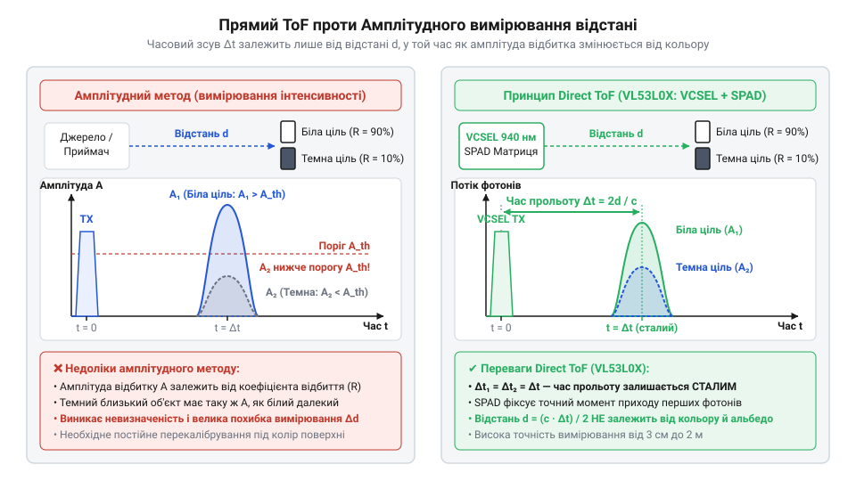
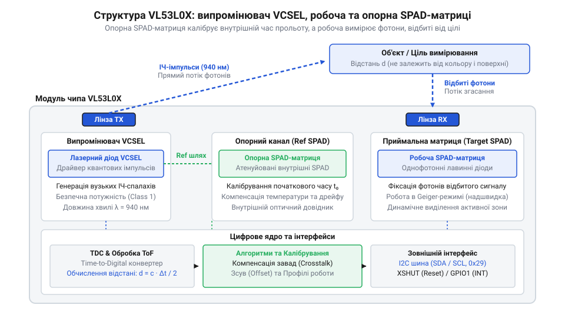
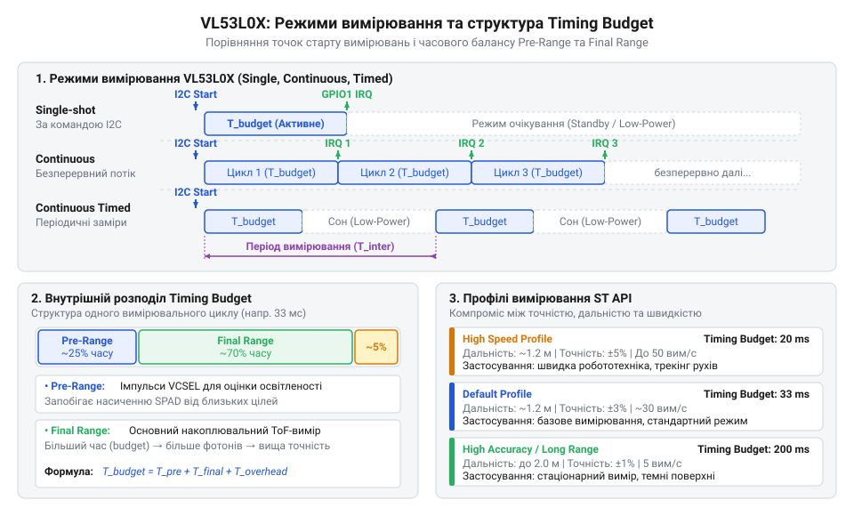
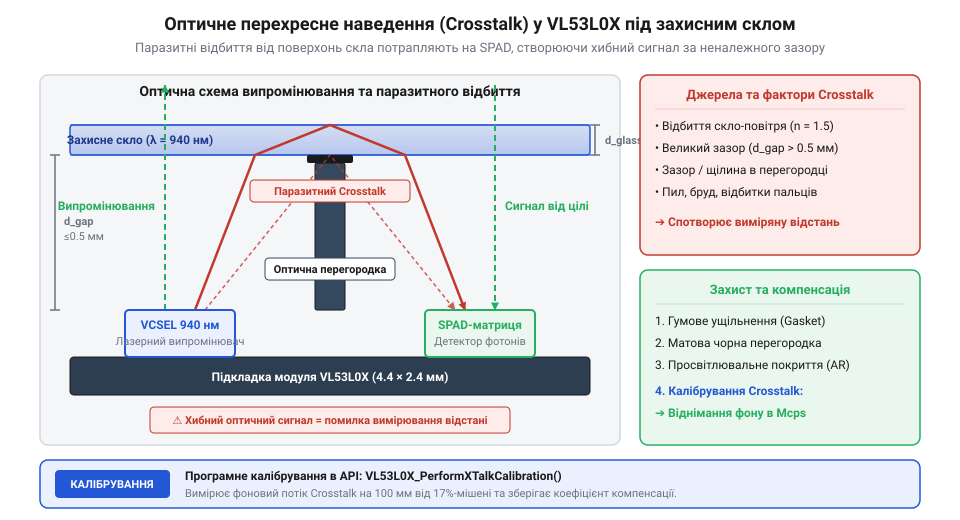
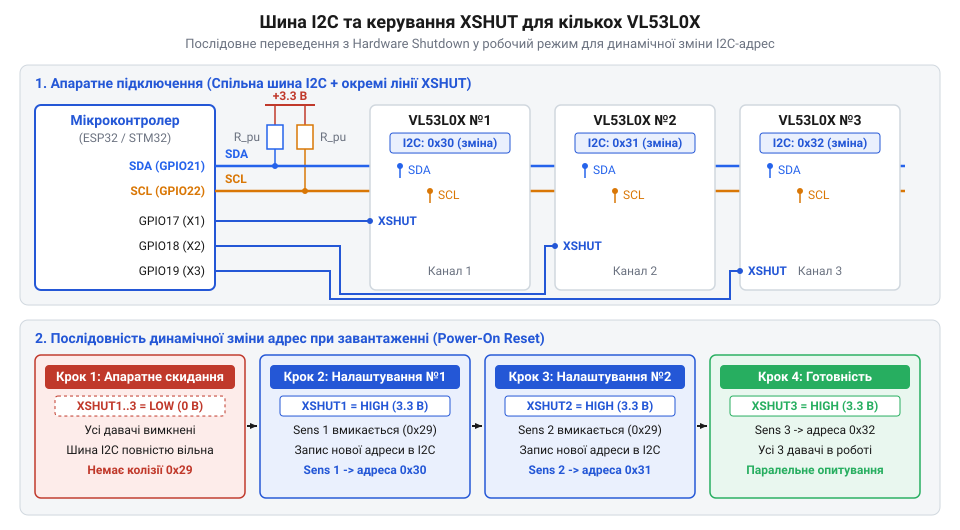

# VL53L0X — лазерний ToF-далекомір (940 нм)

<preknowlist>
- [Sharp GP2Y0A21YK0F — ІЧ-далекомір (10–80 см)](root:cat-hw-sensors/sharp-gp2y0a21) — обмеження вимірювання відстані за інтенсивністю відбитого світла та залежність сигналу від альбедо й текстури поверхні
- [HC-SR04 — ультразвуковий далекомір](root:cat-hw-sensors/hc-sr04) — базовий принцип визначення відстані за часом затримки поширення хвильового імпульсу у середовищі
</preknowlist>

## Ненадійність інтенсивності та принцип ToF

Визначення відстані за яскравістю світла хибує через оптичні властивості поверхні: [ІЧ-далекомір Sharp GP2Y0A21YK0F](root:cat-hw-sensors/sharp-gp2y0a21) сприймає чорну ціль як віддалену через поглинання променя, а нахил розсіює світло.

Для незалежності від оптичного @@en|albedo@@ (від лат. @@la|albedo@@ — білість) застосовують вимірювання часу польоту світла (англ. @@en|Time-of-Flight@@, @@en|ToF@@) — інтервалу між випромінюванням і поверненням імпульсу. На відміну від акустичного [ультразвукового далекоміра HC-SR04](root:cat-hw-sensors/hc-sr04), світло поширюється зі сталою швидкістю.

Відстань `d` обчислюють через швидкість світла `c` та час подвійного проходу `Δt`:

```
d = (c · Δt) ÷ 2
```

Ділення на два враховує шлях променя до перешкоди й назад.

Далекомір @@en|VL53L0X@@ випромінює світло на довжині хвилі 940 нм, де водяна пара атмосфери поглинає сонце. Це створює «темне вікно», що захищає від сонячних завад.


*Принцип ToF обчислює відстань за часовою затримкою імпульсу, усуваючи залежність від альбедо.*

## Архітектура випромінювача VCSEL і SPAD

Світло долає 1 см за 33 пікосекунди, тож звичайні фотодіоди занадто повільні. Для пікосекундної точності чип @@en|VL53L0X@@ поєднує лазер поверхневого випромінювання @@en|VCSEL@@ та матрицю однофотонних діодів @@en|SPAD@@.

Лазер @@en|VCSEL@@ формує короткі імпульси з крутим фронтом. Діоди @@en|SPAD@@ працюють у режимі Гейгера (@@en|Geiger-mode@@), де напруга зміщення перевищує пробійний поріг. Влучання фотона викликає лавину струму, а схема гасіння (@@en|quenching circuit@@) миттєво знижує напругу для відновлення діода.

Матриця має робочу (@@en|Target SPAD Array@@) та опорну (@@en|Reference SPAD Array@@) зони. Опорні діоди отримують світло @@en|VCSEL@@ усередині корпусу, фіксуючи старт `t₀` та компенсуючи температурний дрейф. Цифровий обробник будує гістограму часу прильоту фотонів, відсіюючи шум.


*Робоча та опорна зони SPAD компенсують температурний дрейф і відсіюють завади.*

## Режими вимірювання та часовий бюджет

Чип @@en|VL53L0X@@ підтримує одиночний (англ. @@en|Single Shot@@), безперервний (англ. @@en|Continuous@@) та таймований (англ. @@en|Timed@@) апаратні режими.

Часовий бюджет (англ. @@en|Timing Budget@@) визначає тривалість накопичення фотонів: за пуассонівським розподілом триваліша інтеграція зменшує невизначеність, підвищуючи точність і дальність.

Готові профілі — @@en|High Speed@@ (20 мс, до 50 Гц), @@en|High Accuracy@@ (200 мс, ±3%) та @@en|Long Range@@ (до 2 м) — балансують швидкість і точність, як і в далекомірах [TOF10120](root:cat-hw-sensors/tof10120) та [TOF250](root:cat-hw-sensors/tof250).


*Вибір часового бюджету визначає тривалість накопичення фотонів, балансуючи між точністю вимірювання та частотою оновлення.*

## Захисне скло та триетапне калібрування

Захисне скло викликає оптичне перехресне наведення (англ. @@en|Optical Crosstalk@@): відбиття на матрицю @@en|SPAD@@ створює хибний сигнал близької відстані.

Оптичну ізоляцію забезпечують повітряний зазор (англ. @@en|Air Gap@@) до 0.5 мм і перегородка (лат. @@la|Septum@@). Калібрування триетапне:
1. @@en|Reference SPAD Calibration@@ — активні опорні діоди. 2. @@en|Offset Calibration@@ — систематична похибка нуля. 3. @@en|Crosstalk Calibration@@ — паразитичне відбиття у @@en|MCPS@@ для віднімання з результату.


*Перегородка Septum та калібрування MCPS компенсують паразитичне відбиття від захисного скла до фотодіодів.*

## Динамічна адресація I2C та XSHUT

Паралельне підключення кількох чипів @@en|VL53L0X@@ викликає колізії на шині @@en|I2C@@ через однакову фабричну адресу `0x29`.

Виводи скидання @@en|XSHUT@@ (англ. @@en|Shutdown@@) вимикають @@en|I2C@@-інтерфейс низьким рівнем. Контролер вимикає всі чипи, по черзі активує @@en|XSHUT@@ кожного давача та записує нову адресу (наприклад, `0x30`) у регістр `0x8A`.

Лінії переривань @@en|GPIO1@@ сповіщають про готовність даних, позбавляючи потреби постійно опитувати шину.


*Керування лініями XSHUT дозволяє динамічно призначати унікальні I2C-адреси при старті.*

## Діагностика відмов та статуси вимірювань

Сенсор повертає код якості у змінній @@en|RangeStatus@@. Значення `0` (англ. @@en|Range Valid@@) підтверджує успішний замір. Коди помилок вказують на причину завад: `Status 1` (@@en|Sigma Fail@@) — шум або слабке відбиття, `Status 2` (@@en|Signal Fail@@) — слабкий сигнал, `Status 4` (@@en|Out of Bounds@@) — об'єкт поза межами.

Просідання живлення @@en|AVDD@@ нижче 2.6 В викликає апаратні збої. У разі зависання лінії @@en|SDA@@ контролер подає 9 імпульсів на @@en|SCL@@ для розблокування шини та скидає чип через @@en|XSHUT@@.