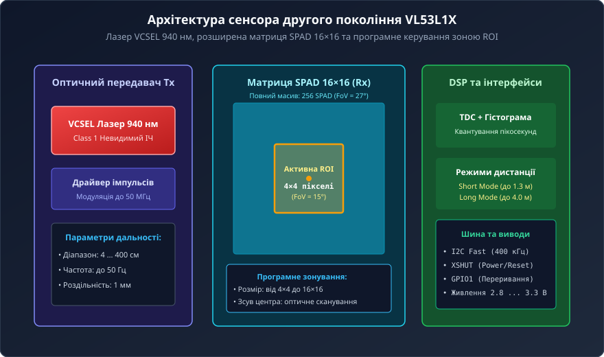
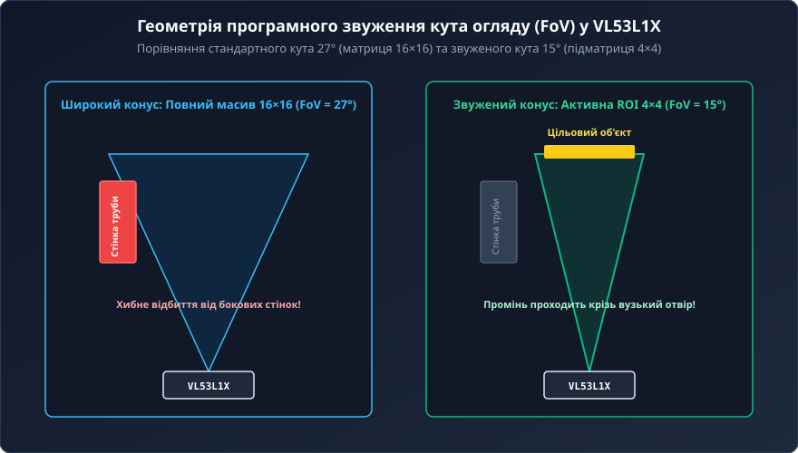
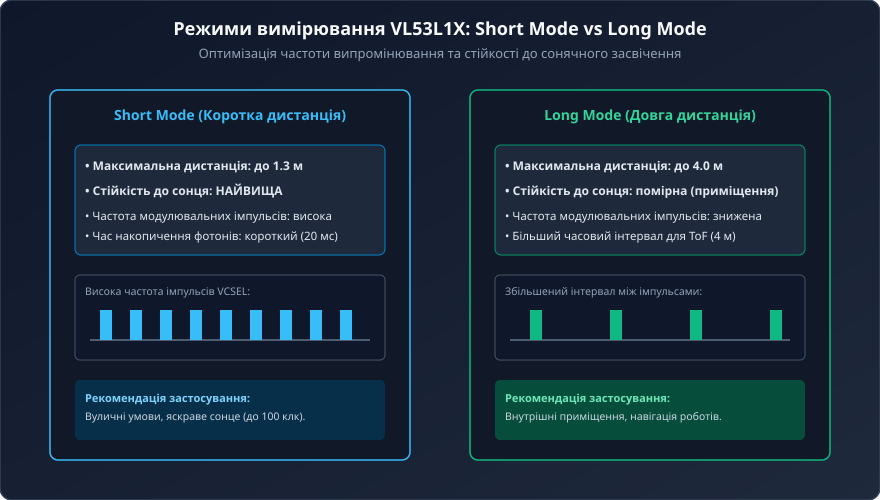
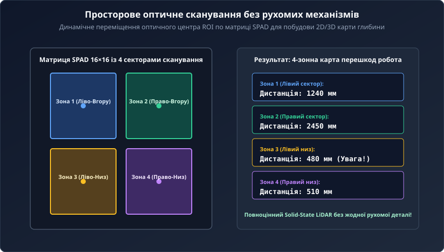

# VL53L1X — ToF-далекомір другого покоління з налаштовуваним кутом огляду (FoV)

<preknowlist>
- [VL53L0X — лазерний ToF-далекомір (940 нм)](root:cat-hw-sensors/vl53l0x) — базова архітектура першого покоління FlightSense, часопролітна концепція та інтерфейс I2C
- [Апаратна структура та принципова схема далекоміра VL53L0X](root:cat-hw-sensors/vl53l0x-hardware) — схемотехніка обв'язки лазера VCSEL, матриця SPAD та вимоги до оптичного скла
- [Оптичні далекоміри: триангуляційні, ToF та амплітудні](root:cat-hw-sensors/optical-distance-sensors-overview) — порівняльний аналіз оптичних методів вимірювання дистанції
</preknowlist>

## 1. Фізико-математичні засади dToF другого покоління

У класичній робототехніці та промисловій автоматизації надійне вимірювання відстані за допомогою оптичного випромінювання стикається з трьома критичними перешкодами: залежністю від оптичного коефіцієнта відбиття цілі (альбедо `R`), оптичним розмиванням через широкий кут розходження конуса огляду та паразитним засвіченням сонячним спектром на відкритому повітрі.

Амплітудні оптичні датчики підпорядковуються фотометричному закону спаду потужності:

```
P_rx = (P_tx · R · A) / (π · d²)      [фотометричне рівняння потужності]
```

Оскільки вихідний струм фотодіода є функцією як відстані `d`, так і невідомого альбедо `R`, розділити ці змінні неможливо. Білий екран на дистанції 2 метри повертає такий самий оптичний потік, як і чорний матовий пластик за 30 сантиметрів.



Сенсор другого покоління VL53L1X реалізує технологію прямого вимірювання часу польоту (Direct Time-of-Flight, dToF). Оскільки швидкість поширення світла в повітрі є фундаментальною константою `c ≈ 299 792 458 м/с`, дистанція розраховується безпосередньо за затримкою прольоту імпульсу фотонів `Δt`:

```
d = (c · Δt) / 2                      [рівняння прямого часу прольоту dToF]
```

Для вимірювання відстані з роздільною здатністю в 1 міліметр необхідна часова точність квантування тракту:

```
Δt = (2 · 0.001 м) / (2.9979 · 10⁸ м/с) ≈ 6.67 · 10⁻¹² с = 6.67 пс
```

VL53L1X забезпечує пікосекундну точність у компактному монолітному оптичному модулі розміром 4.4 × 2.4 × 1.0 мм, подвоюючи робочий діапазон попередника VL53L0X з 2 до 4 метрів.

## 2. Внутрішня оптоелектронна архітектура та матриця 16×16 SPAD

Внутрішня структура VL53L1X містить напівпровідниковий випромінювач, оптичний фотоприймач, квантувач часових міток TDC та вбудований цифровий сигнальний процесор:

1. **Лазер VCSEL (Vertical-Cavity Surface-Emitting Laser):** випромінює імпульси спалаху тривалістю менше 1 нс на довжині хвилі 940 нм. Інфрачервоне випромінювання 940 нм відповідає стандарту безпеки зору Class 1 Eye Safety (IEC 60825-1) і збігається з мінімумом спектра сонячного світла, зумовленим смугою поглинання водяної пари атмосфери Землі.
2. **Матриця 16×16 SPAD (Single-Photon Avalanche Diode):** складається з 256 однофотонних лавинних фотодіодів, що працюють у метастабільному режимі Гейгера (Geiger mode). Зворотна напруга зміщення перевищує напругу лавинного пробою:
   ```
   V_bias = V_breakdown + V_excess
   ```
   Приліт навіть одного фотона породжує лавинний струм з фронтом наростання менше 50 пс, що формує детерміновану часову позначку. Схема активного гасіння (Active Quenching) припиняє розряд і готує діод до реєстрації наступного кванта світла.
3. **Опорний масив Reference SPAD:** внутрішній оптичний світловод спрямовує мікрочастку випромінювання VCSEL безпосередньо на внутрішній опорний масив, фіксуючи точний момент старту `t_start` для компенсації температурного дрейфу напівпровідника та змін напруги живлення.
4. **TDC лічильник і накопичувач гістограм:** фіксує часові відліки повернення фотонів із кроком ~10 пс. Статистичне накопичення тисяч відліків утворює гострий гауссів пік корисного сигналу поверх рівномірного сонячного фону.

## 3. Програмне керування зоною ROI та кутом огляду FoV

У першому поколінні VL53L0X кут огляду (Field of View, FoV) був жорстко зафіксований на рівні 25°. При монтажі сенсора в корпус із заглибленням або роботі у вузьких отворах широкий конус випромінювання призводив до паразитарних відбиттів від стінок каналу.



VL53L1X запроваджує технологію програмного виділення зони зацікавленості (Region of Interest, ROI) на матриці 16×16 SPAD:

- **Повний масив 16×16:** забезпечує максимальний кут огляду 27° для широкого охоплення простору перед роботом.
- **Підматриця 4×4:** мінімальний розмір активної зони, що звужує кут огляду до 15°.
- **Проміжні конфігурації:** підтримуються прямокутні матриці розміром від 4×4 до 16×16 пікселів.

Звуження кута огляду до 15° дозволяє зондувати вузькі щілини та захисні трубки діаметром менше 10 мм без небезпеки хибного виявлення стінок отвору. Крім того, відключення неактивних діодів SPAD зменшує накопичення сонячного фонового струму, підвищуючи співвідношення сигнал/шум на великих дистанціях.

## 4. Апаратні режими дистанції: Short Mode та Long Mode

Для досягнення балансу між максимальною дальністю та стійкістю до сонячного світла сенсор підтримує два конфігураційні профілі вимірювання:



1. **Short Distance Mode (до 1.3 метра):**
   - Лазер VCSEL випромінює імпульси з високою частотою модуляції (інтервал між імпульсами скорочено).
   - Часове вікно накопичення становить від 20 до 50 мс.
   - Забезпечує неперевершену стійкість до сильного зовнішнього сонячного освітлення (працює при засвіченні до 100 клк на прямому сонці).
2. **Long Distance Mode (до 4.0 метрів):**
   - Збільшений період між імпульсами лазера виключає фазове накладення для світлового сигналу, що повертається з дистанцій понад 2 метри.
   - Забезпечує максимальну чутливість при освітленні всередині приміщень (до 5–10 клк).

| Параметр | Short Distance Mode | Long Distance Mode |
| :--- | :--- | :--- |
| **Максимальна дальність (темрява)** | 1.36 м | 4.00 м |
| **Максимальна дальність (яскраве сонце)** | 1.20 м | 0.70 м |
| **Стійкість до зовнішнього шуму** | Висока (до 100 клк) | Середня (до 10 клк) |
| **Час інтеграції (Timing Budget)** | 20–50 мс | 33–100 мс |
| **Максимальна частота опитування** | До 50 Гц | До 30 Гц |

## 5. Багатозонне сканування (Solid-State LiDAR) та практична реалізація

Оскільки центр активної зони ROI можна програмно зміщувати по площині матриці 16×16, VL53L1X перетворюється на твердотільний багатозонний сканер (Solid-State LiDAR) без будь-яких рухомих дзеркал чи електромоторів.



Керуючий мікроконтролер циклічно змінює координати центру зони ROI між чотирма квадрантами (або лінійно вздовж горизонталі у 8 зон). На кожному кроці сенсор зчитує дистанцію до відповідного просторового сектора, створюючи динамічну 2D або 3D карту перешкод.

Нижче наведено приклад конфігурування драйвера VL53L1X для вибору режиму Long Mode, звуження зони ROI до 4×4 пікселів та зчитування дистанції:

```c
/* Приклад ініціалізації VL53L1X у середовищі ESP-IDF (C) */
#include "vl53l1_api.h"

VL53L1_Dev_t dev;

void vl53l1x_setup(void) {
    /* 1. Очікування готовності пристрою після підняття XSHUT */
    VL53L1_WaitDeviceBooted(&dev);
    VL53L1_DataInit(&dev);
    VL53L1_StaticInit(&dev);

    /* 2. Налаштування профілю дистанції (Long Mode) */
    VL53L1_SetDistanceMode(&dev, VL53L1_DISTANCEMODE_LONG);

    /* 3. Встановлення бюджету часу вимірювання (50 мс) */
    VL53L1_SetMeasurementTimingBudgetMicroSeconds(&dev, 50000);

    /* 4. Програмне звуження кута огляду FoV до 15° (ROI 4x4) */
    VL53L1_UserRoi_t roi;
    roi.TopLeftX = 6;
    roi.TopLeftY = 9;
    roi.BotRightX = 9;
    roi.BotRightY = 6;
    VL53L1_SetUserROI(&dev, &roi);

    /* 5. Запуск безперервного циклу вимірювань */
    VL53L1_StartMeasurement(&dev);
}

uint16_t vl53l1x_get_distance(void) {
    uint8_t data_ready = 0;
    VL53L1_RangingMeasurementData_t measurement_data;

    while (!data_ready) {
        VL53L1_GetMeasurementDataReady(&dev, &data_ready);
        vTaskDelay(pdMS_TO_TICKS(5));
    }

    VL53L1_GetRangingMeasurementData(&dev, &measurement_data);
    VL53L1_ClearInterruptAndStartMeasurement(&dev);

    if (measurement_data.RangeStatus == 0) {
        return measurement_data.RangeMilliMeter;
    }
    return 0xFFFF; /* Помилка вимірювання або вихід за межі */
}
```

Реалізація на C++ для Arduino з бібліотекою VL53L1X:

```cpp
/* Приклад налаштування ROI та зчитування дистанції на Arduino */
#include <Wire.h>
#include <VL53L1X.h>

VL53L1X sensor;

void setup() {
    Serial.begin(115200);
    Wire.begin();
    Wire.setClock(400000);

    sensor.setTimeout(500);
    if (!sensor.init()) {
        Serial.println("Помилка ініціалізації VL53L1X!");
        while (1);
    }

    /* Налаштування режиму Long Mode (до 4 м) */
    sensor.setDistanceMode(VL53L1X::Long);
    sensor.setMeasurementTimingBudget(50000); // 50 мс

    /* Звуження зони інтересу (ROI) до 4x4 діодів з оптичним центром 199 */
    sensor.setROISize(4, 4);
    sensor.setROICenter(199);

    sensor.startContinuous(50);
}

void loop() {
    uint16_t distance_mm = sensor.read();

    if (sensor.timeoutOccurred()) {
        Serial.println("Тайм-аут зчитування!");
    } else if (sensor.ranging_data.range_status == VL53L1X::RangeValid) {
        Serial.print("Відстань: ");
        Serial.print(distance_mm);
        Serial.println(" мм");
    }
    delay(50);
}
```

Завдяки поєднанню дальності до 400 см, програмного звуження кута зору до 15° та можливості безмеханічного сканування матрицею ROI, сенсор VL53L1X є універсальним розв'язком для задач локальної навігації, безконтактного детектування жестів та систем безпеки автономних роботів.
