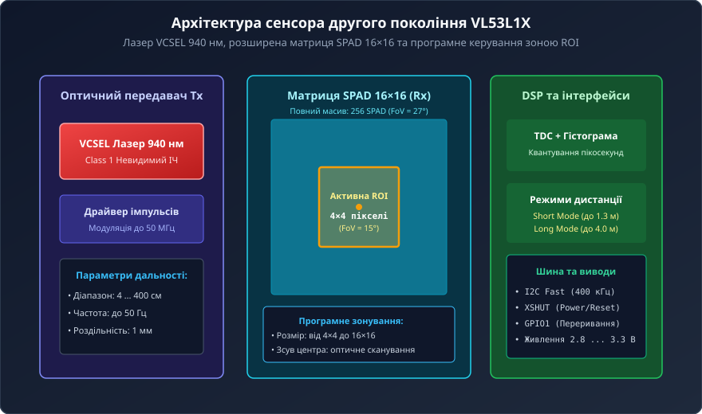
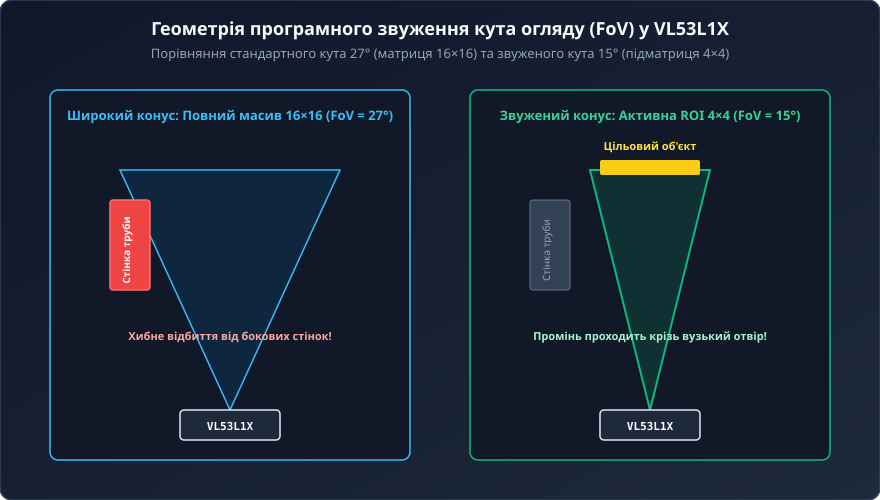
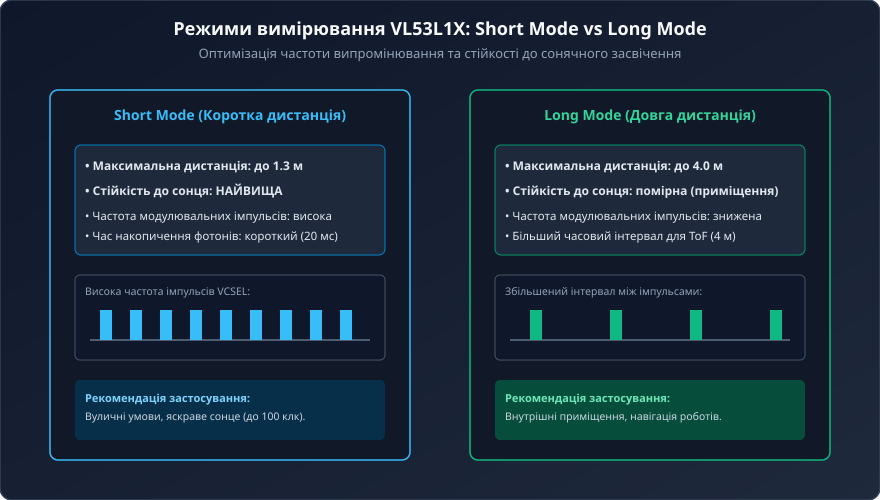
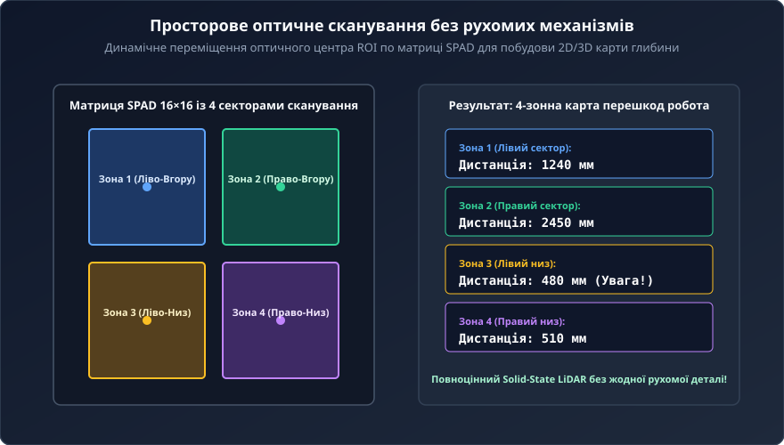

# VL53L1X — ToF-далекомір другого покоління з налаштовуваним кутом огляду (FoV)

Мікросхема VL53L1X від компанії STMicroelectronics є флагманським часопролітним сенсором прямого вимірювання часу польоту світла (Direct Time-of-Flight, dToF) сімейства FlightSense. Зберігаючи сумісність за форм-фактором і габаритами корпусу (4.4 × 2.4 × 1.0 мм) з популярним попередником VL53L0X, датчик другого покоління збільшує максимальну робочу дистанцію до 4 метрів та надає унікальну можливість програмного звуження та просторового переміщення кута огляду (FoV).

## 1. Еволюція Time-of-Flight: переваги другого покоління VL53L1X

Перше покоління інтегральних лазерних далекомірів (VL53L0X) мало два ключові обмеження:
- Максимальна дистанція вимірювання обмежувалася 2 метрами у темному приміщенні та лише 1–1.2 м за помірного кімнатного освітлення.
- Кут огляду був жорстко зафіксований оптичною системою на рівні конічних 25°, що спричиняло паразитні відбиття від бокових стінок при встановленні сенсора всередині корпусних труб, тунелів або вузьких ніш робота.

Сенсор VL53L1X долає ці бар'єри:
1. **Збільшення дальності вдвічі:** вимірювання відстані до 400 см із міліметровою точністю.
2. **Програмована зона зацікавленості (ROI):** можливість вибору активної підматриці фотодіодів зменшує конус зору сенсора з 27° до 15°.
3. **Підвищена частота опитування:** частота оновлення кадрів досягає 50 Гц.
4. **Адаптивні профілі далекості:** розділення на режими Short Mode та Long Mode для збереження працездатності під прямим сонячним світлом.

## 2. Внутрішня оптоелектронна структура: лазер VCSEL та матриця SPAD 16×16

Внутрішня архітектура VL53L1X об'єднує напівпровідниковий випромінювач, оптичний фотоприймач та цифровий сигнальний процесор DSP:
- **Лазер VCSEL (940 нм):** поверхнево-випромінювальний лазер класу Eye Safety Class 1 генерує ультракороткі спалахи накачки на довжині хвилі 940 нм, де інтенсивність сонячного шуму на поверхні Землі значно послаблена поглинанням атмосфери.
- **Матриця SPAD 16×16:** приймальний масив налічує 256 однофотонних лавинних фотодіодів, що працюють у метастабільному режимі Гейгера (Geiger mode) зі швидкістю лавинного наростання менше 50 пс.
- **Опорний масив Reference SPAD:** реєструє спалах лазера всередині корпусу для компенсації температурного дрейфу та флуктуацій напруги живлення.
- **TDC лічильник часу:** вимірює затримку фотонів із кроком ~10 пс та формує статистичні часові гістограми подій.

## 3. Програмне керування кутом огляду (FoV) та налаштування зони ROI

Найважливішим інноваційним досягненням VL53L1X є роздільне матричне керування лавинними діодами SPAD. Повний масив 16×16 формує кут огляду 27°.

Шляхом запису координат у системні регістри сенсора розробник може зменшити розмір активної зони до 4×4 пікселів, що відповідає звуженню поля зору до 15°.

Це забезпечує дві практичні переваги:
- **Усунення паразитних відбиттів від стінок:** промінь сенсора проходить крізь вузькі отвори діаметром лише кілька міліметрів, не чіпляючи бокових країв конструктиву приладу.
- **Концентрація фотонного потоку:** зменшення кількості фонових шумів на неактивних пікселях значно підвищує співвідношення сигнал/шум (SNR).

## 4. Режими вимірювання: Short Mode та Long Mode

Для оптимізації роботи сенсора в різних умовах освітлення VL53L1X надає два апаратні режими:

1. **Short Mode (Коротка дистанція до 1.3 м):**
   - Лазер VCSEL модулюється високою частотою спалахів із коротким інтервалом накопичення.
   - Забезпечує найвищу стійкість до сильного фонового засвічення (до 100 клк на відкритому сонячному світлі).
   - Ідеальний для вуличних мобільних платформ і безконтактного керування.
2. **Long Mode (Довга дистанція до 4.0 м):**
   - Збільшений часовий інтервал між лазерними імпульсами усуває фазову неоднозначність для відстаней до 4 метрів.
   - Оптимальний для внутрішніх приміщень, складської навігації та виявлення перешкод роботами-пилососами.

## 5. Багатозонне твердотільне сканування (Solid-State LiDAR)

Оскільки активну зону ROI можна не лише змінювати за розміром, а й динамічно переміщувати по полю матриці 16×16, VL53L1X здатен виконувати функції твердотільного багатозонного сканера без жодної рухомої деталі.

Шляхом послідовного перемикання зони ROI між чотирма кутовими секторами (ліво-верх, право-верх, ліво-низ, право-низ) керуючий мікроконтролер формує повноцінну 4-зонну карту перешкод з одного статично закріпленого датчика. Це дозволяє розпізнавати не просто наявність перешкоди, а й її просторовий напрямок (ліворуч чи праворуч), реалізуючи інтелектуальне оминання перешкод мобільним роботом.
