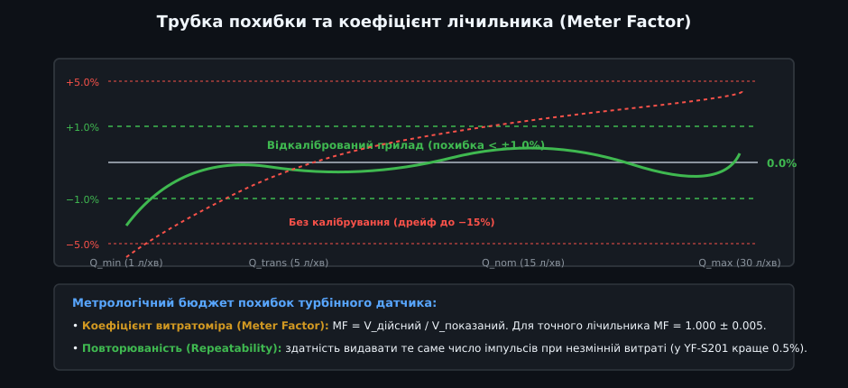
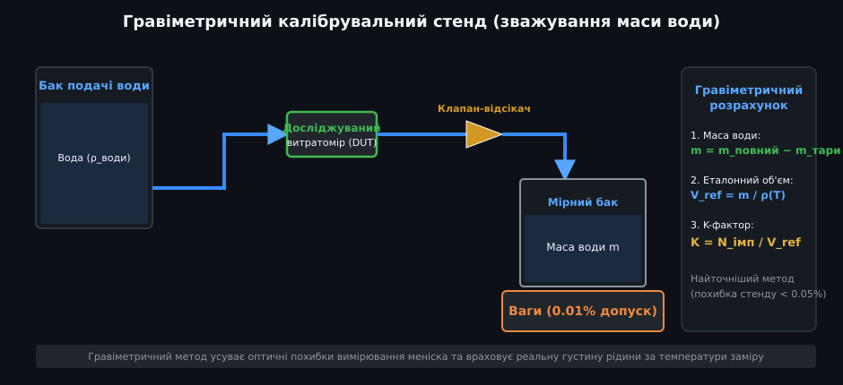
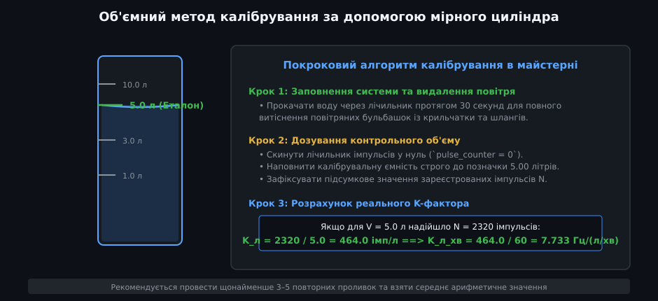
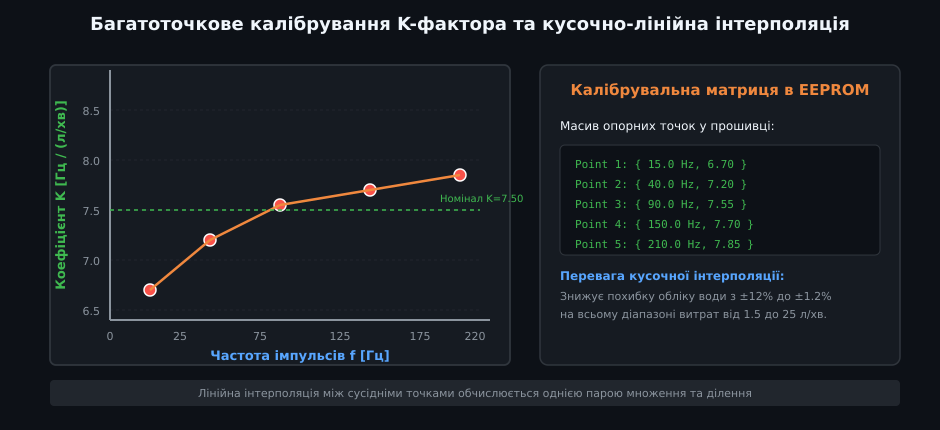
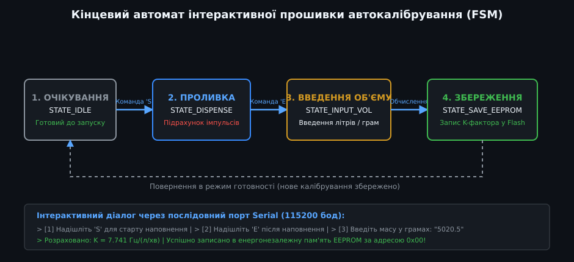

# Поглиблене метрологічне калібрування та інтерполяція K-фактора імпульсних витратомірів

Імпульсні тахометричні перетворювачі витрати (турбінні та крильчасті лічильники рідини) володіють вродженою гідродинамічною нелінійністю. Застосування єдиного скалярного коефіцієнта K-фактора придатне лише для вузького діапазону витрати або грубої побутової індикації. У прецизійних дозувальних комплексах, теплолічильниках та автоматизованих поливальних станціях промислового рівня похибка мінімізується за рахунок багатоточкового калібрування, побудови кривої коефіцієнта лічильника (Meter Factor) та програмної апроксимації калібрувальних таблиць.

---

## 1. Метрологічні характеристики та коефіцієнт лічильника (Meter Factor)

Гідродинаміка крильчатки визначається балансом рушійного моменту від набігаючого струменя рідини та гальмівних моментів (в'язке тертя шарів рідини, механічне тертя опорних підшипників, магнітне гальмування від взаємодії магніту крильчатки з осердям або датчиком Холла).



### Математичний апарат оцінки похибок:
1. **Коефіцієнт лічильника (Meter Factor, MF):**
   Відношення дійсного (еталонного) об'єму рідини V_ref до об'єму V_meas, зареєстрованого витратоміром за базовим паспортним K-фактором:
   
   MF = V_ref / V_meas

   - Якщо MF = 1.000 — прилад ідеально збігається з еталоном.
   - Якщо MF > 1.000 — витратомір недораховує об'єм (занижує показники, крильчатка пригальмовується тертям).
   - Якщо MF < 1.000 — витратомір завищує об'єм.

2. **Відносна похибка вимірювання об'єму (Error, %):**
   
   E = ((V_meas - V_ref) / V_ref) * 100% = ((1 / MF) - 1) * 100%

3. **Коридор похибок (Error Band):**
   - **Зона низьких витрат (Q_min ... 0.2*Q_nom):** Домінує момент сухого та напіврідкісного тертя у підшипниках осі. Турбіна обертається повільніше потоку, похибка різко зростає в мінус (до -15% ... -25%).
   - **Лінійна зона (0.2*Q_nom ... Q_max):** Турбулентний режим із числом Рейнольдса Re > 4000. Сили тертя нехтовно малі порівняно з інерційними силами потоку. Похибка стабілізується в межах цільового коридору ±0.8% ... ±1.5%.
   - **Зона перевантаження (> Q_max):** Небезпека кавітації рідини на тильних кромках лопаток крильчатки та зриву потоку.

---

## 2. Гравіметричний еталонний стенд та усунення динамічних похибок

Для прецизійного визначення залежності K-фактора від витрати використовують еталонні калібрувальні стенди гравіметричного типу (зважування маси води).



### Компенсація динамічних перехідних режимів:
- **Проблема пуску/зупинки:** Якщо пускати воду через витратомір відкриттям звичайного кульового крана, на початку виникає динамічний розгін струменя, а в кінці — гідроудар або поступове перекриття. У цей час витрата нестаціонарна, що спотворює результати калібрування на 2–5%.
- **Застосування пневматичного відсікача (Diverter):**
  1. Помпа створює стабільний неперервний потік із заданою швидкістю через досліджуваний датчик.
  2. Вода спочатку зливається повз ваги через байпас назад у рециркуляційний бак.
  3. Коли турбіна виходить на стаціонарний швидкісний режим, пневматичний відсікач миттєво (за 10–20 мс) перекидає струмінь у ваговий бак на платформі тензометричних ваг.
  4. Одночасно таймер мікроконтролера та таймер ваг починають реєстрацію.
  5. Після набору заданої маси струмінь перекидається назад у байпас.

### Розрахунок еталонного об'єму з урахуванням аеростатичної сили:
Маса води на вагах підлягає корекції на виштовхувальну силу повітря (поправка на аеростатику) та температурну густину:

V_ref = (m_ваги * (1 + (rho_air / rho_weight) - (rho_air / rho_water(T)))) / rho_water(T)

де `rho_air ≈ 1.2 кг/м³`, `rho_weight ≈ 8000 кг/м³` (еталонні гирі зі сталі), `rho_water(T)` — густина дегазованої води за температури калібрування.

---

## 3. Об'ємний експрес-метод із каліброваним мірником

У виробничих майстернях та лабораторіях цехового рівня застосовують метод переливу через металевий або скляний мірник 1-го чи 2-го класу точності.



### Протокол калібрувального проливу:
1. **Стабілізація температури:** Температура рідини вирівнюється з температурою повітря майстерні (20 ± 2 °C) для виключення температурного розширення мірника:
   
   V_t = V_20 * (1 + beta_glass * (T - 20))

   де `beta_glass = 9.9e-6 1/°C` для боросилікатного скла.
2. **Змочування внутрішньої поверхні:** Перед серією випробувань мірник змочують водою і дають стекти краплям протягом 60 секунд. Це забезпечує стабільну залишкову плівку рідини (hold-up volume).
3. **Статистична серія проливів:** Для кожної фіксованої витрати виконується не менше 3 повторних проливів.
   - Критерій збіжності: максимальна різниця кількості імпульсів у серії не повинна перевищувати 0.5%.
   - Середнє арифметичне значення імпульсів береться за базову точку калібрувальної таблиці.

---

## 4. Багатоточкова нелінійна апроксимація та кубічні сплайни

Оскільки крива K-фактора має вигин у зоні низьких витрат, застосування константи призводить до значної похибки інтегрування об'єму. Необхідно закладати в прошивку вектор пар значень `(f_i, K_i)`.



### Алгоритми інтерполяції в бортовому мікроконтролері:

1. **Кусочно-лінійна інтерполяція (Piecewise Linear):**
   Масив опорних точок упорядковано за зростанням поточної частоти: `f_0 < f_1 < ... < f_M`.
   Якщо виміряна частота потрапляє в інтервал `[f_i, f_{i+1}]`:
   
   K(f) = K_i + ((K_{i+1} - K_i) / (f_{i+1} - f_i)) * (f - f_i)

   - *Переваги:* Вимагає всього 4 арифметичні операції, відсутність розбіжностей і перекосу (Runge phenomenon).
   - *Недоліки:* Злами похідної на стиках інтервалів створюють сходинкові пульсації розрахованої миттєвої швидкості витрати.

2. **Кубічний сплайн Ерміта або природний сплайн:**
   Забезпечує неперервність як самої функції K(f), так і її першої похідної (гладке прискорення). Для Cortex-M4/M7 із апаратним FPU обчислювальне навантаження мінімальне, а похибка апроксимації не перевищує 0.15% відносно таблиці еталона.

---

## 5. Промислова реалізація: кінцевий автомат FSM та C++ драйвер калібрування

Для реалізації повністю автоматизованого або напівавтоматичного калібрування в приладі розгортається кінцевий автомат (Finite State Machine).



### Архітектура калібрувального модуля:
Клас `FlowCalibrationManager` інкапсулює збір імпульсів, таймування, фільтрацію викидів, кусочно-лінійний перерахунок та збереження налаштувань у незалежну пам'ять EEPROM/Fram/Flash з обчисленням контрольної суми CRC32.

```cpp
/**
 * @file FlowCalibrationManager.hpp
 * @brief Промисловий менеджер калібрування та лінеаризації імпульсних витратомірів
 */

#pragma once

#include <stdint.h>
#include <stddef.h>
#include <string.h>

// Максимальна кількість калібрувальних точок у таблиці
static constexpr size_t MAX_CALIB_POINTS = 8;

// Стан кінцевого автомата калібрування
enum class CalibState : uint8_t {
    IDLE = 0,           ///< Звичайний режим обліку
    PROBING_START,      ///< Підготовка до проливки, очікування відкриття клапана
    DISPENSING,         ///< Активний підрахунок імпульсів проливки
    AWAITING_INPUT,     ///< Очікування введення дійсного еталонного об'єму/маси
    CALCULATING,        ///< Розрахунок нового K-фактора та оновлення таблиці
    SAVING_NVM          ///< Запис у енергонезалежну пам'ять із верифікацією CRC
};

// Структура опорної калібрувальної точки
struct CalibPoint {
    float freq_hz;      ///< Частота імпульсів датчика Холла (Гц)
    float k_factor;     ///< Емпіричний K-фактор для даного режиму (імп/л)
};

// Загальна структура конфігурації для збереження в EEPROM / Flash
struct CalibrationProfile {
    uint32_t magic_header;                      ///< Сигнатура валідності (0x464C4F57 = 'FLOW')
    uint8_t  points_count;                      ///< Фактична кількість задіяних точок
    CalibPoint points[MAX_CALIB_POINTS];        ///< Впорядкований масив точок
    float nominal_k_factor;                     ///< Базовий коефіцієнт за замовчуванням
    uint32_t crc32;                             ///< Контрольна сума для перевірки цілісності
};

class FlowCalibrationManager {
public:
    FlowCalibrationManager() : state_(CalibState::IDLE), active_pulses_(0), probe_start_ms_(0) {
        // Ініціалізація профілю заводськими параметрами (YF-S201 за замовчуванням)
        profile_.magic_header = 0x464C4F57;
        profile_.points_count = 5;
        profile_.nominal_k_factor = 450.0f; // 450 імп/л
        
        // Початкова типова таблиця для крильчатки G1/2"
        profile_.points[0] = { 7.5f,  390.0f }; // 1.0 л/хв (сильне тертя)
        profile_.points[1] = { 18.0f, 435.0f }; // 2.5 л/хв
        profile_.points[2] = { 38.0f, 460.0f }; // 5.0 л/хв (лінійна ділянка)
        profile_.points[3] = { 75.0f, 465.0f }; // 10.0 л/хв
        profile_.points[4] = { 115.0f, 462.0f}; // 15.0 л/хв
        
        recalculateCrc();
    }

    /**
     * @brief Отримання миттєвого лінеаризованого K-фактора за виміряною частотою
     * @param current_freq Частота імпульсів у Герцах
     * @return Лінеаризоване значення K-фактора (імпульсів на літр)
     */
    float getLinearizedKFactor(float current_freq) const {
        if (profile_.points_count == 0) {
            return profile_.nominal_k_factor;
        }

        // Захист на випадок частоти, меншої за першу точку
        if (current_freq <= profile_.points[0].freq_hz) {
            return profile_.points[0].k_factor;
        }

        // Пошук інтервалу для інтерполяції
        for (uint8_t i = 0; i < profile_.points_count - 1; ++i) {
            if (current_freq >= profile_.points[i].freq_hz && current_freq <= profile_.points[i + 1].freq_hz) {
                float df = profile_.points[i + 1].freq_hz - profile_.points[i].freq_hz;
                if (df < 0.001f) return profile_.points[i].k_factor;
                
                float t = (current_freq - profile_.points[i].freq_hz) / df;
                return profile_.points[i].k_factor + t * (profile_.points[i + 1].k_factor - profile_.points[i].k_factor);
            }
        }

        // Частота вища за останню точку — екстраполяція за останнім значенням
        return profile_.points[profile_.points_count - 1].k_factor;
    }

    /**
     * @brief Обчислення миттєвої витрати з урахуванням лінеаризації
     * @param current_freq Частота імпульсів (Гц)
     * @return Витрата рідини в літрах за хвилину (л/хв)
     */
    float calculateFlowRateLpm(float current_freq) const {
        if (current_freq < 0.5f) return 0.0f; // Відсікання зони нечутливості
        float k = getLinearizedKFactor(current_freq);
        return (current_freq * 60.0f) / k;
    }

    // --- Методи керування процесом калібрування ---

    void startCalibrationRun() {
        active_pulses_ = 0;
        state_ = CalibState::DISPENSING;
    }

    void onPulseReceived() {
        if (state_ == CalibState::DISPENSING) {
            active_pulses_++;
        }
    }

    void stopCalibrationRun() {
        if (state_ == CalibState::DISPENSING) {
            state_ = CalibState::AWAITING_INPUT;
        }
    }

    uint32_t getCapturedPulses() const {
        return active_pulses_;
    }

    /**
     * @brief Застосування результату проливки для калібрувальної точки
     * @param reference_volume_liters Фактичний об'єм із еталонної мірної колби чи ваг
     * @param avg_frequency_hz Середня частота датчика під час проливки
     */
    bool commitCalibrationPoint(float reference_volume_liters, float avg_frequency_hz) {
        if (reference_volume_liters <= 0.001f || active_pulses_ == 0) {
            state_ = CalibState::IDLE;
            return false;
        }

        float computed_k = static_cast<float>(active_pulses_) / reference_volume_liters;

        // Вставка або оновлення точки в масиві із сортуванням за частотою
        insertSortedPoint(avg_frequency_hz, computed_k);
        recalculateCrc();

        state_ = CalibState::IDLE;
        return true;
    }

    CalibState getState() const { return state_; }
    const CalibrationProfile& getProfile() const { return profile_; }

private:
    void insertSortedPoint(float freq, float k) {
        // Пошук індексу для оновлення або додавання
        int target_idx = -1;
        for (uint8_t i = 0; i < profile_.points_count; ++i) {
            if (fabsf(profile_.points[i].freq_hz - freq) < 1.0f) {
                target_idx = i; // Оновлення існуючої точки
                break;
            }
        }

        if (target_idx >= 0) {
            profile_.points[target_idx].k_factor = k;
            return;
        }

        if (profile_.points_count < MAX_CALIB_POINTS) {
            // Додавання нової точки із збереженням сортування
            uint8_t insert_pos = 0;
            while (insert_pos < profile_.points_count && profile_.points[insert_pos].freq_hz < freq) {
                insert_pos++;
            }

            for (uint8_t i = profile_.points_count; i > insert_pos; --i) {
                profile_.points[i] = profile_.points[i - 1];
            }

            profile_.points[insert_pos].freq_hz = freq;
            profile_.points[insert_pos].k_factor = k;
            profile_.points_count++;
        }
    }

    void recalculateCrc() {
        // Простий поліноміальний розрахунок CRC32 для захисту цілісності даних
        const uint8_t* data = reinterpret_cast<const uint8_t*>(&profile_);
        size_t len = offsetof(CalibrationProfile, crc32);
        uint32_t crc = 0xFFFFFFFF;
        for (size_t i = 0; i < len; ++i) {
            crc ^= data[i];
            for (uint8_t j = 0; j < 8; ++j) {
                crc = (crc >> 1) ^ (0xEDB88320 & (-(crc & 1)));
            }
        }
        profile_.crc32 = ~crc;
    }

    CalibrationProfile profile_;
    CalibState state_;
    volatile uint32_t active_pulses_;
    uint32_t probe_start_ms_;
};
```

Така програмна структура гарантує метрологічну простежуваність, захищає систему від випадкових збоїв живлення за рахунок CRC-валідації енергонезалежної пам'яті та забезпечує розрахунок витрати з точністю краще ±1.0% на всьому паспортному діапазоні лічильника.
