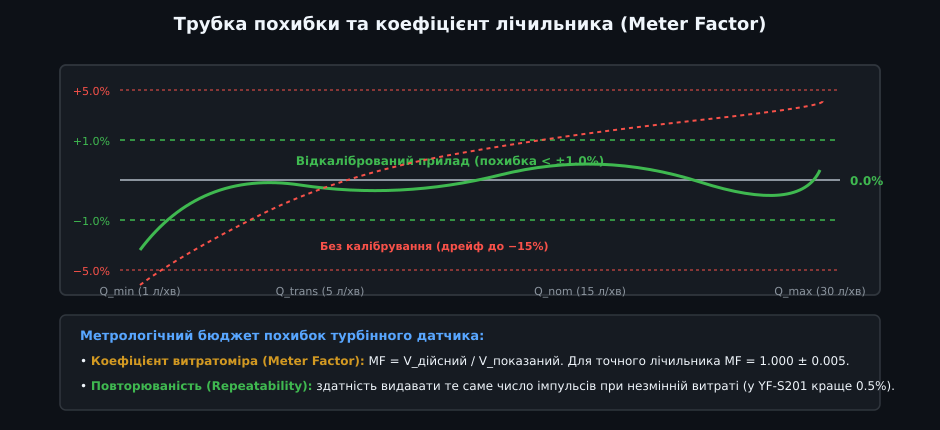
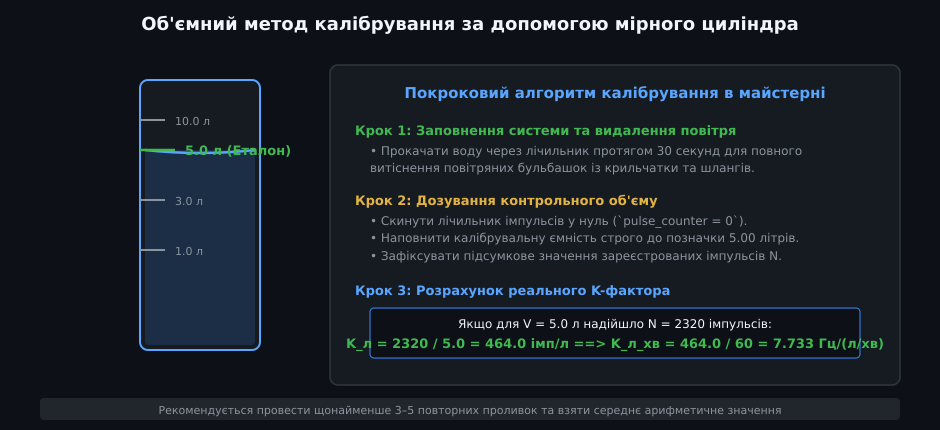
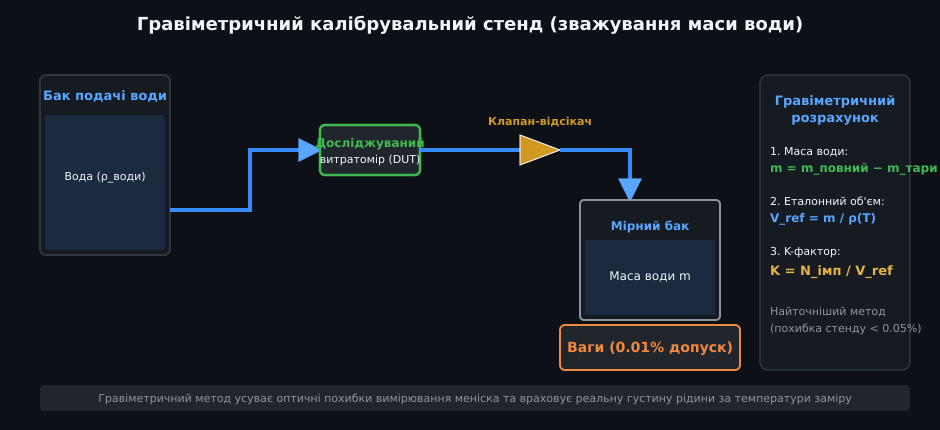
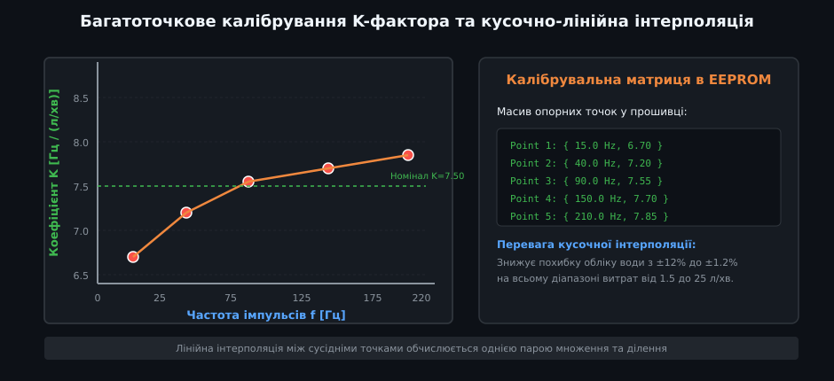
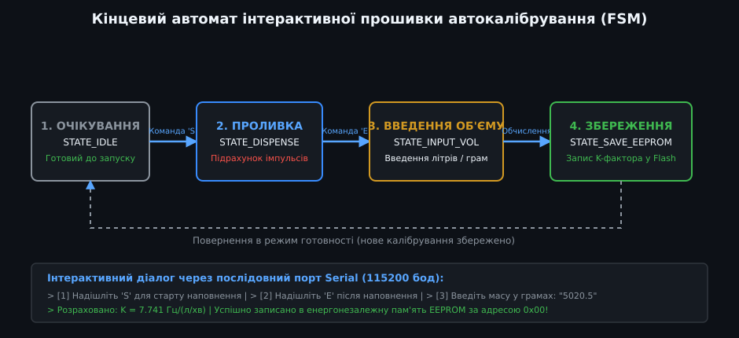

# Калібрування та визначення K-фактора імпульсних витратомірів

Імпульсні турбінні витратоміри (серії YF-S201, YF-B1, FS300A, OF05ZAT) є найдоступнішими сенсорами для обліку об'єму рідини. Проте використання заводського значення K-фактора з опису в інтернеті майже завжди призводить до неприємного розчарування: лічильник може помилятися на 10–25%. Точний облік рідини в розумному будинку, системах поливу чи дозування добрив неможливий без індивідуального метрологічного калібрування конкретного примірника датчика.

---

## 1. Метрологічний бюджет похибок та поняття K-фактора

Головне завдання калібрування полягає у встановленні строгого математичного коефіцієнта пропорційності між кількістю зареєстрованих електричних імпульсів `N` та фізичним об'ємом прокачаної рідини `V`:



- **Визначення K-фактора:**
  - **Об'ємний K-фактор (імп/л):** Показує, скільки імпульсів генерує датчик Холла при проходженні рівно одного літра рідини:
    
    K_л = N / V

  - **Частотний K-фактор (Гц / (л/хв)):** Зв'язує частоту слідування імпульсів у Герцах із поточною швидкістю потоку в літрах за хвилину:
    
    K_Гц = f / Q = K_л / 60

- **Чому заводський номінал бреше:**
  1. Технологічний розкид лиття пластикових лопаток крильчатки (допуски прес-форм до ±0.3 мм).
  2. Різниця зусилля притискання та тертя в підшипниках осі з нержавіючої сталі.
  3. Гідродинамічний вплив монтажу: форма штуцерів, наявність колін або звужень труб безпосередньо перед датчиком змінює завихреність потоку та швидкість обертання турбіни на 5–15%.

---

## 2. Об'ємний метод калібрування (майстерня)

Для більшості практичних завдань у домашніх або навчальних умовах достатньо провести об'ємне калібрування за допомогою мірного циліндра або відкаліброваної каністри:



### Покроковий алгоритм калібрування:
1. **Підготовка системи:** Підключіть витратомір до водопроводу через запірний кран. Прокачайте воду протягом 30 секунд, щоб повністю витіснити повітряні пробки.
2. **Скидання лічильника:** Запустіть скетч, який підраховує кількість імпульсів через переривання, та обнуліть лічильник (`pulse_count = 0`).
3. **Проливка еталонного об'єму:** Відкрийте кран і наповніть мірну колбу строго до позначки (наприклад, V = 5.00 літрів). Різко перекрийте кран.
4. **Фіксація результату:** Запишіть кількість імпульсів N із монітора порту.
5. **Розрахунок:**
   
   K_л = N / V = 2320 / 5.0 = 464 імп/л
   K_Гц = K_л / 60 = 464 / 60 = 7.733 Гц / (л/хв)

---

## 3. Гравіметричний метод високої точності (зважування води)

У метрологічних лабораторіях замість мірних колб використовують гравіметричний стенд із прецизійними електронними вагами:



- **Чому ваги точніші за колбу:** Зважування усуває суб'єктивну людську похибку зчитування меніска рідини та налипання крапель на стінки посуду. Сучасні лабораторні ваги мають похибку менше 0.01%.
- **Врахування температури рідини:** Густина води `ρ` змінюється з температурою (за 20 °C густина становить 998.2 кг/м³, а за 40 °C — 992.2 кг/м³). Еталонний об'єм розраховують як:
  
  V_ref = (m_повний − m_тари) / ρ(T)

- **Швидкодіючий перекидний клапан (Diverter Valve):** Щоб виключити похибки розгону та гальмування турбіни при відкритті крана, потік води спрямовують у вимірювальний бак за допомогою пневматичного клапана-відсікача вже на стаціонарному усталеному режимі течії.

---

## 4. Багатоточкове калібрування та нелінійність K(f)

Для точного обліку води в широкому діапазоні витрат калібрування в одній точці є недостатнім, оскільки при малих витратах механічне тертя гальмує турбіну, а при великих — виникає кавітація:



- **Випробувальні точки:** Метрологічний стандарт вимагає зняття щонайменше 5 опорних точок: 10%, 25%, 50%, 75% та 100% максимальної паспортної витрати.
- **Таблиця інтерполяції:** У пам'ять приладу записують масив пар `(f_i, K_i)`. Під час роботи мікроконтролер визначає поточну частоту імпульсів і лінійно розраховує актуальний K-фактор між двома сусідніми вузлами таблиці. Це знижує сумарну похибку вимірювання витрати з ±15% до менш ніж ±1.5%.

---

## 5. Інтерактивна прошивка автокалібрування з EEPROM



Нижче наведено скетч для автоматичного калібрування витратоміра через послідовний порт із записом результату в енергонезалежну пам'ять EEPROM:

```cpp
/**
 * @file water_flow_autocalibrate.ino
 * @brief Інтерактивний скетч автокалібрування K-фактора з автозбереженням в EEPROM
 */

#include <EEPROM.h>

const int PIN_FLOW_SENSOR = 2; // Пін апаратного переривання
const int EEPROM_ADDR_K = 0;   // Адреса зберігання float K-фактора

volatile uint32_t calib_pulses = 0;
bool is_calibrating = false;

void isrFlow() {
  if (is_calibrating) {
    calib_pulses++;
  }
}

void setup() {
  Serial.begin(115200);
  pinMode(PIN_FLOW_SENSOR, INPUT_PULLUP);
  attachInterrupt(digitalPinToInterrupt(PIN_FLOW_SENSOR), isrFlow, FALLING);

  float saved_k = 0.0f;
  EEPROM.get(EEPROM_ADDR_K, saved_k);
  if (isnan(saved_k) || saved_k < 1.0f || saved_k > 30.0f) {
    saved_k = 7.5f; // Заводський номінал за замовчуванням
  }

  Serial.println(F("\n=== КАЛІБРУВАННЯ ВИТРАТОМІРА ВОДИ ==="));
  Serial.print(F("Поточний збережений K-фактор: "));
  Serial.print(saved_k, 3);
  Serial.println(F(" Гц/(л/хв)"));
  Serial.println(F("Команди:"));
  Serial.println(F("  'S' — Почати протоку еталонного об'єму"));
  Serial.println(F("  'E' — Закінчити протоку та ввести точний об'єм"));
}

void loop() {
  if (Serial.available()) {
    char cmd = Serial.read();

    if (cmd == 'S' || cmd == 's') {
      calib_pulses = 0;
      is_calibrating = true;
      Serial.println(F("[СТАРТ] Наповнюйте мірну ємність. Підрахунок імпульсів увімкнено..."));
    } 
    else if (cmd == 'E' || cmd == 'e') {
      is_calibrating = false;
      Serial.print(F("[СТОП] Зафіксовано імпульсів: "));
      Serial.println(calib_pulses);
      Serial.println(F("Введіть фактичний об'єм у літрах (наприклад: 5.00):"));

      while (!Serial.available()) delay(10); // Очікування введення об'єму
      float actual_liters = Serial.parseFloat();

      if (actual_liters > 0.1f && calib_pulses > 10) {
        // K_Гц = (pulses / actual_liters) / 60.0
        float calculated_k = ((float)calib_pulses / actual_liters) / 60.0f;

        Serial.print(F("Розрахований K-фактор: "));
        Serial.print(calculated_k, 4);
        Serial.println(F(" Гц/(л/хв)"));

        EEPROM.put(EEPROM_ADDR_K, calculated_k);
        Serial.println(F("[УСПІХ] Новий K-фактор успішно записано в EEPROM!"));
      } else {
        Serial.println(F("[ПОМИЛКА] Некоректні дані об'єму чи надто мало імпульсів."));
      }
    }
  }
}
```
