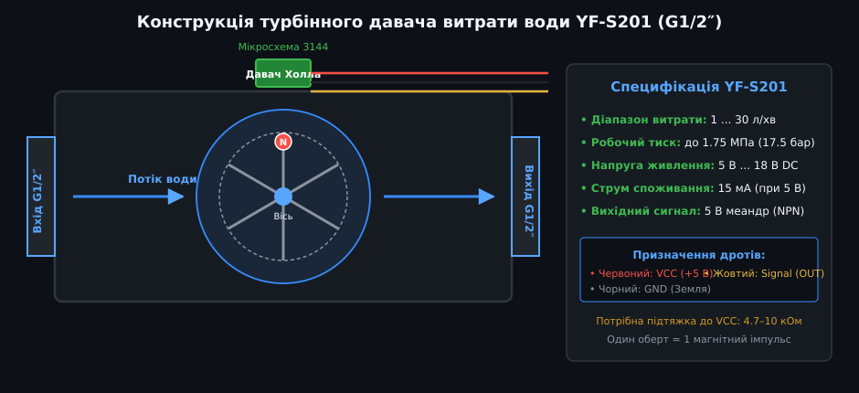
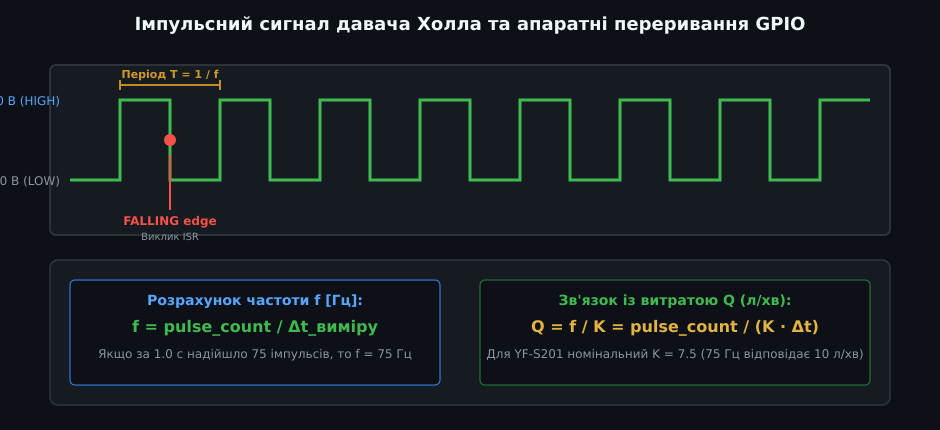
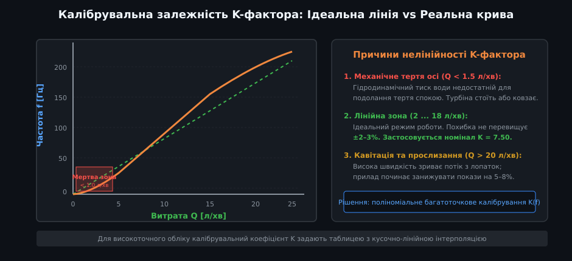
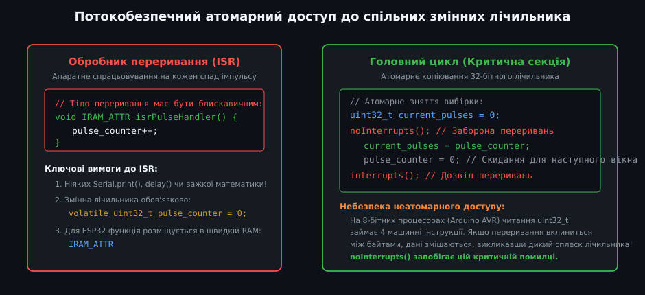
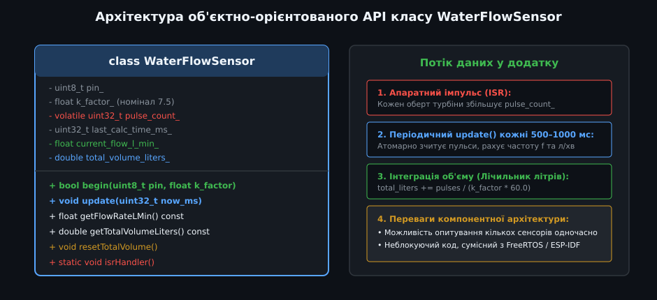

# Поглиблений аналіз програмного API та драйвера витратоміра води G1/2″

Турбінні датчики витрати на базі ефекту Холла (YF-S201, YF-B1, OF05ZAT) є найпоширенішими первинними перетворювачами в комерційних дозаторах, вендингових автоматах, системах зворотного осмосу та агроавтоматиці. Створення надійного, прецизійного драйвера вимагає розуміння гідродинаміки турбінного колеса, коректної організації апаратних переривань, нелінійної компенсації K-фактора та забезпечення потокобезпечності в багатозадачних операційних системах реального часу (RTOS).

---

## 1. Гідродинаміка крильчатки та фізичні обмеження лінійності

Механічний вузол датчика є гідравлічною турбіною Пельтона або аксіальною вертушкою, що приводиться в рух кінетичною енергією струменя води:



### Баланс обертального моменту крильчатки
Швидкість обертання турбіни ω визначається динамічною рівновагою між гідродинамічним рушійним моментом M_гідро та сумарним моментом опору M_опір:
  
J · (dω / dt) = M_гідро − M_тертя − M_в'язк

- **Гідродинамічний момент:** Пропорційний густині рідини ρ, площі лопаток A та квадрату відносної швидкості струменя (v − r·ω)²:
  
  M_гідро ≈ k_geom · ρ · A · (v − r·ω)²

- **Момент сухого тертя:** Виникає на кінцях опорної осі з нержавіючої сталі в підшипниках ковзання (фторопластових або агатових втулках). При нульовій або дуже малій витраті (потік Q < 1.0 л/хв) M_гідро менший за статичний момент тертя спокою M_0. Турбіна зупиняється — виникає «мертва зона» чутливості (Deadband).
- **В'язкісний опір:** Пропорційний динамічній в'язкості рідини η та кутовій швидкості: M_в'язк = k_visc · η · ω. При зміні температури води в'язкість змінюється втричі (від 1.79 мПа·с при 0 °C до 0.65 мПа·с при 40 °C), що зумовлює температурне зміщення K-фактора на 2–4%.

---

## 2. Апаратна взаємодія з таймерами та периферією мікроконтролера

Для високоточного підрахунку імпульсів у діапазоні від 5 до 250 Гц застосовують апаратні можливості вбудованих мікроконтролерів (AVR, STM32, ESP32):



### Особливості платформи ESP32:
1. **Атрибут IRAM_ATTR:** Оскільки код у зовнішній Flash-пам'яті SPI може бути заблокований під час запису сторінок або роботи стека Wi-Fi, функція обробника переривання повинна розташовуватися виключно у внутрішній оперативній пам'яті (Internal SRAM):
   
   ```cpp
   void IRAM_ATTR isrFlowSensor() {
       pulse_counter++;
   }
   ```

2. **Апаратний блок підрахунку імпульсів (Pulse Counter — PCNT):**
   - Мікроконтролери ESP32 мають у своєму складі апаратний модуль PCNT (до 8 незалежних каналів).
   - Блок PCNT підраховує імпульси самостійно на рівні кремнію, не перериваючи процесорне ядро взагалі! Головний процесор звертається до регістра лічильника раз на секунду, повністю розвантажуючи CPU.

---

## 3. Нелінійна модель K-фактора та калібрування K(f)

Помилкою багатьох інженерів є віра в константність K-фактора на всьому робочому діапазоні датчика:



### Чому K-фактор змінюється:
Для датчика YF-S201 номінальне значення K = 7.50 Гц / (л/хв) (що еквівалентно 450 імпульсам на 1 літр) справедливе лише в діапазоні від 5 до 15 л/хв.
- **При малій витраті (1.5–3.0 л/хв):** Через механічне тертя турбіна відстає від струменя рідини. Реальний коефіцієнт падає до K ≈ 5.8...6.5 (похибка лінійної моделі досягає 15–20%).
- **При високій витраті (> 20 л/хв):** Виникає кавітація та турбулентне зривання струменів із лопаток, через що K знову відхиляється на 5–8%.

### Кусочно-лінійна апроксимація калібрувальної таблиці:
Замість однієї константи в прошивку вбудовують таблицю еталонних пар `(частота_Гц, K_коефіцієнт)` і виконують лінійну інтерполяцію:

| Частота f [Гц] | Реальний K-фактор | Фізична витрата Q [л/хв] |
| :--- | :--- | :--- |
| **0.0 ... 8.0 Гц** | 5.50 | 0.0 ... 1.45 л/хв (зона виходу з тертя) |
| **8.0 ... 25.0 Гц** | 6.80 | 1.45 ... 3.68 л/хв |
| **25.0 ... 120.0 Гц**| 7.50 | 3.68 ... 16.00 л/хв (номінальна лінійна полиця) |
| **120.0 ... 220.0 Гц**| 7.85 | 16.00 ... 28.00 л/хв (кавітаційне стиснення) |

---

## 4. Потокобезпечність та атомарні операції

В архітектурах із випереджальною багатозадачністю (Preemptive RTOS, наприклад, FreeRTOS) або за наявності апаратних переривань доступ до змінних накопичувального підсумку лічильника вимагає ізоляції:



- **Критична секція FreeRTOS:**
  Замість глобальної заборони переривань у системах RTOS використовують захист м'ютексом або спінлоком із збереженням маски переривань:
  
  ```cpp
  portMUX_TYPE flow_mux = portMUX_INITIALIZER_UNLOCKED;
  
  // Вхід у критичну секцію
  taskENTER_CRITICAL(&flow_mux);
  uint32_t pulses = shared_pulse_counter;
  shared_pulse_counter = 0;
  taskEXIT_CRITICAL(&flow_mux);
  ```

---

## 5. Промисловий об'єктно-орієнтований C++ клас WaterFlowSensor



Нижче наведено повний виробничий клас C++ для роботи з турбінними витратомірами води, що підтримує багатоточкове калібрування K-фактора, захист від брязкоту контактів і розрахунок витоків.

```cpp
/**
 * @file water_flow_sensor_driver.hpp
 * @brief Повний високоточний клас драйвера витратоміра води (YF-S201 / G1/2")
 */

#include <stdint.h>
#include <stdbool.h>
#include <math.h>

class WaterFlowSensor {
public:
    struct CalibPoint {
        float freq_hz;
        float k_factor;
    };

    WaterFlowSensor() 
        : pin_(255), isr_counter_(0), last_calc_time_ms_(0),
          current_flow_l_min_(0.0f), total_volume_liters_(0.0),
          calib_table_size_(0) {}

    /**
     * @brief Ініціалізація датчика з базовим K-фактором
     * @param gpio_pin Апаратний пін мікроконтролера
     * @param default_k Номінальний коефіцієнт (напр. 7.5 для YF-S201)
     */
    void init(uint8_t gpio_pin, float default_k = 7.5f) {
        pin_ = gpio_pin;
        default_k_ = default_k;
        isr_counter_ = 0;
        last_calc_time_ms_ = 0;
        current_flow_l_min_ = 0.0f;
        total_volume_liters_ = 0.0;
        calib_table_size_ = 0;
    }

    /**
     * @brief Завантаження багатоточкової таблиці калібрування K(f)
     */
    void setCalibrationTable(const CalibPoint *table, uint8_t size) {
        if (size > MAX_CALIB_POINTS) size = MAX_CALIB_POINTS;
        for (uint8_t i = 0; i < size; i++) {
            calib_table_[i] = table[i];
        }
        calib_table_size_ = size;
    }

    /**
     * @brief Обробник імпульсу (викликається з апаратної ISR)
     */
    inline void handleInterrupt() {
        isr_counter_++;
    }

    /**
     * @brief Періодичний розрахунок метрик (викликається раз на 200–1000 мс)
     * @param now_ms Поточний системний час у мілісекундах
     */
    void update(uint32_t now_ms) {
        if (last_calc_time_ms_ == 0) {
            last_calc_time_ms_ = now_ms;
            return;
        }

        uint32_t elapsed_ms = now_ms - last_calc_time_ms_;
        if (elapsed_ms < 100) return; // Занадто малий інтервал

        // 1. Атомарне зняття накопичених імпульсів
        uint32_t pulses = 0;
        // Нижче реалізовано атомарний затиск:
        #if defined(ARDUINO)
        noInterrupts();
        pulses = isr_counter_;
        isr_counter_ = 0;
        interrupts();
        #else
        pulses = __sync_fetch_and_and(&isr_counter_, 0);
        #endif

        last_calc_time_ms_ = now_ms;

        // 2. Розрахунок частоти слідування імпульсів у Герцах
        float freq_hz = ((float)pulses * 1000.0f) / (float)elapsed_ms;

        // 3. Інтерполяція актуального K-фактора залежно від частоти
        float active_k = interpolateKFactor(freq_hz);

        // 4. Розрахунок миттєвої витрати (Q = f / K)
        current_flow_l_min_ = (active_k > 0.01f) ? (freq_hz / active_k) : 0.0f;

        // 5. Інтеграція накопичувального об'єму води
        // V = pulses / (K * 60)
        if (active_k > 0.01f && pulses > 0) {
            double interval_liters = (double)pulses / ((double)active_k * 60.0);
            total_volume_liters_ += interval_liters;
        }
    }

    float getFlowRateLMin() const { return current_flow_l_min_; }
    double getTotalVolumeLiters() const { return total_volume_liters_; }
    void resetTotalVolume() { total_volume_liters_ = 0.0; }

private:
    static const uint8_t MAX_CALIB_POINTS = 8;
    CalibPoint calib_table_[MAX_CALIB_POINTS];
    uint8_t calib_table_size_;

    uint8_t pin_;
    float default_k_;
    volatile uint32_t isr_counter_;
    uint32_t last_calc_time_ms_;
    float current_flow_l_min_;
    double total_volume_liters_;

    float interpolateKFactor(float freq_hz) const {
        if (calib_table_size_ == 0) return default_k_;
        if (freq_hz <= calib_table_[0].freq_hz) return calib_table_[0].k_factor;
        if (freq_hz >= calib_table_[calib_table_size_ - 1].freq_hz) {
            return calib_table_[calib_table_size_ - 1].k_factor;
        }

        // Пошук відрізка таблиці
        for (uint8_t i = 0; i < calib_table_size_ - 1; i++) {
            if (freq_hz >= calib_table_[i].freq_hz && freq_hz <= calib_table_[i + 1].freq_hz) {
                float f1 = calib_table_[i].freq_hz;
                float f2 = calib_table_[i + 1].freq_hz;
                float k1 = calib_table_[i].k_factor;
                float k2 = calib_table_[i + 1].k_factor;
                // Лінійна інтерполяція
                return k1 + ((freq_hz - f1) * (k2 - k1)) / (f2 - f1);
            }
        }
        return default_k_;
    }
};
```

### Практичні інженерні правила надійної експлуатації
1. **Фільтр грубої очистки перед датчиком:** Обов'язково встановлюйте сітчастий косий фільтр-грязьовик (100–300 мкм) перед вхідним штуцером. Попадання навіть крихітної окалини чи піщинки заклинює пластикові лопатки, зупиняючи облік.
2. **Захист від гідравлічного удару:** Швидкодіючі електромагнітні клапани (соленоїди), встановлені після лічильника, при закритті створюють гідроудар до 20–30 бар, що розриває пластиковий корпус або зрізає вісь турбіни. Соленоїдний клапан завжди рекомендується встановлювати **перед** датчиком витрати або використовувати клапани плавного закриття.
3. **Екранування сигнального кабелю:** Лінія `Signal` чутлива до електромагнітних завад від поруч прокладених силових кабелів 220 В насосів. Використовуйте кручену пару в екрані або розміщуйте підтягуючий резистор 4.7 кОм якомога ближче до піна контролера.
