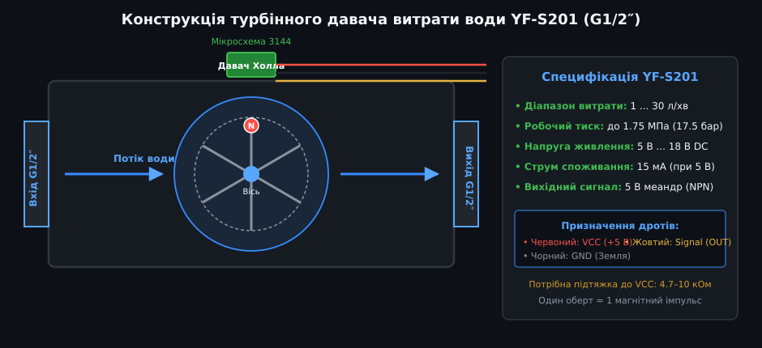
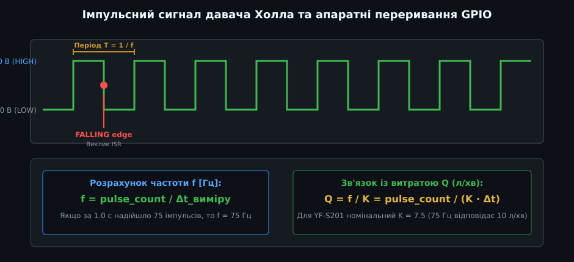
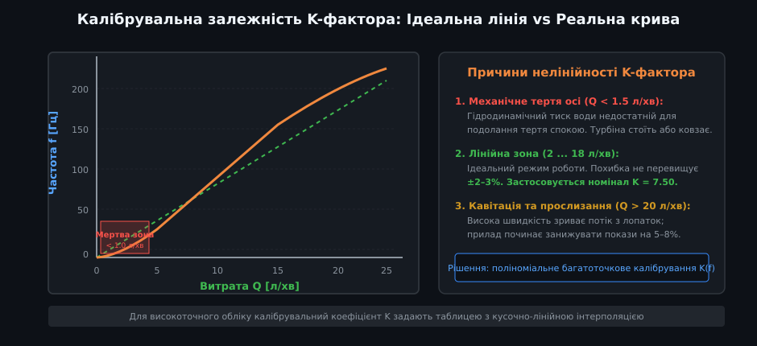
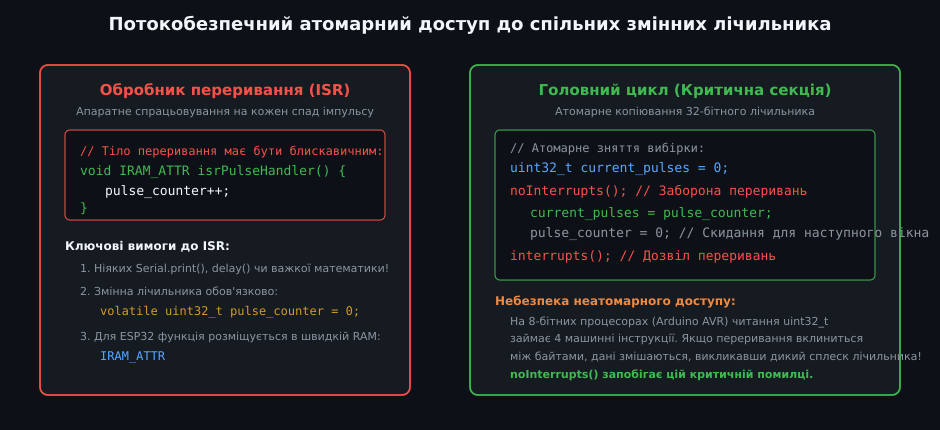
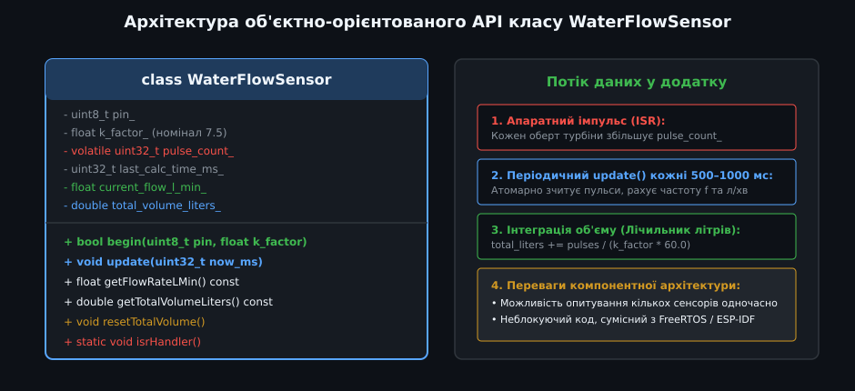

# Програмний API давача витрати води G1/2″: переривання та обчислення K-фактора

Турбінні лічильники витрати води з різьбленням G1/2″ (найвідомішим представником яких є сенсор **YF-S201**) — це найпопулярніший клас датчиків для систем домашньої автоматизації, контролю роботи насосів, обліку поливу та автоматичних дозаторів рідин. Принцип їхньої дії базується на перетворенні швидкості потоку води в послідовність електричних імпульсів за допомогою вбудованого елемента Холла.

---

## 1. Будова та фізичний принцип дії датчика YF-S201

Датчик являє собою проточну пластикову камеру зі стандартними різьбовими патрубками під півдюймову сантехнічну трубу:



- **Гідравлічна камера та крильчатка:** Усередині герметичної порожнини на прецизійній осі з нержавіючої сталі встановлено пластикове колесо з лопатками (турбіну). Потік води, проходячи крізь камеру, змушує крильчатку обертатися зі швидкістю, прямо пропорційною об'ємній витраті.
- **Вбудований постійний магніт:** На одній із лопаток турбіни герметично запресовано мініатюрний постійний неодимовий або феритовий магніт.
- **Елемент Холла (мікросхема 3144):** Чутливий до магнітного поля напівпровідниковий елемент розміщений у верхній герметичній порожнині корпусу, ізольованій від води. Щоразу, коли магніт лопатки проходить повз датчик Холла, його внутрішній тригер Шмітта перемикається, формуючи короткий прямокутний імпульс низького рівня (NPN відкритий колектор).
- **Виводи модуля:** Сенсор має три стандартні дроти:
  - **Червоний (VCC):** живлення +5...18 В постійного струму;
  - **Чорний (GND):** загальний мінус схеми (0 В);
  - **Жовтий (Signal / OUT):** цифровий імпульсний вихід із відкритим колектором (потребує підтяжки резистором 4.7–10 кОм до шини живлення або використання внутрішнього `INPUT_PULLUP`).

---

## 2. Імпульсна послідовність та апаратні переривання GPIO

Вихідний сигнал являє собою цифровий меандр, частота якого зростає разом із витратою води:



- **Чому опитування (polling) не підходить:** Обертання турбіни генерує від 10 до 200 імпульсів за секунду (частота до 200 Гц). Звичайне покрокове читання через `digitalRead()` у головному циклі `loop()` неминуче пропускатиме імпульси, якщо мікроконтролер виконує мережевий обмін Wi-Fi, оновлює дисплей або містить блокуючі затримки.
- **Апаратні переривання (Hardware Interrupts):** Найбільш надійний метод підрахунку — використання зовнішнього переривання мікроконтролера по спадному фронту сигналу (`FALLING`):
  
  ```cpp
  attachInterrupt(digitalPinToInterrupt(FLOW_SENSOR_PIN), flowSensorISR, FALLING);
  ```

  Кожен спад напруги апаратно зупиняє виконання головного коду лише на частку мікросекунди, щоб інкрементувати лічильник.

---

## 3. Фізичний зміст K-фактора та розрахунок витрати

Зв'язок між кількістю імпульсів датчика та об'ємом прокачаної рідини описується калібрувальною константою — **K-фактором** (K-Factor):



- **Паспортна формула YF-S201:** Для номінального сенсора виробник декларує лінійну залежність:
  
  f = 7.5 · Q

  де:
  - `f` — частота вихідних імпульсів у Герцах [Гц] (кількість імпульсів за секунду);
  - `Q` — миттєва об'ємна витрата рідини в літрах за хвилину [л/хв];
  - `K` = 7.5 — номінальний коефіцієнт (при витраті 10 л/хв частота становить рівно 75 Гц).
- **Розрахунок миттєвої витрати:**
  
  Q [л/хв] = f / K = (кількість_імпульсів / час_вимірювання_с) / 7.5

- **Розрахунок сумарного об'єму води:** Кожен окремий імпульс відповідає фіксованому мікрооб'єму води. Для K = 7.5 один літр води створює:
  
  Імпульсів_на_літр = K · 60 = 7.5 · 60 = 450 імпульсів.

  Відповідно, один імпульс відповідає об'єму близько `1 / 450 ≈ 2.22 мл` води.

---

## 4. Потокобезпечний атомарний доступ до спільних змінних

Оскільки лічильник імпульсів змінюється всередині переривання (ISR), а обчислення витрати виконуються в головному циклі, виникає стан гонитви за даними (Data Race):



- **Проблема атомарності:** На 8-бітних процесорах (наприклад, ATmega328P у платі Arduino Uno) 32-бітна змінна `uint32_t` займає 4 байти пам'яті. Мікроконтролер читає її за чотири послідовні машинних такти. Якщо переривання вклиниться між читанням другого і третього байтів, головна програма отримає абсолютно спотворене число!
- **Правило критичної секції:**
  1. Змінна лічильника повинна мати специфікатор `volatile`, який забороняє компілятору оптимізувати її через регістри процесора:
     
     ```cpp
     volatile uint32_t pulse_count = 0;
     ```

  2. Перед копіюванням лічильника в головному циклі переривання тимчасово вимикають функцією `noInterrupts()`, а після копіювання — негайно відновлюють функцією `interrupts()`:
     
     ```cpp
     uint32_t pulses_snapshot = 0;
     noInterrupts();
     pulses_snapshot = pulse_count;
     pulse_count = 0; // Скидаємо для наступного вікна
     interrupts();
     ```

---

## 5. Архітектура базової прошивки та розрахунок сумарного об'єму



Нижче наведено робочий скетч підрахунку миттєвої витрати та накопиченого об'єму з оновленням один раз на секунду:

```cpp
/**
 * @file water_flow_basic.ino
 * @brief Базовий скетч роботи з витратоміром YF-S201 через переривання
 */

const int PIN_FLOW_SENSOR = 2; // Пін переривання (D2 на Arduino Uno)
const float K_FACTOR = 7.5f;   // Паспортний коефіцієнт для YF-S201 (Гц / (л/хв))

volatile uint32_t pulse_counter = 0;
unsigned long last_calc_time_ms = 0;
double total_volume_liters = 0.0;

// Функція обробки переривання (максимально коротка!)
void isrPulseCounter() {
  pulse_counter++;
}

void setup() {
  Serial.begin(115200);
  pinMode(PIN_FLOW_SENSOR, INPUT_PULLUP);
  attachInterrupt(digitalPinToInterrupt(PIN_FLOW_SENSOR), isrPulseCounter, FALLING);
  last_calc_time_ms = millis();
}

void loop() {
  unsigned long now_ms = millis();
  unsigned long elapsed_ms = now_ms - last_calc_time_ms;

  // Оновлення розрахунків кожні 1000 мс
  if (elapsed_ms >= 1000) {
    uint32_t pulses = 0;

    // Атомарне зчитування та скидання лічильника
    noInterrupts();
    pulses = pulse_counter;
    pulse_counter = 0;
    interrupts();

    last_calc_time_ms = now_ms;

    // 1. Обчислення частоти у Герцах (імпульсів за секунду)
    float frequency_hz = ((float)pulses * 1000.0f) / (float)elapsed_ms;

    // 2. Обчислення миттєвої витрати в л/хв: Q = f / K
    float flow_rate_l_min = frequency_hz / K_FACTOR;

    // 3. Додавання прокачаного об'єму: V = pulses / (K * 60)
    float volume_liters_interval = (float)pulses / (K_FACTOR * 60.0f);
    total_volume_liters += (double)volume_liters_interval;

    // Виведення результатів
    Serial.print(F("Імпульсів: "));
    Serial.print(pulses);
    Serial.print(F(" | Частота: "));
    Serial.print(frequency_hz, 1);
    Serial.print(F(" Гц | Витрата: "));
    Serial.print(flow_rate_l_min, 2);
    Serial.print(F(" л/хв | Всього: "));
    Serial.print(total_volume_liters, 3);
    Serial.println(F(" л"));
  }
}
```

### Практичні інженерні застереження:
- **Мертва зона при малих витратах:** При потоці менше 1.0–1.5 л/хв механічне тертя осі не дозволяє крильчатці стабільно обертатися. Сенсор може показувати нульову витрату, хоча вода повільно протікає крізь лопатки.
- **Орієнтація у просторі:** Датчик слід встановлювати стрілкою на корпусі за напрямком потоку. Бажано монтувати його горизонтально або на вертикальній ділянці з напрямком потоку знизу вгору, щоб виключити накопичення бульбашок повітря.
