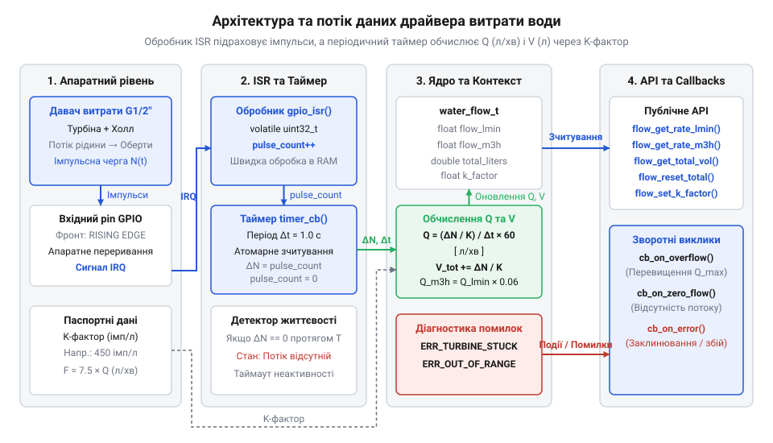
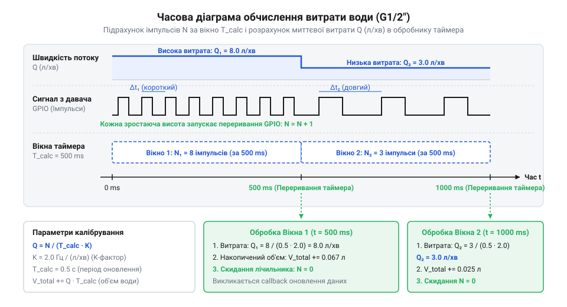

# Програмний інтерфейс драйвера імпульсного давача витрати води

## Проблема обчислення швидкості та об'єму

Коли система вимірювання витрати води намагається зчитувати імпульси від турбінного давача безпосередньо в основному циклі програми шляхом безперервного опитування (@@en|polling@@, від англ. @@en|polling@@, від середньонід. *polle* — «голова, опитати по головах»), вона неминуче стикається з втратою даних. У реальних вбудованих пристроях мікроконтролер виконує багато паралельних завдань: обробляє мережеві стеки, оновлює інформацію на дисплеї, виконує запис логів у флеш-пам'ять та реагує на події користувача. Кожна з цих операцій створює затримку виконання тривалістю від кількох мілісекунд до десятків мілісекунд.

Імпульсний давач витрати води працює за принципом обертання внутрішньої турбінки з закрепленим магнітом під дією потоку рідини. Під час кожного оберту магніт замикає геркон або викликає спрацьовування елемента Холла, генеруючи прямокутний цифровий імпульс. Частота цих імпульсів прямо пропорційна швидкості потоку води і у робочому діапазоні може досягати десятків або сотень герц. Наприклад, при витраті рідини 15 літрів на хвилину давач може формувати понад 100 імпульсів за секунду, що відповідає появі нового фронту сигналу кожні 10 мілісекунд. Якщо основний цикл програми блокується записом у пам'ять або відправкою мережевого пакета на 50 мілісекунд, мікроконтролер повністю пропустить 5 імпульсів. Це призводить до викривлення показника миттєвої витрати та незворотної накопиченої похибки обчисленого об'єму.

Окрім затримок у програмі, сам потік рідини у водопроводі має динамічний та нерівномірний характер. При відкритті крана виникає різкий гідравлічний стрибок, а при його закритті потік зупиняється практично миттєво. Опитування стану виводу у довільні моменти часу не дозволяє точно виміряти інтервал між послідовними імпульсами.

Для усунення пропуску імпульсів та звільнення основного процесора створюють програмний @@en|driver@@ (від англ. @@en|driver@@, від прагерм. *dreibana* — «гнати, керувати»), у якому обробку розділяють на два незалежні шари виконання: *dreibana* — «гнати, керувати»), у якому обробку розділяють на два незалежні шари виконання:

1. **Обробник переривань (@@en|Interrupt Service Routine@@ / @@en|ISR@@, від англ. @@en|interrupt@@, від лат. *interruptus* — «переривати»):** апаратне переривання, що спрацьовує миттєво при появі кожного зростаючого або спадаючого фронту сигналу на GPIO-виводі. Обробник виконує мінімальний обсяг роботи — атомарно збільшує значення внутрішнього лічильника імпульсів. 2. **Періодичний таймер обчислень (@@en|timer@@, від давньоангл. *tīma* — «час»):** системне завдання або апаратний таймер, що спрацьовує з фіксованим інтервалом (наприклад, щосекунди). Таймер зчитує накопичену кількість імпульсів за вимірювальне вікно, розраховує миттєву витрату рідини та додає обчислений об'єм до загального лічильника.


*Архітектура програмного драйвера імпульсного давача витрати води з розділеним ISR-лічильником та періодичним таймером обчислень.*

Контекст драйвера виступає потокобезпечним середовищем обміну даними між @@en|ISR@@ та періодичним @@en|timer@@. Переривання лише інкрементує лічильник, не виконуючи важкої арифметики з плаваючою крапкою. Це гарантує мінімальну затримку обробки переривання (@@en|latency@@, від лат. *latens* — «прихований»). У свою чергу, періодичний @@en|timer@@ виконує обчислення у фоновому контексті завдань, де обробка арифметичних виразів не порушує стабільності системи. Проте пряме зчитування спільного лічильника з фонового завдання створює стан гонитви (@@en|race condition@@, від англ. @@en|race condition@@, від давньоангл. *ræs* — «біг» та лат. *condicio* — «стан»). Якщо @@en|ISR@@ спрацьовує у момент розщепленого зчитання багатобайтової змінної, фоновий @@en|timer@@ отримує спотворене число імпульсів. Для усунення цієї проблеми застосовують атомарні операції (@@en|atomic operation@@, від грец. *atomos* — «неподільний») або короткочасну критичну секцію (@@en|critical section@@) із тимчасовим вимкненням переривань. Під час зчитування фоновий @@en|timer@@ атомарно отримує накопичене значення і скидає лічильник за один нерозривний крок. Це повністю запобігає втраті імпульсів та викривленню обчислень ціною короткого запізнення переривань лише на кілька системних тактів.

## Ініціалізація драйвера та налаштування K-фактора

Двокомпонентна архітектура драйвера вимагає налаштування математичного коефіцієнта перетворення кількості імпульсів у фізичний об'єм — так званого @@en|K-factor@@ (від нім. @@de|Koeffizient@@, від лат. *coefficiens* — «спільно діючий»). Фізична геометрія камери давача та кількість лопатей турбінки визначають, скільки саме імпульсів формується при проходженні одного літра рідини.

Паспортний @@en|K-factor@@ описує зв'язок між частотою імпульсів `f` (Гц) та миттєвою витратою `Q` (л/хв) через лінійне співвідношення `f = K · Q` або задається кількістю імпульсів на один літр (`imp/L`). Якщо для давача YF-S201 коефіцієнт становить `K = 7.5`, це означає, що при витраті `Q = 1 л/хв` частота генерації імпульсів дорівнює `7.5 Гц`. Для практичного вимірювання реального відхилення та корекції цього коефіцієнта за допомогою мірних ємностей дивіться матеріал про [калібрування та визначення K-фактора імпульсних витратомірів](root:cat-hw-sensors/water-flow-sensor/math-water-flow-k-factor.md).

За 1 хвилину (60 секунд) такий давач сформує наступну кількість імпульсів на літр:

```
N_liter = 7.5 × 60
= 450 імпульсів/літр
```

Під час ініціалізації драйвера у структуру конфігурації заносять номер GPIO-виводу, режим підтяжки, вибраний фронт сигналу (зазвичай `RISING`), значення K-фактора та тривалість вікна дискретизації таймера (наприклад, `1000 мс`).

Послідовність кроків ініціалізації драйвера:
1. Виділення пам'яті під структуру контексту та обнулення внутрішніх змінних. 2. Конфігурація GPIO-виводу на вхід із внутрішньою підтяжкою до живлення (`PULLUP`). 3. Реєстрація обробника @@en|ISR@@ для обраного GPIO-переривання. 4. Створення та запуск періодичного таймера обчислень. 5. Переведення драйвера у робочий стан.

Нижче наведено практичну реалізацію ініціалізації драйвера мовами C та C++.

:::tabs
@tab ESP-IDF (C)
:::code api-water-flow-sensor-driver-sw/c/esp-idf/water-flow-gpio-isr-handler.c
@tab Arduino (C++)
:::code api-water-flow-sensor-driver-sw/cpp/arduino/waterflowsensor.cpp
:::

## Зчитування миттєвої витрати та об'єму

Після ініціалізації драйвер у фоновому режимі виконує обчислення поточних метрик. Для прикладного програмного забезпечення надається синхронний API зчитування миттєвої витрати рідини у різних фізичних одиницях та контролю накопиченого об'єму.

Математична модель перетворення частоти імпульсів у витрату та об'єм ґрунтується на послідовності обчислювальних кроків.

Перед розрахунком визначають значення миттєвої частоти імпульсів `f` (Гц) за тривалість вимірювального вікна `Δt` (секунди):

        f = ΔN ÷ Δt

Миттєва витрати у літрах на хвилину `Q_Lmin` дістається діленням імпульсної частоти на значення калібрувального K-фактора:

        Q_Lmin = f ÷ K_factor
        = (ΔN ÷ Δt) ÷ K_factor      [підстановка виразу частоти]

Для переведення отриманого значення витрати у кубічні метри за годину `Q_m3h` застосовують масштабувальний коефіцієнт 0.06:

        Q_m3h = Q_Lmin × 0.06
        = (Q_Lmin × 60) ÷ 1000      [перетворення л/хв у м³/год]

Приріст об'єму `ΔV` у літрах за інтервал дискретизації `Δt` обчислюють так:

        ΔV = Q_Lmin × (Δt ÷ 60)
        = (ΔN ÷ K_factor) ÷ 60      [обчислення об'єму за тривалість вікна]

Накопичений сумарний об'єм додають до накопичувача:

        V_total = V_previous + ΔV


*Часова діаграма надходження імпульсів від давача та їх квантування у дискретні вікна обчислення таймера.*

Прикладному рівню надаються такі функції API:
- `water_flow_get_rate_lmin()` — отримання поточної витрати у л/хв. - `water_flow_get_rate_m3h()` — отримання витрати у м³/год. - `water_flow_get_total_volume()` — зчитування сумарного об'єму прокачаної води в літрах. - `water_flow_reset_total_volume()` — скидання накопичувального лічильника об'єму в нуль.

Коли автоматизована система поєднує облік витрати з оцінкою зволоженості ділянки, дані розрахунку потоку передають у модуль поливу поруч із [показниками ємнісного давача](root:cat-hw-sensors/capacitive-soil) для прийняття рішення про зрошення.

Нижче наведено приклад реалізації викликів зчитування метрик у мові C:

:::code api-water-flow-sensor-driver-sw/c/water-flow-get-rate-lmin.c

## Реєстрація зворотних викликів для подій

Постійне опитування (@@en|polling@@) функцій зчитування витрати в основному циклі програми завантажує процесор та затримує реагування на критичні ситуації. Для асинхронного сповіщення системи у драйвер інтегрують механізм подієвих зворотних викликів (@@en|callback@@, від англ. @@en|call@@ та @@en|back@@ — «зворотний виклик»).

Використання @@en|callback@@ дозволяє задати граничні параметри роботи та автоматично викликати обробник подій при їх досягненні. Драйвер підтримує такі типи подій:
1. `WATER_FLOW_EVENT_MAX_THRESHOLD_EXCEEDED` — витрата перевищила заданий максимум (аварійний порив або відкритий скидний клапан). 2. `WATER_FLOW_EVENT_ZERO_FLOW_DETECTED` — потік припинився після робочого стану (перекриття магістралі або зупинка насоса). 3. `WATER_FLOW_EVENT_LEAK_DETECTED` — виявлено тривалий малий потік рідини, що вказує на виток у системі.

Критичною вимогою є виконання зворотних викликів у контексті періодичного таймера, а не з усередини @@en|ISR@@. Виклики користувацького коду безпосередньо з переривання можуть викликати переповнення стеку та порушення часових інтервалів системи.

Для уникнення сухого ходу насоса при виявленні тривалої відсутності потоку контролер може перевірити [наявність води в резервуарі](root:cat-hw-sensors/liquid-level-sensor) через відповідний модуль контролю рівня.

Нижче наведено структуру даних та функцію реєстрації зворотного виклику:

:::code api-water-flow-sensor-driver-sw/c/water-flow-register-callback.c

У циклі обчислення періодичного таймера після оновлення значення `current_flow_lmin` драйвер порівнює його з порогом `max_flow_threshold_lmin`. Якщо потік виходить за межі, заповнюється структура `water_flow_event_data_t` і викликається зареєстрована функція `cb(event, user_data)`.

## Обробка помилок та діагностика аномалій

Надійна експлуатація системи обліку рідини вимагає від драйвера обробки аномальних режимів та надання чітких кодів помилок.

Основні коди помилок API драйвера:
- `WATER_FLOW_OK` (0): Операція виконана успішно. - `WATER_FLOW_ERR_INVALID_ARG` (-1): Передано некоректний вказівник або неприпустиме значення K-фактора. - `WATER_FLOW_ERR_NOT_INITIALIZED` (-2): Виклик API здійснено до завершення ініціалізації. - `WATER_FLOW_ERR_OUT_OF_RANGE` (-3): Частота імпульсів перевищує гранично допустиму фізичну межу давача. - `WATER_FLOW_ERR_TURBINE_JAMMED` (-4): Виявлено заклинювання турбінки під час активного стану системи. - `WATER_FLOW_ERR_DEBOUNCE_NOISE` (-5): Зафіксовано високочастотні завади, які усуваються алгоритмом придушення дребезгу (@@en|debounce@@, від англ. @@en|bounce@@ — «відскік»). Для реалізації алгоритмів програмної фільтрації та обмеження тривалості хибних спрацьовувань герконових контактів перегляньте керівництво про [програмне придушення дребезгу контактів герконових давачів](root:sf-devices/switch-debounce).

Аномалія заклинювання турбінки діагностується порівнянням стану керованого клапана чи насоса із сигналами давача. Якщо клапан відчинений, а лічильник імпульсів залишається нульовим протягом кількох вікон обчислення, драйвер формує код помилки `WATER_FLOW_ERR_TURBINE_JAMMED`.

У простих контрольних вузлах сигналізація витоку може доповнюватися перевіркою спрацьовування [давача рівня води HW-038](root:cat-hw-sensors/hw-038-water-level) на піддоні пристрою.

Приклад обробки статусних кодів у прикладній програмі:

:::code api-water-flow-sensor-driver-sw/c/snippet-5.c