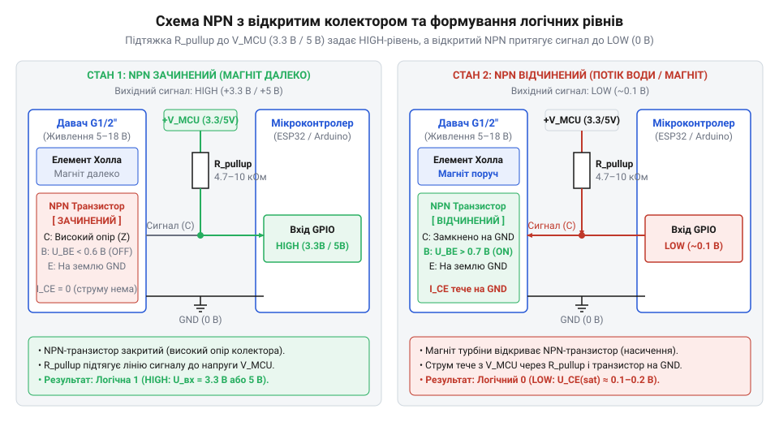
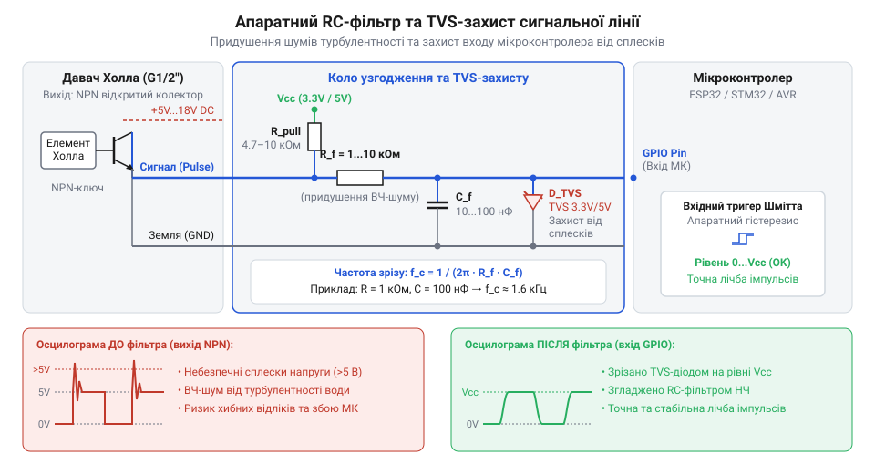

# Залізний інтерфейс давача витрати води G1/2″: розводка, живлення та рівні сигналів

## Небезпеки прямого підключення давача води

Підключення давача витрати води до обчислювального пристрою без попереднього розрахунку електричних та механічних режимів часто призводить до раптового виходу з ладу всієї системи. На практиці розробники початківці стикаються з двома фундаментальними загрозами: електричним пробоєм вхідного порту мікроконтролера та механічним руйнуванням корпусу під час експлуатації у водопровідній мережі.

Електрична небезпека зумовлена різницею робочих напруг пристроїв. Внутрішня електронна схема, яку містить @@en|давач Холла@@ (від англ. *Hall effect sensor* — напівпровідниковий елемент на основі відкриття Едвіна Холла), для стабільної роботи вимагає живлення напругою в діапазоні від 5 В до 18 В постійного струму. У промислових або побутових системах автоматизації живлення давача найчастіше здійснюють від шини 12 В. Якщо сигнальний провід такого давача підключити безпосередньо до входу мікроконтролера з логічними рівнями 3.3 В (наприклад, ESP32 або STM32) і задіяти зовнішню підтяжку до шини 12 В, на цифровий порт подається потенціал, що значно перевищує максимально припустиму напругу живлення кристала. Це викликає лавинний струм через захисні ESD-діоди мікроконтролера, їх термічний пробій та незворотне пошкодження внутрішньої структури кремнієвого чіпа.

Механічна небезпека пов'язана з динамікою рідини у закритому трубопроводі. На відміну від стаціонарних ємнісних систем, де використовується [поплавковий давач рівня рідини](root:cat-hw-sensors/liquid-level-sensor) для негерметичних резервуарів, імпульсний давач витрати води інтегрується безпосередньо у напірну магістраль. Стандартний пластиковий корпус давача розрахований на статичний тиск до `1.75 MPa` (17.5 бар). Проте під час швидкого перекриття електромагнітного клапана або закриття крана кінетична енергія рухомого стовпа води перетворюється на стрибок тиску, відомий як @@en|гідроудар@@ (від англ. *water hammer* — гідравлічний удар при раптовій зупинці потоку). Піковий тиск під час гідроудару у локальній точці магістралі може перевищувати `3.0`–`5.0 MPa` протягом кількох мілісекунд. Це спричиняє розрив пластикових стінок, видавлювання ущільнювальних кілець або деформацію обертової @@en|крильчатки@@ (від англ. *impeller* — обертове лопатеве колесо), що призводить до затоплення приміщення та виходу з ладу всього обладнання.

Додатковим джерелом ризику є високочастотні імпульсні наводки, які виникають у момент перемикання потужних індуктивних навантажень — насосів або реле, розташованих поруч із трубопроводом. Довгий сигнальний кабель давача працює як антена, наводячи сплески напруги амплітудою в десятки вольт, здатні викликати хибні переривання або апаратне зависання обчислювача.

Суворе дотримання граничних електричних параметрів живлення, логічних рівнів узгодження та механічних допусків тиску є обов'язковою передумовою для проектування надійного залізного інтерфейсу.

## Електричні характеристики та розводка роз'єму

Для безпечної інтеграції давача G1/2″ необхідно чітко розрізняти функціональне призначення кожного з його провідників та межі допустимих електричних і гідравлічних режимів. Physical-інтерфейс пристрою виконано у вигляді 3-провідного кабелю, що закінчується стандартним роз'ємом (найчастіше JST-XH з кроком 2.54 мм) зі суворо визначеним кольоровим маркуванням.

Червоний провід призначено для підключення позитивної лінії живлення `VCC`. Внутрішня інтегральна мікросхема Холла працездатна в діапазоні напруги від `5 V` до `18 V` постійного струму (DC). Власний струм споживання електронного блоку давача без урахування зовнішньої підтяжки не перевищує `15 mA` при напрузі живлення `5 V DC`.

Чорний провід є спільним провідником `GND` (мінус живлення). Він створює опорний потенціал для живлення мікросхеми та формування вихідного логічного сигналу.

Жовтий (у деяких модифікаціях білий) провід є сигнальною лінією `Signal`. На цей провід виведено вихід NPN-транзистора з конфігурацією @@en|відкритий колектор@@ (від англ. *open collector* — вихідна схема з непідключеним колектором NPN-транзистора). Схема виходу не видає високу напругу самостійно: коли транзистор відкритий, провід замикається на `GND`, а коли закритий — перебуває у високоімпедансному стані.

Електричні та механічні специфікації давача витрати води G1/2″ зведено до наступних граничних параметрів:

- Напруга живлення (`VCC`): від `5 V` до `18 V DC`. - Максимальний струм затікання виходу (`I_sink`): `10 mA` (гранично припустимий короткочасний струм `20 mA`). - Напруга низького рівня виходу (`V_OL`): не більше `0.5 V` при струмі затікання `10 mA`. - Робочий тиск рідини: не більше `1.75 MPa` (`17.5` бар). - Опір ізоляції: не менше `100 MΩ` при випробувальній напрузі `500 V DC`. - Робочий діапазон температури рідини: від `-25 °C` до `+80 °C` (для стандартного пластикового корпусу з поліоксиметилену POM). - Діапазон вимірюваної витрати води: від `1` до `30 L/min` (літрів за хвилину).

Розділення кола живлення давача та кола формування сигнального рівня є головною конструктивною перевагою схемотехніки з відкритим колектором. Подібно до того як [аналоговий давач вологості](root:cat-hw-sensors/soil-moisture) вимагає суворого дотримання діапазону живлення для збереження точності, давач витрати води вимагає стабільної напруги живлення мікросхеми Холла. Проте потенціал на сигнальному проводі задається зовнішньою шиною живлення мікроконтролера, що дає змогу живити давач від джерела `12 V DC`, а сигнальний вихід безпечно підключати до мікроконтролерів із логікою `3.3 V` або `5 V`.

## NPN-вихід Холла та підтягувальні резистори

Всередині вимірювальної камери давача розташована @@en|крильчатка@@, у лопаті якої впресовано постійний магніт. Під дією потоку рідини крильчатка обертається, і під час кожного проходження магніту повз елемент Холла напівпровідникова мікросхема фіксує зміну магнітного поля. Вихідний NPN-транзистор мікросхеми відкривається, з'єднуючи сигнальний вихід `Signal` із лінією `GND`. У цей момент напруга на сигнальній лінії падає до потенціалу насичення транзистора `V_OL ≤ 0.5 V` (логічний нуль). Докладніше про напівпровідникові явища та виникнення поперечної різниці потенціалів під дією магнітного поля читайте у матеріалі про [фізичні принципи та пристрій елементів Холла](root:ph-condensed/hall-effect).

Коли магніт виходить із зони чутливості, NPN-транзистор закривається. Оскільки колектор транзистора всередині давача ні куди не підключений, сигнальний провід переходить у стан високого імпедансу (High-Z). Якщо сигнальний вихід залишити без зовнішнього підключення, цифровий вхід мікроконтролера опиниться у плаваючому стані. Вхідний опір GPIO-порту становить кілька мегаом, тому будь-які електромагнітні наводки викликатимуть хаотичні перемикання логічного рівня та хибні спрацьовування лічильника імпульсів.

Для формування чітких прямокутних імпульсів між сигнальним проводом та шиною живлення мікроконтролера `V_MCU` необхідно встановити зовнішній @@en|підтягувальний резистор@@ (від англ. *pull-up resistor* — резистор підтягування потенціалу) `R_pullup`. На відміну від цифрових схем узгодження, які використовує [ємнісний давач вологості ґрунту](root:cat-hw-sensors/capacitive-soil) з аналоговим виходом, відкритий колектор вимагає виключно цифрового підтягувального резистора. Коли NPN-транзистор закритий, струм від шини `V_MCU` через резистор `R_pullup` підтягує потенціал сигнальної лінії до напруги живлення обчислювача (логічна одиниця).

Розрахунок номіналу підтягувального резистора обмежується двома граничними умовами: мінімальним та максимальним опором.

Мінімальний опір `R_min` визначається максимально припустимим струмом затікання `I_sink_max`, який може пропустити через себе відкритий NPN-транзистор давача, не перегріваючись і не виходячи з ладу:

```
R_min = (V_MCU - V_OL) / I_sink_max
```

Визначимо мінімальний припустимий опір для двох поширених систем обчислювачів.

**Умова: Розрахунок мінімального опору підтяжки для мікроконтролера з живленням 5 В та обмеженням струму транзистора до 5 мА.**

```
R_min = (5.0 V - 0.4 V) / 0.005 A
      = 4.6 V / 0.005 A            [закон Ома для кола колектора]
      = 920 Ом                     [найменший припустимий опір]
```

**Умова: Розрахунок мінімального опору підтяжки для мікроконтролера з живленням 3.3 В та обмеженням струму транзистора до 3.3 мА.**

```
R_min = (3.3 V - 0.4 V) / 0.0033 A
      = 2.9 V / 0.0033 A           [закон Ома для кола колектора]
      ≈ 878.79 Ом                  [найменший припустимий опір]
```

Максимальний опір `R_max` обмежується струмом витоку цифрового входу мікроконтролера `I_leak` (типово близько `1 μA`) та паразитною ємністю сигнального кабелю `C_line`. Занадто великий опір (наприклад, 100 кОм) збільшує постійну часу RC-ланцюга, затягуючи фронт наростання імпульсу та спотворюючи його форму на високій швидкості обертання крильчатки.

Типовий практичний діапазон номіналу `R_pullup` становить від `2.2 kΩ` до `10 kΩ`. Найпоширенішим універсальним вибором є резистор номіналом `4.7 kΩ`. Внутрішні підтягувальні резистори мікроконтролера (які зазвичай мають опір від 20 кОм до 50 кОм) використовувати не рекомендується, оскільки слабка підтяжка робить лінію вразливою до зовнішніх промислових завад.

Принципову схему з'єднання давача з відкритим колектором та обчислювачами з різними логічними рівнями наведено нижче:


*Принципова схема підключення NPN-виходу давача Холла з відкритим колектором та зовнішнім підтягувальним резистором до логічних входів мікроконтролера.*

## Апаратні заходи фільтрації та захист сигналу

Навіть за наявності правильно розрахованого підтягувального резистора реальні умови експлуатації у водопровідних мережах створюють завади, які призводять до викривлення імпульсного сигналу. Основними джерелами спотворень є:

1. @@en|дребезг потоку@@ (від англ. *bounce* або *chatter* — мікроімпульси завад від коливань рідини), зумовлений турбулентними вихорами та механічним биттям лопатей крильчатки на малих або гранично високих швидкостях потоку. 2. Електромагнітні наводки високої частоти, які наводяться на довгі з'єднувальні дроти від силових кабелів живлення, трансформаторів та імпульсних джерел живлення. 3. Високовольтні індуктивні сплески напруги, що виникають у момент вимкнення насосів або електромагнітних клапанів, підключених до тієї самої електричної мережі або гідравлічної магістралі.

Для нейтралізації високочастотного шуму та дребезгу застосовують апаратний низькочастотний @@en|RC-фільтр@@ (від англ. *resistor-capacitor filter* — резистивно-ємнісний фільтр). Фільтр складається з послідовно включеного в сигнальну лінію резистора `R_f` та конденсатора `C_f`, підключеного між цифровим входом мікроконтролера та шиною `GND`.

Частота зрізу `f_c` для такого фільтра обчислюється за формулою:

```
f_c = 1 / (2 · π · R_f · C_f)
```

Проведемо розрахунок елементів RC-фільтра для максимальної витрати води.

**Умова: Розрахунок частоти зрізу RC-фільтра з резистором R_f = 1 кОм та конденсатором C_f = 100 нФ для давача з максимальною частотою сигнальних імпульсів 225 Гц.**

```
f_c = 1 / (2 · 3.14159 · 1000 Ом · 100 · 10⁻⁹ Ф)
    = 1 / (6.28318 · 10⁻⁴)                      [обчислення знаменника]
    ≈ 1591.55 Гц                                [частота зрізу RC-ланцюга]
```

Оскільки розрахована частота зрізу `1591.55 Hz` суттєво перевищує максимальну робочу частоту давача (`225 Hz` при витраті 30 л/хв), вимірювальні імпульси проходять через фільтр без згасання та фазових спотворень. Водночас високочастотні імпульсні завади з частотою понад `10 kHz` ефективно шунтуються конденсатором на землю.

Для придушення високовольтних сплесків та захисту вхідних кіл мікроконтролера від статичної електрики паралельно конденсатору `C_f` встановлюють напівпровідниковий придушувач напруги — @@en|TVS-діод@@ (від англ. *transient voltage suppressor* — напівпровідниковий придушувач сплесків напруги) або @@en|діод Зенера@@ (від прізвища физика Кларенса Зенера, англ. *Zener diode* — стабілітрон). Для мікроконтролерів із живленням 3.3 В обирають TVS-діод з напругою обмеження `3.3 V` або `3.6 V`, а для систем 5 В — стабілітрон на `5.1 V`.

Якщо вхідний цифровий порт мікроконтролера не має вбудованого гістерезису, після RC-фільтра рекомендується встановлювати буферний @@en|тригер Шмітта@@ (від прізвища винахідника Отто Шмітта, англ. *Schmitt trigger* — пороговий компаратор із гістерезисом). Він перетворює згладжений фронт аналогової напруги з конденсатора на чистий прямокутний імпульс із чіткими логічними рівнями.

У промислових умовах з високим рівнем електричних завад або при різниці потенціалів між землею давача та землею обчислювача сигнальне коло розв'язують гальванічно, застосовуючи @@en|оптопару@@ (від англ. *optocoupler* — пристрій оптичної розв'язки, наприклад PC817).

На відміну від простих контактних плат, таких як [друкований давач рівня води](root:cat-hw-sensors/hw-038-water-level) чи [плата давача дощу](root:cat-hw-sensors/funduino-rain), де сигнал схильний лише до повільних резистивних змін, давач витрати генерує високочастотний цифровий імпульсний потік. Для налаштування обробки отриманого імпульсного потоку за допомогою переривань мікроконтролера та розрахунку витрати рідини дивіться статтю про [програмний API давача витрати води G1/2″](root:cat-hw-sensors/water-flow-sensor-sw-api).

Повну принципову схему апаратного RC-фільтра та захисного TVS-діода зображено нижче:


*Принципова схема апаратного RC-фільтра низьких частот та захисного TVS-діода для узгодження сигнальної лінії давача з цифровим входом обчислювача.*