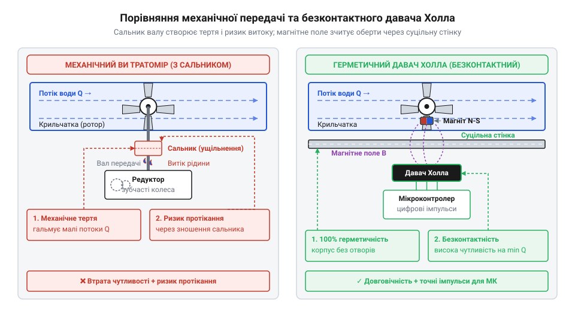
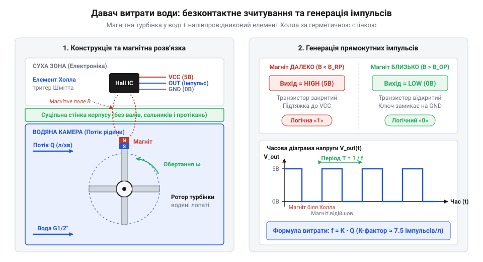

# Історія розвитку турбінних витратомірів та впровадження давачів Холла

## Проблема вимірювання потоку та млин Вольтмана

Контроль об'єму рідини, яка транспортується трубопроводами, виник як критична інженерна потреба під час промислової революції кінця XVIII століття. Розвиток мануфактур, перших міських водогонів та вугільних шахт вимагав обліку викачаної води та ресурсу, що витрачався на технологічні потреби. До цього часу оцінити кількість води у відкритому каналі чи річці значуще вдавалося лише за наближеними спостереженнями.

У 1790 році німецький інженер-гідротехнік @@en|Reinhard Woltman@@ (Райнгард Вольтман) запропонував пристрій, який поклав початок класичній тахометрії потоку. Прилад отримав назву гідрометричний млин (або вертушка Вольтмана). Фізична логіка винаходу спиралася на тахометричний (грец. *tachys* — швидкий, *metron* — міра) принцип: вимірювання швидкості рідини за допомогою лопатевого ротора або турбіни (лат. *turbo* — вихор, обертання), зануреної у потік. Коли рідина рухається вздовж лопатей, вона передає їм частину своєї кінетичної енергії. Внаслідок цього ротор починає обертатися з кутовою швидкістю, прямо пропорційною швидкості потоку рідини.

Оберти ротора за допомогою прямого механічного з'єднання передавалися на лічильний редуктор. Зраховуючи загальну кількість обертів за певний проміжок часу, інженери вперше отримали можливість обчислити не лише миттєву швидкість, а й сумарний об'єм пропущеної рідини. Такий @@en|тахометричний витратомір@@ чудово працював у відкритих каналах і річках, де прилад занурювали у воду, а лічильний механізм розташовувався вище рівня води.

Проте спроба адаптувати логіку млина Вольтмана для закритих напірних трубопроводів зустрілася з принциповим бар'єром. У закритій трубі рідина перебуває під надлишковим тиском і повністю заповнює її переріз. Щоб порахувати оберти турбіни, зануреної всередину герметичної труби, її обертовий вал потрібно було вивести крізь металеву стінку назовні — до зовнішнього механічного циферблата. Створення наскрізного отвору в стінці труби зруйнувало суцільність корпусу та поставило перед інженерами конфлікт між герметичністю й вільнотою обертання.

## Паразитне тертя та зношування механічних редукторів

Прямий механічний вивід валу ротора за межі герметичного корпусу вимагав застосування щільних ущільнювачів. Для запобігання витоку рідини під тиском уздовж валу в конструкціях XIX та початку XX століття використовували сальникове ущільнення або @@en|stuffing box@@ (сальник, від історичного використання тканини або волокон, просочених жиром чи салом). Одночасно оберти валу знижувалися за допомогою механічного редуктора (лат. *reductor* — той, що відводить назад, зменшує), виготовленого з системи зубчастих коліс.

Впровадження цієї механічної передачі спричинило появу нездоланного фізичного обмеження — паразитне тертя (@@en|parasitic friction@@). Щоб рідина з труби не витікала назовні, сальник мусили затискати із значним зусиллям. Це зусилля створювало високий гальмівний момент (@@en|resistive torque@@) на самому валу. Ротор витратоміра опинився під постійним механічним опором, який критично спотворював вимірювання.

На малих швидкостях потоку кінетичної енергії рідини просто не вистачало для подолання статичного тертя сальника та зубчастих передач редуктора. Ротор залишався нерухомим навіть тоді, коли рідина продовжувала протікати крізь трубу. Утворювалася так звана «мертва зона» чутливості, у якій прилад взагалі не фіксував витрату. Коли ж потік зростав і турбіна починала обертатися, частина енергії середовища неперервно втрачалася на подолання тертя, що спричиняло нелінійну похибку вимірювання.

Окрім втрати точності, механічні вузли швидкими темпами зношувалися. Постійне тертя металевого або бронзового валу об сальникову набивку призводило до появи люфтів та канавок на поверхні деталі. Як наслідок, герметичність порушувалася, і витратомір починав протікати. Заміна ущільнень вимагала регулярного обслуговування, зупинки трубопроводу та повторного калібрування. На відміну від статичних систем обліку, як-от [давач рівня рідини](root:cat-hw-sensors/liquid-level-sensor), де відсутні рухомі деталі, що перетинають корпус, механічний турбінний лічильник вимагав принципово нового підходу до зчитування обертів.


*Механічна передача вимагає наскрізного отвору із сальником, що створює паразитне тертя й ризик протікання, тоді як магнітне поле ротора безконтактно передає сигнали через герметичну стінку.*

Вихід із цієї інженерної глухий кута полягав у відмові від механічного зв'язку між ротором і вимірювальним блоком. Інженерам потрібно було навчитися «бачити» обертання турбіни через суцільну, нерозривну стінку корпусу, усунувши будь-які наскрізні отвори й вали.

## Відкриття Едвіна Холла та історичні міфи

Пошук безконтактного методу виявлення руху привів до фізичного явища, відкритого наприкінці XIX століття. У 1879 році американський фізик @@en|Edwin Hall@@ (Едвін Холл) під час роботи в Університеті Джонса Гопкінса експериментував із тонкими металевими пластинами. Він виявив, що коли крізь пластину із золотої фольги пропускати постійний електричний струм і помістити її у перпендикулярне магнітне поле, на бічних гранях пластини виникає різниця потенціалів.

Це явище отримало назву ефект Холла (@@en|Hall effect@@) і стало одним із відкритих гальваномагнітних ефектів (від імені італійського вченого Луїджі Гальвані та грец. *magnētis lithos* — камінь з Магнезії). Фізична суть ефекту полягає в дії сили Лоренца (@@en|Lorentz force@@) на рухомі носії заряду. Магнітне поле відхиляє електрони від прямолінійної траєкторії до однієї з граней провідника, створюючи поперечне електричне поле та напругу Холла (@@en|Hall voltage@@).

Нерідко довкола цього винайдення виникають історичні міфи, які спотворюють реальний хід наукового прогресу. Популярне хибне уявлення стверджує, ніби Едвін Холл особисто розробив цифровий витратомір води. Насправді у 1879 році фізична база для такого застосування була відсутня. У металевих провідниках напруга Холла становить лише мікровольти, які в XIX століття можна було зафіксувати тільки у лабораторних умовах за допомогою надчутливих дзеркальних гальванометрів. Холл відкрив фундаментальний фізичний принцип, але не мав жодного відношення до давачів потоку чи мікроконтролерів.

Інший поширений міф полягає в думці, що турбінні витратоміри є суто сучасним винайденням цифрової епохи. Насправді тахометрична гідромеханіка Вольтмана існувала за 170 років до своєї цифровізації. Сучасний пристрій є результатом синтезу гідродинаміки XVIII століття, електромагнетизму XIX століття та напівпровідникової фізики XX століття.

Революційний прорив у витратометрії відбувся лише в середині XX століття із розвитком напівпровідникової мікроелектроніки. У напівпровідниках (лат. *semi* — напів, *producere* — проводити), таких як кремній чи арсенід індію, концентрація носіїв заряду значно нижча, ніж у металах, через що напруга Холла стає у тисячі разів більшою. Це дозволило створити мініатюрний напівпровідниковий давач Холла (@@en|semiconductor Hall sensor@@).


*При обертанні турбінки магніт на її лопатці проходить повз давач Холла за суцільною стінкою корпусу, що збуджує сплески напруги та формує лінійну послідовність прямокутних цифрових імпульсів.*

Конструктивна реалізація нового витратоміра виявилася витонченою: у лопатку або вісь турбінки, розташованої у повністю герметичному пластиковому чи латунному корпусі, вмонтовують крихітний постійний магніт. З зовнішнього боку корпусу, безпосередньо навпроти зони проходження магніту, встановлюють давач Холла з інтегрованим тригером Шмітта (@@en|Schmitt trigger@@).

Коли рідина обертає турбінку, магніт при кожному оберті проходить повз давач. Його магнітне поле без перешкод долає немагнітну стінку корпусу і змінює стан давача. Тригер Шмітта перетворює аналоговий сплеск напруги у чіткий прямокутний цифровий імпульс. Вихідний сигнал давача являє собою послідовність імпульсів, частота яких строго пропорційна швидкості потоку рідини.

На відміну від аналогових давачів граничних станів, таких як [HW-038 — давач рівня води](root:cat-hw-sensors/hw-038-water-level), сучасний імпульсний турбінний витратомір дає змогу вимірювати не лише наявність рідини, а й її динамічний об'єм. Безконтактне магнітне зчитування повністю усунуло паразитне тертя сальників та протікання, забезпечивши високу чутливість приладу на малих потоках і пряму сумісність із цифровими входами мікроконтролерів. Для задач, де обертові деталі взагалі неприпустимі через високу в'язкість чи забруднення рідини, згодом з'явилися альтернативні принципи, зокрема [ультразвукові витратоміри](root:cat-hw-sensors/ultrasonic-flowmeter) та [електромагнітні витратоміри](root:cat-hw-sensors/electromagnetic-flowmeter).

## Безконтактне зчитування через герметичний корпус

Поява напівпровідникових інтегральних давачів у середині XX століття докорінно змінила підхід до конструювання тахометричних приладів обліку. Інженерний прорив полягав у створенні суцільної, нерозривної фізичної перегородки між гідравлічним середовищем та електронним блоком обробки сигналів. Замість виведення обертового механічного валу за межі труби через сальники, ротор турбінки оснастили постійним магнітом, а вимірювальний елемент винесли на зовнішню поверхню корпусу.

У цій конструктивній схемі @@en|ротор турбінки@@ (лат. *rotare* — обертатися) розміщується всередині герметичної вимірювальної камери, виготовленої з немагнітного матеріалу. Для побудови корпусу зазвичай використовують конструкційні термопласти, як-от @@en|поліоксиметилен@@ (від грец. *polys* — численний, *oxys* — кислий, *methy* — вино та *hyle* — деревина), або корозійностійку латунь (нім. *Lattun* — сплав міді та цинку). Оскільки ці матеріали мають діамагнітні або слабопарамагнітні властивості, вони не екранують магнітне поле. Коли вмонтований у лопатку або маточину ротора крихітний @@en|неодимовий магніт@@ (від грец. *neos* — новий та *didymos* — близнюк) рухається по колу, його силові лінії безперешкодно проникають крізь суцільну стінку корпусу завтовшки в кілька міліметрів.

На зовнішньому боці камери у сухому атмосферному середовищі монтують @@en|напівпровідниковий давач Холла@@ (@@en|semiconductor Hall sensor@@). Розвиток мікроелектроніки у 1960–1970-х роках дозволив об'єднати на одному силіцієвому кристалі елемент Холла, диференціальний підсилювач, схему температурної компенсації та @@en|тригер Шмітта@@ (названий на честь американського біофізика Отто Шмітта). Під час кожного наближення магніту до давача магнітна індукція викликає сплеск напруги, який тригер Шмітта миттєво перетворює у прямокутний цифровий імпульс із чіткими фронтами.

Така конструкція реалізує @@en|магнітне сполучення@@ (від англ. @@en|magnetic coupling@@ — магнітне сполучення), яке повністю усуває паразитне тертя сальникових ущільнень та зубчастих редукторів. Оскільки ротор більше не має механічного зв'язку з зовнішніми індикаторами, єдиним опором для його руху залишається в'язке тертя рідини та опір прецизійних підшипників ковзання. Це дозволило змістити нижній поріг чутливості приладу в область мікровитрат і забезпечити повну герметичність корпусу під високим тиском.

Перші спроби безконтактного зчитування у XX столітті спиралися на електромеханічні елементи, зокрема @@en|геркон@@ (скорочення від *герметизований контакт*). Однак геркони мали суттєві обмеження: пружні металеві контактори зазнавали механічної втоми, мали низьку частоту спрацьовування та спричиняли брязкіт контактів (@@en|contact bounce@@). Натомість монокристалічний давач Холла не має рухомих деталей, забезпечує практично нескінченну кількість циклів перемикання і здатен безперебійно фіксувати частоти обертання в сотні герц.

## Сучасні імпульсні витратоміри в цифрових системах

Безконтактний турбінний витратомір з напівпровідниковим давачем Холла перетворює механічний потік рідини на послідовність цифрових електричних імпульсів. Кожен імпульс відповідає проходженню магнітного полюса повз чутливу зону давача, що відповідає повороту ротора на фіксований кут та проходженню певної строго визначеної порції об'єму рідини.

Ключовою метричною характеристикою імпульсного витратоміра є його @@en|коефіцієнт лічильника@@, або @@en|K-factor@@ (від англ. *factor* — чинник, коефіцієнт). Ця величина виражає кількість імпульсів, яку генерує пристрій при проходженні одиниці об'єму середовища, і зазвичай вимірюється в імпульсах на літр. Взаємозв'язок між частотою вихідного сигналу та об'ємною витратою рідини описується лінійною залежністю. Якщо позначити частоту імпульсів через `f` (у герцах), об'ємну витрату рідини через `Q` (у літрах за секунду), об'єм пропущеної рідини через `V` (у літрах), час вимірювання через `t` (у секундах), а коефіцієнт лічильника через `K` (у імпульсах на літр), то вихідна частота обчислюється за формулою:

```
f = K × Q
= K × (V ÷ t)            [вираження об'ємної витрати Q через відношення об'єму V до часу t]
```

Для визначення миттєвої об'ємної витрати рідини `Q` за виміряною частотою імпульсів `f` математичний вираз зводиться до вигляду:

```
Q = f ÷ K
```

З отриманої залежності видно, що миттєва витрата рідини прямо пропорційна частоті імпульсів. Мікроконтролер вимірює період між послідовними імпульсами або підраховує їхню кількість за фіксований інтервал часу, після чого перераховує отримане значення у миттєву витрату чи сумарний накопичений об'єм.

Для узгодження вихідного сигналу давача Холла з цифровими входами мікроконтролерів найчастіше застосовують схему з виходом типу @@en|відкритий колектор@@ (@@en|open collector@@). Вихідний NPN-транзистор давача працює як електронний ключ, який під час спрацьовування замикає сигнальну лінію на спільну землю. Для формування повноцінного високого логічного рівня між сигнальним виводом і лінією живлення вмикають зовнішній @@en|підтягувальний резистор@@ (@@en|pull-up resistor@@). Це забезпечує сумісність із різними напругами живлення (від 3.3 В до 24 В) і дозволяє підключати давач до цифрових входів мікроконтролерів, що обробляють апаратні @@en|переривання@@ (від англ. @@en|hardware interrupt@@).

Попри високу точність і надійність, турбінні імпульсні витратоміри мають фізичні межі застосування. Стабільність коефіцієнта `K` зберігається лише в діапазоні ламінарно-турбулентного потоку з низькою в'язкістю. Збільшення динамічної @@en|в'язкості рідини@@ (від лат. *viscosus* — клейкий) створює додатковий опір обертанню ротора, що порушує лінійність калібрувальної кривої. Надмірна швидкість потоку може викликати явище @@en|кавітації@@ (від лат. *cavitas* — порожнеча), коли локальне падіння тиску призводить до утворення парових бульбашок і руйнування лопатей. Крім того, наявність у рідині механічних домішок чи абразивних часток вимагає встановлення сітчастих фільтрів, а для вимірювання стаціонарних рівнів або сухого ходу застосовують [давач рівня рідини](root:cat-hw-sensors/liquid-level-sensor) або [HW-038 — давач рівня води](root:cat-hw-sensors/hw-038-water-level).